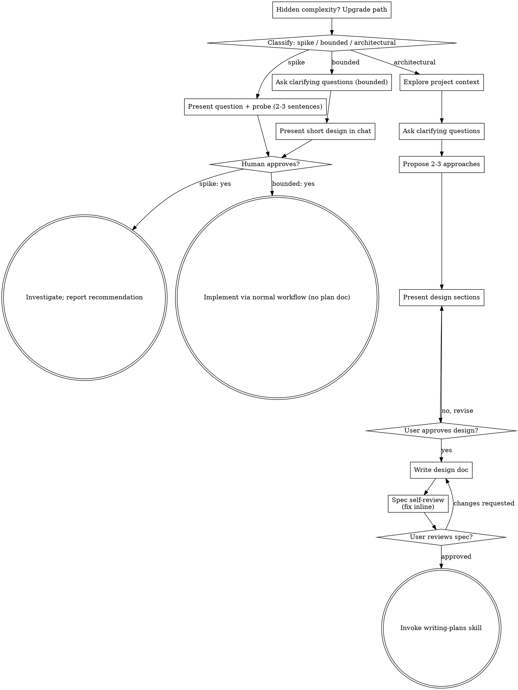

# New session - 2026-09-25T11:27:08.701Z

**Session ID:** ses_f27ae4a63ffe7AhXn59kL3NFhd
**Created:** 9/25/2026, 11:27:08 AM
**Updated:** 9/25/2026, 11:34:56 AM

---

## User

baca dulu AGENTS.md ,selanjutnya baca HANDOFF.md dan lanjut kerjakan

---

## Assistant (Build · MiMo-V2.6-Flash Free · 7.6s)

_Thinking:_

The user wants me to read AGENTS.md first, then HANDOFF.md, and continue the work. Let me start by reading both files.

**Tool: read**

**Input:**
```json
{
  "filePath": "/data/data/com.termux/files/home/SSR SPACE/AGENTS.md"
}
```

**Output:**
```
<path>/data/data/com.termux/files/home/SSR SPACE/AGENTS.md</path>
<type>file</type>
<content>
1: # AGENTS.md — SSR SPACE
2: 
3: Panduan kerja untuk agent / contributor di repo ini. Baca dulu sebelum ubah kode.
4: 
5: ---
6: 
7: ## 1. Identitas projek
8: 
9: | | |
10: |---|---|
11: | Nama | **SSR SPACE** |
12: | Path | `/data/data/com.termux/files/home/SSR SPACE` |
13: | Remote | `https://github.com/Sendysyah27/SSR-SPACE.git` |
14: | Versi | `2.3.9+22` (`pubspec.yaml`) |
15: | Stack | Flutter (stable) + Supabase (Auth + Postgres RLS) + Notification Listener |
16: | Bahasa UI | Indonesia |
17: | Build | GitHub Actions (`.github/workflows/apk.yml`), **bukan** lokal Termux |
18: | APK hasil | artifact `ssr-space-apk` di run Actions terakhir |
19: | Package id | `com.ssr.space.ssr_space` (`ownPackage` di `notif_track_service.dart`) |
20: 
21: **Bukan lagi app offline sqflite penuh.** Storage utama = Supabase cloud per workspace. Spec lama di `docs/superpowers/specs/` sebagian basi — lihat bagian update di situ (ada catatan 2026-09-24).
22: 
23: ---
24: 
25: ## 2. Tujuan produk (goal)
26: 
27: **Tagline resmi (keputusan 2026-09-25):** ***Simple. Secure. Reliable. Your Finance Space.***
28: (Kata "Offline" dibuang dari tagline lama; storage tetap Supabase cloud. Posisi = ruang keuangan pribadi yang tenang, bukan klaim teknis offline.)
29: 
30: Aplikasi Android pencatatan keuangan harian untuk user Indonesia:
31: 
32: 1. **Catat pemasukan & pengeluaran** multi-dompet (Kas, DANA, Bank, dll).
33: 2. **Workspace (org)** multi-user: satu workspace = buku kas bersama / pribadi.
34: 3. **Auto-track notifikasi bank & dompet digital** → jadi transaksi otomatis di workspace aktif (fitur pembeda utama).
35: 4. Budget per kategori per bulan, laporan CSV/PDF, kode transaksi `TX-000001`.
36: 5. Sesi aman: PIN + lockout, auto-lock 5 menit background.
37: 
38: ---
39: 
40: ## 3. Workflow yang SUDAH dilakukan (riwayat kerja)
41: 
42: Urutan penting — jangan diulang salah:
43: 
44: ### 3.1 Fase awal (sebelum audit 2026-09-24)
45: 1. Scaffold Flutter + session enterprise (PIN hash SHA-256+salt, lockout 5x→60s).
46: 2. Desain `DESIGN.md`: palet kertas/zamrud, motif ledger, bottom nav 5 tab, dial ENERGY 1 / RHYTHM 2 / MOTION 1.
47: 3. Migrate arsitektur dari “offline sqflite” → **Supabase SaaS** (auth, org, RLS).
48: 4. Fitur inti: beranda surplus, transaksi, budget, laporan CSV/PDF, billing Midtrans edge fn.
49: 5. Kode TX via RPC `mint_tx_code` + tabel `tx_sequences` (RLS deny direct).
50: 6. **Auto-track notifikasi** bank/e-wallet → transaksi + badge “Otomatis”.
51: 7. Tambah daftar bank: BRI, BNI, BTN, Jenius, Jago, Blu, CIMB, KEB Hana, ISAKU, dll.
52: 8. CI: `flutter test` + `flutter build apk --release` + signing keystore dari GitHub Secrets.
53: 9. Design pass: `DESIGN.md` + theme zamrud + `rp()` tabular + state standar.
54: 
55: ### 3.2 Fase audit mendalam (2026-09-24) — fokus auto-track
56: Audit dilakukan dengan lensa **security-and-hardening** (threat model RLS + input notif).
57: 
58: Temuan utama yang dieksekusi:
59: 
60: | Prioritas | Temuan | Status |
61: |-----------|--------|--------|
62: | **P0** | RLS `join own org` hanya cek `user_id = auth.uid()` → user login manapun bisa auto-join org korban | ✅ fixed (`migration_07`) |
63: | **P0** | `mint_tx_code` SECURITY DEFINER tanpa cek membership → siapa pun bisa bakal sequence org lain | ✅ fixed |
64: | **P1** | Auto-track tanpa `wallet_id` → saldo multi-dompet tidak ikut | ✅ fixed (mapping pref + auto-match nama) |
65: | **P1** | `category` = nama app (`"DANA"`) → budget kacau | ✅ fixed (pref `track_cat_*`, default null) |
66: | **P1** | `date` selalu `current_date` server | ✅ fixed (kirim `ymd(waktu terima)`) |
67: | **P1** | Match package = substring bebas (`blu`, `dana`, `btn`) → false positive | ✅ fixed (allowlist prefix titik) |
68: | **P1** | Hash dedup permanen tanpa hari → notif identik beda hari ditolak | ✅ fixed (hash per hari) |
69: | **P1** | `mintCode` sebelum insert → nomor TX terbakar bila insert gagal | ✅ fixed (insert dulu, mint+update) |
70: | **P2** | WIP `createdAt` tanpa constructor → analyzer error | ✅ fixed |
71: | **P2** | Test hanya parse | ✅ ditambah `notif_track_test` |
72: | **P0 regression** | `migration_07` policy SELECT `org_members` self-ref → **RLS recursion** → “Gagal memuat dompet” | ✅ fixed (`migration_08`) |
73: 
74: ### 3.2b Roadmap scale (disepakati 2026-09-24, sesi brainstorm)
75: 
76: Arah pengembangan ke **skala banyak user** — urutan wajib dijaga, jangan melompat:
77: 
78: | Fase | Isi | Status |
79: |------|-----|--------|
80: | **Fase 1** | **Fitur inti:** foreground service auto-track (`specialUse`) + invite workspace (token hash + RPC `join_org_by_invite`, `migration_10`) | ✅ done 2.3.6+19: kode selesai, CI milestone 2 hijau (run `36075349074`); catatan: `migration_10` masih dijalankan manual user, foreground service baru aktif setelah install APK baru |
81: | Fase 2 | Hardening: rate limit auto-insert (A3), audit log (A4), error monitoring, backup DB (D5), `flutter analyze` di CI (D1) | ✅ **done 2.3.7+20** (2026-09-25): D1 analyze CI (`739fbb4`+`e7e88e8`, run `36090886163`); A3+A4+monitoring+D5 (`74d85c5`…`105beaf`), CI run `36098447278` hijau penuh. Catatan: `migration_11_hardening.sql` masih dijalankan manual user |
82: | Fase 3 | Scale ops: cek limit plan Supabase, dependabot/pin actions SHA (D4), test RLS server-side | ✅ **done 2026-09-25**: limit plan ✅ (spike, rekomendasi AUDIT §4 — free cukup, **waspada pause 7 hari inaktif**, naik Pro $25/bln saat launch Fase 4); D4 dependabot + pin SHA ✅ (`.github/dependabot.yml` + 4 action di-SHA, D2 sekalian: checkout v7.0.1 / setup-java v6.0.1); **F3-c test RLS CI** ✅ (`rls-test.yml` + `supabase/test/`, 40+ assert — **nemukan 2 P0/penting → migration_12**); **F3-d retention + backup** ✅ (migration_13 pg_cron + `backup-db.yml` mingguan). Sisa backlog: D8 heartbeat anti-pause |
83: | Fase 4 | Monetisasi: billing Midtrans per plan + limit kuota | ⬜ |
84: 
85: Keputusan produk Fase 1: **foreground service penuh** (bukan opt-in), start dari `track_master`; parser/gate `_onEvent` TIDAK berubah.
86: 
87: ### 3.3 Workflow teknis wajib setiap perubahan
88: ```
89: 1. Analisa / baca file terkait
90: 2. Ubah kode + test (TDD kalau logika murni: parse, hash, gate)
91: 3. git add → commit message jelas → push origin main
92: 4. pantau: gh run watch $(gh run list --limit 1 --json databaseId --jq '.[0].databaseId') --exit-status
93: 5. bila hijau: gh run download <run-id> -n ssr-space-apk
94: 6. file final → /sdcard/Download/SSR-SPACE/ (rapi, nama jelas)
95: 7. bila ubah SQL: JELASKAN migration apa yang harus user jalankan di Supabase
96: 8. **SELESAI → wajib catat hasil kerja di AGENTS.md (status/fitur) + AUDIT.md (changelog §7)** — jangan diakhiri sebelum doc diupdate
97: ```
98: 
99: **Jangan commit tanpa diminta user** (peraturan global HP ini), kecuali user sudah bilang “commit” / “lanjut push”.
100: 
101: **Aturan wajib (2026-09-25):** setiap pekerjaan yang sudah selesai (fix, fitur, redesign, migration) **harus dibaca ulang doc-nya lalu dicatat** di `AGENTS.md` + `AUDIT.md` — minimal changelog commit di AUDIT.md §7 dan baris status terkait di AGENTS.md. Doc boleh tertinggal ≤1 sesi, jangan lebih.
102: 
103: ### 3.4 Workflow Supabase migration
104: Semua SQL di `supabase/`. User jalankan manual di **Dashboard → SQL Editor**.
105: 
106: Urutan install fresh:
107: ```
108: schema.sql
109: migration_02_org_policies.sql
110: migration_03_budgets.sql
111: migration_04_subscriptions.sql
112: migration_05_tx_codes.sql
113: migration_06_notif_source.sql
114: migration_07_security.sql
115: migration_08_fix_rls_recursion.sql   ← wajib bila pernah jalan 07 versi lama
116: migration_09_wallet_balance.sql
117: migration_10_org_invites.sql         ← Fase 1 (invite workspace)
118: migration_11_hardening.sql           ← Fase 2 (rate limit + audit_logs + client_errors)
119: migration_12_join_fixes.sql          ← fix P0 bikin workspace gagal + invite idempoten (2026-09-25)
120: migration_13_retention.sql           ← Fase 3 (pg_cron retention; di test suite dilewati, butuh pg_cron)
121: ```
122: 
123: **Aturan RLS (jangan dilanggar):**
124: - Policy SELECT di `org_members` **TIDAK BOLEH** subquery ke `org_members` lagi → infinite recursion.
125: - Cek owner/admin pakai helper `public.is_org_admin(org_id)` (SECURITY DEFINER).
126: - Semua akses data org lewat `exists (select from org_members where org_id=... and user_id=auth.uid())` di tabel tsb.
127: - Policy di **`org_invites`** juga wajib lewat `is_org_admin` saja — jangan subquery `org_members`.
128: - Join workspace lain **HANYA** lewat RPC `join_org_by_invite`; jangan bikin jalur insert `org_members` baru selain `join own org` (created_by) dan RPC itu.
129: - `org_invites` menyimpan **hash sha256 token** saja, tidak pernah token asli.
130: 
131: ---
132: 
133: ## 4. Fitur yang telah update (detail per 2026-09-25, v2.3.7+20)
134: 
135: ### 4.1 Sesi & auth
136: - Splash → **intro + persetujuan (user baru / belum setuju)** → Auth email/password Supabase → pilih/buat workspace → `MainShell`.
137: - **IntroConsentScreen** (`lib/screens/auth/intro_consent_screen.dart`): PageView 4 halaman (brand tagline → 3 nilai fitur → kesadaran finansial → syarat & persetujuan + checkbox). Centang wajib sebelum "Setuju & mulai". Disimpan di prefs `consent_v1` (timestamp ISO); gate ada di `SplashScreen._boot` **sebelum** cek workspace. User lama juga lihat sekali (flag belum pernah ada). Gagal tulis prefs → snackbar, tetap di layar.
138: - PIN: hash SHA-256 + salt 16 byte di storage; 5 salah → lockout 60 detik; auto-lock 5 menit.
139: - Verifikasi email wajib (resend tersedia).
140: 
141: ### 4.2 Workspace (org)
142: - Buat: insert `organizations` dengan **`created_by = auth.uid()`** + insert self sebagai `owner` di `org_members`.
143: - RLS create org: `with check (created_by = auth.uid())`.
144: - RLS join: self hanya bila `created_by = auth.uid()`, ATAU `is_org_admin(org_id)` (owner/admin).
145: - Active org disimpan di prefs: `active_org_id`, `active_org_name`.
146: - Switch workspace di Lainnya → Ganti workspace.
147: 
148: ### 4.3 Dompet
149: - CRUD sederhana (nama + type: cash/ewallet/bank).
150: - RLS: member org saja yang bisa baca/tulis.
151: - **Belum ada saldo terhitung otomatis** dari mutasi (lihat backlog).
152: 
153: ### 4.4 Transaksi
154: - Tipe: `in` | `out` | `transfer` (transfer = 2 leg via `wallet_id` + `to_wallet_id`).
155: - Kode TX: di-insert **tanpa code dulu**, lalu `mint_tx_code` + UPDATE — gagal insert tidak bakal nomor.
156: - Urutan list: `date` DESC, `created_at` DESC.
157: - Badge “Otomatis” bila `source_package != null`.
158: 
159: ### 4.5 Auto-track notifikasi (fitur inti)
160: 
161: **Pipeline:**
162: ```
163: Android NotificationListener
164:   → NotifTrack.ensureListening()  (dipanggil di MainShell.initState)
165:   → _onEvent(ServiceNotificationEvent)
166:   → filter berurutan:
167:        1. bukan app sendiri
168:        2. package cocok allowlist (prefix)
169:        3. track_master == true
170:        4. track_<Label> != false
171:        5. session Supabase aktif
172:        6. active_org_id terisi
173:        7. amount > 0 dan type in/out terbaca
174:   → resolve wallet_id (pref track_wallet_<Label> atau auto-cocok nama)
175:   → kategori dari track_cat_<Label> (opsional, default null)
176:   → TransactionService.add(date: ymd(at), sourcePackage, sourceHash)
177:   → status di NotifTrack.recent (max 20, RAM saja)
178: ```
179: 
180: **Allowlist package** (`lib/services/notif_parse.dart`) — match `package == prefix` atau `startsWith(prefix + '.')`:
181: 
182: | Label | Prefix package |
183: |-------|----------------|
184: | myBCA | `com.bca.mybca` |
185: | BCA | `com.bankcentralasia`, `com.bca.main` |
186: | Livin Mandiri | `com.mandiri.mobile`, `com.bankmandiri` |
187: | DANA | `id.dana` |
188: | OVO | `com.vnoo.ovo`, `com.ovo` |
189: | GoPay | `com.gojek.app`, `com.gojek.gojek` |
190: | ShopeePay | `com.shopee` |
191: | SeaBank | `com.seabank`, `id.co.seabank`, `id.co.bankbkemobile`, `id.co.bankbke` |
192: | BRI | `com.bri.brimo`, `id.co.bri.brimo`, `com.bri.browser` |
193: | BNI | `com.bni`, `id.co.bni` |
194: | BTN | `com.btn`, `id.co.btn` |
195: | Jenius | `com.btpn`, `id.co.btpn` |
196: | Jago | `id.co.jago`, `com.bankjago` |
197: | Blu | `com.bca.digital`, `id.co.bca.blu` |
198: | CIMB | `com.cimb`, `com.octo` |
199: | KEB Hana | `id.co.kebhana`, `co.id.myhana.app` |
200: | ISAKU | `com.isaku` |
201: 
202: Urutan list penting: **myBCA sebelum BCA**.
203: 
204: > **Catatan package (2026-09-25, A0):** SeaBank di Play Store memakai package lama BKE → **`id.co.bankbkemobile.digitalbank`** (bukan KEB Hana). KEB Hana asli = **`co.id.myhana.app`** (MyHana). Selalu verifikasi package asli dari Play Store / App info device sebelum menambah prefix.
205: 
206: **Parser:**
207: - Nominal: regex `Rp` pertama; `1.234.567` → 1234567; `10.800,00` → 10800.
208: - Klasifikasi: keyword in / out; bila **dua-duanya** ada → `null` (tidak dicatat, user bisa Simpan manual).
209: - Hash dedup: `sha256(YYYY-MM-DD | package | title | content)` — unik per org (index `unique_tx_hash`).
210: 
211: **Prefs keys:**
212: | Key | Arti |
213: |-----|------|
214: | `track_master` | master on/off (default **false**) |
215: | `track_<Label>` | toggle per app (default true) |
216: | `track_wallet_<Label>` | wallet id tujuan |
217: | `track_cat_<Label>` | kategori belanja (opsional) |
218: | `active_org_id` / `active_org_name` | workspace aktif |
219: 
220: **UI:** Lainnya → Pelacakan otomatis  
221: - Izin notification listener  
222: - Master switch  
223: - Per app: toggle + dropdown dompet + field kategori  
224: - “Pindai notifikasi aktif” + daftar recent + tombol Simpan manual  
225: **Batasan sadar (by design / sisa backlog):**
226: 
227: - **Foreground service (Fase 1):** `lib/services/foreground_track.dart` menjaga proses hidup selama `track_master` ON + session aktif (Android saja, service type `specialUse`), mati saat master OFF / logout. Start/stop dipanggil dari `main.dart` (init), `notif_settings` (toggle), `main_shell` (init/resume), `other_screen` (logout). Gate `_onEvent` TIDAK berubah karenanya. Izin Manifest (`FOREGROUND_SERVICE_SPECIAL_USE` + service) di-inject CI (`apk.yml`); `android/` tidak di-commit. OEM agresif masih bisa kill → status jujur via `ForegroundTrack.isRunning`, jangan janji "selalu aktif".
228: - Plugin **tidak mengekspos timestamp notif asli** → tanggal = waktu diterima event.
229: - Isi pesan full **tidak diupload**; yang dikirim: amount, type, package, hash, category, note, date, wallet_id.
230: 
231: ### 4.6 Budget & laporan
232: - Budget per kategori per bulan (`budgets`: org_id, category, month, limit_amount).
233: - Progress spent dari transaksi `type=out` bulan berjalan, grouping `category` (null → “Lainnya”).
234: - Laporan: filter bulan, total in/out, export CSV + PDF via share_plus.
235: 
236: ### 4.7 Design system
237: - Lihat `DESIGN.md` — wajib dipatuhi untuk UI baru.
238: - **Font global (2.3.9+22):** Plus Jakarta Sans (`SsrFonts.body`, semua layar) + Anton (`SsrFonts.display`, wordmark) + Phosphor Fill (`SsrFonts.icon`, layar intro) — dibundel di `assets/fonts/`, tetap jalan offline. Jangan tambah `fontFamily` hardcoded (kecuali monospace kode invite yang sengaja).
239: - Uang selalu `rp()` + `FontFeature.tabularFigures`.
240: - Aksen zamrud `#0F766E`, danger bata `#B3261E`, kertas `#FAFAF7`.
241: - Bottom nav 5 tab; reload beranda/budget/laporan tiap pindah tab (`MainShell._select`).
242: 
243: ### 4.8 Build & release
244: - Push `main` → Actions: `flutter pub get` → generate `android/` bila belum → inject NotificationListenerService ke Manifest → `flutter analyze` (wajib 0 issue, tambahan Fase 2 D1) → `flutter test` → inject signing dari secrets → `flutter build apk --release --dart-define=SUPABASE_*` → upload artifact.
245: - Secrets: `SSR_KEYSTORE_B64`, `SSR_KEYSTORE_PASS`, `SSR_KEY_ALIAS`, `SSR_KEY_PASS`, `SUPABASE_URL`, `SUPABASE_ANON_KEY`.
246: - Folder `android/` **tidak di-commit** (di-generate CI).
247: 
248: ### 4.9 Fase 2 hardening (v2.3.7+20)
249: 
250: - **A3 rate limit auto-insert:** trigger `before insert` di `transactions` (`supabase/migration_11_hardening.sql`) — maks **10 auto-insert (`source_package != null`) / 60 detik / org**, index partial pendukung. Lewat batas → `raise 'RATE_LIMITED'`. Client: `saveErrorStatus()` (`notif_track_service.dart`) → status recent **"Dibatasi, terlalu banyak. Coba lagi."** (dipakai di `_onEvent` + `forceSave`). Insert form manual tidak kena limit.
251: - **A4 audit log:** tabel `audit_logs` + trigger SECURITY DEFINER: `tx_auto_insert` (meta: tx_id, amount, type, package, date) dan `org_join` (meta: role). RLS: SELECT member saja, **tanpa** INSERT/UPDATE/DELETE client. Tanpa UI (baca via Dashboard).
252: - **Error monitoring in-house:** `lib/services/error_reporter.dart` — `ErrorReporter.init()` di `main()` (`FlutterError.onError` + `PlatformDispatcher.onError` + `runZonedGuarded`), `capture()` dipanggil di catch pipeline notif/backup. Anti-flood murni Dart: dedupe `context|message` per 60 menit + maks 20 event/jam, gagal upload = drop senyap. Tabel `client_errors` (RLS tulis+baca milik sendiri). **Tanpa PII**: hanya message/stack/context/`app_version` (`AppInfo.version`, ikut bump pubspec).
253: - **D5 backup manual:** Lainnya → **Cadangkan data** → 3 CSV (`dompet/transaksi/budget-ssr-space.csv`) via share sheet. Builder murni di `lib/services/backup_export.dart`. Tanpa jadwal otomatis (pg_cron = backlog Fase 3).
254: 
255: ### 4.10 Fase 3 (mulai 2026-09-25) — scale ops
256: 
257: - **Cek limit plan Supabase (spike):** free plan 2026 = 500 MB DB, 5 GB egress, 50k MAU, 500k edge fn invocations, max 2 project; **project pause setelah 7 hari inaktif** (diperketat 2026-02-01) — cegah via aktivitas harian DB/API atau email warning Supabase. Rekomendasi + trigger naik Pro: lihat AUDIT §4.
258: - **D4 supply chain:** `.github/dependabot.yml` (github-actions, weekly, digroup jadi 1 PR) + semua action di `apk.yml` **di-pin ke commit SHA** dengan komentar versi (dependabot yang update). D2 ikut selesai: `checkout` v4→**v7.0.1**, `setup-java` v4→**v6.0.1**, `flutter-action`→**v2.23.0**, `upload-artifact` v4→**v7.0.1**. SHA via `git ls-remote` (jangan pernah karangan).
259: - **F3-c test RLS server-side:** workflow `.github/workflows/rls-test.yml` (trigger push `supabase/**` + PR + manual) → service `postgres:16` → `supabase/test/run.sh` = `setup.sql` (stub role `anon`/`authenticated`/`service_role` + schema `auth` + `auth.uid()` baca GUC `test.user_id` + default privileges) → `schema.sql` → `migration_02..12` → `rls_test.sql` (assert T01–T11: regresi recursion, isolasi baca/tulis lintas org, join org korban, mint_tx_code, rate limit, audit log, client_errors, invite hash/idempoten/exhausted/anon, tx_sequences, wallet_balance). `migration_13` dilewati harness (butuh pg_cron). **Jalankan lokal:** `SSR_RLS_DB_URL=postgresql://… bash supabase/test/run.sh`.
260: - **Temuan test → `migration_12_join_fixes.sql` (wajib user jalankan):** [P0] bikin workspace baru gagal sejak migration_07 (subquery `organizations` di policy kena RLS "member read org" → chicken-and-egg; fix helper `is_org_creator` SECURITY DEFINER); [minor] `join_org_by_invite` cek EXHAUSTED sebelum idempoten → re-join member selalu error (urutan cek dibetulkan).
261: - **F3-d retention + backup:** `migration_13_retention.sql` (pg_cron, idempotent: `client_errors` 30 hari, `audit_logs` 180 hari, `cron.job_run_details` 14 hari — anti warning upgrade Supabase) + workflow `backup-db.yml` (cron Senin 02:00 UTC + manual; pg_dump via container `postgres:18-alpine` → artifact 30 hari; **butuh secret `SUPABASE_DB_URL`**, kalau kosong job skip dengan warning, bukan gagal). **Status akhir 2026-09-25:** migration_12 + 13 sudah user jalankan; secret diset (session pooler URI) → run `36110689118` hijau, artifact `ssr-space-backup` 63 KB.
262: 
263: ### 4.11 Privacy mode — samarkan nominal (2026-09-25)
264: 
265: - **State:** prefs `mask_amounts` (default OFF) + `ValueNotifier` global `maskAmounts` di `lib/utils/mask.dart`; dimuat di `main()` via `loadMaskAmounts(prefs)`.
266: - **Format:** `amt(value)` → `rp(value)` bila mati, placeholder `Rp ••••••` bila menyala. `mask.dart` me-`export` `money.dart` (jadi `rp` tetap tersedia).
267: - **Rebuild global:** `MainShell.body` dibungkus `ValueListenableBuilder(maskAmounts)` → toggle langsung bikin semua tab ulang-build tanpa reload data.
268: - **Titik pakai:** beranda (surplus + masuk/keluar), transaksi (list via `TxRow` + label dropdown dompet), dompet (saldo + total), budget (spent/limit), laporan (in/out/net), recent notif. **Billing sengaja tetap `rp()`** (harga plan app, bukan uang user).
269: - **Toggle:** ikon mata di `AppBar` Beranda (`lib/widgets/mask_toggle.dart`) + tile **Tampilan → Samarkan nominal** di Lainnya. Billing/field input form tidak ikut disembunyikan.
270: - **Test:** `test/mask_test.dart` (asli/menyamar + default OFF + persist prefs).
271: 
272: ### 4.12 Refactor struktur lib/ + widget bersama (2026-09-25)
273: 
274: **Hard constraint: struktur saja — pixel, warna, spacing, font, behavior wajib identik.**
275: 
276: - **Fase A** (`112c64d`, CI run `36123125093` hijau): `lib/core/{saas,session,format,theme}` → `lib/{services,utils,theme}` + `lib/screens/<fitur>/` (auth, shell, beranda, transaksi, dompet, budget, laporan, lainnya, workspace). Import-only, nol ubah kode.
277: - **Fase B** (`19e979d`): 5 widget baru — `NavTile`, `WalletRow`, `BankTrackRow`, `LabeledSectionCard`, `TxTypeSelector` — plus dekomposisi `build()` besar per layar dan dedup `_orgId`/`activeOrgId` → `lib/utils/org_prefs.dart`. **Re-use wajib** 5 widget lama (`SectionCard`, `StatusChip`, `TxRow`, `PrimaryButton`, `PinField`) — dilarang bikin duplikat paralel.
278: - **Fix Fase B** (`33dcd31`): 2 error analyze — `nav_tile` `Text(String?)` (String? tak otomatis promote) dan `RecentNotifTile._saveButton/_pickTypeAndSave` yang akses `context` di luar `build` → `BuildContext` dilewatkan eksplisit. CI run `36126303610` hijau penuh (analyze → test → APK `2.3.9+22-refactor`).
279: - **Aturan tambah widget baru:** cek dulu isi `lib/widgets/` (12 file); nominal wajib lewat `amt()`; nilai styling harus **persis** sama — beda satu angka pun = jangan digabung (parameterisasi eksplisit atau pisah).
280: - **Verifikasi:** `flutter` tak ada di Termux → bukti = CI analyze/test hijau + screenshot before/after manual di device user (tiap layar yang disentuh).
281: 
282: ---
283: 
284: ## 5. Struktur repo (penting)
285: 
286: ```
287: SSR SPACE/
288: ├── AGENTS.md                 ← file ini
289: ├── AUDIT.md                  ← audit + backlog detail
290: ├── DESIGN.md                 ← arah visual (wajib)
291: ├── README.md
292: ├── pubspec.yaml
293: ├── assets/fonts/             ← PJS variable + Anton + Phosphor-Fill (bundled)
294: ├── .github/workflows/        ← apk.yml, rls-test.yml, backup-db.yml
295: ├── lib/
296: │   ├── main.dart
297: │   ├── theme/       (app_theme: SsrColors, SsrSpace, SsrRadius, SsrFonts)
298: │   ├── utils/       (money/rp, datetime/ymd, mask/amt, org_prefs, app_info)
299: │   ├── services/    (auth, wallet, transaction, budget, dashboard,
300: │   │                 notif_parse, notif_track_service, invite_service,
301: │   │                 invite_token, foreground_track, supabase_config,
302: │   │                 session_service, error_reporter, backup_export, …)
303: │   ├── models/      (wallet, transaction, wallet_balance)
304: │   ├── screens/     ← satu folder per fitur:
305: │   │   ├── auth/    (splash, intro_consent, auth, lock, onboarding)
306: │   │   ├── shell/   (main_shell)
307: │   │   ├── beranda/ transaksi/ dompet/ budget/ laporan/
308: │   │   ├── lainnya/ (other, notif_settings, billing)
309: │   │   └── workspace/ (invite, org_switcher)
310: │   └── widgets/     (section_card, status_chip, tx_row, primary_button,
311: │                     pin_field, nav_tile, wallet_row, bank_track_row,
312: │                     labeled_section_card, tx_type_selector, mask_toggle,
313: │                     month_picker, state_views)
314: ├── test/            (session, notif_parse, notif_track, budget, dashboard, …)
315: ├── supabase/
316: │   ├── schema.sql
317: │   ├── migration_02 … migration_13
318: │   ├── test/        (run.sh, setup.sql, rls_test.sql — CI rls-test.yml)
319: │   └── functions/create-snap/
320: └── docs/superpowers/ (spec + plan historis)
321: ```
322: 
323: > **Catatan path:** struktur di atas berlaku sejak refactor 2026-09-25 (`112c64d` + `19e979d`).
324: > Spec lama di `docs/superpowers/specs/` masih menulis path lama (`lib/core/saas/…`,
325: > `lib/screens/*_screen.dart`) — jangan ditiru, cek struktur di atas.
326: 
327: ---
328: 
329: ## 6. Perintah berguna
330: 
331: ```bash
332: # status & log
333: git status && git log --oneline -15
334: 
335: # commit + push + pantau CI
336: git add -A && git commit -m "feat: …" && git push origin main
337: gh run watch $(gh run list --limit 1 --json databaseId --jq '.[0].databaseId') --exit-status
338: 
339: # unduh APK terbaru
340: gh run download <run-id> -n ssr-space-apk -D /sdcard/Download/SSR-SPACE/
341: 
342: # cek SS (screenshot) terbaru dari user — bukti bug / package app / UI device
343: ls -t /sdcard/DCIM/Screenshots | head -5
344: # → lalu read file terbaru namanya Screenshot_<YYYY-MM-DD-HH-MM>... ; jangan nebak isi SS tanpa buka
345: 
346: # lokal: flutter TIDAK terpasang di Termux ini → test jalan di CI saja
347: ```
348: 
349: ---
350: 
351: ## 7. Aturan kontribusi / agent
352: 
353: 1. **Bahasa commit:** `feat:` / `fix:` / `chore:` / `design:` + deskripsi singkat EN atau ID konsisten.
354: 2. **UI baru** → ikuti `DESIGN.md` + cek `antislop` bila ada sesi UI.
355: 3. **Ubah RLS / SQL** → tulis migration baru (`migration_09_…`), jangan edit history; update `README` urutan; ingatkan user jalankan di Supabase.
356: 4. **Jangan** hardcode secret di repo.
357: 5. **Jangan** policy org_members self-recursive.
358: 6. **Test** untuk logic murni (parse, hash, budget math) wajib; jalankan via CI.
359: 7. File deliverable → `/sdcard/Download/SSR-SPACE/`.
360: 8. Konfirmasi sebelum commit besar / push kalau user belum minta.
361: 
362: ---
363: 
364: ## 8. Kontak / environment
365: 
366: - HP: Termux Android, working dir home.
367: - `dart` ada lokal; **`flutter` tidak** — analyze/test = CI.
368: - `gh` CLI ter-login ke `Sendysyah27`.

(End of file - total 368 lines)
</content>
```

**Tool: glob**

**Input:**
```json
{
  "pattern": "HANDOFF.md"
}
```

**Output:**
```
/data/data/com.termux/files/home/SSR SPACE/HANDOFF.md
```

---

## Assistant (Build · MiMo-V2.6-Flash Free · 5.4s)

_Thinking:_

Let me read HANDOFF.md.

**Tool: read**

**Input:**
```json
{
  "filePath": "/data/data/com.termux/files/home/SSR SPACE/HANDOFF.md"
}
```

**Output:**
```
<path>/data/data/com.termux/files/home/SSR SPACE/HANDOFF.md</path>
<type>file</type>
<content>
1: # New session - 2026-09-25T10:01:33.080Z
2: 
3: **Session ID:** ses_f27fca769ffekmV1MKZeGBpFPd
4: **Created:** 9/25/2026, 10:01:33 AM
5: **Updated:** 9/25/2026, 10:38:12 AM
6: 
7: ---
8: 
9: ## User
10: 
11: bro gua mau minta AUDIT.md dan design.md terbaru ke folder sdcard 
12: 
13: ---
14: 
15: ## Assistant (Build · MiMo-V2.6-Flash Free · 9.1s)
16: 
17: _Thinking:_
18: 
19: User minta AUDIT.md dan DESIGN.md terbaru dikirim ke /sdcard/Download. Simpel - copy file. Tapi AGENTS.md bilang wajib konfirmasi dulu untuk hasil kerja berupa file. Ini cuma copy file sederhana, bukan hasil kerja baru. Sepertinya tidak perlu brainstorm. Langsung saja copy dan sebut nama foldernya.
20: 
21: **Tool: bash**
22: 
23: **Input:**
24: ```json
25: {
26:   "command": "mkdir -p \"/sdcard/Download/SSR-SPACE\" && cp \"/data/data/com.termux/files/home/SSR SPACE/AUDIT.md\" \"/data/data/com.termux/files/home/SSR SPACE/DESIGN.md\" \"/sdcard/Download/SSR-SPACE/\" && ls -la \"/sdcard/Download/SSR-SPACE/\""
27: }
28: ```
29: 
30: **Output:**
31: ```
32: total 168428
33: -rw-rw----. 1 root everybody     3452 Sep 23 17:40 2026-09-23-ssr-space-design.md
34: -rw-rw----. 1 root everybody     3214 Sep 23 17:40 2026-09-23-ssr-space.md
35: -rw-rw----. 1 root everybody    22834 Sep 25 16:40 AGENTS.md
36: -rw-rw----. 1 root everybody    32828 Sep 25 17:01 AUDIT.md
37: -rw-rw----. 1 root everybody     2153 Sep 25 17:01 DESIGN.md
38: -rw-rw----. 1 root everybody     1494 Sep 25 16:40 README.md
39: -rw-rw----. 1 root everybody 57255131 Sep 25 12:36 SSR-SPACE-2.3.7-20-fase2-hardening.apk
40: -rw-rw----. 1 root everybody 57255399 Sep 25 15:43 SSR-SPACE-2.3.8-21-allowlist-mask.apk
41: -rw-rw----. 1 root everybody 57642785 Sep 25 16:40 SSR-SPACE-2.3.9-22-tagline-consent.apk
42: -rw-rw----. 1 root everybody      717 Sep 24 17:34 migration_02_org_policies.sql
43: -rw-rw----. 1 root everybody      759 Sep 24 17:34 migration_03_budgets.sql
44: -rw-rw----. 1 root everybody      790 Sep 24 17:34 migration_04_subscriptions.sql
45: -rw-rw----. 1 root everybody     1490 Sep 24 17:34 migration_05_tx_codes.sql
46: -rw-rw----. 1 root everybody      323 Sep 24 17:34 migration_06_notif_source.sql
47: -rw-rw----. 1 root everybody     2671 Sep 24 17:41 migration_07_security.sql
48: -rw-rw----. 1 root everybody     1489 Sep 24 17:41 migration_08_fix_rls_recursion.sql
49: -rw-rw----. 1 root everybody      796 Sep 24 18:57 migration_09_wallet_balance.sql
50: -rw-rw----. 1 root everybody     3273 Sep 25 09:41 migration_10_org_invites.sql
51: -rw-rw----. 1 root everybody     4602 Sep 25 12:37 migration_11_hardening.sql
52: -rw-rw----. 1 root everybody     3748 Sep 25 14:32 migration_12_join_fixes.sql
53: -rw-rw----. 1 root everybody     1867 Sep 25 14:32 migration_13_retention.sql
54: -rw-rw----. 1 root everybody     3593 Sep 24 17:41 schema.sql
55: -rw-rw----. 1 root everybody      609 Sep 23 17:56 ssr-space-pubspec.yaml
56: 
57: ```
58: 
59: ---
60: 
61: ## Assistant (Build · MiMo-V2.6-Flash Free · 5.1s)
62: 
63: _Thinking:_
64: 
65: Files already exist there and were updated (Sep 25 17:01). Done.
66: 
67: Selesai. File terbaru sudah di `/sdcard/Download/SSR-SPACE/`:
68: 
69: - **AUDIT.md** (25 Sep, 17:01)
70: - **DESIGN.md** (25 Sep, 17:01)
71: 
72: ---
73: 
74: ## User
75: 
76: # Cek dependency yang kepasang
77: cat pubspec.yaml | grep -iE "provider|riverpod|bloc|get:|getx|flutter_bloc|mobx"
78: 
79: ---
80: 
81: ## Assistant (Build · MiMo-V2.6-Flash Free · 5.4s)
82: 
83: _Thinking:_
84: 
85: The user asks to run a command. Just run it.
86: 
87: **Tool: bash**
88: 
89: **Input:**
90: ```json
91: {
92:   "command": "grep -iE \"provider|riverpod|bloc|get:|getx|flutter_bloc|mobx\" pubspec.yaml",
93:   "workdir": "/data/data/com.termux/files/home/SSR SPACE"
94: }
95: ```
96: 
97: **Output:**
98: ```
99:   provider: ^6.1.1
100:   path_provider: ^2.1.0
101: 
102: ```
103: 
104: ---
105: 
106: ## Assistant (Build · MiMo-V2.6-Flash Free · 12.3s)
107: 
108: _Thinking:_
109: 
110: Only provider (path_provider is unrelated). Answer concisely.
111: 
112: `provider: ^6.1.1` saja (state management yang aktif dipakai). `path_provider` itu plugin path file, bukan state mgmt. Tidak ada riverpod/bloc/getx/mobx.
113: 
114: ---
115: 
116: ## User
117: 
118: Read AGENTS.md + AUDIT.md frist ,PROJECT CONTEXT — READ BEFORE TOUCHING ANYTHING
119: This codebase already went through a prior UI redesign (commit a0cf623) that extracted 5 shared widgets: SectionCard, StatusChip, TxRow, PrimaryButton, PinField. It also has: SsrFonts (typography tokens: body=Plus Jakarta Sans, display=Anton, icon=Phosphor Fill), mask.dart / amt() (privacy-mode value masking used across Beranda/Transaksi/Dompet/Budget/Laporan), and MainShell (handles global rebuild for the mask toggle, likely already centralizes bottom nav).
120: Before extracting ANY widget, first inventory these existing components and confirm whether the pattern you're about to extract already exists under one of these names. Reuse and extend the existing widget instead of creating a parallel one with a different name. Only create a new widget file for a pattern that is confirmed NOT already covered by SectionCard, StatusChip, TxRow, PrimaryButton, or PinField.
121: 
122: ROLE
123: You are refactoring the Flutter codebase for "SSR SPACE," a finance/wallet app. This is a STRUCTURE-ONLY refactor. Zero visual or behavioral change is allowed.
124: 
125: HARD CONSTRAINT — READ FIRST
126: The rendered UI (pixels, colors, spacing, fonts, animations, layout, widget hierarchy AS SEEN ON SCREEN) must be 100% identical before and after this refactor. If any change you're about to make would alter what the user sees or how the app behaves, STOP and do not make that change. This is a code-organization task, not a design task.
127: 
128: OBJECTIVE
129: Improve the internal structure, readability, and maintainability of the UI codebase without touching visual output.
130: 
131: KNOWN REPEATED PATTERNS (re-verify against existing widgets first)
132: - Transaction row (icon + Masuk/Keluar + nominal + badge) — likely IS ALREADY `TxRow`. Confirm it's used consistently on Beranda, Transaksi, Laporan; if any of those screens has a hand-rolled duplicate instead of using TxRow, consolidate it INTO TxRow, don't create a new widget.
133: - Status badge (Otomatis/BONUS) — likely IS ALREADY `StatusChip`. Same rule: consolidate stragglers into it.
134: - White rounded content card wrapper — likely IS ALREADY `SectionCard`. Confirm Dompet, Budget, Pelacakan otomatis use it.
135: - wallet_row_tile (wallet icon + name + type tag + nominal, 8x on Dompet) — NOT mentioned in existing widget list. Likely new. Extract it, and make sure it calls the existing amt() masking helper for the nominal display — do not hardcode value formatting.
136: - bank_toggle_row (bank name + switch + dual dropdown, Pelacakan otomatis) — NOT in existing widget list. Likely new, extract it.
137: - month_pager ("< Month Year >" header) — NOT in existing widget list. Likely new, extract it.
138: - segmented_tab_selector (Masuk/Keluar/Transfer pill toggle) — NOT in existing widget list. Likely new, extract it.
139: - section_list_row (icon + title + chevron, Lainnya menu) — NOT in existing widget list. Likely new, extract it.
140: - Bottom navigation bar — check MainShell first; it likely already centralizes this. If so, no action needed there.
141: 
142: Any value shown as money (nominal, saldo, budget amount) must continue passing through amt() so the "Samarkan nominal" masking feature keeps working exactly as before. Do not bypass or reimplement this formatting inline.
143: 
144: For each pattern above: confirm the instances are actually visually/structurally identical (not just similar) before merging. If two instances differ in any value (padding, color, font size), do NOT force them into one component — either parameterize the difference explicitly or leave them separate. Silently merging near-identical patterns is a visual-risk change and is forbidden under the hard constraint above.
145: 
146: TASKS
147: 
148: 1. WIDGET DECOMPOSITION
149:    - Break down any build() method longer than ~40-50 lines into named, extracted widget classes (prefer StatelessWidget/const widgets over private _build methods where it doesn't change behavior).
150:    - Extract the KNOWN REPEATED PATTERNS above first (reusing existing widgets where they already exist), then continue extracting any other repeated UI patterns found under lib/widgets/ or lib/components/.
151:    - Keep each extracted widget in its own file, named clearly.
152: 
153: 2. FOLDER STRUCTURE
154:    Reorganize into (create if missing, migrate without breaking imports):
155:    lib/
156:      screens/        -> one folder per screen/feature (beranda, transaksi, budget, laporan, lainnya, dompet, workspace)
157:      widgets/         -> shared reusable widgets (SectionCard, StatusChip, TxRow, PrimaryButton, PinField, and any newly extracted ones)
158:      theme/           -> colors, text styles, spacing tokens, SsrFonts (extract hardcoded values here, values must stay identical)
159:      models/
160:      services/
161:      providers/ (or state/ depending on current state management)
162:      utils/           -> mask.dart / amt() and similar helpers
163:    Move files into this structure preserving all existing functionality. Update all imports accordingly.
164: 
165: 3. DEDUPLICATION
166:    - Find repeated inline styling (colors, TextStyle, EdgeInsets, BorderRadius) copy-pasted across files. Extract into theme/ constants ONLY if the value is exactly identical everywhere it's used — do not merge near-identical values into one, since that would be a visual change.
167:    - Find duplicated widget trees beyond the KNOWN REPEATED PATTERNS list and consolidate into shared components with parameters.
168: 
169: 4. PERFORMANCE-NEUTRAL CLEANUP (allowed since it doesn't change output)
170:    - Add `const` constructors wherever valid.
171:    - Replace ListView(children: [...]) with ListView.builder where it's a dynamic/long list (e.g. wallet list in Dompet, transaction history in Transaksi/Laporan).
172:    - Remove unused imports, dead code, unused variables.
173:    - Flatten unnecessary nested Container/Padding/SizedBox wrappers ONLY if the resulting render tree produces pixel-identical output (verify padding/margin math before collapsing).
174: 
175: 5. NAMING & READABILITY
176:    - Rename ambiguous variables/widgets to intention-revealing names.
177:    - Add short doc comments to non-trivial extracted widgets explaining their purpose and which screens use them.
178: 
179: EXPLICITLY FORBIDDEN
180: - Do NOT change any color value, font size, font family, padding/margin number, border radius, animation duration/curve, or asset.
181: - Do NOT change widget order that affects z-index/stacking or visual layering.
182: - Do NOT upgrade/change packages as part of this task.
183: - Do NOT change any business logic, API calls, state values, or navigation behavior.
184: - Do NOT add new UI elements or remove existing ones.
185: - Do NOT merge two patterns that only look similar but differ in actual values.
186: - Do NOT create a new widget that duplicates SectionCard, StatusChip, TxRow, PrimaryButton, or PinField — reuse them.
187: - Do NOT bypass amt() when rendering monetary values.
188: 
189: DEFINITION OF DONE
190: - App builds successfully (flutter analyze clean, no new warnings introduced).
191: - Every screen visually matches pre-refactor screenshots pixel-for-pixel (manually verify each modified screen with before/after screenshot comparison — flag any screen you cannot verify this way).
192: - All KNOWN REPEATED PATTERNS are either consolidated into existing widgets or extracted as new ones where confirmed genuinely new.
193: - No new widget classes duplicate logic that already exists elsewhere (especially the 5 existing widgets).
194: - File/folder structure matches the target layout above.
195: - Git diff review: every hunk should be explainable as "moved code" or "extracted code," never "changed value."
196: 
197: WORKFLOW
198: 1. First, inventory existing widgets (SectionCard, StatusChip, TxRow, PrimaryButton, PinField) — read their source and note their current props/usage.
199: 2. Scan and list all files >150 lines or build() methods >50 lines — report this list before making changes.
200: 3. Cross-reference the KNOWN REPEATED PATTERNS list against actual source to confirm exact matches; report any pattern that turns out NOT to be identical across screens, and report which patterns are already covered by existing widgets vs genuinely new.
201: 4. Propose the extraction/reorganization plan per file (which widgets get extracted or reused, where they move to).
202: 5. Execute one screen/feature at a time, not the whole app in one pass.
203: 6. After each screen, confirm no visual diff before moving to the next.
204: 7. Update HANDOFF.md with what was restructured and what remains. 
205: 
206: ---
207: 
208: ## Assistant (Build · MiMo-V2.6-Flash Free · 17.1s)
209: 
210: _Thinking:_
211: 
212: The user wants me to do a big refactoring task. Per instructions: read AGENTS.md + AUDIT.md first (I have AGENTS.md content in system prompt, but should read AUDIT.md), and the superpowers workflow says brainstorming before creative work... but this is a refactoring task with an explicit plan given. The user gave a very detailed task spec. Per using-superpowers, before plan mode → brainstorming skill. But user instructions take precedence... Actually the task says workflow steps including inventory and report before making changes. Also global AGENTS.md says: workflow wajib — analisa dulu, presentasikan desain, tunggu konfirmasi eksplisit, baru eksekusi.
213: 
214: So step 1: read AUDIT.md, inventory widgets, scan files, cross-reference patterns, report plan, then wait for confirmation.
215: 
216: Let me start by reading the files. Also maybe load brainstorming skill? The task is a refactor with explicit instructions — it's more of an executing task. The skill rule says if 1% chance applies, must invoke. Brainstorming: "You MUST use this before any creative work - creating features, building components..." This is refactoring. The user gave a full spec already. But the rule says invoke it. However user instructions take precedence: user gave explicit workflow (inventory → report → propose plan → execute). The plan workflow resembles writing-plans. Hmm.
217: 
218: I think the practical approach: announce using brainstorming? Actually the user's task has explicit workflow steps that conflict with a heavy brainstorm. The user instruction says read files first. Let me do the read/analysis phase (which is read-only anyway), report findings, and ask for confirmation before executing — satisfying both brainstorming spirit and AGENTS.md confirmation rule.
219: 
220: Let me load the brainstorming skill quickly to comply... The instruction: "Invoke relevant or requested skills BEFORE any response or action". Brainstorming arguably applies (modifying behavior? structure-only refactor). I'll invoke brainstorming skill first, then do inventory.
221: 
222: Actually plan mode: system says I'm not in plan mode. Let me invoke brainstorming skill.
223: 
224: **Tool: skill**
225: 
226: **Input:**
227: ```json
228: {
229:   "name": "brainstorming"
230: }
231: ```
232: 
233: **Output:**
234: ```
235: <skill_content name="brainstorming">
236: # Skill: brainstorming
237: 
238: # Brainstorming Ideas Into Designs
239: 
240: Help turn ideas into fully formed designs and specs through natural collaborative dialogue.
241: 
242: Start by classifying how much process the request needs, then work
243: through your path: understand the context, refine the idea, present a
244: design, and get your human partner's approval.
245: 
246: <HARD-GATE>
247: Do NOT invoke any implementation skill, write any code, scaffold any
248: project, or take any implementation action until you have told your
249: human partner what you intend and they have approved it. This applies
250: to EVERY task on EVERY path below — the ceremony scales with the task;
251: the approval gate never does.
252: </HARD-GATE>
253: 
254: ## Three Paths
255: 
256: Before your first question, classify the request and say the
257: classification out loud — "this looks bounded, so I'll present a short
258: design here rather than write a spec" — so your human partner can
259: override it:
260: 
261: - **Spike** — a feasibility question ("can we...", "is it possible...",
262:   "quick and dirty is fine") whose output is an answer, not code you
263:   keep. Present the question and what you'll try in 2-3 sentences, get
264:   a nod, then find out as cheaply as correctness allows. No design
265:   doc, no spec file. Report findings as a recommendation; anything you
266:   built stays labeled throwaway.
267: - **Bounded** — a well-scoped change to code that already exists in
268:   this repo: a new flag, a small endpoint, a one-file fix.
269:   Understanding the kind of app is not enough — bounded means the flow
270:   you are changing is already here to read. If there is no existing
271:   flow to change, the task is not bounded. Ask the clarifying
272:   questions that matter, present a short design IN CHAT (a few
273:   sentences to a few short paragraphs), and STOP. Implementation
274:   starts only after your human partner says yes to that design — a
275:   bounded task's approval is as hard a gate as an architectural
276:   one. No spec file, no implementation plan document.
277: - **Architectural** — new projects, new subsystems, changes that
278:   restructure how components fit together or alter interfaces others
279:   depend on. Follow the full process: questions, approaches, sectioned
280:   design, written spec, then the writing-plans skill.
281: 
282: When in doubt between two paths, take the heavier one. The ratchet is
283: one-way: hidden complexity discovered mid-task upgrades the path —
284: stop, say so, and step up. Nothing downgrades mid-task.
285: 
286: ## Anti-Pattern: "Too Simple To Need Approval"
287: 
288: Every path ends with your human partner approving your intent before
289: implementation. A todo list, a single-function utility, a config
290: change — the design may be two sentences in chat, but you MUST present
291: it and get approval. "Simple" tasks are where unexamined assumptions
292: cause the most wasted work. What scales with simplicity is the
293: artifact, never the approval.
294: 
295: ## Red Flags
296: 
297: | Thought | Reality |
298: |---------|---------|
299: | "This is too simple to need a design" | Simple means a short design, not no design. Two sentences in chat, then approval. |
300: | "I'll call it bounded and skip the spec" | Reaching for a label to skip work IS the doubt — take the heavier path. |
301: | "It's bounded and the design is obvious — I'll start while they read it" | The gate is the approval, not the design's length. Present, then stop until you hear yes. |
302: | "I understand this kind of app, so it's bounded" | Bounded measures the repo, not your familiarity. A new project has no existing flow — it is architectural. |
303: | "The spike works, so I'll keep the code" | A spike's output is an answer. Keeping the code is a new request — classify it. |
304: | "It grew, but I'm almost done — no need to re-classify" | Hidden complexity upgrades the path mid-task. Stop and say so. |
305: | "They approved the spike, so the follow-up change is approved too" | Each task gets its own classification and its own approval. |
306: 
307: ## Checklist
308: 
309: Classify first, announce the path, then create a task for each item on
310: your path and complete them in order.
311: 
312: **Spike:**
313: 1. **Explore project context** — enough to frame the probe
314: 2. **Present question + probe plan** — 2-3 sentences
315: 3. **Get approval** — a nod is enough
316: 4. **Investigate** — as cheaply as correctness allows
317: 5. **Report findings** — a recommendation; label anything built as throwaway
318: 
319: **Bounded:**
320: 1. **Explore project context** — check files, docs, recent commits
321: 2. **Ask clarifying questions** — one at a time, the ones that matter
322: 3. **Present short design in chat** — approach, files touched, testing
323: 4. **Get approval** — STOP and wait for an explicit yes; presenting the design and starting in the same breath is skipping the gate
324: 5. **Implement** — proceed with the normal development workflow (TDD applies); no plan document
325: 
326: **Architectural:**
327: 1. **Explore project context** — check files, docs, recent commits
328: 2. **Offer the visual companion just-in-time** — NOT upfront. The first time a question would genuinely be clearer shown than described, offer it then (its own message); on approval its browser tab opens for you. If no visual question ever arises, never offer it. See the Visual Companion section below.
329: 3. **Ask clarifying questions** — one at a time, understand purpose/constraints/success criteria
330: 4. **Propose 2-3 approaches** — with trade-offs and your recommendation
331: 5. **Present design** — in sections scaled to their complexity, get user approval after each section
332: 6. **Write design doc** — save to `docs/superpowers/specs/YYYY-MM-DD-<topic>-design.md` and commit
333: 7. **Spec self-review** — quick inline check for placeholders, contradictions, ambiguity, scope (see below)
334: 8. **User reviews written spec** — ask user to review the spec file before proceeding
335: 9. **Transition to implementation** — invoke writing-plans skill to create implementation plan
336: 
337: ## Process Flow
338: 
339: ```dot
340: digraph brainstorming {
341:     "Classify: spike / bounded / architectural" [shape=diamond];
342:     "Present question + probe (2-3 sentences)" [shape=box];
343:     "Ask clarifying questions (bounded)" [shape=box];
344:     "Present short design in chat" [shape=box];
345:     "Human approves?" [shape=diamond];
346:     "Investigate; report recommendation" [shape=doublecircle];
347:     "Implement via normal workflow (no plan doc)" [shape=doublecircle];
348:     "Explore project context" [shape=box];
349:     "Ask clarifying questions" [shape=box];
350:     "Propose 2-3 approaches" [shape=box];
351:     "Present design sections" [shape=box];
352:     "User approves design?" [shape=diamond];
353:     "Write design doc" [shape=box];
354:     "Spec self-review\n(fix inline)" [shape=box];
355:     "User reviews spec?" [shape=diamond];
356:     "Invoke writing-plans skill" [shape=doublecircle];
357:     "Hidden complexity? Upgrade path" [shape=box];
358: 
359:     "Classify: spike / bounded / architectural" -> "Present question + probe (2-3 sentences)" [label="spike"];
360:     "Classify: spike / bounded / architectural" -> "Ask clarifying questions (bounded)" [label="bounded"];
361:     "Classify: spike / bounded / architectural" -> "Explore project context" [label="architectural"];
362:     "Present question + probe (2-3 sentences)" -> "Human approves?";
363:     "Ask clarifying questions (bounded)" -> "Present short design in chat";
364:     "Present short design in chat" -> "Human approves?";
365:     "Human approves?" -> "Investigate; report recommendation" [label="spike: yes"];
366:     "Human approves?" -> "Implement via normal workflow (no plan doc)" [label="bounded: yes"];
367:     "Hidden complexity? Upgrade path" -> "Classify: spike / bounded / architectural";
368:     "Explore project context" -> "Ask clarifying questions";
369:     "Ask clarifying questions" -> "Propose 2-3 approaches";
370:     "Propose 2-3 approaches" -> "Present design sections";
371:     "Present design sections" -> "User approves design?";
372:     "User approves design?" -> "Present design sections" [label="no, revise"];
373:     "User approves design?" -> "Write design doc" [label="yes"];
374:     "Write design doc" -> "Spec self-review\n(fix inline)";
375:     "Spec self-review\n(fix inline)" -> "User reviews spec?";
376:     "User reviews spec?" -> "Write design doc" [label="changes requested"];
377:     "User reviews spec?" -> "Invoke writing-plans skill" [label="approved"];
378: }
379: ```
380: 
381: **Terminal states are path-bound.** Architectural: the ONLY skill you
382: invoke after brainstorming is writing-plans — never frontend-design,
383: mcp-builder, or any other implementation skill. Bounded: after
384: approval, implementation proceeds directly through the normal
385: development workflow; no plan document. Spike: the terminal state is a
386: reported recommendation.
387: 
388: ## The Process
389: 
390: The subsections below serve the bounded and architectural paths (a
391: spike stops at "present the probe, get a nod"). Sections from
392: **Exploring approaches** onward are architectural-path depth — for
393: bounded work, context plus a few questions plus a short in-chat design
394: is the whole process.
395: 
396: **Understanding the idea:**
397: 
398: - Check out the current project state first (files, docs, recent commits)
399: - Before asking detailed questions, assess scope: if the request describes multiple independent subsystems (e.g., "build a platform with chat, file storage, billing, and analytics"), flag this immediately. Don't spend questions refining details of a project that needs to be decomposed first.
400: - If the project is too large for a single spec, help the user decompose into sub-projects: what are the independent pieces, how do they relate, what order should they be built? Then brainstorm the first sub-project through the normal design flow. Each sub-project gets its own spec → plan → implementation cycle.
401: - For appropriately-scoped projects, ask questions one at a time to refine the idea
402: - Prefer multiple choice questions when possible, but open-ended is fine too
403: - Only one question per message - if a topic needs more exploration, break it into multiple questions
404: - Focus on understanding: purpose, constraints, success criteria
405: 
406: **Exploring approaches:**
407: 
408: - Propose 2-3 different approaches with trade-offs
409: - Present options conversationally with your recommendation and reasoning
410: - Lead with your recommended option and explain why
411: - YAGNI ruthlessly - remove unnecessary features from every approach and design
412: 
413: **Presenting the design:**
414: 
415: - Once you believe you understand what you're building, present the design
416: - Scale each section to its complexity: a few sentences if straightforward, up to 200-300 words if nuanced
417: - Ask after each section whether it looks right so far
418: - Cover: architecture, components, data flow, error handling, testing
419: - Be ready to go back and clarify if something doesn't make sense
420: 
421: **Design for isolation and clarity:**
422: 
423: - Break the system into smaller units that each have one clear purpose, communicate through well-defined interfaces, and can be understood and tested independently
424: - For each unit, you should be able to answer: what does it do, how do you use it, and what does it depend on?
425: - Can someone understand what a unit does without reading its internals? Can you change the internals without breaking consumers? If not, the boundaries need work.
426: - Smaller, well-bounded units are also easier for you to work with - you reason better about code you can hold in context at once, and your edits are more reliable when files are focused. When a file grows large, that's often a signal that it's doing too much.
427: 
428: **Working in existing codebases:**
429: 
430: - Explore the current structure before proposing changes. Follow existing patterns.
431: - Where existing code has problems that affect the work (e.g., a file that's grown too large, unclear boundaries, tangled responsibilities), include targeted improvements as part of the design - the way a good developer improves code they're working in.
432: - Don't propose unrelated refactoring. Stay focused on what serves the current goal.
433: 
434: ## After the Design (architectural path)
435: 
436: **Documentation:**
437: 
438: - Write the validated design (spec) to `docs/superpowers/specs/YYYY-MM-DD-<topic>-design.md`
439:   - (User preferences for spec location override this default)
440: - Use elements-of-style:writing-clearly-and-concisely skill if available
441: - Commit the design document to git
442: 
443: **Spec Self-Review:**
444: After writing the spec document, look at it with fresh eyes:
445: 
446: 1. **Placeholder scan:** Any "TBD", "TODO", incomplete sections, or vague requirements? Fix them.
447: 2. **Internal consistency:** Do any sections contradict each other? Does the architecture match the feature descriptions?
448: 3. **Scope check:** Is this focused enough for a single implementation plan, or does it need decomposition?
449: 4. **Ambiguity check:** Could any requirement be interpreted two different ways? If so, pick one and make it explicit.
450: 
451: Fix any issues inline. No need to re-review — just fix and move on.
452: 
453: **User Review Gate:**
454: After the spec review loop passes, ask the user to review the written spec before proceeding:
455: 
456: > "Spec written and committed to `<path>`. Please review it and let me know if you want to make any changes before we start writing out the implementation plan."
457: 
458: Wait for the user's response. If they request changes, make them and re-run the spec review loop. Only proceed once the user approves.
459: 
460: **Implementation:**
461: 
462: - Invoke the writing-plans skill to create a detailed implementation plan
463: - Do NOT invoke any other skill. writing-plans is the next step.
464: 
465: ## Visual Companion
466: 
467: A browser-based companion for showing mockups, diagrams, and visual options during brainstorming. Available as a tool — not a mode. Accepting the companion means it's available for questions that benefit from visual treatment; it does NOT mean every question goes through the browser.
468: 
469: **Offering the companion (just-in-time):** Do NOT offer it upfront. Wait until a question would genuinely be clearer shown than told — a real mockup / layout / diagram question, not merely a UI *topic*. The first time that happens, offer it then, as its own message:
470: > "This next part might be easier if I show you — I can put together mockups, diagrams, and comparisons in a browser tab as we go. It's still new and can be token-intensive. Want me to? I'll open it for you."
471: 
472: **This offer MUST be its own message.** Only the offer — no clarifying question, summary, or other content. Wait for the user's response. If they accept, start the server with `--open` so their browser opens to the first screen automatically. If they decline, continue text-only and don't offer again unless they raise it.
473: 
474: **Per-question decision:** Even after the user accepts, decide FOR EACH QUESTION whether to use the browser or the terminal. The test: **would the user understand this better by seeing it than reading it?**
475: 
476: - **Use the browser** for content that IS visual — mockups, wireframes, layout comparisons, architecture diagrams, side-by-side visual designs
477: - **Use the terminal** for content that is text — requirements questions, conceptual choices, tradeoff lists, A/B/C/D text options, scope decisions
478: 
479: A question about a UI topic is not automatically a visual question. "What does personality mean in this context?" is a conceptual question — use the terminal. "Which wizard layout works better?" is a visual question — use the browser.
480: 
481: If they agree to the companion, read the detailed guide before proceeding:
482: `skills/brainstorming/visual-companion.md`
483: 
484: Base directory for this skill: /data/data/com.termux/files/home/.cache/opencode/packages/superpowers@git+https:/github.com/obra/superpowers.git/node_modules/superpowers/skills/brainstorming
485: Relative paths in this skill (e.g., scripts/, reference/) are relative to this base directory.
486: Note: file list is sampled.
487: 
488: <skill_files>
489: <file>/data/data/com.termux/files/home/.cache/opencode/packages/superpowers@git+https:/github.com/obra/superpowers.git/node_modules/superpowers/skills/brainstorming/visual-companion.md</file>
490: <file>/data/data/com.termux/files/home/.cache/opencode/packages/superpowers@git+https:/github.com/obra/superpowers.git/node_modules/superpowers/skills/brainstorming/spec-document-reviewer-prompt.md</file>
491: <file>/data/data/com.termux/files/home/.cache/opencode/packages/superpowers@git+https:/github.com/obra/superpowers.git/node_modules/superpowers/skills/brainstorming/scripts/stop-server.sh</file>
492: <file>/data/data/com.termux/files/home/.cache/opencode/packages/superpowers@git+https:/github.com/obra/superpowers.git/node_modules/superpowers/skills/brainstorming/scripts/start-server.sh</file>
493: <file>/data/data/com.termux/files/home/.cache/opencode/packages/superpowers@git+https:/github.com/obra/superpowers.git/node_modules/superpowers/skills/brainstorming/scripts/helper.js</file>
494: <file>/data/data/com.termux/files/home/.cache/opencode/packages/superpowers@git+https:/github.com/obra/superpowers.git/node_modules/superpowers/skills/brainstorming/scripts/server.cjs</file>
495: <file>/data/data/com.termux/files/home/.cache/opencode/packages/superpowers@git+https:/github.com/obra/superpowers.git/node_modules/superpowers/skills/brainstorming/scripts/frame-template.html</file>
496: </skill_files>
497: </skill_content>
498: ```
499: 
500: ---
501: 
502: ## Assistant (Build · MiMo-V2.6-Flash Free · 12.5s)
503: 
504: _Thinking:_
505: 
506: Classify: this is a large refactor touching many files — restructure folders, extract widgets across screens. It's a restructure of how components fit together → architectural? It doesn't alter interfaces others depend on externally (it's an app), but it reorganizes the whole lib/. The task spec is already extremely detailed — the user basically wrote the design. Per AGENTS.md: workflow wajib — analisa dulu, presentasikan desain + file yang akan diubah, tunggu konfirmasi.
507: 
508: I'd classify as architectural-lite... but the user already provided a detailed spec. The heavier path would demand writing a design doc + plan. Given the user provided their own spec with explicit workflow (inventory → report → propose plan → execute one screen at a time), I'll classify: "architectural" but the spec is pre-written; still, per skill, approval gate before implementation. I'll do exploration (read AGENTS/AUDIT, inventory widgets, scan files), then present findings + plan, get approval.
509: 
510: Actually AGENTS.md I already have in context. AUDIT.md I should read (at least relevant parts — it's 32KB, could read fully or grep). Let me explore the codebase.
511: 
512: Plan of exploration:
513: 1. Read AUDIT.md (skim/relevant sections).
514: 2. Inventory lib/widgets/ files, read the 5 shared widgets.
515: 3. Scan file sizes and build() methods >50 lines.
516: 4. Cross-reference patterns.
517: 
518: Let me do parallel: read AUDIT.md, glob lib/**.
519: 
520: **Klasifikasi: architectural** (restrukturisasi seluruh `lib/` + ekstraksi widget lintas layar) — tapi spek-nya sudah kamu tulis lengkap, jadi saya langsung ke tahap **inventory + rencana**, lalu berhenti menunggu konfirmasi sebelum eksekusi (hard gate brainstorming + aturan workflow AGENTS.md).
521: 
522: Mulai inventory:
523: 
524: **Tool: read**
525: 
526: **Input:**
527: ```json
528: {
529:   "filePath": "/data/data/com.termux/files/home/SSR SPACE/AUDIT.md"
530: }
531: ```
532: 
533: **Output:**
534: ```
535: <path>/data/data/com.termux/files/home/SSR SPACE/AUDIT.md</path>
536: <type>file</type>
537: <content>
538: 1: # AUDIT.md — SSR SPACE
539: 2: 
540: 3: Audit keamanan & kualitas fitur **auto-track notifikasi bank / dompet digital**.  
541: 4: Tanggal audit: **2026-09-24** · Versi saat audit: 2.3.2+14 → dieksekusi sampai **2.3.6+19**.  
542: 5: Lensa: OWASP / RLS Supabase / input hostile (isi notif pihak ketiga).
543: 6: 
544: 7: **Update 2026-09-24/25 (sesi lanjutan):**
545: 8: - Bug **input manual gagal** (`date` null eksplisit → default `current_date` tak dipakai) fixed di `385489a` + test `tx_payload_test.dart`.
546: 9: - **Redesign UI/UX** anti-slop selesai (`a0cf623`): dial `ENERGY 2 / RHYTHM 2 / MOTION 2`, 5 widget baru (`SectionCard`, `StatusChip`, `TxRow`, `PrimaryButton`, `PinField`), 16 layar diredesain, `dashboard_screen` dihapus (dead code), kontras hero zamrud diperbaiki (WCAG AA). Delivery Gate antislop PASS.
547: 10: - Fix build CI (`4693c88`): `ExtendedFloatingActionButton` sudah tak ada di Flutter stable + `NavigationBar` tak punya param `iconTheme` (dipindah ke `NavigationBarTheme`). **Pelajaran: `flutter test` tak menangkap error layar yang tak di-import test; `flutter build apk` wajib hijau sebelum dibilang selesai.**
548: 11: - **BRI**: diverifikasi user di device → deteksi notif **aman** (sebagian A6).
549: 12: - **Bug sisa belum diidentifikasi** — BRI lolos tapi user masih melaporkan bug; detail + root cause = sesi baru.
550: 13: - APK rilis: `/sdcard/Download/SSR-SPACE/SSR-SPACE-2.3.5-18-redesign.apk`
551: 14: - **Fase 1 scale** (invite workspace + foreground service): kode + docs commit lokal; CI milestone 1 run `36069820717` dan milestone 2 run `36075349074` hijau. Changelog commit di §7.
552: 15: - APK rilis Fase 1: `/sdcard/Download/SSR-SPACE/SSR-SPACE-2.3.6-19-fase1-scale.apk` (diunduh dari run CI setelah push docs ini)
553: 16: - **Fase 2 D1** (2026-09-25): CI kini wajib lulus `flutter analyze` sebelum test; 26 temuan lama dibersihkan sekali jalan (`739fbb4` + `e7e88e8`), run `36090886163` hijau penuh (analyze → test → APK).
554: 17: - **Fase 2 hardening** (2026-09-25): A3 rate limit auto-insert + A4 audit log (`migration_11_hardening.sql`), error monitoring in-house (`client_errors` + `ErrorReporter`), D5 backup manual multi-CSV. CI run `36098447278` hijau penuh; APK `SSR-SPACE-2.3.7-20-fase2-hardening.apk`. **User wajib jalankan migration_11 di Supabase.**
555: 18: - **Fase 3 awal** (2026-09-25): spike limit plan Supabase (hasil §4) + D4 dependabot & pin actions by SHA (D2 sekalian selesai).
556: 19: - **A0 bug sisa pasca-redesign — SELESAI** (2026-09-25): root cause = **prefix package salah**. App **SeaBank** (Play Store) pakai `id.co.bankbkemobile.digitalbank` → kena label "KEB Hana"; **KEB Hana asli** (`co.id.myhana.app`) tidak terpantau sama sekali. Fix: pindahkan prefix BKE (`id.co.bankbkemobile`, `id.co.bankbke`) ke SeaBank, KEB Hana → `id.co.kebhana` + `co.id.myhana.app`, test dibalik. **Fitur baru: privacy mode "Samarkan nominal"** (`mask.dart` + `amt()`, toggle mata di Beranda + tile Lainnya, `test/mask_test.dart`).
557: 20: - **Fase 3 F3-c/F3-d** (2026-09-25): **test RLS server-side di CI** (`rls-test.yml` + `supabase/test/`, 40+ assert, lulus lokal + CI) → **nemukan 2 temuan** → `migration_12_join_fixes.sql` (**[P0] bikin workspace baru gagal sejak migration_07** — subquery `organizations` di policy `join own org` kena RLS "member read org" (chicken-and-egg); + [minor] `join_org_by_invite` cek EXHAUSTED sebelum idempoten); **F3-d**: `migration_13_retention.sql` (pg_cron retention) + `backup-db.yml` (pg_dump mingguan, butuh secret `SUPABASE_DB_URL`). **Migrasi 12 + 13 sudah dijalankan user (2026-09-25)**; secret `SUPABASE_DB_URL` diset → backup mingguan aktif (run `36110689118` hijau, artifact 63 KB).
558: 21: - **Sesi tagline + intro consent + font premium** (2026-09-25, v2.3.9+22): tagline resmi **"Simple. Secure. Reliable. Your Finance Space."** (kata Offline dibuang; D3 pubspec description ditutup); **IntroConsentScreen** carousel 4 halaman + checkbox persetujuan (prefs `consent_v1`, gate di splash sebelum workspace); **font global** Plus Jakarta Sans + Anton (wordmark) + Phosphor Fill (intro) dari `sdcard/Assets/` → `assets/fonts/`; DESIGN.md tipografi/ikon ditulis ulang. Changelog commit di §7.
559: 22: 
560: 23: ---
561: 24: 
562: 25: ## Ringkasan eksekutif
563: 26: 
564: 27: | Area | Sebelum | Sesudah (commit `9634116`…`d4aec58`) |
565: 28: |------|---------|----------------------------------------|
566: 29: | Join workspace | User manapun bisa insert `org_members` utk org apa pun | Hanya pembuat (`created_by`) atau owner/admin via `is_org_admin` |
567: 30: | `mint_tx_code` | SECURITY DEFINER tanpa authz | Wajib member org tsb |
568: 31: | Mapping dompet | Notif otomatis **tanpa** `wallet_id` | Pref per-app + auto-match nama wallet |
569: 32: | Kategori | = nama app (`DANA`) | Pref `track_cat_*`, default null |
570: 33: | Tanggal transaksi | Selalu `current_date` server | `date` = hari saat notif diterima |
571: 34: | Match app | Substring bebas | Allowlist **prefix package** |
572: 35: | Dedup hash | Permanen (tanpa hari) | Per **hari** + content + package |
573: 36: | Urutan TX code | Mint dulu → insert bisa gagal → lubang nomor | Insert dulu → mint → update |
574: 37: | Regression 07 | — | Policy SELECT org_members self-ref → recursion dompet → **migration_08** |
575: 38: 
576: 39: **Status CI setelah fix:** green · 11 file test · APK `ssr-space-apk` sukses (build `4693c88`).
577: 40: 
578: 41: ---
579: 42: 
580: 43: ## 1. Peta ancaman auto-track (threat model singkat)
581: 44: 
582: 45: ### Trust boundary
583: 46: | Boundary | Arah data | Risiko |
584: 47: |----------|-----------|--------|
585: 48: | Notifikasi Android → app | Hostile text (attacker bisa push notif dari app mirip nama) | Salah nominal, salah jenis, spam insert |
586: 49: | App → Supabase (anon key + user JWT) | Semi-trusted client | IDOR org, tulis lintas workspace |
587: 50: | Supabase RLS | Server-side gate | Policy salah = bocor massal |
588: 51: | Isi notif ke UI recent | Local only | Screenshot / screen share bocor PII transaksi |
589: 52: 
590: 53: ### Aset
591: 54: - Saldo & mutasi nyata user (wallets, transactions)
592: 55: - Membership workspace (org_members)
593: 56: - Sequence kode TX
594: 57: - Token keystore release (CI secrets — sudah benar di GitHub Secrets)
595: 58: 
596: 59: ### STRIDE ringkas
597: 60: | T | Temuan | Mitigasi sekarang |
598: 61: |---|--------|-------------------|
599: 62: | Spoofing | App package mirip bank | Allowlist prefix; masih bisa typosquat prefix panjang → monitor |
600: 63: | Tampering | Insert tx org lain | RLS member-only + `created_by` join |
601: 64: | Repudiation | “Saya tidak catat itu” | `source_package`, `source_hash`, `note` “Otomatis dari X”; belum ada audit log server |
602: 65: | Info disclosure | Baca tx org lain | RLS + **migration_08** hilangkan recursion / policy longgar |
603: 66: | DoS | Flood notif → insert | Unique hash/hari; **belum** rate limit |
604: 67: | Elevation | Join org korban; mint code org lain | Fixed P0 |
605: 68: 
606: 69: ---
607: 70: 
608: 71: ## 2. Temuan detail & status
609: 72: 
610: 73: ### P0 — Keamanan (SELESAI)
611: 74: 
612: 75: #### A1. RLS join org terlalu longgar
613: 76: **Lokasi (lama):** `migration_02` / `schema.sql`  
614: 77: `with check (user_id = auth.uid())` tanpa cek siapa yang boleh join.
615: 78: 
616: 79: **Eksploitasi:** attacker login → `insert into org_members (org_id=victim, user_id=self, role=member)` → RLS `member wallets` / `member tx` lolos → baca/tulis buku kas korban (termasuk hasil auto-track).
617: 80: 
618: 81: **Fix:** `migration_07_security.sql`
619: 82: - kolom `organizations.created_by`
620: 83: - insert org: `created_by = auth.uid()`
621: 84: - insert membership: self jika pembuat, ATAU `public.is_org_admin(org_id)`
622: 85: 
623: 86: **Verifikasi:** user lama tanpa `created_by` di-backfill dari owner pertama.
624: 87: 
625: 88: #### A2. `mint_tx_code` tanpa authorization
626: 89: **Lama:** siapa pun `authenticated` bisa `rpc('mint_tx_code', {p_org_id: org_lain})` → increment sequence korban.
627: 90: 
628: 91: **Fix:** di dalam function  
629: 92: `if not exists (select from org_members where org_id=p and user_id=auth.uid()) then raise …`
630: 93: 
631: 94: #### A3. RLS recursion (regression setelah 07)
632: 95: **Gejala:** app → Dompet → **“Gagal memuat dompet. Periksa koneksi.”**  
633: 96: **Akar:** policy  
634: 97: `member read org_members` USING `(… or exists (select from org_members …))`  
635: 98: → Postgres re-enter policy → *infinite recursion detected in policy for relation org_members* → query `wallets` (RLS-nya juga baca `org_members`) ikut gagal.
636: 99: 
637: 100: **Fix:** `migration_08_fix_rls_recursion.sql`
638: 101: 1. `drop policy "member read org_members"`
639: 102: 2. SELECT cukup `own memberships` (`user_id = auth.uid()`)
640: 103: 3. Helper `is_org_admin(uuid)` SECURITY DEFINER untuk INSERT join
641: 104: 4. Error UI wallets kini menyebut recursion bila masih terjadi
642: 105: 
643: 106: **Lesson (wajib di AGENTS):**  
644: 107: > Jangan pernah bikin policy SELECT `org_members` yang subquery ke `org_members`.
645: 108: 
646: 109: ---
647: 110: 
648: 111: ### P1 — Integritas auto-track (SELESAI di `9634116`)
649: 112: 
650: 113: #### B1. Transaksi otomatis tidak nempel dompet
651: 114: `notif_track_service` dulu insert tanpa `wallet_id`.
652: 115: 
653: 116: **Fix:**
654: 117: - Pref `track_wallet_<Label>` (dropdown di Pengaturan pelacakan)
655: 118: - Fallback: cocok `wallet.name` mengandung label / alias (`myBCA`→BCA, `Livin Mandiri`→Mandiri, …)
656: 119: - Status bila gagal: `Tersimpan (dompet belum cocok)`
657: 120: 
658: 121: #### B2. Kategori = nama aplikasi
659: 122: `category: appLabel` → budget “Makan” tidak kena; muncul budget aneh “DANA”.
660: 123: 
661: 124: **Fix:** `category` dari `track_cat_<Label>` (opsional). Default `null` → agregat “Lainnya”.  
662: 125: Note tetap `Otomatis dari <Label>`; sumber app via `source_package`.
663: 126: 
664: 127: #### B3. Tanggal selalu hari ini (server)
665: 128: **Fix:** kirim `date: ymd(capture.at)`.  
666: 129: **Limitasi:** plugin tidak kasih `when` notif asli → “hari ini” = saat event diterima. Scan ulang shade lama bisa salah hari → backlog parse tanggal dari teks / ganti plugin.
667: 130: 
668: 131: #### B4. Match package substring
669: 132: Dulu: `p.contains('dana')`, `contains('blu')`, `contains('btn')` → `com.example.danagame`, bluetooth, dll ikut.
670: 133: 
671: 134: **Fix:** `WatchedApp.packagePrefixes` + `==` atau `startsWith(prefix + '.')`.  
672: 135: Test: `com.example.danagame` → null; `com.bluetooth…` → null; `id.dana.debug` → DANA.
673: 136: 
674: 137: **Sisa risiko:** prefix masih bisa terlalu umum (`com.shopee`, `com.bri.browser`) — audit prefix vs package asli rilis Play Store perlu diverifikasi di device.
675: 138: 
676: 139: #### B5. Dedup hash tanpa waktu
677: 140: Dulu: `sha256(pkg|title|content)` unique per org → notif promo identik besok ditolak.
678: 141: 
679: 142: **Fix:** `sha256(YYYY-MM-DD|pkg|title|content)`.
680: 143: 
681: 144: #### B6. Burn sequence TX
682: 145: Dulu: `mintCode()` → `add()`; insert gagal (23505 / RLS) → nomor hilang.
683: 146: 
684: 147: **Fix:** `TransactionService.add`:
685: 148: 1. insert tanpa code  
686: 149: 2. bila `code == null` → mint → `update set code`  
687: 150: 3. kegagalan mint ditelan (transaksi tetap ada)
688: 151: 
689: 152: ---
690: 153: 
691: 154: ### P2 — Kualitas (SELESAI sebagian)
692: 155: 
693: 156: | ID | Temuan | Status |
694: 157: |----|--------|--------|
695: 158: | C1 | Field `createdAt` tanpa init constructor | ✅ model lengkap + `fromMap created_at` |
696: 159: | C2 | Helper `dayLabel`/`txTime` tak terpakai | ✅ dipakai beranda |
697: 160: | C3 | Test hanya parse amount | ✅ + hash hari, allowlist, ymd, CapturedNotif, pref key |
698: 161: | C4 | Spec docs bilang offline sqflite | ✅ header spec diupdate |
699: 162: | C5 | `forceSave` skip gate amount≤0 | ✅ dipersempit; master toggle masih bisa “manual save” (by design) |
700: 163: | C6 | Input manual gagal “Gagal menyimpan” (2.3.4+) | ✅ `385489a`: `txInsertPayload` selalu isi `date` (default hari ini), error Postgrest transparan, test `tx_payload_test.dart` |
701: 164: | C7 | Build APK gagal di CI padahal test hijau | ✅ `4693c88`: API Flutter stable (`FloatingActionButton.extended` + `NavigationBarTheme`) |
702: 165: 
703: 166: ---
704: 167: 
705: 168: ### P3 — Terbuka (belum dikerjakan)
706: 169: 
707: 170: Lihat **Backlog** di bawah.
708: 171: 
709: 172: ---
710: 173: 
711: 174: ## 3. Pipeline auto-track (referensi kode)
712: 175: 
713: 176: ```
714: 177: lib/main.dart
715: 178:   SupabaseConfig.init()
716: 179: lib/screens/main_shell.dart:26
717: 180:   NotifTrack.ensureListening()
718: 181: lib/core/saas/notif_track_service.dart
719: 182:   notificationsStream → _onEvent
720: 183: lib/core/saas/notif_parse.dart
721: 184:   matchWatchedApp / parseNotifAmount / classifyNotif / notifHash / ymd
722: 185: lib/core/saas/transaction_service.dart
723: 186:   add() → insert → mint_tx_code → update code
724: 187: lib/screens/notif_settings_screen.dart
725: 188:   master + per-app + wallet mapping + recent + forceSave
726: 189: supabase/migration_06_notif_source.sql
727: 190:   source_package, source_hash, unique_tx_hash
728: 191: supabase/migration_07 + 08
729: 192:   RLS join + is_org_admin + drop recursion policy
730: 193: ```
731: 194: 
732: 195: ### Gate `_onEvent` (order)
733: 196: 1. `hasRemoved` → skip  
734: 197: 2. package kosong / == `com.ssr.space.ssr_space` → skip  
735: 198: 3. `matchWatchedApp == null` → status “Bukan app terpantau”  
736: 199: 4. `track_master` false → skip  
737: 200: 5. `track_<Label>` false → skip  
738: 201: 6. no session → skip  
739: 202: 7. no `active_org_id` → skip  
740: 203: 8. amount null / ≤0 / type null → skip  
741: 204: 9. resolve wallet + category → `add(...)`  
742: 205: 10. `PostgrestException 23505` → “Sudah pernah dicatat”
743: 206: 
744: 207: ---
745: 208: 
746: 209: ## 4. Backlog / update lanjutan (jelas & terurut)
747: 210: 
748: 211: ### Sprint A — P0/P1 sisa (disarankan berikutnya)
749: 212: 
750: 213: | # | Item | Detail “done when” |
751: 214: |---|------|---------------------|
752: 215: | A0 | **Bug sisa pasca-redesign** | ✅ **SELESAI 2026-09-25** — root cause: allowlist salah. SeaBank (`id.co.bankbkemobile.digitalbank`) dilabel "KEB Hana"; MyHana (`co.id.myhana.app`) tak terpantau. Fix di `notif_parse.dart` + test dibalik. Sisa A6 (verifikasi prefix bank lain) terpisah. |
753: 216: | A1 | **Edit transaksi** (wallet, kategori, tanggal, amount) | ✅ done `2.3.4+16` edit in-place + hapus berkonfirmasi (`transactions_screen`, `TransactionService.update`/`delete`) |
754: 217: | A2 | **Saldo dompet** | ✅ done `2.3.4+16` view `wallet_balance` (`migration_09`, `security_invoker`); tampil di Dompet + dropdown form |
755: 218: | A3 | **Rate limit auto-insert** | ✅ done `2.3.7+20`: trigger `before insert` di `transactions` (migration_11), maks 10 auto-insert/60 detik/org → `RATE_LIMITED` → status recent "Dibatasi, terlalu banyak. Coba lagi."; form manual bebas limit |
756: 219: | A4 | **Audit log server** | ✅ done `2.3.7+20`: tabel `audit_logs` + trigger SECURITY DEFINER `tx_auto_insert` & `org_join` (migration_11); RLS SELECT member saja, client write deny total; tanpa UI (baca via Dashboard) |
757: 220: | A5 | **Invite workspace** | ✅ done `2.3.6+19` (migration_10, token hash + RPC `join_org_by_invite`); UX Lainnya → Undang anggota |
758: 221: | A6 | **Verifikasi package Play Store** | Di device: catat `packageName` asli tiap bank di allowlist; perbaiki prefix yang meleset. **BRI ✅ aman (user device, 2026-09-24); SeaBank ✅ + KEB Hana ✅ (Play Store + App info device, 2026-09-25)**; sisa: myBCA/BCA/DANA/OVO/dst |
759: 222: | A7 | **Bikin workspace baru gagal sejak migration_07** | ✅ ditemukan test RLS F3-c (2026-09-25), fixed `migration_12`: policy `join own org` subquery `organizations` kena RLS "member read org" → 42501 chicken-and-egg; fix helper `is_org_creator` SECURITY DEFINER. Gejala user: "Gagal membuat workspace. Periksa nama dan koneksi." |
760: 223: | A8 | **Re-join invite selalu INVITE_EXHAUSTED** | ✅ fixed `migration_12`: cek "sudah member" (idempoten) dipindah sebelum cek EXHAUSTED di `join_org_by_invite`; non-member tetap tak lolos tanpa slot |
761: 224: 
762: 225: ### Sprint B — Kualitas auto-track
763: 226: 
764: 227: | # | Item | Detail |
765: 228: |---|------|--------|
766: 229: | B1 | **Tanggal dari isi notif** | Regex `dd/MM/yyyy` / `yyyyMMdd` di title-content → `date` lebih akurat untuk scan ulang |
767: 230: | B2 | **Ganti / fork plugin notif** | Plugin sekarang tanpa timestamp; eval `flutter_notification_listener` (ada `timestamp`) atau native |
768: 231: | B3 | **Foreground service / boot receiver** | ✅ done `2.3.6+19` (`flutter_foreground_task` specialUse, start/stop dari `track_master`) |
769: 232: | B4 | **Parser nominal lebih cerdas** | Ambil kandidat `Rp` **terakhir** / kandidat terbesar; handle `IDR`; tolak promo “Rp0” |
770: 233: | B5 | **Classifier dua-arah** | Bila in+out → coba urutkan frasa / minta user pilih di recent (sudah ada Simpan manual) |
771: 234: | B6 | **Persist recent notif** | Table lokal / prefs agar history tidak hilang restart |
772: 235: | B7 | **Test integration gate** | Fake event stream → assert insert / skip per gate (mock Supabase) |
773: 236: 
774: 237: ### Sprint C — Produk & design
775: 238: 
776: 239: | # | Item | Detail |
777: 240: |---|------|--------|
778: 241: | C1 | Transfer antar dompet **leg atomik** di cloud | Saat ini transfer = 1 row type=transfer; perlu 2-leg atau view saldo konsisten |
779: 242: | C2 | Hapus / edit budget historis bulan lalu | |
780: 243: | C3 | Grafik dashboard (fl_chart sudah di pubspec, dipakai?) | Pastikan pie/garik sesuai spec lama |
781: 244: | C4 | Onboarding PIN vs Supabase auth flow | Clarify: PIN lokal masih dipakai parallel? Dokumentasikan |
782: 245: | C5 | Dark mode / toggle | DESIGN.md mon-light; hanya ship bila diminta + R-34 |
783: 246: | C6 | Sync offline-first (kembali sqflite + Supabase sync) | Hanya bila user mau offline; berat |
784: 247: 
785: 248: ### Sprint D — Infra
786: 249: 
787: 250: | # | Item | Detail |
788: 251: |---|------|--------|
789: 252: | D1 | CI: `flutter analyze` step | ✅ done 2026-09-25: langkah `flutter analyze` blocking sebelum test (`739fbb4`); 26 temuan lama (5 warning `unawaited_return_in_try_block`, 21 info: deprecation `withOpacity`/`DropdownButtonFormField.value`/`anonKey`, curly braces, unnecessary import, const) dibersihkan di `e7e88e8`; CI run `36090886163` hijau |

(Output capped at 50 KB. Showing lines 1-789. Use offset=790 to continue.)
</content>
```

---

## Assistant (Build · MiMo-V2.6-Flash Free · 9.8s)

_Thinking:_

Let me continue reading HANDOFF.md — the file is large. Actually the read output was capped at 50KB? No, it showed the AUDIT.md content embedded within HANDOFF.md's tool output record. HANDOFF.md contains a transcript of the previous session. I need to read the rest of HANDOFF.md to find what remains to be done.

Let me read HANDOFF.md from line ~790 onward... Actually wait, the read output above was for HANDOFF.md but it embedded a tool result of reading AUDIT.md. The read tool capped at 50KB. HANDOFF.md appears to be a large transcript. Let me read the remainder.

**Tool: read**

**Input:**
```json
{
  "filePath": "/data/data/com.termux/files/home/SSR SPACE/HANDOFF.md",
  "offset": 790
}
```

**Output:**
```
<path>/data/data/com.termux/files/home/SSR SPACE/HANDOFF.md</path>
<type>file</type>
<content>
790: 253: | D2 | Setup-java v5 + checkout v5 | ✅ done 2026-09-25 (sekalian D4): `checkout` **v7.0.1**, `setup-java` **v6.0.1** (lewat v5 — versi terbaru 2026), di-pin SHA |
791: 254: | D3 | Pubspec description masih “offline multi-dompet” | ✅ done 2.3.9+22: description = tagline + realita SaaS (workspace + auto-track), kata "offline" dibuang |
792: 255: | D4 | Dependabot / pin actions by SHA | ✅ done 2026-09-25: `.github/dependabot.yml` (github-actions, weekly, digroup 1 PR) + 4 action di `apk.yml` di-pin commit SHA + komentar versi (`checkout` v7.0.1, `setup-java` v6.0.1, `flutter-action` v2.23.0, `upload-artifact` v7.0.1) |
793: 256: | D5 | Backup export DB | ✅ **manual** multi-CSV (dompet/transaksi/budget) dari Lainnya → Cadangkan data (`backup_export.dart`); **otomatis ✅ 2026-09-25**: `backup-db.yml` pg_dump mingguan (cron Senin 02:00 UTC) → artifact 30 hari, butuh secret `SUPABASE_DB_URL` |
794: 257: | D6 | Retention `client_errors` + `audit_logs` | ✅ done 2026-09-25: `migration_13_retention.sql` (pg_cron harian: `client_errors` 30 hari, `audit_logs` 180 hari, `cron.job_run_details` 14 hari; idempotent). UI baca `audit_logs` opsional tetap backlog |
795: 258: | D7 | Error monitoring lanjutan | ⬜ Baru: eksplorasi alert/DSN Sentry bila volume error in-house mulai besar |
796: 259: | D8 | Anti-pause heartbeat free plan | ⬜ Baru: workflow GitHub Actions cron (mis. 2×/minggu) hit query ringan ke project → cegah pause 7 hari (lihat §4 Fase 3). Alternatif: email warning dibaca, atau naik Pro |
797: 260: 
798: 261: ### Fase 3 — Cek limit plan Supabase (spike, 2026-09-25)
799: 262: 
800: 263: Sumber: `supabase.com/pricing` + docs *Project Pausing* (nilai 2026; bisa berubah — cek ulang sebelum Fase 4).
801: 264: 
802: 265: | Kuota | Free | Pro ($25/bln) | Pemakaian kita (free, user sedikit) |
803: 266: |-------|------|---------------|-------------------------------------|
804: 267: | DB size | 500 MB | 8 GB (+$0,125/GB) | Baris kecil: transaksi/audit/error ~ratusan baris/org → **jauh di bawah** |
805: 268: | Egress | 5 GB | 250 GB | Fetch list per sesi (KB-an) → cukup untuk ribuan sesi/bln |
806: 269: | MAU auth | 50.000 | 100.000 | Puluhan–ratusan |
807: 270: | Edge fn | 500k invocations | 2 jt | `create-snap` hanya saat checkout (Fase 4) |
808: 271: | Realtime | 200 koneksi, 2 jt msg | 500 / 5 jt | **Tidak dipakai** (app reload per pindah tab) |
809: 272: | File storage | 1 GB | 100 GB | Tidak dipakai |
810: 273: | Project | maks 2 aktif | bayar per project | 1 project |
811: 274: | **Pause inaktif** | **ya, 7 hari** (diperketat 2026-02-01) | tidak pernah | **RISIKO UTAMA** |
812: 275: | Backup otomatis | tidak ada | harian, simpan 7 hari | Manual CSV (D5) saja — lemah untuk data finansial |
813: 276: | Log retention | 1 hari | 7 hari | `client_errors`/`audit_logs` = tabel kita (aman), tapi log platform cuma 1 hari |
814: 277: | pg_cron | ✅ tersedia | ✅ | Untuk F3-d retention |
815: 278: 
816: 279: **Kesimpulan:**
817: 280: 1. **Free cukup untuk skala sekarang → Fase 4 aman dimulai di free.** Kuota utama semua >10× kebutuhan.
818: 281: 2. **Risiko #1 = pause 7 hari inaktif**: tanpa user buka app / API dipanggil selama seminggu, project berhenti → semua user error. Supabase kirim email peringatan ~1 minggu sebelumnya; pulihkan = 1 klik (backup disimpan max 1 tahun). Mitigasi: **D8 heartbeat cron**, baca email warning, atau Pro.
819: 282: 3. **Trigger naik Pro ($25/bln):** (a) DB > ~400 MB, (b) mulai ada revenue Midtrans → backup harian otomatis wajib untuk data finansial, (c) pause jadi berulang/panic, (d) butuh log platform >1 hari untuk debugging. **Disarankan: naik Pro bersamaan dengan launch Fase 4 publik**, bukan sebelumnya. Catatan: **Supabase TIDAK punya trial Pro** (docs billing 2026) — upgrade langsung kena tagihan, batal = prorated credit.
820: 283: 
821: 284: ### Fase 3 — Test RLS server-side di CI (F3-c, 2026-09-25)
822: 285: 
823: 286: - **Harness:** `supabase/test/setup.sql` mereproduksi lingkungan Supabase di Postgres polos (role `anon`/`authenticated`/`service_role`, schema `auth` + `auth.uid()` dari GUC `test.user_id`, default privileges grant-all ke client roles).
824: 287: - **Runner:** `supabase/test/run.sh` = reset skema → setup → `schema.sql` → `migration_02..12` (ON_ERROR_STOP) → `rls_test.sql`. `migration_13` dilewati (butuh pg_cron).
825: 288: - **Workflow:** `.github/workflows/rls-test.yml` — push `supabase/**` + PR + manual; service `postgres:16`.
826: 289: - **Cakupan assert (T01–T11):** regresi recursion migration_08; isolasi baca & tulis lintas org (wallets/tx/budgets/subscriptions/audit_logs/orgs/org_members); auto-join org korban ditolak; `mint_tx_code` non-member error; rate limit 10/60s + manual bebas; audit trigger `tx_auto_insert`/`org_join` + client write audit ditolak; `client_errors` per-user; invite (hash-only, admin-only read/create, join sukses, exhausted+rollback, idempoten, anon denied); `tx_sequences` tersembunyi; `wallet_balance` security_invoker.
827: 290: - **Temuan → `migration_12_join_fixes.sql` (wajib jalankan):** [P0] A7 + [minor] A8 (lihat Sprint A).
828: 291: 
829: 292: ---
830: 293: 
831: 294: ## 5. Checklist verifikasi manual (device)
832: 295: 
833: 296: Setelah install APK v2.3.3+ & migration 07+08:
834: 297: 
835: 298: - [ ] Daftar / login → buat workspace → **Dompet load** (bukan “Gagal memuat dompet”)
836: 299: - [ ] Tambah dompet “DANA” + “Bank”
837: 300: - [ ] Lainnya → Pelacakan otomatis → izin listener → master ON
838: 301: - [ ] Map DANA → dompet DANA, kategori kosong
839: 302: - [ ] Trigger notif uji (atau notif bank asli) → recent “Tersimpan”
840: 303: - [ ] Beranda: baris “Otomatis”, tanggal hari ini, nominal benar
841: 304: - [ ] Notif identik hari berikutnya → bisa dicatat lagi (hash beda hari)
842: 305: - [ ] Force save notif ambigu → masuk
843: 306: - [ ] User kedua **tidak** bisa insert membership org pertama (cek via SQL / API)
844: 307: - [ ] `mint_tx_code` org lain → error “not a member”
845: 308: - [ ] Budget kategori belanja terisi bila set `track_cat_*`
846: 309: - [ ] Jalankan `migration_09_wallet_balance.sql` di Supabase Dashboard
847: 310: - [ ] Install APK `2.3.4+16` → Dompet: saldo tampil per baris; wallet baru = `Rp0`
848: 311: - [ ] Tambah transaksi in 100.000 ke DANA → saldo DANA `Rp100.000`
849: 312: - [ ] Tap baris → ubah wallet ke Bank → simpan → kode TX sama, saldo DANA/Bank berubah
850: 313: - [ ] Transfer DANA→Bank 30.000 → DANA −30.000, Bank +30.000
851: 314: - [ ] Hapus transaksi dengan konfirmasi → hilang dari list, saldo balik
852: 315: - [ ] Form transaksi: dropdown menampilkan `nama · Rp…`
853: 316: - [ ] Auto-track “dompet belum cocok” → tap → pilih dompet → simpan → baris “Otomatis” tetap, saldo benar
854: 317: - [ ] User kedua: query `select * from wallet_balance` → hanya row org sendiri (atau kosong)
855: 318: - [ ] Balances gagal load: Dompet tetap tampil nama, nominal “Belum termuat”, bukan 0
856: 319: - [ ] Empty list Transaksi: teks ajakan catat, bukan layar kosong tanpa keterangan
857: 320: - [ ] Tombol Hapus / Simpan / Batalkan edit: mudah ditekan satu tangan, tanpa overflow horizontal di layar kecil
858: 321: - [ ] Tidak ada `—` (em dash) di copy UI hasil build
859: 322: - [ ] Install APK `2.3.5+18` → splash → login → semua tab terbuka, FAB “Catat” muncul, nav bawah 5 tab warna zamrud saat aktif
860: 323: - [ ] Onboarding PIN: dua field tak rebutan fokus (field kedua fokus saat diketuk)
861: 324: - [ ] Catat transaksi manual (in/out/transfer) dari FAB → tersimpan, saldo berubah
862: 325: - [ ] Reproduksi **bug sisa** yang dilaporkan user → catat gejala + screenshot di sesi baru (A0)
863: 326: - [ ] Jalankan migration_10_org_invites.sql di Supabase Dashboard
864: 327: - [ ] Lainnya → Undang anggota → Buat undangan → salin kode → org switcher (device/user kedua) → Gabung → masuk workspace
865: 328: - [ ] Kode invite kedaluwarsa/dipakai → pesan spesifik, bukan error generik
866: 329: - [ ] Master ON → notif persist "SSR SPACE aktif" muncul; swipe app dari recents → buka lagi → transaksi notif tercatat
867: 330: - [ ] Master OFF / logout → notif persist hilang
868: 331: - [ ] Jalankan `migration_11_hardening.sql` di Supabase Dashboard (setelah migration_10)
869: 332: - [ ] Auto-track normal (1–2 notif) → "Tersimpan" + baris `tx_auto_insert` muncul di `audit_logs`
870: 333: - [ ] User join workspace (manual & via invite) → row `org_join` di `audit_logs`
871: 334: - [ ] `insert into audit_logs` dari client biasa → ditolak RLS; `select` hanya row org sendiri
872: 335: - [ ] Flood ≥11 notif cepat → status "Dibatasi, terlalu banyak. Coba lagi."; setelah >60 detik auto-track bisa lagi
873: 336: - [ ] `client_errors` terisi setelah error uji → cek di Dashboard: ada `app_version`, **tidak ada** nominal/note/isi notif di kolom mana pun
874: 337: - [ ] Install APK `2.3.7+20` → Lainnya → Cadangkan data → share sheet berisi 3 CSV; buka di Sheets → kolom lengkap, angka benar
875: 338: - [x] Push Fase 3 → CI hijau walau semua action di-pin SHA; Dependabot sudah aktif (2 PR update github-actions sukses)
876: 339: - [x] Push F3-c → run `rls-test` hijau (`36107004906`, suite T01–T11 lulus di postgres:16 CI); `build-apk` `36107004899` hijau
877: 340: - [x] Jalankan `migration_12_join_fixes.sql` di Supabase Dashboard (setelah migration_11) — ✅ user 2026-09-25
878: 341: - [ ] **Buat workspace BARU** → berhasil (bukan "Gagal membuat workspace") — regresi P0 A7
879: 342: - [ ] Join via invite → keluar → tempel kode sama lagi → sukses/idempoten (bukan error "sudah dipakai")
880: 343: - [x] Jalankan `migration_13_retention.sql` → ✅ user 2026-09-25 (cek `select * from cron.job where jobname like 'ssr_%'` → 3 job ada)
881: 344: - [x] Secret `SUPABASE_DB_URL` diset (session pooler URI) → `backup-db` run `36110689118` hijau, artifact `ssr-space-backup` 63 KB `.dump`
882: 345: - [x] Tanpa secret: `backup-db` skip dengan warning, tidak merah (run `36108091344`)
883: 346: - [ ] Notif **SeaBank** asli → status recent "…dari SeaBank", pref `track_wallet_SeaBank` (bukan KEB Hana)
884: 347: - [ ] Notif **MyHana/KEB Hana** → label "KEB Hana" (bila app terpasang)
885: 348: - [ ] Toggle samarkan nominal (mata di Beranda / tile Lainnya) → beranda, transaksi, dompet, budget, laporan, recent jadi `Rp ••••••`; mati lagi → normal; **restart app → state tetap**; harga plan Billing tidak ikut disembunyikan
886: 349: - [ ] Install APK `2.3.9+22` → splash menampilkan tagline baru (2 baris, center)
887: 350: - [ ] User lama buka app → carousel intro muncul 4 halaman, swipe/`Lanjut` jalan, dots sinkron
888: 351: - [ ] Halaman 4: tombol "Setuju & mulai" **mati** sebelum dicentang; centang → aktif → setuju → lanjut ke workspace/PIN
889: 352: - [ ] Force-kill app sebelum setuju → buka lagi → carousel muncul lagi (flag belum tersimpan)
890: 353: - [ ] Setuju sekali → restart app → carousel **tidak** muncul lagi
891: 354: - [ ] Visual font: seluruh layar pakai Plus Jakarta Sans; wordmark "SSR SPACE" (splash/auth) pakai Anton; **angka rupiah tetap sejajar (tabular)** dan tak ada overflow/terpotong di layar kecil
892: 355: - [ ] Carousel intro: ikon Phosphor Fill tampil (bukan kotak/huruf aneh); tombol/checkbox mudah ditekan
893: 356: 
894: 357: ---
895: 358: 
896: 359: ## 6. Test yang menutup temuan
897: 360: 
898: 361: | File | Menutup |
899: 362: |------|---------|
900: 363: | `test/notif_parse_test.dart` | nominal, classify, **hash beda hari**, **allowlist exact**, ymd |
901: 364: | `test/notif_track_test.dart` | dayLabel, txTime, CapturedNotif, pref key clash |
902: 365: | `test/session_service_test.dart` | PIN, lockout, first-run |
903: 366: | `test/dashboard_calc_test.dart` | total in/out |
904: 367: | `test/budget_progress_test.dart` | progress cap |
905: 368: | `test/month_category_test.dart` | helper bulan + icon fallback |
906: 369: | `test/org_select_test.dart` | persist org |
907: 370: | `test/wallet_model_test.dart` | fromMap |
908: 371: | `test/tx_payload_test.dart` | `date` null → default hari ini (bukan null), `now` injectable |
909: 372: | `test/tx_validation_test.dart` | `validateTxInput` |
910: 373: | `test/wallet_balance_test.dart` | kalkulasi saldo `wallet_balance` |
911: 374: | `test/error_reporter_test.dart` | dedupe 60 menit, cap 20/jam + reset, payload persis 4 kunci + clip 500/4000 (tanpa PII) |
912: 375: | `test/backup_export_test.dart` | header + escaping CSV 3 tabel, nama file, baris kosong |
913: 376: | `test/notif_track_test.dart` (tambahan) | `saveErrorStatus`: RATE_LIMITED → "Dibatasi…", 23505 → "Sudah pernah dicatat", lainnya → "Gagal simpan: code" |
914: 377: | `supabase/test/rls_test.sql` (CI, bukan Flutter) | **40+ assert RLS**: regresi recursion, isolasi lintas org, join korban, mint_tx_code, rate limit, audit log, client_errors, invite hash/idempoten/exhausted/anon, tx_sequences, wallet_balance |
915: 378: | `test/mask_test.dart` | `amt()` asli/menyamar, default OFF saat prefs kosong, persist `mask_amounts` |
916: 379: 
917: 380: **Belum ada test:** pipeline `_onEvent` penuh (mock Supabase).
918: 381: 
919: 382: ---
920: 383: 
921: 384: ## 7. Changelog audit → release
922: 385: 
923: 386: | Commit | Isi |
924: 387: |--------|-----|
925: 388: | `9634116` | P0 RLS+mint + P1 auto-track (wallet/date/allowlist/hash/insert-order) + tests + v2.3.3+15 |
926: 389: | `1c401ef` | Fix prefix KEB Hana `id.co.bankbkemobile` (CI test merah) |
927: 390: | `d4aec58` | **migration_08** fix RLS recursion “Gagal memuat dompet” |
928: 391: | `bfc2017`…`d8d5953` | wallet_balance + edit/delete tx + validateTxInput + v2.3.4+16 |
929: 392: | `30787f2`…`776b764` | auto-track: parser IDR, classifier fleksibel, deteksi service disconnect, postTime |
930: 393: | `385489a` | **Fix input manual gagal**: `txInsertPayload` + test + error transparan + v2.3.4+17 |
931: 394: | `a0cf623` | **Redesign UI/UX** anti-slop ENERGY 2 / RHYTHM 2 / MOTION 2, 16 layar + 5 widget, hapus dashboard + v2.3.5+18 |
932: 395: | `4693c88` | Fix build APK: `FloatingActionButton.extended` + `NavigationBarTheme.iconTheme` |
933: 396: | `2e849c6`…`0c8132b` | **Fase 1 scale**: invite workspace (migration_10, token hash, RPC `join_org_by_invite`, layar Undang anggota) + foreground service `specialUse` (`ForegroundTrack`, wiring lifecycle, CI inject Manifest) + v2.3.6+19 |
934: 397: | `83f10b4` | migration_10 hardening: gerbang `used_count` atomik (`INVITE_EXHAUSTED` + rollback), hash invite di-`upper()` sinkron dgn client, revoke execute dari `public`/`anon` |
935: 398: | `4642d52` | Invite UI: guard tombol utk non-admin, map RLS `42501` ke pesan jelas (bukan error generik) |
936: 399: | `b2703ad` | Foreground: telan error stop service saat logout; fix fakta di AGENTS/AUDIT. CI run `36086384993` hijau |
937: 400: | `3658b2c` | Docs: changelog 3 commit hardening + aturan wajib catat hasil kerja di AGENTS/AUDIT |
938: 401: | `739fbb4` | **Fase 2 D1**: langkah `flutter analyze` blocking di CI sebelum test |
939: 402: | `e7e88e8` | Bersihkan **26 temuan analyze**: await di splash `_boot`, curly braces, `withValues`, `initialValue` dropdown, `publishableKey`, hapus import sisa, `const pw.TextStyle`. Run `36090886163` hijau (analyze+test+APK) |
940: 403: | `74d85c5` | **migration_11**: trigger rate limit auto-insert (10/60s/org) + `audit_logs` (trigger `tx_auto_insert`/`org_join`, RLS deny client write) + `client_errors` |
941: 404: | `dbc7794` | **ErrorReporter** in-house: dedupe/cap murni Dart + payload tanpa PII + `AppInfo.version` + test |
942: 405: | `391d747` | Mapping `RATE_LIMITED` → status "Dibatasi, terlalu banyak. Coba lagi." (`saveErrorStatus`); wiring `ErrorReporter` ke `main` (init + `runZonedGuarded`) & catch pipeline notif + test |
943: 406: | `105beaf` | **D5 backup**: `backup_export.dart` (3 CSV builder) + tile Lainnya → Cadangkan data + test |
944: 407: | `0ba570b` | Fix temuan analyze pertama: `LineSplitter` static, hapus `dart:ui`, `const` test. Run `36098447278` hijau penuh → APK `2.3.7+20` |
945: 408: | `12d1a26` | Spec + implementation plan Fase 2 hardening |
946: 409: | (Fase 3) | **D4 supply chain**: `.github/dependabot.yml` + pin 4 action ke commit SHA di `apk.yml`; D2 sekalian (checkout v7.0.1, setup-java v6.0.1, flutter-action v2.23.0, upload-artifact v7.0.1). Spike limit plan Supabase → §4 |
947: 410: | (Fase 3 F3-c/d) | **Test RLS CI**: `rls-test.yml` + `supabase/test/{setup,run,rls_test}` (40+ assert) → temukan **[P0] bikin workspace gagal sejak 07** + [minor] re-join invite EXHAUSTED → `migration_12_join_fixes.sql`; **retention**: `migration_13_retention.sql` (pg_cron 3 job) + `backup-db.yml` pg_dump mingguan |
948: 411: | (A0) | **Fix allowlist SeaBank/KEB Hana** + **fitur privacy mode "Samarkan nominal"**: `notif_parse.dart` (SeaBank ← prefix BKE, KEB Hana ← `co.id.myhana.app`), `mask.dart`/`amt()`/`MaskToggle`, `MainShell` rebuild global, 7 layar + `tx_row`, tile Lainnya, `test/mask_test.dart`, docs |
949: 412: | (tagline+consent) | **Tagline resmi "Simple. Secure. Reliable. Your Finance Space."** + **IntroConsentScreen** carousel 4 halaman (brand → nilai → kesadaran finansial → syarat + checkbox, prefs `consent_v1`, gate splash) + **font global** PJS/Anton/Phosphor-Fill (`assets/fonts/`, `SsrFonts`) + pubspec D3 ditutup + v2.3.9+22 |
950: 413: 
951: 414: APK artefak: run Actions hijau terakhir → artifact `ssr-space-apk`.
952: 415: 
953: 416: ---
954: 417: 
955: 418: ## 8. Cara baca doc ini
956: 419: 
957: 420: - **AGENTS.md** → cara kerja, workflow, aturan jangan-dilanggar.  
958: 421: - **AUDIT.md** (ini) → kenapa kode begini, apa yang sudah / belum, urutan lanjutan.  
959: 422: - Spec historis → `docs/superpowers/specs/2026-09-23-ssr-space-design.md` (baca bagian update).
960: 
961: (End of file - total 422 lines)
962: </content>
963: ```
964: 
965: **Tool: bash**
966: 
967: **Input:**
968: ```json
969: {
970:   "command": "find lib -name \"*.dart\" | xargs wc -l | sort -rn",
971:   "workdir": "/data/data/com.termux/files/home/SSR SPACE"
972: }
973: ```
974: 
975: **Output:**
976: ```
977:   7297 total
978:    579 lib/screens/notif_settings_screen.dart
979:    523 lib/screens/transactions_screen.dart
980:    473 lib/screens/intro_consent_screen.dart
981:    429 lib/screens/beranda_screen.dart
982:    416 lib/core/saas/notif_track_service.dart
983:    361 lib/screens/other_screen.dart
984:    353 lib/screens/invite_screen.dart
985:    324 lib/screens/wallets_screen.dart
986:    290 lib/screens/org_switcher_screen.dart
987:    287 lib/screens/reports_screen.dart
988:    234 lib/screens/budgets_screen.dart
989:    228 lib/core/theme/app_theme.dart
990:    220 lib/screens/auth_screen.dart
991:    210 lib/screens/billing_screen.dart
992:    188 lib/core/saas/transaction_service.dart
993:    177 lib/core/saas/notif_parse.dart
994:    155 lib/screens/onboarding_screen.dart
995:    142 lib/screens/main_shell.dart
996:    140 lib/screens/splash_screen.dart
997:    124 lib/widgets/pin_field.dart
998:    117 lib/screens/lock_screen.dart
999:    117 lib/core/saas/foreground_track.dart
1000:    105 lib/widgets/state_views.dart
1001:    102 lib/widgets/tx_row.dart
1002:     99 lib/core/saas/error_reporter.dart
1003:     84 lib/core/session/session_service.dart
1004:     84 lib/core/saas/invite_service.dart
1005:     72 lib/widgets/status_chip.dart
1006:     65 lib/core/saas/backup_export.dart
1007:     58 lib/core/saas/invite_token.dart
1008:     45 lib/models/transaction.dart
1009:     44 lib/core/saas/budget_service.dart
1010:     39 lib/widgets/primary_button.dart
1011:     39 lib/main.dart
1012:     37 lib/core/saas/dashboard_service.dart
1013:     33 lib/widgets/section_card.dart
1014:     33 lib/core/saas/month.dart
1015:     32 lib/core/saas/category_icons.dart
1016:     28 lib/widgets/month_picker.dart
1017:     25 lib/core/saas/supabase_config.dart
1018:     24 lib/core/saas/wallet_service.dart
1019:     24 lib/core/format/mask.dart
1020:     23 lib/core/saas/auth_service.dart
1021:     21 lib/models/wallet_balance.dart
1022:     21 lib/core/format/datetime.dart
1023:     20 lib/widgets/mask_toggle.dart
1024:     17 lib/core/saas/billing_service.dart
1025:     14 lib/core/saas/tx_validation.dart
1026:     13 lib/models/wallet.dart
1027:      5 lib/core/format/money.dart
1028:      4 lib/core/app_info.dart
1029: 
1030: ```
1031: 
1032: ---
1033: 
1034: ## Assistant (Build · MiMo-V2.6-Flash Free · 8.1s)
1035: 
1036: _Thinking:_
1037: 
1038: Now inventory the 5 shared widgets and scan for the KNOWN REPEATED PATTERNS. Let me read widgets and grep for patterns. Also need build() method lengths >50 lines.
1039: 
1040: Let me batch: read the widget files (section_card, status_chip, tx_row, primary_button, pin_field, state_views, month_picker, mask_toggle), and grep for patterns.
1041: 
1042: **Tool: bash**
1043: 
1044: **Input:**
1045: ```json
1046: {
1047:   "command": "for f in lib/widgets/*.dart; do echo \"=== $f ===\"; cat \"$f\"; done",
1048:   "workdir": "/data/data/com.termux/files/home/SSR SPACE"
1049: }
1050: ```
1051: 
1052: **Output:**
1053: ```
1054: === lib/widgets/mask_toggle.dart ===
1055: import 'package:flutter/material.dart';
1056: import 'package:ssr_space/core/format/mask.dart';
1057: 
1058: class MaskToggle extends StatelessWidget {
1059:   const MaskToggle({super.key});
1060: 
1061:   @override
1062:   Widget build(BuildContext context) {
1063:     return ValueListenableBuilder<bool>(
1064:       valueListenable: maskAmounts,
1065:       builder: (context, masked, _) => IconButton(
1066:         tooltip: masked ? 'Tampilkan nominal' : 'Samarkan nominal',
1067:         icon: Icon(
1068:           masked ? Icons.visibility_off_outlined : Icons.visibility_outlined,
1069:         ),
1070:         onPressed: () => setMaskAmounts(!masked),
1071:       ),
1072:     );
1073:   }
1074: }
1075: === lib/widgets/month_picker.dart ===
1076: import 'package:flutter/material.dart';
1077: import 'package:ssr_space/core/saas/month.dart';
1078: 
1079: class MonthPicker extends StatelessWidget {
1080:   final String month;
1081:   final ValueChanged<String> onChanged;
1082:   const MonthPicker({super.key, required this.month, required this.onChanged});
1083:   @override
1084:   Widget build(BuildContext context) {
1085:     final isCurrent = month == currentMonth();
1086:     return Row(
1087:       mainAxisAlignment: MainAxisAlignment.center,
1088:       children: [
1089:         IconButton(
1090:           tooltip: 'Bulan lalu',
1091:           icon: const Icon(Icons.chevron_left),
1092:           onPressed: () => onChanged(prevMonth(month)),
1093:         ),
1094:         Text(monthLabel(month), style: Theme.of(context).textTheme.titleMedium),
1095:         IconButton(
1096:           tooltip: 'Bulan depan',
1097:           icon: const Icon(Icons.chevron_right),
1098:           onPressed: isCurrent ? null : () => onChanged(nextMonth(month)),
1099:         ),
1100:       ],
1101:     );
1102:   }
1103: }
1104: === lib/widgets/pin_field.dart ===
1105: import 'package:flutter/material.dart';
1106: import 'package:flutter/services.dart';
1107: import 'package:ssr_space/core/theme/app_theme.dart';
1108: 
1109: class PinField extends StatefulWidget {
1110:   final TextEditingController controller;
1111:   final int length;
1112:   final String? error;
1113:   final ValueChanged<String>? onCompleted;
1114:   final bool obscure;
1115:   final bool autofocus;
1116: 
1117:   const PinField({
1118:     super.key,
1119:     required this.controller,
1120:     this.length = 6,
1121:     this.error,
1122:     this.onCompleted,
1123:     this.obscure = true,
1124:     this.autofocus = false,
1125:   });
1126: 
1127:   @override
1128:   State<PinField> createState() => _PinFieldState();
1129: }
1130: 
1131: class _PinFieldState extends State<PinField> {
1132:   late final FocusNode _focus;
1133: 
1134:   @override
1135:   void initState() {
1136:     super.initState();
1137:     _focus = FocusNode();
1138:     widget.controller.addListener(_maybeComplete);
1139:   }
1140: 
1141:   void _maybeComplete() {
1142:     final v = widget.controller.text;
1143:     if (v.length >= widget.length) {
1144:       widget.onCompleted?.call(v);
1145:     }
1146:   }
1147: 
1148:   @override
1149:   void dispose() {
1150:     widget.controller.removeListener(_maybeComplete);
1151:     _focus.dispose();
1152:     super.dispose();
1153:   }
1154: 
1155:   @override
1156:   Widget build(BuildContext context) {
1157:     final text = widget.controller.text;
1158:     final boxes = List.generate(widget.length, (i) {
1159:       final filled = i < text.length;
1160:       final isCurrent = i == text.length && _focus.hasFocus;
1161:       return AnimatedContainer(
1162:         duration: const Duration(milliseconds: 160),
1163:         curve: Curves.easeOutCubic,
1164:         width: 44,
1165:         height: 52,
1166:         margin: const EdgeInsets.symmetric(horizontal: 4),
1167:         decoration: BoxDecoration(
1168:           color: Colors.white,
1169:           borderRadius: BorderRadius.circular(SsrRadius.input),
1170:           border: Border.all(
1171:             color: widget.error != null
1172:                 ? SsrColors.danger
1173:                 : isCurrent || filled
1174:                 ? SsrColors.accent
1175:                 : const Color(0xFFD9D7D0),
1176:             width: isCurrent ? 1.8 : 1.2,
1177:           ),
1178:         ),
1179:         alignment: Alignment.center,
1180:         child: Text(
1181:           filled ? (widget.obscure ? '•' : text[i]) : '',
1182:           style: const TextStyle(
1183:             fontSize: 22,
1184:             fontWeight: FontWeight.w700,
1185:             color: SsrColors.ink,
1186:           ),
1187:         ),
1188:       );
1189:     });
1190: 
1191:     return Column(
1192:       crossAxisAlignment: CrossAxisAlignment.start,
1193:       children: [
1194:         SizedBox(
1195:           height: 52,
1196:           child: Stack(
1197:             children: [
1198:               Opacity(
1199:                 opacity: 0,
1200:                 child: TextField(
1201:                   controller: widget.controller,
1202:                   focusNode: _focus,
1203:                   keyboardType: TextInputType.number,
1204:                   inputFormatters: [
1205:                     FilteringTextInputFormatter.digitsOnly,
1206:                     LengthLimitingTextInputFormatter(widget.length),
1207:                   ],
1208:                   autofocus: widget.autofocus,
1209:                 ),
1210:               ),
1211:               GestureDetector(
1212:                 onTap: () => _focus.requestFocus(),
1213:                 child: Row(children: boxes),
1214:               ),
1215:             ],
1216:           ),
1217:         ),
1218:         if (widget.error != null) ...[
1219:           const SizedBox(height: 8),
1220:           Text(
1221:             widget.error!,
1222:             style: const TextStyle(color: SsrColors.danger, fontSize: 13),
1223:           ),
1224:         ],
1225:       ],
1226:     );
1227:   }
1228: }
1229: === lib/widgets/primary_button.dart ===
1230: import 'package:flutter/material.dart';
1231: 
1232: class PrimaryButton extends StatelessWidget {
1233:   final String label;
1234:   final VoidCallback? onPressed;
1235:   final bool loading;
1236: 
1237:   const PrimaryButton({
1238:     super.key,
1239:     required this.label,
1240:     required this.onPressed,
1241:     this.loading = false,
1242:   });
1243: 
1244:   @override
1245:   Widget build(BuildContext context) {
1246:     return SizedBox(
1247:       width: double.infinity,
1248:       height: 48,
1249:       child: ElevatedButton(
1250:         onPressed: loading ? null : onPressed,
1251:         child: AnimatedSwitcher(
1252:           duration: const Duration(milliseconds: 180),
1253:           child: loading
1254:               ? const SizedBox(
1255:                   key: ValueKey('loading'),
1256:                   width: 22,
1257:                   height: 22,
1258:                   child: CircularProgressIndicator(
1259:                     strokeWidth: 2.4,
1260:                     color: Colors.white,
1261:                   ),
1262:                 )
1263:               : Text(label, key: ValueKey(label)),
1264:         ),
1265:       ),
1266:     );
1267:   }
1268: }
1269: === lib/widgets/section_card.dart ===
1270: import 'package:flutter/material.dart';
1271: import 'package:ssr_space/core/theme/app_theme.dart';
1272: 
1273: class SectionCard extends StatelessWidget {
1274:   final Widget child;
1275:   final EdgeInsetsGeometry padding;
1276:   final EdgeInsetsGeometry margin;
1277:   final Color? color;
1278:   final Color? borderColor;
1279: 
1280:   const SectionCard({
1281:     super.key,
1282:     required this.child,
1283:     this.padding = const EdgeInsets.all(SsrSpace.lg),
1284:     this.margin = EdgeInsets.zero,
1285:     this.color,
1286:     this.borderColor,
1287:   });
1288: 
1289:   @override
1290:   Widget build(BuildContext context) {
1291:     return Container(
1292:       margin: margin,
1293:       padding: padding,
1294:       decoration: BoxDecoration(
1295:         color: color ?? Colors.white,
1296:         borderRadius: BorderRadius.circular(SsrRadius.card),
1297:         border: Border.all(color: borderColor ?? const Color(0xFFE8E6DF)),
1298:       ),
1299:       child: child,
1300:     );
1301:   }
1302: }
1303: === lib/widgets/state_views.dart ===
1304: import 'package:flutter/material.dart';
1305: 
1306: class LoadingView extends StatelessWidget {
1307:   final String label;
1308:   const LoadingView({super.key, required this.label});
1309:   @override
1310:   Widget build(BuildContext context) {
1311:     return Center(
1312:       child: Column(
1313:         mainAxisSize: MainAxisSize.min,
1314:         children: [
1315:           const CircularProgressIndicator(),
1316:           const SizedBox(height: 12),
1317:           Text(label, style: Theme.of(context).textTheme.bodyMedium),
1318:         ],
1319:       ),
1320:     );
1321:   }
1322: }
1323: 
1324: class EmptyView extends StatelessWidget {
1325:   final IconData icon;
1326:   final String title;
1327:   final String? subtitle;
1328:   final String actionLabel;
1329:   final VoidCallback onAction;
1330:   const EmptyView({
1331:     super.key,
1332:     required this.icon,
1333:     required this.title,
1334:     this.subtitle,
1335:     required this.actionLabel,
1336:     required this.onAction,
1337:   });
1338:   @override
1339:   Widget build(BuildContext context) {
1340:     return Center(
1341:       child: Padding(
1342:         padding: const EdgeInsets.all(24),
1343:         child: Column(
1344:           mainAxisSize: MainAxisSize.min,
1345:           children: [
1346:             Container(
1347:               width: 56,
1348:               height: 56,
1349:               decoration: BoxDecoration(
1350:                 color: const Color(0xFFE6F3F1),
1351:                 borderRadius: BorderRadius.circular(16),
1352:               ),
1353:               child: Icon(
1354:                 icon,
1355:                 size: 28,
1356:                 color: Theme.of(context).colorScheme.primary,
1357:               ),
1358:             ),
1359:             const SizedBox(height: 14),
1360:             Text(
1361:               title,
1362:               textAlign: TextAlign.center,
1363:               style: Theme.of(context).textTheme.titleMedium,
1364:             ),
1365:             if (subtitle != null) ...[
1366:               const SizedBox(height: 6),
1367:               Text(
1368:                 subtitle!,
1369:                 textAlign: TextAlign.center,
1370:                 style: Theme.of(context).textTheme.bodySmall,
1371:               ),
1372:             ],
1373:             const SizedBox(height: 16),
1374:             ElevatedButton(onPressed: onAction, child: Text(actionLabel)),
1375:           ],
1376:         ),
1377:       ),
1378:     );
1379:   }
1380: }
1381: 
1382: class ErrorView extends StatelessWidget {
1383:   final String message;
1384:   final VoidCallback onRetry;
1385:   const ErrorView({super.key, required this.message, required this.onRetry});
1386:   @override
1387:   Widget build(BuildContext context) {
1388:     return Center(
1389:       child: Padding(
1390:         padding: const EdgeInsets.all(24),
1391:         child: Column(
1392:           mainAxisSize: MainAxisSize.min,
1393:           children: [
1394:             const Icon(Icons.cloud_off_outlined, size: 40),
1395:             const SizedBox(height: 12),
1396:             Text(
1397:               message,
1398:               textAlign: TextAlign.center,
1399:               style: Theme.of(context).textTheme.bodyMedium,
1400:             ),
1401:             const SizedBox(height: 12),
1402:             ElevatedButton(onPressed: onRetry, child: const Text('Coba lagi')),
1403:           ],
1404:         ),
1405:       ),
1406:     );
1407:   }
1408: }
1409: === lib/widgets/status_chip.dart ===
1410: import 'package:flutter/material.dart';
1411: import 'package:ssr_space/core/theme/app_theme.dart';
1412: 
1413: enum StatusTone { neutral, accent, danger, ink }
1414: 
1415: class StatusChip extends StatelessWidget {
1416:   final String label;
1417:   final StatusTone tone;
1418:   final IconData? icon;
1419: 
1420:   const StatusChip({
1421:     super.key,
1422:     required this.label,
1423:     this.tone = StatusTone.neutral,
1424:     this.icon,
1425:   });
1426: 
1427:   Color get _bg {
1428:     switch (tone) {
1429:       case StatusTone.accent:
1430:         return SsrColors.accentSoft;
1431:       case StatusTone.danger:
1432:         return SsrColors.dangerSoft;
1433:       case StatusTone.ink:
1434:         return SsrColors.ink;
1435:       case StatusTone.neutral:
1436:         return SsrColors.surfaceMuted;
1437:     }
1438:   }
1439: 
1440:   Color get _fg {
1441:     switch (tone) {
1442:       case StatusTone.accent:
1443:         return SsrColors.accent;
1444:       case StatusTone.danger:
1445:         return SsrColors.danger;
1446:       case StatusTone.ink:
1447:         return Colors.white;
1448:       case StatusTone.neutral:
1449:         return SsrColors.secondary;
1450:     }
1451:   }
1452: 
1453:   @override
1454:   Widget build(BuildContext context) {
1455:     return Container(
1456:       padding: const EdgeInsets.symmetric(horizontal: 8, vertical: 3),
1457:       decoration: BoxDecoration(
1458:         color: _bg,
1459:         borderRadius: BorderRadius.circular(SsrRadius.chip),
1460:       ),
1461:       child: Row(
1462:         mainAxisSize: MainAxisSize.min,
1463:         children: [
1464:           if (icon != null) ...[
1465:             Icon(icon, size: 12, color: _fg),
1466:             const SizedBox(width: 4),
1467:           ],
1468:           Text(
1469:             label,
1470:             style: TextStyle(
1471:               fontSize: 11,
1472:               fontWeight: FontWeight.w600,
1473:               color: _fg,
1474:               height: 1.2,
1475:             ),
1476:           ),
1477:         ],
1478:       ),
1479:     );
1480:   }
1481: }
1482: === lib/widgets/tx_row.dart ===
1483: import 'package:flutter/material.dart';
1484: import 'package:ssr_space/core/format/mask.dart';
1485: import 'package:ssr_space/core/saas/category_icons.dart';
1486: import 'package:ssr_space/core/theme/app_theme.dart';
1487: import 'package:ssr_space/models/transaction.dart';
1488: import 'package:ssr_space/widgets/status_chip.dart';
1489: 
1490: class TxRow extends StatelessWidget {
1491:   final SaasTransaction tx;
1492:   final VoidCallback? onTap;
1493:   final bool selected;
1494: 
1495:   const TxRow({super.key, required this.tx, this.onTap, this.selected = false});
1496: 
1497:   String get _kindLabel {
1498:     switch (tx.type) {
1499:       case 'in':
1500:         return 'Masuk';
1501:       case 'transfer':
1502:         return 'Transfer';
1503:       default:
1504:         return 'Keluar';
1505:     }
1506:   }
1507: 
1508:   Color get _amountColor {
1509:     if (tx.type == 'in') return SsrColors.accent;
1510:     if (tx.type == 'out') return SsrColors.danger;
1511:     return SsrColors.ink;
1512:   }
1513: 
1514:   @override
1515:   Widget build(BuildContext context) {
1516:     final theme = Theme.of(context);
1517:     final auto = tx.sourcePackage != null;
1518:     final chips = <Widget>[
1519:       StatusChip(label: tx.code ?? 'Tanpa kode', tone: StatusTone.neutral),
1520:       if (auto)
1521:         const StatusChip(
1522:           label: 'Otomatis',
1523:           tone: StatusTone.accent,
1524:           icon: Icons.bolt,
1525:         ),
1526:       if (tx.category != null && tx.category!.isNotEmpty)
1527:         StatusChip(label: tx.category!, tone: StatusTone.neutral),
1528:     ];
1529: 
1530:     return Material(
1531:       color: selected ? SsrColors.accentSoft : Colors.transparent,
1532:       child: InkWell(
1533:         onTap: onTap,
1534:         child: Padding(
1535:           padding: const EdgeInsets.symmetric(vertical: 10, horizontal: 4),
1536:           child: Row(
1537:             crossAxisAlignment: CrossAxisAlignment.start,
1538:             children: [
1539:               Container(
1540:                 width: 44,
1541:                 height: 44,
1542:                 decoration: BoxDecoration(
1543:                   color: SsrColors.accentSoft,
1544:                   borderRadius: BorderRadius.circular(SsrRadius.tile),
1545:                 ),
1546:                 child: Icon(
1547:                   iconForCategory(tx.category),
1548:                   color: SsrColors.accent,
1549:                   size: 22,
1550:                 ),
1551:               ),
1552:               const SizedBox(width: 12),
1553:               Expanded(
1554:                 child: Column(
1555:                   crossAxisAlignment: CrossAxisAlignment.start,
1556:                   children: [
1557:                     Text(
1558:                       '$_kindLabel: ${amt(tx.amount)}',
1559:                       style: theme.textTheme.titleMedium?.copyWith(
1560:                         color: _amountColor,
1561:                         fontFeatures: const [FontFeature.tabularFigures()],
1562:                       ),
1563:                     ),
1564:                     const SizedBox(height: 6),
1565:                     Wrap(spacing: 6, runSpacing: 4, children: chips),
1566:                     if (tx.note != null && tx.note!.isNotEmpty) ...[
1567:                       const SizedBox(height: 4),
1568:                       Text(
1569:                         tx.note!,
1570:                         style: theme.textTheme.bodySmall,
1571:                         maxLines: 2,
1572:                         overflow: TextOverflow.ellipsis,
1573:                       ),
1574:                     ],
1575:                   ],
1576:                 ),
1577:               ),
1578:             ],
1579:           ),
1580:         ),
1581:       ),
1582:     );
1583:   }
1584: }
1585: 
1586: ```
1587: 
1588: **Tool: bash**
1589: 
1590: **Input:**
1591: ```json
1592: {
1593:   "command": "grep -rn \"build(BuildContext\" lib/screens --include=\"*.dart\" -A0 | wc -l; echo \"---\"; for f in lib/screens/*.dart; do echo \"$f:\"; awk '/Widget build\\(BuildContext/{start=NR; depth=0} start{ } ' \"$f\" >/dev/null; done; echo \"--- per-file build method line counts ---\"; for f in lib/screens/*.dart lib/widgets/*.dart; do n=$(grep -c \"Widget build(BuildContext\" \"$f\"); echo \"$f builds=$n\"; done",
1594:   "workdir": "/data/data/com.termux/files/home/SSR SPACE"
1595: }
1596: ```
1597: 
1598: **Output:**
1599: ```
1600: 31
1601: ---
1602: lib/screens/auth_screen.dart:
1603: lib/screens/beranda_screen.dart:
1604: lib/screens/billing_screen.dart:
1605: lib/screens/budgets_screen.dart:
1606: lib/screens/intro_consent_screen.dart:
1607: lib/screens/invite_screen.dart:
1608: lib/screens/lock_screen.dart:
1609: lib/screens/main_shell.dart:
1610: lib/screens/notif_settings_screen.dart:
1611: lib/screens/onboarding_screen.dart:
1612: lib/screens/org_switcher_screen.dart:
1613: lib/screens/other_screen.dart:
1614: lib/screens/reports_screen.dart:
1615: lib/screens/splash_screen.dart:
1616: lib/screens/transactions_screen.dart:
1617: lib/screens/wallets_screen.dart:
1618: --- per-file build method line counts ---
1619: lib/screens/auth_screen.dart builds=1
1620: lib/screens/beranda_screen.dart builds=1
1621: lib/screens/billing_screen.dart builds=1
1622: lib/screens/budgets_screen.dart builds=1
1623: lib/screens/intro_consent_screen.dart builds=1
1624: lib/screens/invite_screen.dart builds=1
1625: lib/screens/lock_screen.dart builds=1
1626: lib/screens/main_shell.dart builds=1
1627: lib/screens/notif_settings_screen.dart builds=1
1628: lib/screens/onboarding_screen.dart builds=1
1629: lib/screens/org_switcher_screen.dart builds=1
1630: lib/screens/other_screen.dart builds=1
1631: lib/screens/reports_screen.dart builds=1
1632: lib/screens/splash_screen.dart builds=1
1633: lib/screens/transactions_screen.dart builds=1
1634: lib/screens/wallets_screen.dart builds=1
1635: lib/widgets/mask_toggle.dart builds=1
1636: lib/widgets/month_picker.dart builds=1
1637: lib/widgets/pin_field.dart builds=1
1638: lib/widgets/primary_button.dart builds=1
1639: lib/widgets/section_card.dart builds=1
1640: lib/widgets/state_views.dart builds=3
1641: lib/widgets/status_chip.dart builds=1
1642: lib/widgets/tx_row.dart builds=1
1643: 
1644: ```
1645: 
1646: ---
1647: 
1648: ## Assistant (Build · MiMo-V2.6-Flash Free · 13.1s)
1649: 
1650: _Thinking:_
1651: 
1652: Interesting: each screen file has only 1 `Widget build(BuildContext` — but many screens have multiple widget classes probably (private classes in same file). Let me check for class declarations per screen file and measure build method lengths properly. Let me write a small script to compute build() method lengths by brace counting, or simply grep for `Widget build` including `_XState` etc. Actually grep count said builds=1 per file — but stateful screens have `createState` and one build in the State class... Hmm, e.g. transactions_screen 523 lines with 1 build? Possibly helper widget classes each with build... but count is per file and shows 1. Wait, I grepped `Widget build(BuildContext` — could be `Widget build(BuildContext context)` appears once per class. Let me count `class ` declarations per file instead.
1653: 
1654: Let me get: classes per file, and build method lengths via awk brace counting.
1655: 
1656: **Tool: bash**
1657: 
1658: **Input:**
1659: ```json
1660: {
1661:   "command": "python3 - <<'EOF'\nimport re, os, glob\n\ndef analyze(path):\n    src = open(path).read()\n    lines = src.split('\\n')\n    results = []\n    # find class declarations\n    for m in re.finditer(r'class\\s+(\\w+)', src):\n        results.append(m.group(1))\n    # find build methods and their length by brace matching\n    builds = []\n    for m in re.finditer(r'Widget build\\(BuildContext[^)]*\\)\\s*\\{', src):\n        start = m.end() - 1\n        depth = 0\n        i = start\n        while i < len(src):\n            if src[i] == '{': depth += 1\n            elif src[i] == '}':\n                depth -= 1\n                if depth == 0: break\n            i += 1\n        lineno = src[:m.start()].count('\\n') + 1\n        endline = src[:i].count('\\n') + 1\n        builds.append((lineno, endline, endline - lineno + 1))\n    return results, builds\n\nfor path in sorted(glob.glob('lib/screens/*.dart') + glob.glob('lib/widgets/*.dart')):\n    classes, builds = analyze(path)\n    total = len(open(path).read().split('\\n'))\n    big = [b for b in builds if b[2] > 50]\n    print(f\"{path} ({total} lines) classes={classes}\")\n    for b in builds:\n        mark = ' <== BIG' if b[2] > 50 else ''\n        print(f\"   build lines {b[0]}-{b[1]} = {b[2]}{mark}\")\nEOF",
1662:   "workdir": "/data/data/com.termux/files/home/SSR SPACE"
1663: }
1664: ```
1665: 
1666: **Output:**
1667: ```
1668: lib/screens/auth_screen.dart (221 lines) classes=['AuthScreen', '_AuthScreenState']
1669:    build lines 149-219 = 71 <== BIG
1670: lib/screens/beranda_screen.dart (430 lines) classes=['BerandaScreen', 'BerandaScreenState']
1671:    build lines 122-135 = 14
1672: lib/screens/billing_screen.dart (211 lines) classes=['BillingScreen', '_BillingScreenState']
1673:    build lines 95-209 = 115 <== BIG
1674: lib/screens/budgets_screen.dart (235 lines) classes=['BudgetsScreen', 'BudgetsScreenState']
1675:    build lines 112-185 = 74 <== BIG
1676: lib/screens/intro_consent_screen.dart (474 lines) classes=['IntroConsentScreen', '_IntroConsentScreenState']
1677:    build lines 425-472 = 48
1678: lib/screens/invite_screen.dart (354 lines) classes=['InviteScreen', '_InviteScreenState']
1679:    build lines 206-306 = 101 <== BIG
1680: lib/screens/lock_screen.dart (118 lines) classes=['LockScreen', '_LockScreenState']
1681:    build lines 69-116 = 48
1682: lib/screens/main_shell.dart (143 lines) classes=['MainShell', '_MainShellState']
1683:    build lines 60-141 = 82 <== BIG
1684: lib/screens/notif_settings_screen.dart (580 lines) classes=['NotifSettingsScreen', '_NotifSettingsScreenState']
1685:    build lines 151-462 = 312 <== BIG
1686: lib/screens/onboarding_screen.dart (156 lines) classes=['OnboardingScreen', '_OnboardingScreenState']
1687:    build lines 103-154 = 52 <== BIG
1688: lib/screens/org_switcher_screen.dart (291 lines) classes=['OrgSwitcherScreen', '_OrgSwitcherScreenState']
1689:    build lines 191-289 = 99 <== BIG
1690: lib/screens/other_screen.dart (362 lines) classes=['_OtherMeta', 'OtherScreen', '_OtherScreenState']
1691:    build lines 201-360 = 160 <== BIG
1692: lib/screens/reports_screen.dart (288 lines) classes=['ReportsScreen', 'ReportsScreenState']
1693:    build lines 129-286 = 158 <== BIG
1694: lib/screens/splash_screen.dart (141 lines) classes=['SplashScreen', '_SplashScreenState']
1695:    build lines 84-139 = 56 <== BIG
1696: lib/screens/transactions_screen.dart (524 lines) classes=['TransactionsScreen', '_TransactionsScreenState']
1697:    build lines 300-522 = 223 <== BIG
1698: lib/screens/wallets_screen.dart (325 lines) classes=['WalletsScreen', '_WalletsScreenState']
1699:    build lines 161-278 = 118 <== BIG
1700: lib/widgets/mask_toggle.dart (21 lines) classes=['MaskToggle']
1701:    build lines 8-19 = 12
1702: lib/widgets/month_picker.dart (29 lines) classes=['MonthPicker']
1703:    build lines 9-27 = 19
1704: lib/widgets/pin_field.dart (125 lines) classes=['PinField', '_PinFieldState']
1705:    build lines 52-123 = 72 <== BIG
1706: lib/widgets/primary_button.dart (40 lines) classes=['PrimaryButton']
1707:    build lines 16-38 = 23
1708: lib/widgets/section_card.dart (34 lines) classes=['SectionCard']
1709:    build lines 21-32 = 12
1710: lib/widgets/state_views.dart (106 lines) classes=['LoadingView', 'EmptyView', 'ErrorView']
1711:    build lines 7-18 = 12
1712:    build lines 36-76 = 41
1713:    build lines 84-104 = 21
1714: lib/widgets/status_chip.dart (73 lines) classes=['StatusChip']
1715:    build lines 45-71 = 27
1716: lib/widgets/tx_row.dart (103 lines) classes=['TxRow']
1717:    build lines 33-101 = 69 <== BIG
1718: 
1719: ```
1720: 
1721: ---
1722: 
1723: ## Assistant (Build · MiMo-V2.6-Flash Free · 49.6s)
1724: 
1725: _Thinking:_
1726: 
1727: Now cross-reference the KNOWN REPEATED PATTERNS. Let me grep for:
1728: 1. TxRow usage across screens vs hand-rolled transaction rows
1729: 2. StatusChip usage
1730: 3. SectionCard usage
1731: 4. wallet_row_tile pattern in wallets_screen
1732: 5. bank_toggle_row in notif_settings
1733: 6. month_pager — note MonthPicker already exists! (lib/widgets/month_picker.dart) — pattern may already be covered
1734: 7. segmented_tab_selector (Masuk/Keluar/Transfer)
1735: 8. section_list_row in other_screen
1736: 9. Bottom nav in main_shell
1737: 
1738: Also check which files use amt().
1739: 
1740: **Tool: bash**
1741: 
1742: **Input:**
1743: ```json
1744: {
1745:   "command": "echo \"=== TxRow users ===\"; grep -rln \"TxRow\" lib/; echo; echo \"=== StatusChip users ===\"; grep -rln \"StatusChip\" lib/; echo; echo \"=== SectionCard users ===\"; grep -rln \"SectionCard\" lib/; echo; echo \"=== PrimaryButton users ===\"; grep -rln \"PrimaryButton\" lib/; echo; echo \"=== MonthPicker users ===\"; grep -rln \"MonthPicker\" lib/; echo; echo \"=== state_views users ===\"; grep -rln \"LoadingView\\|EmptyView\\|ErrorView\" lib/; echo; echo \"=== amt() users ===\"; grep -rln \"amt(\" lib/; echo; echo \"=== hand-rolled 'Masuk:'/'Keluar:' rows ===\"; grep -rn \"Masuk\\|Keluar\" lib/screens/*.dart | grep -v \"TxRow\" | head -40",
1746:   "workdir": "/data/data/com.termux/files/home/SSR SPACE"
1747: }
1748: ```
1749: 
1750: **Output:**
1751: ```
1752: === TxRow users ===
1753: lib/screens/transactions_screen.dart
1754: lib/screens/reports_screen.dart
1755: lib/screens/beranda_screen.dart
1756: lib/widgets/tx_row.dart
1757: 
1758: === StatusChip users ===
1759: lib/screens/org_switcher_screen.dart
1760: lib/screens/wallets_screen.dart
1761: lib/screens/invite_screen.dart
1762: lib/screens/budgets_screen.dart
1763: lib/screens/billing_screen.dart
1764: lib/screens/beranda_screen.dart
1765: lib/screens/other_screen.dart
1766: lib/screens/notif_settings_screen.dart
1767: lib/widgets/status_chip.dart
1768: lib/widgets/tx_row.dart
1769: 
1770: === SectionCard users ===
1771: lib/screens/org_switcher_screen.dart
1772: lib/screens/wallets_screen.dart
1773: lib/screens/transactions_screen.dart
1774: lib/screens/invite_screen.dart
1775: lib/screens/budgets_screen.dart
1776: lib/screens/reports_screen.dart
1777: lib/screens/billing_screen.dart
1778: lib/screens/other_screen.dart
1779: lib/screens/notif_settings_screen.dart
1780: lib/widgets/section_card.dart
1781: 
1782: === PrimaryButton users ===
1783: lib/screens/splash_screen.dart
1784: lib/screens/onboarding_screen.dart
1785: lib/screens/lock_screen.dart
1786: lib/screens/auth_screen.dart
1787: lib/screens/org_switcher_screen.dart
1788: lib/screens/wallets_screen.dart
1789: lib/screens/transactions_screen.dart
1790: lib/screens/invite_screen.dart
1791: lib/screens/budgets_screen.dart
1792: lib/screens/billing_screen.dart
1793: lib/screens/beranda_screen.dart
1794: lib/screens/intro_consent_screen.dart
1795: lib/widgets/primary_button.dart
1796: 
1797: === MonthPicker users ===
1798: lib/screens/transactions_screen.dart
1799: lib/screens/reports_screen.dart
1800: lib/screens/beranda_screen.dart
1801: lib/widgets/month_picker.dart
1802: 
1803: === state_views users ===
1804: lib/screens/splash_screen.dart
1805: lib/screens/org_switcher_screen.dart
1806: lib/screens/wallets_screen.dart
1807: lib/screens/transactions_screen.dart
1808: lib/screens/invite_screen.dart
1809: lib/screens/budgets_screen.dart
1810: lib/screens/reports_screen.dart
1811: lib/screens/billing_screen.dart
1812: lib/screens/beranda_screen.dart
1813: lib/screens/notif_settings_screen.dart
1814: lib/widgets/state_views.dart
1815: 
1816: === amt() users ===
1817: lib/core/format/mask.dart
1818: lib/screens/wallets_screen.dart
1819: lib/screens/transactions_screen.dart
1820: lib/screens/budgets_screen.dart
1821: lib/screens/reports_screen.dart
1822: lib/screens/beranda_screen.dart
1823: lib/screens/notif_settings_screen.dart
1824: lib/widgets/tx_row.dart
1825: 
1826: === hand-rolled 'Masuk:'/'Keluar:' rows ===
1827: lib/screens/auth_screen.dart:63:            err = 'Masuk gagal, sesi kosong. Kalau baru daftar, verifikasi email dulu.';
1828: lib/screens/auth_screen.dart:80:            info = 'Akun dibuat. Cek email, klik link verifikasi, lalu Masuk.';
1829: lib/screens/auth_screen.dart:159:              'Masuk untuk lanjut catat harian.',
1830: lib/screens/auth_screen.dart:203:              label: isLogin ? 'Masuk' : 'Daftar',
1831: lib/screens/auth_screen.dart:212:                    : 'Sudah punya akun? Masuk',
1832: lib/screens/beranda_screen.dart:339:                      'Masuk',
1833: lib/screens/beranda_screen.dart:363:                      'Keluar',
1834: lib/screens/lock_screen.dart:96:                  'Masukkan PIN untuk buka sesi',
1835: lib/screens/notif_settings_screen.dart:362:                                labelText: 'Masuk ke dompet',
1836: lib/screens/notif_settings_screen.dart:502:                        label: n.type == 'in' ? 'Masuk' : 'Keluar',
1837: lib/screens/notif_settings_screen.dart:567:            title: const Text('Masuk (pemasukan)'),
1838: lib/screens/notif_settings_screen.dart:572:            title: const Text('Keluar (pengeluaran)'),
1839: lib/screens/other_screen.dart:76:        title: const Text('Keluar dari akun?'),
1840: lib/screens/other_screen.dart:88:            child: const Text('Keluar'),
1841: lib/screens/other_screen.dart:349:                      title: 'Keluar',
1842: lib/screens/reports_screen.dart:170:                        'Masuk',
1843: lib/screens/reports_screen.dart:189:                        'Keluar',
1844: lib/screens/transactions_screen.dart:381:                    ButtonSegment(value: 'in', label: Text('Masuk')),
1845: lib/screens/transactions_screen.dart:382:                    ButtonSegment(value: 'out', label: Text('Keluar')),
1846: 
1847: ```
1848: 
1849: **Tool: bash**
1850: 
1851: **Input:**
1852: ```json
1853: {
1854:   "command": "echo \"=== chevron/menu rows in other_screen ===\"; grep -n \"chevron_right\\|Icons\\.\" lib/screens/other_screen.dart | head -30; echo; echo \"=== segmented toggle (Masuk/Keluar/Transfer) ===\"; grep -rn \"'Masuk'\\|'Keluar'\\|'Transfer'\" lib/screens/*.dart | head -30; echo; echo \"=== month pager pattern ===\"; grep -rn \"chevron_left\\|monthLabel\" lib/screens/*.dart | head; echo; echo \"=== import map sample ===\"; grep -rn \"^import\" lib/screens/beranda_screen.dart",
1855:   "workdir": "/data/data/com.termux/files/home/SSR SPACE"
1856: }
1857: ```
1858: 
1859: **Output:**
1860: ```
1861: === chevron/menu rows in other_screen ===
1862: 193:          const Icon(Icons.chevron_right, color: SsrColors.secondary),
1863: 244:                      icon: Icons.swap_horiz_outlined,
1864: 251:                      icon: Icons.person_add_alt_outlined,
1865: 258:                      icon: Icons.account_balance_wallet_outlined,
1866: 276:                      icon: Icons.notifications_active_outlined,
1867: 301:                      icon: Icons.save_alt_outlined,
1868: 341:                      icon: Icons.receipt_outlined,
1869: 348:                      icon: Icons.logout_outlined,
1870: 
1871: === segmented toggle (Masuk/Keluar/Transfer) ===
1872: lib/screens/auth_screen.dart:203:              label: isLogin ? 'Masuk' : 'Daftar',
1873: lib/screens/beranda_screen.dart:339:                      'Masuk',
1874: lib/screens/beranda_screen.dart:363:                      'Keluar',
1875: lib/screens/notif_settings_screen.dart:502:                        label: n.type == 'in' ? 'Masuk' : 'Keluar',
1876: lib/screens/other_screen.dart:88:            child: const Text('Keluar'),
1877: lib/screens/other_screen.dart:349:                      title: 'Keluar',
1878: lib/screens/reports_screen.dart:170:                        'Masuk',
1879: lib/screens/reports_screen.dart:189:                        'Keluar',
1880: lib/screens/transactions_screen.dart:381:                    ButtonSegment(value: 'in', label: Text('Masuk')),
1881: lib/screens/transactions_screen.dart:382:                    ButtonSegment(value: 'out', label: Text('Keluar')),
1882: lib/screens/transactions_screen.dart:383:                    ButtonSegment(value: 'transfer', label: Text('Transfer')),
1883: 
1884: === month pager pattern ===
1885: lib/screens/beranda_screen.dart:242:                '${items.length} transaksi ${monthLabel(month).toLowerCase()}',
1886: lib/screens/beranda_screen.dart:318:            'Selisih ${monthLabel(month).toLowerCase()}',
1887: lib/screens/reports_screen.dart:209:                  'Selisih ${monthLabel(month)}',
1888: lib/screens/transactions_screen.dart:494:            'Riwayat ${monthLabel(month).toLowerCase()}',
1889: 
1890: === import map sample ===
1891: 1:import 'package:flutter/material.dart';
1892: 2:import 'package:shared_preferences/shared_preferences.dart';
1893: 3:import 'package:ssr_space/core/format/datetime.dart';
1894: 4:import 'package:ssr_space/core/format/mask.dart';
1895: 5:import 'package:ssr_space/core/saas/month.dart';
1896: 6:import 'package:ssr_space/core/saas/transaction_service.dart';
1897: 7:import 'package:ssr_space/core/theme/app_theme.dart';
1898: 8:import 'package:ssr_space/models/transaction.dart';
1899: 9:import 'package:ssr_space/screens/budgets_screen.dart';
1900: 10:import 'package:ssr_space/screens/reports_screen.dart';
1901: 11:import 'package:ssr_space/screens/transactions_screen.dart';
1902: 12:import 'package:ssr_space/widgets/mask_toggle.dart';
1903: 13:import 'package:ssr_space/widgets/month_picker.dart';
1904: 14:import 'package:ssr_space/widgets/primary_button.dart';
1905: 15:import 'package:ssr_space/widgets/state_views.dart';
1906: 16:import 'package:ssr_space/widgets/status_chip.dart';
1907: 17:import 'package:ssr_space/widgets/tx_row.dart';
1908: 
1909: ```
1910: 
1911: ---
1912: 

(Output capped at 50 KB. Showing lines 790-1912. Use offset=1913 to continue.)
</content>
```

---

## Assistant (Build · MiMo-V2.6-Flash Free · 5.2s)

_Thinking:_

Let me continue reading HANDOFF.md from line 1913 to find where the previous session ended and what remains to be done.

**Tool: read**

**Input:**
```json
{
  "filePath": "/data/data/com.termux/files/home/SSR SPACE/HANDOFF.md",
  "offset": 1913
}
```

**Output:**
```
<path>/data/data/com.termux/files/home/SSR SPACE/HANDOFF.md</path>
<type>file</type>
<content>
1913: ## Assistant (Build · MiMo-V2.6-Flash Free · 41.2s)
1914: 
1915: _Thinking:_
1916: 
1917: Good. Now let's look at the specific repeated patterns in detail:
1918: 
1919: 1. wallet row tile in wallets_screen (8x)
1920: 2. bank toggle row in notif_settings
1921: 3. segmented tab — transactions uses SegmentedButton (Material3) at line 381; beranda has 'Masuk'/'Keluar' cards? beranda 339/363 may be summary tiles not toggle. reports 170/189 also summary. So segmented tab may only exist in transactions (single instance → not repeated).
1922: 4. section_list_row in other_screen (line ~193 chevron row) — check if repeated elsewhere.
1923: 5. month pager — MonthPicker already exists, used in 3 screens. So already covered!
1924: 
1925: Let me read wallets_screen, notif_settings (relevant parts), other_screen, reports, transactions, budgets, main_shell to see patterns. That's a lot of lines. Let me read key files.
1926: 
1927: **Tool: read**
1928: 
1929: **Input:**
1930: ```json
1931: {
1932:   "filePath": "/data/data/com.termux/files/home/SSR SPACE/lib/screens/wallets_screen.dart"
1933: }
1934: ```
1935: 
1936: **Output:**
1937: ```
1938: <path>/data/data/com.termux/files/home/SSR SPACE/lib/screens/wallets_screen.dart</path>
1939: <type>file</type>
1940: <content>
1941: 1: import 'package:flutter/material.dart';
1942: 2: import 'package:shared_preferences/shared_preferences.dart';
1943: 3: import 'package:ssr_space/core/format/mask.dart';
1944: 4: import 'package:ssr_space/core/saas/wallet_service.dart';
1945: 5: import 'package:ssr_space/core/session/session_service.dart';
1946: 6: import 'package:ssr_space/core/theme/app_theme.dart';
1947: 7: import 'package:ssr_space/models/wallet.dart';
1948: 8: import 'package:ssr_space/models/wallet_balance.dart';
1949: 9: import 'package:ssr_space/widgets/primary_button.dart';
1950: 10: import 'package:ssr_space/widgets/section_card.dart';
1951: 11: import 'package:ssr_space/widgets/state_views.dart';
1952: 12: import 'package:ssr_space/widgets/status_chip.dart';
1953: 13: 
1954: 14: class WalletsScreen extends StatefulWidget {
1955: 15:   final SessionService? session;
1956: 16:   const WalletsScreen({super.key, this.session});
1957: 17:   @override
1958: 18:   State<WalletsScreen> createState() => _WalletsScreenState();
1959: 19: }
1960: 20: 
1961: 21: class _WalletsScreenState extends State<WalletsScreen> {
1962: 22:   List<Wallet> items = [];
1963: 23:   List<WalletBalance> balances = [];
1964: 24:   bool balancesOk = false;
1965: 25:   bool noOrg = false;
1966: 26:   bool loading = true;
1967: 27:   bool saving = false;
1968: 28:   String? err;
1969: 29:   String? formErr;
1970: 30:   final nameC = TextEditingController();
1971: 31:   final nameFocus = FocusNode();
1972: 32:   String type = 'cash';
1973: 33: 
1974: 34:   @override
1975: 35:   void initState() {
1976: 36:     super.initState();
1977: 37:     _load();
1978: 38:   }
1979: 39: 
1980: 40:   @override
1981: 41:   void dispose() {
1982: 42:     nameC.dispose();
1983: 43:     nameFocus.dispose();
1984: 44:     super.dispose();
1985: 45:   }
1986: 46: 
1987: 47:   Future<String> _orgId() async =>
1988: 48:       (await SharedPreferences.getInstance()).getString('active_org_id') ?? '';
1989: 49: 
1990: 50:   Future<void> _load() async {
1991: 51:     setState(() {
1992: 52:       loading = true;
1993: 53:       err = null;
1994: 54:     });
1995: 55:     try {
1996: 56:       final orgId = await _orgId();
1997: 57:       if (orgId.isEmpty) {
1998: 58:         setState(() {
1999: 59:           noOrg = true;
2000: 60:           loading = false;
2001: 61:         });
2002: 62:         return;
2003: 63:       }
2004: 64:       final data = await WalletService().list(orgId);
2005: 65:       List<WalletBalance> bals = [];
2006: 66:       var bOk = false;
2007: 67:       try {
2008: 68:         bals = await WalletService().balances(orgId);
2009: 69:         bOk = true;
2010: 70:       } catch (_) {
2011: 71:         bals = [];
2012: 72:         bOk = false;
2013: 73:       }
2014: 74:       if (!mounted) return;
2015: 75:       setState(() {
2016: 76:         noOrg = false;
2017: 77:         items = data;
2018: 78:         balances = bals;
2019: 79:         balancesOk = bOk;
2020: 80:         loading = false;
2021: 81:       });
2022: 82:     } catch (e) {
2023: 83:       if (!mounted) return;
2024: 84:       final msg = e.toString();
2025: 85:       final short = msg.contains('recursion')
2026: 86:           ? 'Gagal memuat dompet: RLS recursion. Jalankan migration_08 di Supabase.'
2027: 87:           : msg.contains('permission')
2028: 88:           ? 'Gagal memuat dompet: izin RLS. Cek membership workspace.'
2029: 89:           : 'Gagal memuat dompet. Periksa koneksi.';
2030: 90:       setState(() {
2031: 91:         loading = false;
2032: 92:         err = short;
2033: 93:       });
2034: 94:     }
2035: 95:   }
2036: 96: 
2037: 97:   String _balanceLabel(String walletId) {
2038: 98:     if (!balancesOk) return 'Belum termuat';
2039: 99:     for (final b in balances) {
2040: 100:       if (b.walletId == walletId) return amt(b.balance);
2041: 101:     }
2042: 102:     return amt(0);
2043: 103:   }
2044: 104: 
2045: 105:   double? _totalBalance() {
2046: 106:     if (!balancesOk) return null;
2047: 107:     var sum = 0.0;
2048: 108:     for (final b in balances) {
2049: 109:       sum += b.balance;
2050: 110:     }
2051: 111:     return sum;
2052: 112:   }
2053: 113: 
2054: 114:   String _typeLabel(String t) {
2055: 115:     switch (t) {
2056: 116:       case 'cash':
2057: 117:         return 'Tunai';
2058: 118:       case 'ewallet':
2059: 119:         return 'E-wallet';
2060: 120:       case 'bank':
2061: 121:         return 'Bank';
2062: 122:       default:
2063: 123:         return t;
2064: 124:     }
2065: 125:   }
2066: 126: 
2067: 127:   Future<void> _save() async {
2068: 128:     final name = nameC.text.trim();
2069: 129:     if (name.isEmpty) {
2070: 130:       setState(() => formErr = 'Isi nama dompet dulu.');
2071: 131:       return;
2072: 132:     }
2073: 133:     setState(() {
2074: 134:       formErr = null;
2075: 135:       saving = true;
2076: 136:     });
2077: 137:     try {
2078: 138:       final orgId = await _orgId();
2079: 139:       await WalletService().create(orgId, name, type);
2080: 140:       nameC.clear();
2081: 141:       await _load();
2082: 142:       if (mounted) {
2083: 143:         ScaffoldMessenger.of(context)
2084: 144:             .showSnackBar(const SnackBar(content: Text('Dompet ditambahkan.')));
2085: 145:       }
2086: 146:     } catch (_) {
2087: 147:       if (!mounted) return;
2088: 148:       setState(() => formErr = 'Gagal menyimpan. Periksa koneksi.');
2089: 149:     } finally {
2090: 150:       if (mounted) setState(() => saving = false);
2091: 151:     }
2092: 152:   }
2093: 153: 
2094: 154:   void _focusForm() {
2095: 155:     WidgetsBinding.instance.addPostFrameCallback((_) {
2096: 156:       nameFocus.requestFocus();
2097: 157:     });
2098: 158:   }
2099: 159: 
2100: 160:   @override
2101: 161:   Widget build(BuildContext context) {
2102: 162:     if (noOrg) {
2103: 163:       return Scaffold(
2104: 164:         appBar: AppBar(title: const Text('Dompet')),
2105: 165:         body: EmptyView(
2106: 166:           icon: Icons.account_balance_wallet_outlined,
2107: 167:           title: 'Pilih atau buat workspace dulu.',
2108: 168:           subtitle: 'Dompet selalu menempel pada satu workspace.',
2109: 169:           actionLabel: 'Muat ulang',
2110: 170:           onAction: _load,
2111: 171:         ),
2112: 172:       );
2113: 173:     }
2114: 174:     if (loading) {
2115: 175:       return Scaffold(
2116: 176:         appBar: AppBar(title: const Text('Dompet')),
2117: 177:         body: const LoadingView(label: 'Memuat dompet...'),
2118: 178:       );
2119: 179:     }
2120: 180:     if (err != null) {
2121: 181:       return Scaffold(
2122: 182:         appBar: AppBar(title: const Text('Dompet')),
2123: 183:         body: ErrorView(message: err!, onRetry: _load),
2124: 184:       );
2125: 185:     }
2126: 186:     final total = items.isEmpty ? null : _totalBalance();
2127: 187:     return Scaffold(
2128: 188:       appBar: AppBar(title: const Text('Dompet')),
2129: 189:       body: ListView(
2130: 190:         padding: const EdgeInsets.all(SsrSpace.lg),
2131: 191:         children: [
2132: 192:           if (total != null)
2133: 193:             SectionCard(
2134: 194:               margin: const EdgeInsets.only(bottom: SsrSpace.md),
2135: 195:               child: Column(
2136: 196:                 crossAxisAlignment: CrossAxisAlignment.start,
2137: 197:                 children: [
2138: 198:                   Text(
2139: 199:                     'Total aset',
2140: 200:                     style: Theme.of(context).textTheme.bodySmall,
2141: 201:                   ),
2142: 202:                   const SizedBox(height: SsrSpace.xs),
2143: 203:                   Text(amt(total), style: SsrTheme.moneyLarge),
2144: 204:                 ],
2145: 205:               ),
2146: 206:             ),
2147: 207:           if (items.isEmpty)
2148: 208:             EmptyView(
2149: 209:               icon: Icons.account_balance_wallet_outlined,
2150: 210:               title: 'Belum ada dompet.',
2151: 211:               subtitle: 'Tambah dompet pertama lewat form di bawah.',
2152: 212:               actionLabel: 'Isi dompet',
2153: 213:               onAction: _focusForm,
2154: 214:             )
2155: 215:           else
2156: 216:             SectionCard(
2157: 217:               margin: const EdgeInsets.only(bottom: SsrSpace.md),
2158: 218:               padding: const EdgeInsets.symmetric(
2159: 219:                 horizontal: SsrSpace.md,
2160: 220:                 vertical: SsrSpace.xs,
2161: 221:               ),
2162: 222:               child: Column(
2163: 223:                 children: [
2164: 224:                   for (var i = 0; i < items.length; i++) ...[
2165: 225:                     if (i > 0) const Divider(height: 1),
2166: 226:                     _walletRow(items[i]),
2167: 227:                   ],
2168: 228:                 ],
2169: 229:               ),
2170: 230:             ),
2171: 231:           SectionCard(
2172: 232:             child: Column(
2173: 233:               crossAxisAlignment: CrossAxisAlignment.start,
2174: 234:               children: [
2175: 235:                 Text(
2176: 236:                   'Dompet baru',
2177: 237:                   style: Theme.of(context).textTheme.titleMedium,
2178: 238:                 ),
2179: 239:                 const SizedBox(height: SsrSpace.md),
2180: 240:                 TextField(
2181: 241:                   controller: nameC,
2182: 242:                   focusNode: nameFocus,
2183: 243:                   decoration: const InputDecoration(
2184: 244:                     labelText: 'Nama dompet (Kas, Dana, Bank)',
2185: 245:                   ),
2186: 246:                 ),
2187: 247:                 const SizedBox(height: SsrSpace.md),
2188: 248:                 DropdownButtonFormField<String>(
2189: 249:                   initialValue: type,
2190: 250:                   decoration: const InputDecoration(labelText: 'Jenis'),
2191: 251:                   items: const [
2192: 252:                     DropdownMenuItem(value: 'cash', child: Text('Tunai')),
2193: 253:                     DropdownMenuItem(value: 'ewallet', child: Text('E-wallet')),
2194: 254:                     DropdownMenuItem(value: 'bank', child: Text('Bank')),
2195: 255:                   ],
2196: 256:                   onChanged: (v) => setState(() => type = v ?? 'cash'),
2197: 257:                 ),
2198: 258:                 if (formErr != null) ...[
2199: 259:                   const SizedBox(height: SsrSpace.sm),
2200: 260:                   Text(
2201: 261:                     formErr!,
2202: 262:                     style: Theme.of(context).textTheme.bodySmall
2203: 263:                         ?.copyWith(color: SsrColors.danger),
2204: 264:                   ),
2205: 265:                 ],
2206: 266:                 const SizedBox(height: SsrSpace.lg),
2207: 267:                 PrimaryButton(
2208: 268:                   label: 'Simpan dompet',
2209: 269:                   loading: saving,
2210: 270:                   onPressed: _save,
2211: 271:                 ),
2212: 272:               ],
2213: 273:             ),
2214: 274:           ),
2215: 275:         ],
2216: 276:       ),
2217: 277:     );
2218: 278:   }
2219: 279: 
2220: 280:   Widget _walletRow(Wallet w) {
2221: 281:     final balance = _balanceLabel(w.id);
2222: 282:     return Padding(
2223: 283:       padding: const EdgeInsets.symmetric(vertical: SsrSpace.sm),
2224: 284:       child: Row(
2225: 285:         children: [
2226: 286:           Container(
2227: 287:             width: 44,
2228: 288:             height: 44,
2229: 289:             decoration: BoxDecoration(
2230: 290:               color: SsrColors.accentSoft,
2231: 291:               borderRadius: BorderRadius.circular(SsrRadius.tile),
2232: 292:             ),
2233: 293:             child: const Icon(
2234: 294:               Icons.account_balance_wallet_outlined,
2235: 295:               color: SsrColors.accent,
2236: 296:               size: 22,
2237: 297:             ),
2238: 298:           ),
2239: 299:           const SizedBox(width: SsrSpace.md),
2240: 300:           Expanded(
2241: 301:             child: Column(
2242: 302:               crossAxisAlignment: CrossAxisAlignment.start,
2243: 303:               children: [
2244: 304:                 Text(w.name, style: Theme.of(context).textTheme.titleMedium),
2245: 305:                 const SizedBox(height: 2),
2246: 306:                 StatusChip(label: _typeLabel(w.type)),
2247: 307:               ],
2248: 308:             ),
2249: 309:           ),
2250: 310:           const SizedBox(width: SsrSpace.sm),
2251: 311:           Flexible(
2252: 312:             child: Text(
2253: 313:               balance,
2254: 314:               textAlign: TextAlign.end,
2255: 315:               style: balance == 'Belum termuat'
2256: 316:                   ? Theme.of(context).textTheme.bodySmall
2257: 317:                   : SsrTheme.money.copyWith(fontSize: 14),
2258: 318:             ),
2259: 319:           ),
2260: 320:         ],
2261: 321:       ),
2262: 322:     );
2263: 323:   }
2264: 324: }
2265: 
2266: (End of file - total 324 lines)
2267: </content>
2268: ```
2269: 
2270: **Tool: read**
2271: 
2272: **Input:**
2273: ```json
2274: {
2275:   "filePath": "/data/data/com.termux/files/home/SSR SPACE/lib/screens/other_screen.dart"
2276: }
2277: ```
2278: 
2279: **Output:**
2280: ```
2281: <path>/data/data/com.termux/files/home/SSR SPACE/lib/screens/other_screen.dart</path>
2282: <type>file</type>
2283: <content>
2284: 1: import 'dart:io';
2285: 2: 
2286: 3: import 'package:flutter/material.dart';
2287: 4: import 'package:path_provider/path_provider.dart';
2288: 5: import 'package:share_plus/share_plus.dart';
2289: 6: import 'package:shared_preferences/shared_preferences.dart';
2290: 7: import 'package:ssr_space/core/format/mask.dart';
2291: 8: import 'package:ssr_space/core/saas/backup_export.dart';
2292: 9: import 'package:ssr_space/core/saas/billing_service.dart';
2293: 10: import 'package:ssr_space/core/saas/error_reporter.dart';
2294: 11: import 'package:ssr_space/core/saas/foreground_track.dart';
2295: 12: import 'package:ssr_space/core/saas/supabase_config.dart';
2296: 13: import 'package:ssr_space/core/session/session_service.dart';
2297: 14: import 'package:ssr_space/core/theme/app_theme.dart';
2298: 15: import 'package:ssr_space/screens/billing_screen.dart';
2299: 16: import 'package:ssr_space/screens/invite_screen.dart';
2300: 17: import 'package:ssr_space/screens/notif_settings_screen.dart';
2301: 18: import 'package:ssr_space/screens/org_switcher_screen.dart';
2302: 19: import 'package:ssr_space/screens/splash_screen.dart';
2303: 20: import 'package:ssr_space/screens/wallets_screen.dart';
2304: 21: import 'package:ssr_space/widgets/section_card.dart';
2305: 22: import 'package:ssr_space/widgets/status_chip.dart';
2306: 23: 
2307: 24: class _OtherMeta {
2308: 25:   final String orgName;
2309: 26:   final String plan;
2310: 27:   final bool tracking;
2311: 28:   const _OtherMeta({
2312: 29:     required this.orgName,
2313: 30:     required this.plan,
2314: 31:     required this.tracking,
2315: 32:   });
2316: 33: }
2317: 34: 
2318: 35: class OtherScreen extends StatefulWidget {
2319: 36:   final SessionService session;
2320: 37:   const OtherScreen({super.key, required this.session});
2321: 38: 
2322: 39:   @override
2323: 40:   State<OtherScreen> createState() => _OtherScreenState();
2324: 41: }
2325: 42: 
2326: 43: class _OtherScreenState extends State<OtherScreen> {
2327: 44:   late Future<_OtherMeta> _metaFuture;
2328: 45: 
2329: 46:   @override
2330: 47:   void initState() {
2331: 48:     super.initState();
2332: 49:     _metaFuture = _meta();
2333: 50:   }
2334: 51: 
2335: 52:   Future<_OtherMeta> _meta() async {
2336: 53:     final p = await SharedPreferences.getInstance();
2337: 54:     final orgName = p.getString('active_org_name') ?? '-';
2338: 55:     final tracking = p.getBool('track_master') ?? false;
2339: 56:     final orgId = p.getString('active_org_id') ?? '';
2340: 57:     var plan = '';
2341: 58:     if (orgId.isNotEmpty) {
2342: 59:       try {
2343: 60:         plan = await currentPlan(orgId);
2344: 61:       } catch (_) {
2345: 62:         plan = '';
2346: 63:       }
2347: 64:     }
2348: 65:     return _OtherMeta(orgName: orgName, plan: plan, tracking: tracking);
2349: 66:   }
2350: 67: 
2351: 68:   void _refreshMeta() {
2352: 69:     setState(() => _metaFuture = _meta());
2353: 70:   }
2354: 71: 
2355: 72:   Future<void> _confirmLogout() async {
2356: 73:     final ok = await showDialog<bool>(
2357: 74:       context: context,
2358: 75:       builder: (ctx) => AlertDialog(
2359: 76:         title: const Text('Keluar dari akun?'),
2360: 77:         content: const Text(
2361: 78:           'Sesi berakhir. Workspace aktif di HP ini ikut dilepas.',
2362: 79:         ),
2363: 80:         actions: [
2364: 81:           TextButton(
2365: 82:             onPressed: () => Navigator.pop(ctx, false),
2366: 83:             child: const Text('Batal'),
2367: 84:           ),
2368: 85:           TextButton(
2369: 86:             style: TextButton.styleFrom(foregroundColor: SsrColors.danger),
2370: 87:             onPressed: () => Navigator.pop(ctx, true),
2371: 88:             child: const Text('Keluar'),
2372: 89:           ),
2373: 90:         ],
2374: 91:       ),
2375: 92:     );
2376: 93:     if (ok != true || !mounted) return;
2377: 94:     await SupabaseConfig.client.auth.signOut();
2378: 95:     final p = await SharedPreferences.getInstance();
2379: 96:     await p.remove('active_org_id');
2380: 97:     await ForegroundTrack.stop();
2381: 98:     if (!mounted) return;
2382: 99:     Navigator.pushAndRemoveUntil(
2383: 100:       context,
2384: 101:       MaterialPageRoute(builder: (_) => SplashScreen(session: widget.session)),
2385: 102:       (_) => false,
2386: 103:     );
2387: 104:   }
2388: 105: 
2389: 106:   Future<void> _push(Widget screen) async {
2390: 107:     await Navigator.push(context, MaterialPageRoute(builder: (_) => screen));
2391: 108:     if (mounted) _refreshMeta();
2392: 109:   }
2393: 110: 
2394: 111:   bool backingUp = false;
2395: 112: 
2396: 113:   Future<void> _backup() async {
2397: 114:     if (backingUp) return;
2398: 115:     setState(() => backingUp = true);
2399: 116:     try {
2400: 117:       final p = await SharedPreferences.getInstance();
2401: 118:       final orgId = p.getString('active_org_id') ?? '';
2402: 119:       if (orgId.isEmpty) throw StateError('org kosong');
2403: 120:       final c = SupabaseConfig.client;
2404: 121:       final List<Map<String, dynamic>> wallets = await c
2405: 122:           .from('wallets')
2406: 123:           .select()
2407: 124:           .eq('org_id', orgId)
2408: 125:           .order('created_at');
2409: 126:       final List<Map<String, dynamic>> txs = await c
2410: 127:           .from('transactions')
2411: 128:           .select()
2412: 129:           .eq('org_id', orgId)
2413: 130:           .order('date')
2414: 131:           .limit(10000);
2415: 132:       final List<Map<String, dynamic>> budgets = await c
2416: 133:           .from('budgets')
2417: 134:           .select()
2418: 135:           .eq('org_id', orgId)
2419: 136:           .order('month');
2420: 137:       final contents = [
2421: 138:         walletsCsv(wallets),
2422: 139:         transactionsCsv(txs),
2423: 140:         budgetsCsv(budgets),
2424: 141:       ];
2425: 142:       final dir = await getTemporaryDirectory();
2426: 143:       final files = <XFile>[];
2427: 144:       for (var i = 0; i < contents.length; i++) {
2428: 145:         final f = File('${dir.path}/${backupFileNames()[i]}');
2429: 146:         await f.writeAsString(contents[i]);
2430: 147:         files.add(XFile(f.path));
2431: 148:       }
2432: 149:       await Share.shareXFiles(files, text: 'Cadangan data SSR SPACE (CSV)');
2433: 150:       if (!mounted) return;
2434: 151:       ScaffoldMessenger.of(context).showSnackBar(
2435: 152:         const SnackBar(content: Text('File cadangan siap dibagikan.')),
2436: 153:       );
2437: 154:     } catch (err, st) {
2438: 155:       ErrorReporter.capture(err, st, context: 'backup');
2439: 156:       if (!mounted) return;
2440: 157:       ScaffoldMessenger.of(context).showSnackBar(
2441: 158:         const SnackBar(content: Text('Gagal membuat cadangan. Coba lagi.')),
2442: 159:       );
2443: 160:     } finally {
2444: 161:       if (mounted) setState(() => backingUp = false);
2445: 162:     }
2446: 163:   }
2447: 164: 
2448: 165:   Widget _iconTile(IconData icon) {
2449: 166:     return Container(
2450: 167:       width: 44,
2451: 168:       height: 44,
2452: 169:       decoration: BoxDecoration(
2453: 170:         color: SsrColors.accentSoft,
2454: 171:         borderRadius: BorderRadius.circular(SsrRadius.tile),
2455: 172:       ),
2456: 173:       child: Icon(icon, color: SsrColors.accent, size: 20),
2457: 174:     );
2458: 175:   }
2459: 176: 
2460: 177:   Widget _navTile({
2461: 178:     required IconData icon,
2462: 179:     required String title,
2463: 180:     String? subtitle,
2464: 181:     StatusChip? chip,
2465: 182:     VoidCallback? onTap,
2466: 183:   }) {
2467: 184:     return ListTile(
2468: 185:       contentPadding: EdgeInsets.zero,
2469: 186:       leading: _iconTile(icon),
2470: 187:       title: Text(title),
2471: 188:       subtitle: subtitle != null ? Text(subtitle) : null,
2472: 189:       trailing: Row(
2473: 190:         mainAxisSize: MainAxisSize.min,
2474: 191:         children: [
2475: 192:           if (chip != null) ...[chip, const SizedBox(width: SsrSpace.sm)],
2476: 193:           const Icon(Icons.chevron_right, color: SsrColors.secondary),
2477: 194:         ],
2478: 195:       ),
2479: 196:       onTap: onTap,
2480: 197:     );
2481: 198:   }
2482: 199: 
2483: 200:   @override
2484: 201:   Widget build(BuildContext context) {
2485: 202:     return Scaffold(
2486: 203:       appBar: AppBar(title: const Text('Lainnya')),
2487: 204:       body: FutureBuilder<_OtherMeta>(
2488: 205:         future: _metaFuture,
2489: 206:         builder: (_, snap) {
2490: 207:           final meta = snap.data;
2491: 208:           final planLabel = meta == null || meta.plan.isEmpty
2492: 209:               ? '-'
2493: 210:               : meta.plan == 'pro'
2494: 211:               ? 'Pro'
2495: 212:               : 'Gratis';
2496: 213:           return ListView(
2497: 214:             padding: const EdgeInsets.all(SsrSpace.lg),
2498: 215:             children: [
2499: 216:               SectionCard(
2500: 217:                 margin: const EdgeInsets.only(bottom: SsrSpace.md),
2501: 218:                 child: Column(
2502: 219:                   crossAxisAlignment: CrossAxisAlignment.start,
2503: 220:                   children: [
2504: 221:                     Text(
2505: 222:                       'Workspace',
2506: 223:                       style: Theme.of(context).textTheme.bodySmall,
2507: 224:                     ),
2508: 225:                     const SizedBox(height: SsrSpace.xs),
2509: 226:                     Row(
2510: 227:                       children: [
2511: 228:                         Expanded(
2512: 229:                           child: Text(
2513: 230:                             meta?.orgName ?? '-',
2514: 231:                             style: Theme.of(context).textTheme.titleMedium,
2515: 232:                           ),
2516: 233:                         ),
2517: 234:                         StatusChip(
2518: 235:                           label: planLabel,
2519: 236:                           tone: meta?.plan == 'pro'
2520: 237:                               ? StatusTone.accent
2521: 238:                               : StatusTone.neutral,
2522: 239:                         ),
2523: 240:                       ],
2524: 241:                     ),
2525: 242:                     const Divider(height: SsrSpace.xl),
2526: 243:                     _navTile(
2527: 244:                       icon: Icons.swap_horiz_outlined,
2528: 245:                       title: 'Ganti workspace',
2529: 246:                       onTap: () =>
2530: 247:                           _push(OrgSwitcherScreen(session: widget.session)),
2531: 248:                     ),
2532: 249:                     const Divider(height: 1),
2533: 250:                     _navTile(
2534: 251:                       icon: Icons.person_add_alt_outlined,
2535: 252:                       title: 'Undang anggota',
2536: 253:                       subtitle: 'Bagikan kode untuk gabung workspace',
2537: 254:                       onTap: () => _push(const InviteScreen()),
2538: 255:                     ),
2539: 256:                     const Divider(height: 1),
2540: 257:                     _navTile(
2541: 258:                       icon: Icons.account_balance_wallet_outlined,
2542: 259:                       title: 'Dompet',
2543: 260:                       onTap: () => _push(const WalletsScreen()),
2544: 261:                     ),
2545: 262:                   ],
2546: 263:                 ),
2547: 264:               ),
2548: 265:               SectionCard(
2549: 266:                 margin: const EdgeInsets.only(bottom: SsrSpace.md),
2550: 267:                 child: Column(
2551: 268:                   crossAxisAlignment: CrossAxisAlignment.start,
2552: 269:                   children: [
2553: 270:                     Text(
2554: 271:                       'Pelacakan',
2555: 272:                       style: Theme.of(context).textTheme.bodySmall,
2556: 273:                     ),
2557: 274:                     const SizedBox(height: SsrSpace.xs),
2558: 275:                     _navTile(
2559: 276:                       icon: Icons.notifications_active_outlined,
2560: 277:                       title: 'Pelacakan otomatis',
2561: 278:                       subtitle: 'Notifikasi bank jadi transaksi',
2562: 279:                       chip: StatusChip(
2563: 280:                         label: meta?.tracking == true ? 'Menyala' : 'Mati',
2564: 281:                         tone: meta?.tracking == true
2565: 282:                             ? StatusTone.accent
2566: 283:                             : StatusTone.neutral,
2567: 284:                       ),
2568: 285:                       onTap: () => _push(const NotifSettingsScreen()),
2569: 286:                     ),
2570: 287:                   ],
2571: 288:                 ),
2572: 289:               ),
2573: 290:               SectionCard(
2574: 291:                 margin: const EdgeInsets.only(bottom: SsrSpace.md),
2575: 292:                 child: Column(
2576: 293:                   crossAxisAlignment: CrossAxisAlignment.start,
2577: 294:                   children: [
2578: 295:                     Text(
2579: 296:                       'Data',
2580: 297:                       style: Theme.of(context).textTheme.bodySmall,
2581: 298:                     ),
2582: 299:                     const SizedBox(height: SsrSpace.xs),
2583: 300:                     _navTile(
2584: 301:                       icon: Icons.save_alt_outlined,
2585: 302:                       title: 'Cadangkan data',
2586: 303:                       subtitle: 'Ekspor seluruh workspace ke CSV',
2587: 304:                       onTap: backingUp ? null : _backup,
2588: 305:                     ),
2589: 306:                   ],
2590: 307:                 ),
2591: 308:               ),
2592: 309:               SectionCard(
2593: 310:                 margin: const EdgeInsets.only(bottom: SsrSpace.md),
2594: 311:                 child: Column(
2595: 312:                   crossAxisAlignment: CrossAxisAlignment.start,
2596: 313:                   children: [
2597: 314:                     Text(
2598: 315:                       'Tampilan',
2599: 316:                       style: Theme.of(context).textTheme.bodySmall,
2600: 317:                     ),
2601: 318:                     const SizedBox(height: SsrSpace.xs),
2602: 319:                     ValueListenableBuilder<bool>(
2603: 320:                       valueListenable: maskAmounts,
2604: 321:                       builder: (context, masked, _) => SwitchListTile(
2605: 322:                         contentPadding: EdgeInsets.zero,
2606: 323:                         title: const Text('Samarkan nominal'),
2607: 324:                         subtitle: const Text(
2608: 325:                           'Sembunyikan saldo & nominal transaksi',
2609: 326:                         ),
2610: 327:                         value: masked,
2611: 328:                         onChanged: setMaskAmounts,
2612: 329:                       ),
2613: 330:                     ),
2614: 331:                   ],
2615: 332:                 ),
2616: 333:               ),
2617: 334:               SectionCard(
2618: 335:                 child: Column(
2619: 336:                   crossAxisAlignment: CrossAxisAlignment.start,
2620: 337:                   children: [
2621: 338:                     Text('Akun', style: Theme.of(context).textTheme.bodySmall),
2622: 339:                     const SizedBox(height: SsrSpace.xs),
2623: 340:                     _navTile(
2624: 341:                       icon: Icons.receipt_outlined,
2625: 342:                       title: 'Billing',
2626: 343:                       subtitle: 'Paket $planLabel',
2627: 344:                       onTap: () => _push(const BillingScreen()),
2628: 345:                     ),
2629: 346:                     const Divider(height: 1),
2630: 347:                     _navTile(
2631: 348:                       icon: Icons.logout_outlined,
2632: 349:                       title: 'Keluar',
2633: 350:                       onTap: _confirmLogout,
2634: 351:                     ),
2635: 352:                   ],
2636: 353:                 ),
2637: 354:               ),
2638: 355:             ],
2639: 356:           );
2640: 357:         },
2641: 358:       ),
2642: 359:     );
2643: 360:   }
2644: 361: }
2645: 
2646: (End of file - total 361 lines)
2647: </content>
2648: ```
2649: 
2650: ---
2651: 
2652: ## Assistant (Build · MiMo-V2.6-Flash Free · 66.5s)
2653: 
2654: _Thinking:_
2655: 
2656: Now check notif_settings (bank_toggle_row), transactions (segmented), reports/beranda (month pager usage — MonthPicker already exists). Let me read notif_settings and transactions key sections, and main_shell, budgets, reports, beranda quickly. That's a lot. Maybe read notif_settings fully (580 lines) and transactions (524). Let's read them.
2657: 
2658: **Tool: read**
2659: 
2660: **Input:**
2661: ```json
2662: {
2663:   "filePath": "/data/data/com.termux/files/home/SSR SPACE/lib/screens/notif_settings_screen.dart"
2664: }
2665: ```
2666: 
2667: **Output:**
2668: ```
2669: <path>/data/data/com.termux/files/home/SSR SPACE/lib/screens/notif_settings_screen.dart</path>
2670: <type>file</type>
2671: <content>
2672: 1: import 'dart:async';
2673: 2: 
2674: 3: import 'package:flutter/material.dart';
2675: 4: import 'package:intl/intl.dart';
2676: 5: import 'package:shared_preferences/shared_preferences.dart';
2677: 6: import 'package:ssr_space/core/format/mask.dart';
2678: 7: import 'package:ssr_space/core/saas/foreground_track.dart';
2679: 8: import 'package:ssr_space/core/saas/notif_parse.dart';
2680: 9: import 'package:ssr_space/core/saas/notif_track_service.dart';
2681: 10: import 'package:ssr_space/core/saas/wallet_service.dart';
2682: 11: import 'package:ssr_space/core/theme/app_theme.dart';
2683: 12: import 'package:ssr_space/models/wallet.dart';
2684: 13: import 'package:ssr_space/widgets/section_card.dart';
2685: 14: import 'package:ssr_space/widgets/state_views.dart';
2686: 15: import 'package:ssr_space/widgets/status_chip.dart';
2687: 16: 
2688: 17: class NotifSettingsScreen extends StatefulWidget {
2689: 18:   const NotifSettingsScreen({super.key});
2690: 19:   @override
2691: 20:   State<NotifSettingsScreen> createState() => _NotifSettingsScreenState();
2692: 21: }
2693: 22: 
2694: 23: class _NotifSettingsScreenState extends State<NotifSettingsScreen> {
2695: 24:   bool master = false;
2696: 25:   bool granted = false;
2697: 26:   bool serviceConnected = false;
2698: 27:   bool foregroundRunning = false;
2699: 28:   Map<String, bool> perApp = {};
2700: 29:   Map<String, String?> walletFor = {};
2701: 30:   Map<String, String> catFor = {};
2702: 31:   List<Wallet> wallets = [];
2703: 32:   bool loading = true;
2704: 33:   String scanStatus = '';
2705: 34:   bool scanning = false;
2706: 35: 
2707: 36:   @override
2708: 37:   void initState() {
2709: 38:     super.initState();
2710: 39:     _load();
2711: 40:   }
2712: 41: 
2713: 42:   Future<void> _load() async {
2714: 43:     final prefs = await SharedPreferences.getInstance();
2715: 44:     final g = await NotifTrack.permissionGranted();
2716: 45:     final conn = g ? await NotifTrack.isServiceConnected() : false;
2717: 46:     final fr = await ForegroundTrack.isRunning;
2718: 47:     List<Wallet> ws = [];
2719: 48:     try {
2720: 49:       final orgId = prefs.getString('active_org_id') ?? '';
2721: 50:       if (orgId.isNotEmpty) ws = await WalletService().list(orgId);
2722: 51:     } catch (e) {
2723: 52:       debugPrint('wallet map load: $e');
2724: 53:     }
2725: 54:     if (!mounted) return;
2726: 55:     setState(() {
2727: 56:       master = prefs.getBool('track_master') ?? false;
2728: 57:       granted = g;
2729: 58:       serviceConnected = conn;
2730: 59:       foregroundRunning = fr;
2731: 60:       wallets = ws;
2732: 61:       perApp = {
2733: 62:         for (final a in watchedApps)
2734: 63:           a.label: prefs.getBool('track_${a.label}') ?? true,
2735: 64:       };
2736: 65:       walletFor = {
2737: 66:         for (final a in watchedApps)
2738: 67:           a.label: prefs.getString(NotifTrack.walletPrefKey(a.label)),
2739: 68:       };
2740: 69:       catFor = {
2741: 70:         for (final a in watchedApps)
2742: 71:           a.label: prefs.getString(NotifTrack.catPrefKey(a.label)) ?? '',
2743: 72:       };
2744: 73:       loading = false;
2745: 74:     });
2746: 75:     unawaited(_scan());
2747: 76:   }
2748: 77: 
2749: 78:   Future<void> _scan() async {
2750: 79:     if (scanning) return;
2751: 80:     setState(() => scanning = true);
2752: 81:     final msg = await NotifTrack.refreshActive();
2753: 82:     final conn = await NotifTrack.isServiceConnected();
2754: 83:     if (!mounted) return;
2755: 84:     setState(() {
2756: 85:       scanning = false;
2757: 86:       scanStatus = msg;
2758: 87:       serviceConnected = conn;
2759: 88:     });
2760: 89:   }
2761: 90: 
2762: 91:   Future<void> _setMaster(bool v) async {
2763: 92:     final prefs = await SharedPreferences.getInstance();
2764: 93:     await prefs.setBool('track_master', v);
2765: 94:     setState(() => master = v);
2766: 95:     await ForegroundTrack.syncFromPrefs();
2767: 96:     final fr = await ForegroundTrack.isRunning;
2768: 97:     if (!mounted) return;
2769: 98:     setState(() => foregroundRunning = fr);
2770: 99:   }
2771: 100: 
2772: 101:   Future<void> _setApp(String label, bool v) async {
2773: 102:     final prefs = await SharedPreferences.getInstance();
2774: 103:     await prefs.setBool('track_$label', v);
2775: 104:     setState(() => perApp[label] = v);
2776: 105:   }
2777: 106: 
2778: 107:   Future<void> _setWallet(String label, String? id) async {
2779: 108:     final prefs = await SharedPreferences.getInstance();
2780: 109:     if (id == null || id.isEmpty) {
2781: 110:       await prefs.remove(NotifTrack.walletPrefKey(label));
2782: 111:     } else {
2783: 112:       await prefs.setString(NotifTrack.walletPrefKey(label), id);
2784: 113:     }
2785: 114:     setState(() => walletFor[label] = (id == null || id.isEmpty) ? null : id);
2786: 115:   }
2787: 116: 
2788: 117:   Future<void> _setCat(String label, String value) async {
2789: 118:     final prefs = await SharedPreferences.getInstance();
2790: 119:     final v = value.trim();
2791: 120:     if (v.isEmpty) {
2792: 121:       await prefs.remove(NotifTrack.catPrefKey(label));
2793: 122:     } else {
2794: 123:       await prefs.setString(NotifTrack.catPrefKey(label), v);
2795: 124:     }
2796: 125:     setState(() => catFor[label] = v);
2797: 126:   }
2798: 127: 
2799: 128:   String? _autoMatchLabel(String label) {
2800: 129:     final mapped = walletFor[label];
2801: 130:     if (mapped != null && mapped.isNotEmpty) {
2802: 131:       for (final w in wallets) {
2803: 132:         if (w.id == mapped) return w.name;
2804: 133:       }
2805: 134:     }
2806: 135:     final target = label.toLowerCase();
2807: 136:     for (final w in wallets) {
2808: 137:       final n = w.name.toLowerCase();
2809: 138:       if (n == target || n.contains(target)) return w.name;
2810: 139:     }
2811: 140:     return null;
2812: 141:   }
2813: 142: 
2814: 143:   StatusTone _statusTone(String? status) {
2815: 144:     final s = (status ?? '').toLowerCase();
2816: 145:     if (s.startsWith('tersimpan')) return StatusTone.accent;
2817: 146:     if (s.contains('gagal')) return StatusTone.danger;
2818: 147:     return StatusTone.neutral;
2819: 148:   }
2820: 149: 
2821: 150:   @override
2822: 151:   Widget build(BuildContext context) {
2823: 152:     if (loading) {
2824: 153:       return Scaffold(
2825: 154:         appBar: AppBar(title: const Text('Pelacakan otomatis')),
2826: 155:         body: const LoadingView(label: 'Memuat pengaturan...'),
2827: 156:       );
2828: 157:     }
2829: 158:     final time = DateFormat('HH:mm');
2830: 159:     return Scaffold(
2831: 160:       appBar: AppBar(title: const Text('Pelacakan otomatis')),
2832: 161:       body: ListView(
2833: 162:         padding: const EdgeInsets.all(SsrSpace.lg),
2834: 163:         children: [
2835: 164:           Text(
2836: 165:             'Aplikasi membaca notifikasi bank dan dompet di HP ini saja, lalu mencatatnya otomatis ke workspace aktif. Isi pesan tidak diunggah. Yang dikirim: nominal, jenis, nama app, dan hash.',
2837: 166:             style: Theme.of(context).textTheme.bodyMedium,
2838: 167:           ),
2839: 168:           const SizedBox(height: SsrSpace.md),
2840: 169:           SectionCard(
2841: 170:             margin: const EdgeInsets.only(bottom: SsrSpace.md),
2842: 171:             child: Column(
2843: 172:               crossAxisAlignment: CrossAxisAlignment.start,
2844: 173:               children: [
2845: 174:                 Row(
2846: 175:                   children: [
2847: 176:                     Expanded(
2848: 177:                       child: Text(
2849: 178:                         'Status pelacakan',
2850: 179:                         style: Theme.of(context).textTheme.titleMedium,
2851: 180:                       ),
2852: 181:                     ),
2853: 182:                     StatusChip(
2854: 183:                       label: master ? 'Menyala' : 'Mati',
2855: 184:                       tone: master ? StatusTone.accent : StatusTone.neutral,
2856: 185:                     ),
2857: 186:                   ],
2858: 187:                 ),
2859: 188:                 const SizedBox(height: SsrSpace.xs),
2860: 189:                 SwitchListTile(
2861: 190:                   contentPadding: EdgeInsets.zero,
2862: 191:                   title: const Text('Pelacakan otomatis'),
2863: 192:                   subtitle: const Text('Mati = tidak ada yang dicatat'),
2864: 193:                   value: master,
2865: 194:                   onChanged: _setMaster,
2866: 195:                 ),
2867: 196:                 const Divider(height: 1),
2868: 197:                 Padding(
2869: 198:                   padding: const EdgeInsets.symmetric(vertical: SsrSpace.sm),
2870: 199:                   child: Row(
2871: 200:                     children: [
2872: 201:                       Expanded(
2873: 202:                         child: Column(
2874: 203:                           crossAxisAlignment: CrossAxisAlignment.start,
2875: 204:                           children: [
2876: 205:                             Text(
2877: 206:                               'Pemantauan latar',
2878: 207:                               style: Theme.of(context).textTheme.labelLarge,
2879: 208:                             ),
2880: 209:                             const SizedBox(height: 2),
2881: 210:                             StatusChip(
2882: 211:                               label: foregroundRunning ? 'Aktif' : 'Mati',
2883: 212:                               tone: foregroundRunning
2884: 213:                                   ? StatusTone.accent
2885: 214:                                   : StatusTone.neutral,
2886: 215:                             ),
2887: 216:                           ],
2888: 217:                         ),
2889: 218:                       ),
2890: 219:                       Flexible(
2891: 220:                         child: Text(
2892: 221:                           foregroundRunning
2893: 222:                               ? 'Transaksi tetap tercatat walau app ditutup'
2894: 223:                               : 'Buka app agar pelacakan berjalan',
2895: 224:                           style: Theme.of(context).textTheme.bodySmall,
2896: 225:                         ),
2897: 226:                       ),
2898: 227:                     ],
2899: 228:                   ),
2900: 229:                 ),
2901: 230:                 const Divider(height: 1),
2902: 231:                 Padding(
2903: 232:                   padding: const EdgeInsets.symmetric(vertical: SsrSpace.sm),
2904: 233:                   child: Row(
2905: 234:                     children: [
2906: 235:                       Expanded(
2907: 236:                         child: Column(
2908: 237:                           crossAxisAlignment: CrossAxisAlignment.start,
2909: 238:                           children: [
2910: 239:                             Text(
2911: 240:                               'Izin baca notifikasi',
2912: 241:                               style: Theme.of(context).textTheme.labelLarge,
2913: 242:                             ),
2914: 243:                             const SizedBox(height: 2),
2915: 244:                             StatusChip(
2916: 245:                               label: granted ? 'Aktif' : 'Belum aktif',
2917: 246:                               tone: granted
2918: 247:                                   ? StatusTone.accent
2919: 248:                                   : StatusTone.neutral,
2920: 249:                             ),
2921: 250:                           ],
2922: 251:                         ),
2923: 252:                       ),
2924: 253:                       OutlinedButton(
2925: 254:                         onPressed: () async {
2926: 255:                           await NotifTrack.requestPermission();
2927: 256:                           await _load();
2928: 257:                         },
2929: 258:                         child: Text(granted ? 'Cek lagi' : 'Aktifkan'),
2930: 259:                       ),
2931: 260:                     ],
2932: 261:                   ),
2933: 262:                 ),
2934: 263:                 const Divider(height: 1),
2935: 264:                 Padding(
2936: 265:                   padding: const EdgeInsets.symmetric(vertical: SsrSpace.sm),
2937: 266:                   child: Row(
2938: 267:                     children: [
2939: 268:                       Expanded(
2940: 269:                         child: Column(
2941: 270:                           crossAxisAlignment: CrossAxisAlignment.start,
2942: 271:                           children: [
2943: 272:                             Text(
2944: 273:                               'Service listener',
2945: 274:                               style: Theme.of(context).textTheme.labelLarge,
2946: 275:                             ),
2947: 276:                             const SizedBox(height: 2),
2948: 277:                             Text(
2949: 278:                               connectionLabel(
2950: 279:                                 permissionGranted: granted,
2951: 280:                                 serviceConnected: serviceConnected,
2952: 281:                               ),
2953: 282:                               style: Theme.of(context).textTheme.bodySmall,
2954: 283:                             ),
2955: 284:                           ],
2956: 285:                         ),
2957: 286:                       ),
2958: 287:                       if (granted && !serviceConnected)
2959: 288:                         OutlinedButton(
2960: 289:                           onPressed: scanning
2961: 290:                               ? null
2962: 291:                               : () async {
2963: 292:                                   await NotifTrack.reconnectService();
2964: 293:                                   await Future.delayed(
2965: 294:                                     const Duration(milliseconds: 900),
2966: 295:                                   );
2967: 296:                                   if (!mounted) return;
2968: 297:                                   await _load();
2969: 298:                                 },
2970: 299:                           child: const Text('Sambung'),
2971: 300:                         )
2972: 301:                       else if (granted)
2973: 302:                         StatusChip(
2974: 303:                           label: serviceConnected ? 'Terhubung' : 'Terputus',
2975: 304:                           tone: serviceConnected
2976: 305:                               ? StatusTone.accent
2977: 306:                               : StatusTone.danger,
2978: 307:                         )
2979: 308:                       else
2980: 309:                         const StatusChip(
2981: 310:                           label: 'Belum siap',
2982: 311:                           tone: StatusTone.neutral,
2983: 312:                         ),
2984: 313:                     ],
2985: 314:                   ),
2986: 315:                 ),
2987: 316:               ],
2988: 317:             ),
2989: 318:           ),
2990: 319:           SectionCard(
2991: 320:             margin: const EdgeInsets.only(bottom: SsrSpace.md),
2992: 321:             child: Column(
2993: 322:               crossAxisAlignment: CrossAxisAlignment.start,
2994: 323:               children: [
2995: 324:                 Text(
2996: 325:                   'Bank & dompet',
2997: 326:                   style: Theme.of(context).textTheme.titleMedium,
2998: 327:                 ),
2999: 328:                 const SizedBox(height: SsrSpace.xs),
3000: 329:                 if (wallets.isEmpty)
3001: 330:                   Text(
3002: 331:                     'Belum ada dompet. Buat dulu di menu Lainnya, lalu Dompet, lalu petakan di sini.',
3003: 332:                     style: Theme.of(context).textTheme.bodySmall,
3004: 333:                   ),
3005: 334:                 for (final app in watchedApps) ...[
3006: 335:                   const Divider(height: 1),
3007: 336:                   SwitchListTile(
3008: 337:                     contentPadding: EdgeInsets.zero,
3009: 338:                     title: Text(app.label),
3010: 339:                     subtitle: Text(
3011: 340:                       [
3012: 341:                         'Dompet: ${_autoMatchLabel(app.label) ?? 'belum cocok'}',
3013: 342:                         if ((catFor[app.label] ?? '').isNotEmpty)
3014: 343:                           'Kategori: ${catFor[app.label]}',
3015: 344:                       ].join(' | '),
3016: 345:                     ),
3017: 346:                     value: perApp[app.label] ?? true,
3018: 347:                     onChanged: (v) => _setApp(app.label, v),
3019: 348:                   ),
3020: 349:                   if (wallets.isNotEmpty)
3021: 350:                     Padding(
3022: 351:                       padding: const EdgeInsets.only(
3023: 352:                         left: 4,
3024: 353:                         bottom: SsrSpace.md,
3025: 354:                       ),
3026: 355:                       child: Row(
3027: 356:                         children: [
3028: 357:                           Expanded(
3029: 358:                             child: DropdownButtonFormField<String?>(
3030: 359:                               initialValue: walletFor[app.label],
3031: 360:                               isExpanded: true,
3032: 361:                               decoration: const InputDecoration(
3033: 362:                                 labelText: 'Masuk ke dompet',
3034: 363:                                 isDense: true,
3035: 364:                               ),
3036: 365:                               items: [
3037: 366:                                 const DropdownMenuItem<String?>(
3038: 367:                                   value: null,
3039: 368:                                   child: Text('Otomatis / ikut nama'),
3040: 369:                                 ),
3041: 370:                                 for (final w in wallets)
3042: 371:                                   DropdownMenuItem<String?>(
3043: 372:                                     value: w.id,
3044: 373:                                     child: Text(w.name),
3045: 374:                                   ),
3046: 375:                               ],
3047: 376:                               onChanged: (v) => _setWallet(app.label, v),
3048: 377:                             ),
3049: 378:                           ),
3050: 379:                           const SizedBox(width: SsrSpace.sm),
3051: 380:                           Expanded(
3052: 381:                             child: TextFormField(
3053: 382:                               initialValue: catFor[app.label] ?? '',
3054: 383:                               decoration: const InputDecoration(
3055: 384:                                 labelText: 'Kategori',
3056: 385:                                 isDense: true,
3057: 386:                               ),
3058: 387:                               onChanged: (v) => _setCat(app.label, v),
3059: 388:                             ),
3060: 389:                           ),
3061: 390:                         ],
3062: 391:                       ),
3063: 392:                     ),
3064: 393:                 ],
3065: 394:               ],
3066: 395:             ),
3067: 396:           ),
3068: 397:           SectionCard(
3069: 398:             child: Column(
3070: 399:               crossAxisAlignment: CrossAxisAlignment.start,
3071: 400:               children: [
3072: 401:                 Text(
3073: 402:                   'Terakhir terlihat',
3074: 403:                   style: Theme.of(context).textTheme.titleMedium,
3075: 404:                 ),
3076: 405:                 const SizedBox(height: SsrSpace.xs),
3077: 406:                 Text(
3078: 407:                   'Pindai notifikasi yang masih ada di panel HP.',
3079: 408:                   style: Theme.of(context).textTheme.bodySmall,
3080: 409:                 ),
3081: 410:                 const SizedBox(height: SsrSpace.sm),
3082: 411:                 Align(
3083: 412:                   alignment: Alignment.centerLeft,
3084: 413:                   child: TextButton.icon(
3085: 414:                     onPressed: scanning ? null : _scan,
3086: 415:                     icon: scanning
3087: 416:                         ? const SizedBox(
3088: 417:                             width: 16,
3089: 418:                             height: 16,
3090: 419:                             child: CircularProgressIndicator(strokeWidth: 2),
3091: 420:                           )
3092: 421:                         : const Icon(Icons.refresh),
3093: 422:                     label: Text(
3094: 423:                       scanning
3095: 424:                           ? 'Memindai...'
3096: 425:                           : 'Pindai notifikasi aktif sekarang',
3097: 426:                     ),
3098: 427:                   ),
3099: 428:                 ),
3100: 429:                 if (scanStatus.isNotEmpty)
3101: 430:                   Text(
3102: 431:                     scanStatus,
3103: 432:                     style: Theme.of(context).textTheme.bodySmall,
3104: 433:                   ),
3105: 434:                 Builder(
3106: 435:                   builder: (_) {
3107: 436:                     final shown = NotifTrack.recent;
3108: 437:                     if (shown.isEmpty) {
3109: 438:                       return Padding(
3110: 439:                         padding: const EdgeInsets.only(top: SsrSpace.sm),
3111: 440:                         child: Text(
3112: 441:                           'Belum ada notifikasi keuangan tertangkap sesi ini.',
3113: 442:                           style: Theme.of(context).textTheme.bodyMedium,
3114: 443:                         ),
3115: 444:                       );
3116: 445:                     }
3117: 446:                     return Column(
3118: 447:                       children: [
3119: 448:                         for (var i = 0; i < shown.length; i++) ...[
3120: 449:                           if (i > 0) const Divider(height: 1),
3121: 450:                           _recentTile(shown[i], time),
3122: 451:                         ],
3123: 452:                       ],
3124: 453:                     );
3125: 454:                   },
3126: 455:                 ),
3127: 456:               ],
3128: 457:             ),
3129: 458:           ),
3130: 459:         ],
3131: 460:       ),
3132: 461:     );
3133: 462:   }
3134: 463: 
3135: 464:   Widget _recentTile(CapturedNotif n, DateFormat time) {
3136: 465:     final statusLabel = (n.status == null || n.status!.isEmpty)
3137: 466:         ? 'Melewati filter'
3138: 467:         : n.status!;
3139: 468:     final saveBtn = _saveButton(n);
3140: 469:     return Padding(
3141: 470:       padding: const EdgeInsets.symmetric(vertical: SsrSpace.sm),
3142: 471:       child: Row(
3143: 472:         crossAxisAlignment: CrossAxisAlignment.start,
3144: 473:         children: [
3145: 474:           Expanded(
3146: 475:             child: Column(
3147: 476:               crossAxisAlignment: CrossAxisAlignment.start,
3148: 477:               children: [
3149: 478:                 Text(
3150: 479:                   n.title.isEmpty ? (n.appLabel ?? n.package) : n.title,
3151: 480:                   style: Theme.of(context).textTheme.titleMedium,
3152: 481:                 ),
3153: 482:                 const SizedBox(height: 2),
3154: 483:                 Text(
3155: 484:                   '${n.appLabel ?? n.package} | ${time.format(n.at)}',
3156: 485:                   style: Theme.of(context).textTheme.bodySmall,
3157: 486:                 ),
3158: 487:                 if (n.content.isNotEmpty)
3159: 488:                   Text(n.content, style: Theme.of(context).textTheme.bodySmall),
3160: 489:                 const SizedBox(height: SsrSpace.xs),
3161: 490:                 Wrap(
3162: 491:                   spacing: SsrSpace.sm,
3163: 492:                   runSpacing: SsrSpace.xs,
3164: 493:                   children: [
3165: 494:                     StatusChip(label: statusLabel, tone: _statusTone(n.status)),
3166: 495:                     if (n.amount != null)
3167: 496:                       StatusChip(
3168: 497:                         label: amt(n.amount!),
3169: 498:                         tone: StatusTone.neutral,
3170: 499:                       ),
3171: 500:                     if (n.type != null)
3172: 501:                       StatusChip(
3173: 502:                         label: n.type == 'in' ? 'Masuk' : 'Keluar',
3174: 503:                         tone: n.type == 'in'
3175: 504:                             ? StatusTone.accent
3176: 505:                             : StatusTone.danger,
3177: 506:                       ),
3178: 507:                   ],
3179: 508:                 ),
3180: 509:               ],
3181: 510:             ),
3182: 511:           ),
3183: 512:           if (saveBtn != null) ...[const SizedBox(width: SsrSpace.sm), saveBtn],
3184: 513:         ],
3185: 514:       ),
3186: 515:     );
3187: 516:   }
3188: 517: 
3189: 518:   Widget? _saveButton(CapturedNotif n) {
3190: 519:     final saved =
3191: 520:         n.status == 'Tersimpan' || (n.status?.startsWith('Tersimpan') ?? false);
3192: 521:     if (saved) return null;
3193: 522:     if (n.amount == null || n.amount! <= 0) return null;
3194: 523:     if (n.type != null) {
3195: 524:       return TextButton(
3196: 525:         onPressed: () async {
3197: 526:           final msg = await NotifTrack.forceSave(n);
3198: 527:           if (!mounted) return;
3199: 528:           setState(() {});
3200: 529:           ScaffoldMessenger.of(context)
3201: 530:               .showSnackBar(SnackBar(content: Text(msg)));
3202: 531:         },
3203: 532:         child: const Text('Simpan'),
3204: 533:       );
3205: 534:     }
3206: 535:     return TextButton(
3207: 536:       onPressed: () => _pickTypeAndSave(n),
3208: 537:       child: const Text('Simpan...'),
3209: 538:     );
3210: 539:   }
3211: 540: 
3212: 541:   Future<void> _pickTypeAndSave(CapturedNotif n) async {
3213: 542:     final type = await showModalSheetOfType(context, n);
3214: 543:     if (type == null || !mounted) return;
3215: 544:     final msg = await NotifTrack.forceSave(n, forceType: type);
3216: 545:     if (!mounted) return;
3217: 546:     setState(() {});
3218: 547:     ScaffoldMessenger.of(context).showSnackBar(SnackBar(content: Text(msg)));
3219: 548:   }
3220: 549: }
3221: 550: 

(Output capped at 50 KB. Showing lines 1913-3221. Use offset=3222 to continue.)
</content>
```

---

## Assistant (Build · MiMo-V2.6-Flash Free · 15.1s)

_Thinking:_

Let me continue reading HANDOFF.md from line 3222 to find where the previous session ended and what remains.

**Tool: read**

**Input:**
```json
{
  "filePath": "/data/data/com.termux/files/home/SSR SPACE/HANDOFF.md",
  "offset": 3222
}
```

**Output:**
```
<path>/data/data/com.termux/files/home/SSR SPACE/HANDOFF.md</path>
<type>file</type>
<content>
3222: 551: Future<String?> showModalSheetOfType(BuildContext context, CapturedNotif n) {
3223: 552:   return showModalBottomSheet<String>(
3224: 553:     context: context,
3225: 554:     builder: (ctx) => SafeArea(
3226: 555:       child: Column(
3227: 556:         mainAxisSize: MainAxisSize.min,
3228: 557:         children: [
3229: 558:           Padding(
3230: 559:             padding: const EdgeInsets.all(16),
3231: 560:             child: Text(
3232: 561:               'Jenis transaksi untuk ${amt(n.amount ?? 0)}',
3233: 562:               style: Theme.of(ctx).textTheme.titleMedium,
3234: 563:             ),
3235: 564:           ),
3236: 565:           ListTile(
3237: 566:             leading: const Icon(Icons.arrow_downward),
3238: 567:             title: const Text('Masuk (pemasukan)'),
3239: 568:             onTap: () => Navigator.pop(ctx, 'in'),
3240: 569:           ),
3241: 570:           ListTile(
3242: 571:             leading: const Icon(Icons.arrow_upward),
3243: 572:             title: const Text('Keluar (pengeluaran)'),
3244: 573:             onTap: () => Navigator.pop(ctx, 'out'),
3245: 574:           ),
3246: 575:         ],
3247: 576:       ),
3248: 577:     ),
3249: 578:   );
3250: 579: }
3251: 
3252: (End of file - total 579 lines)
3253: </content>
3254: ```
3255: 
3256: ---
3257: 
3258: ## Assistant (Build · MiMo-V2.6-Flash Free · 6.5s)
3259: 
3260: _Thinking:_
3261: 
3262: Now transactions, beranda, reports, budgets, main_shell. Let me read transactions + main_shell, and skim beranda/reports/budgets.
3263: 
3264: **Tool: read**
3265: 
3266: **Input:**
3267: ```json
3268: {
3269:   "filePath": "/data/data/com.termux/files/home/SSR SPACE/lib/screens/transactions_screen.dart"
3270: }
3271: ```
3272: 
3273: **Output:**
3274: ```
3275: <path>/data/data/com.termux/files/home/SSR SPACE/lib/screens/transactions_screen.dart</path>
3276: <type>file</type>
3277: <content>
3278: 1: import 'package:flutter/material.dart';
3279: 2: import 'package:shared_preferences/shared_preferences.dart';
3280: 3: import 'package:ssr_space/core/format/mask.dart';
3281: 4: import 'package:ssr_space/core/saas/month.dart';
3282: 5: import 'package:ssr_space/core/saas/transaction_service.dart';
3283: 6: import 'package:ssr_space/core/saas/tx_validation.dart';
3284: 7: import 'package:ssr_space/core/saas/wallet_service.dart';
3285: 8: import 'package:ssr_space/core/theme/app_theme.dart';
3286: 9: import 'package:ssr_space/models/transaction.dart';
3287: 10: import 'package:ssr_space/models/wallet.dart';
3288: 11: import 'package:ssr_space/models/wallet_balance.dart';
3289: 12: import 'package:ssr_space/widgets/month_picker.dart';
3290: 13: import 'package:ssr_space/widgets/primary_button.dart';
3291: 14: import 'package:ssr_space/widgets/section_card.dart';
3292: 15: import 'package:ssr_space/widgets/state_views.dart';
3293: 16: import 'package:ssr_space/widgets/tx_row.dart';
3294: 17: import 'package:supabase_flutter/supabase_flutter.dart';
3295: 18: 
3296: 19: class TransactionsScreen extends StatefulWidget {
3297: 20:   final String? initialMonth;
3298: 21:   const TransactionsScreen({super.key, this.initialMonth});
3299: 22:   @override
3300: 23:   State<TransactionsScreen> createState() => _TransactionsScreenState();
3301: 24: }
3302: 25: 
3303: 26: class _TransactionsScreenState extends State<TransactionsScreen> {
3304: 27:   late String month;
3305: 28:   List<SaasTransaction> items = [];
3306: 29:   List<Wallet> wallets = [];
3307: 30:   List<WalletBalance> balances = [];
3308: 31:   SaasTransaction? editing;
3309: 32:   DateTime? editDate;
3310: 33:   final formKey = GlobalKey();
3311: 34:   bool noOrg = false;
3312: 35:   bool loading = true;
3313: 36:   bool saving = false;
3314: 37:   String? err;
3315: 38:   String? formErr;
3316: 39:   final amountC = TextEditingController();
3317: 40:   final noteC = TextEditingController();
3318: 41:   final catC = TextEditingController();
3319: 42:   String type = 'out';
3320: 43:   String? walletId;
3321: 44:   String? toWalletId;
3322: 45: 
3323: 46:   @override
3324: 47:   void initState() {
3325: 48:     super.initState();
3326: 49:     month = widget.initialMonth ?? currentMonth();
3327: 50:     _load();
3328: 51:   }
3329: 52: 
3330: 53:   Future<String> _orgId() async =>
3331: 54:       (await SharedPreferences.getInstance()).getString('active_org_id') ?? '';
3332: 55: 
3333: 56:   Future<void> _load() async {
3334: 57:     setState(() {
3335: 58:       loading = true;
3336: 59:       err = null;
3337: 60:     });
3338: 61:     try {
3339: 62:       final orgId = await _orgId();
3340: 63:       if (orgId.isEmpty) {
3341: 64:         setState(() {
3342: 65:           noOrg = true;
3343: 66:           loading = false;
3344: 67:         });
3345: 68:         return;
3346: 69:       }
3347: 70:       final w = await WalletService().list(orgId);
3348: 71:       List<WalletBalance> bals = [];
3349: 72:       try {
3350: 73:         bals = await WalletService().balances(orgId);
3351: 74:       } catch (_) {
3352: 75:         bals = [];
3353: 76:       }
3354: 77:       final t = await TransactionService().listMonth(orgId, month);
3355: 78:       if (!mounted) return;
3356: 79:       setState(() {
3357: 80:         noOrg = false;
3358: 81:         wallets = w;
3359: 82:         balances = bals;
3360: 83:         items = t;
3361: 84:         loading = false;
3362: 85:       });
3363: 86:     } catch (_) {
3364: 87:       if (!mounted) return;
3365: 88:       setState(() {
3366: 89:         loading = false;
3367: 90:         err = 'Gagal memuat transaksi. Periksa koneksi.';
3368: 91:       });
3369: 92:     }
3370: 93:   }
3371: 94: 
3372: 95:   double? _balanceOf(String? id) {
3373: 96:     if (id == null) return null;
3374: 97:     for (final b in balances) {
3375: 98:       if (b.walletId == id) return b.balance;
3376: 99:     }
3377: 100:     return null;
3378: 101:   }
3379: 102: 
3380: 103:   void _startEdit(SaasTransaction t) {
3381: 104:     setState(() {
3382: 105:       editing = t;
3383: 106:       type = t.type;
3384: 107:       amountC.text = t.amount.toStringAsFixed(0);
3385: 108:       catC.text = t.category ?? '';
3386: 109:       noteC.text = t.note ?? '';
3387: 110:       walletId = t.walletId;
3388: 111:       toWalletId = t.toWalletId;
3389: 112:       editDate = t.date == null ? null : DateTime.tryParse(t.date!);
3390: 113:       formErr = null;
3391: 114:     });
3392: 115:     WidgetsBinding.instance.addPostFrameCallback((_) {
3393: 116:       final ctx = formKey.currentContext;
3394: 117:       if (ctx != null) {
3395: 118:         Scrollable.ensureVisible(
3396: 119:           ctx,
3397: 120:           duration: SsrMotion.base,
3398: 121:           curve: SsrMotion.curve,
3399: 122:         );
3400: 123:       }
3401: 124:     });
3402: 125:   }
3403: 126: 
3404: 127:   void _cancelEdit() {
3405: 128:     setState(() {
3406: 129:       editing = null;
3407: 130:       editDate = null;
3408: 131:       type = 'out';
3409: 132:       amountC.clear();
3410: 133:       noteC.clear();
3411: 134:       catC.clear();
3412: 135:       walletId = null;
3413: 136:       toWalletId = null;
3414: 137:       formErr = null;
3415: 138:     });
3416: 139:   }
3417: 140: 
3418: 141:   String _ymd(DateTime d) =>
3419: 142:       '${d.year.toString().padLeft(4, '0')}-'
3420: 143:       '${d.month.toString().padLeft(2, '0')}-'
3421: 144:       '${d.day.toString().padLeft(2, '0')}';
3422: 145: 
3423: 146:   Future<void> _save() async {
3424: 147:     final nominal = double.tryParse(amountC.text);
3425: 148:     if (nominal == null) {
3426: 149:       setState(() => formErr = 'Isi nominal dengan angka yang benar.');
3427: 150:       return;
3428: 151:     }
3429: 152:     final v = validateTxInput(
3430: 153:       amount: nominal,
3431: 154:       walletId: walletId,
3432: 155:       type: type,
3433: 156:       toWalletId: toWalletId,
3434: 157:     );
3435: 158:     if (v != null) {
3436: 159:       setState(() => formErr = v);
3437: 160:       return;
3438: 161:     }
3439: 162:     setState(() {
3440: 163:       saving = true;
3441: 164:       formErr = null;
3442: 165:     });
3443: 166:     try {
3444: 167:       final orgId = await _orgId();
3445: 168:       final cat = catC.text.trim().isEmpty ? null : catC.text.trim();
3446: 169:       final note = noteC.text.trim();
3447: 170:       final svc = TransactionService();
3448: 171:       if (editing != null) {
3449: 172:         await svc.update(
3450: 173:           id: editing!.id,
3451: 174:           orgId: orgId,
3452: 175:           type: type,
3453: 176:           amount: nominal,
3454: 177:           walletId: walletId,
3455: 178:           toWalletId: type == 'transfer' ? toWalletId : null,
3456: 179:           category: cat,
3457: 180:           note: note.isEmpty ? null : note,
3458: 181:           date: editDate == null ? editing!.date : _ymd(editDate!),
3459: 182:         );
3460: 183:         if (!mounted) return;
3461: 184:         _cancelEdit();
3462: 185:         ScaffoldMessenger.of(
3463: 186:           context,
3464: 187:         ).showSnackBar(const SnackBar(content: Text('Transaksi diperbarui')));
3465: 188:       } else {
3466: 189:         await svc.add(
3467: 190:           orgId: orgId,
3468: 191:           type: type,
3469: 192:           amount: nominal,
3470: 193:           walletId: walletId,
3471: 194:           toWalletId: type == 'transfer' ? toWalletId : null,
3472: 195:           category: cat,
3473: 196:           note: note,
3474: 197:         );
3475: 198:         if (!mounted) return;
3476: 199:         amountC.clear();
3477: 200:         noteC.clear();
3478: 201:         catC.clear();
3479: 202:         setState(() {
3480: 203:           walletId = null;
3481: 204:           toWalletId = null;
3482: 205:         });
3483: 206:       }
3484: 207:       await _load();
3485: 208:     } catch (e) {
3486: 209:       if (!mounted) return;
3487: 210:       debugPrint('save tx: $e');
3488: 211:       setState(() => formErr = _txError(e, 'menyimpan'));
3489: 212:     } finally {
3490: 213:       if (mounted) setState(() => saving = false);
3491: 214:     }
3492: 215:   }
3493: 216: 
3494: 217:   String _txError(Object e, String action) {
3495: 218:     if (e is PostgrestException) {
3496: 219:       switch (e.code) {
3497: 220:         case '42501':
3498: 221:           return 'Tidak punya akses ke workspace ini.';
3499: 222:         case '23503':
3500: 223:           return 'Dompet tidak valid. Muat ulang lalu pilih lagi.';
3501: 224:         case '23514':
3502: 225:           return 'Data tidak lolos validasi server.';
3503: 226:         case '23505':
3504: 227:           return 'Transaksi duplikat sudah tercatat.';
3505: 228:         case 'PGRST116':
3506: 229:           return 'Gagal $action: respons server tidak valid.';
3507: 230:         default:
3508: 231:           return 'Gagal $action (${e.code ?? 'error'}). Coba lagi.';
3509: 232:       }
3510: 233:     }
3511: 234:     return 'Gagal $action. Coba lagi.';
3512: 235:   }
3513: 236: 
3514: 237:   Future<void> _confirmDelete() async {
3515: 238:     if (editing == null) return;
3516: 239:     final ok = await showDialog<bool>(
3517: 240:       context: context,
3518: 241:       builder: (ctx) => AlertDialog(
3519: 242:         title: const Text('Hapus transaksi'),
3520: 243:         content: const Text('Hapus transaksi ini? Tidak bisa dibatalkan.'),
3521: 244:         actions: [
3522: 245:           TextButton(
3523: 246:             onPressed: () => Navigator.pop(ctx, false),
3524: 247:             child: const Text('Batal'),
3525: 248:           ),
3526: 249:           TextButton(
3527: 250:             onPressed: () => Navigator.pop(ctx, true),
3528: 251:             child: const Text('Hapus'),
3529: 252:           ),
3530: 253:         ],
3531: 254:       ),
3532: 255:     );
3533: 256:     if (ok != true || !mounted || editing == null) return;
3534: 257:     try {
3535: 258:       final orgId = await _orgId();
3536: 259:       await TransactionService().delete(editing!.id, orgId);
3537: 260:       if (!mounted) return;
3538: 261:       _cancelEdit();
3539: 262:       ScaffoldMessenger.of(context)
3540: 263:           .showSnackBar(const SnackBar(content: Text('Transaksi dihapus')));
3541: 264:       await _load();
3542: 265:     } catch (e) {
3543: 266:       if (!mounted) return;
3544: 267:       debugPrint('delete tx: $e');
3545: 268:       setState(() => formErr = _txError(e, 'menghapus'));
3546: 269:     }
3547: 270:   }
3548: 271: 
3549: 272:   DropdownMenuItem<String> _walletItem(Wallet w, ThemeData theme) {
3550: 273:     final bal = _balanceOf(w.id);
3551: 274:     return DropdownMenuItem(
3552: 275:       value: w.id,
3553: 276:       child: Text(
3554: 277:         bal == null ? w.name : '${w.name} · ${amt(bal)}',
3555: 278:         style: bal == null
3556: 279:             ? null
3557: 280:             : theme.textTheme.bodyMedium?.copyWith(
3558: 281:                 color: SsrColors.secondary,
3559: 282:                 fontFeatures: const [FontFeature.tabularFigures()],
3560: 283:               ),
3561: 284:       ),
3562: 285:     );
3563: 286:   }
3564: 287: 
3565: 288:   void _scrollToForm() {
3566: 289:     final ctx = formKey.currentContext;
3567: 290:     if (ctx != null) {
3568: 291:       Scrollable.ensureVisible(
3569: 292:         ctx,
3570: 293:         duration: SsrMotion.base,
3571: 294:         curve: SsrMotion.curve,
3572: 295:       );
3573: 296:     }
3574: 297:   }
3575: 298: 
3576: 299:   @override
3577: 300:   Widget build(BuildContext context) {
3578: 301:     final theme = Theme.of(context);
3579: 302:     if (noOrg) {
3580: 303:       return Scaffold(
3581: 304:         appBar: AppBar(title: const Text('Transaksi')),
3582: 305:         body: EmptyView(
3583: 306:           icon: Icons.business_outlined,
3584: 307:           title: 'Belum ada workspace',
3585: 308:           subtitle: 'Pilih atau buat workspace dulu di menu Lainnya.',
3586: 309:           actionLabel: 'Muat ulang',
3587: 310:           onAction: _load,
3588: 311:         ),
3589: 312:       );
3590: 313:     }
3591: 314:     if (loading) {
3592: 315:       return Scaffold(
3593: 316:         appBar: AppBar(title: const Text('Transaksi')),
3594: 317:         body: const LoadingView(label: 'Memuat transaksi...'),
3595: 318:       );
3596: 319:     }
3597: 320:     if (err != null) {
3598: 321:       return Scaffold(
3599: 322:         appBar: AppBar(title: const Text('Transaksi')),
3600: 323:         body: ErrorView(message: err!, onRetry: _load),
3601: 324:       );
3602: 325:     }
3603: 326:     return Scaffold(
3604: 327:       appBar: AppBar(title: const Text('Transaksi')),
3605: 328:       body: ListView(
3606: 329:         padding: const EdgeInsets.fromLTRB(
3607: 330:           SsrSpace.lg,
3608: 331:           SsrSpace.lg,
3609: 332:           SsrSpace.lg,
3610: 333:           96,
3611: 334:         ),
3612: 335:         children: [
3613: 336:           MonthPicker(
3614: 337:             month: month,
3615: 338:             onChanged: (m) {
3616: 339:               setState(() => month = m);
3617: 340:               _load();
3618: 341:             },
3619: 342:           ),
3620: 343:           const SizedBox(height: SsrSpace.md),
3621: 344:           SectionCard(
3622: 345:             key: formKey,
3623: 346:             child: Column(
3624: 347:               crossAxisAlignment: CrossAxisAlignment.stretch,
3625: 348:               children: [
3626: 349:                 if (editing != null) ...[
3627: 350:                   Container(
3628: 351:                     width: double.infinity,
3629: 352:                     padding: const EdgeInsets.all(SsrSpace.md),
3630: 353:                     decoration: BoxDecoration(
3631: 354:                       color: SsrColors.accentSoft,
3632: 355:                       borderRadius: BorderRadius.circular(SsrRadius.tile),
3633: 356:                     ),
3634: 357:                     child: Row(
3635: 358:                       children: [
3636: 359:                         Expanded(
3637: 360:                           child: Text(
3638: 361:                             'Mengubah ${editing!.code ?? 'transaksi'}',
3639: 362:                             style: theme.textTheme.bodyMedium,
3640: 363:                           ),
3641: 364:                         ),
3642: 365:                         TextButton(
3643: 366:                           onPressed: _cancelEdit,
3644: 367:                           child: const Text('Batalkan edit'),
3645: 368:                         ),
3646: 369:                       ],
3647: 370:                     ),
3648: 371:                   ),
3649: 372:                   const SizedBox(height: SsrSpace.md),
3650: 373:                 ],
3651: 374:                 Text(
3652: 375:                   editing != null ? 'Mengubah transaksi' : 'Catat transaksi',
3653: 376:                   style: theme.textTheme.titleMedium,
3654: 377:                 ),
3655: 378:                 const SizedBox(height: SsrSpace.md),
3656: 379:                 SegmentedButton<String>(
3657: 380:                   segments: const [
3658: 381:                     ButtonSegment(value: 'in', label: Text('Masuk')),
3659: 382:                     ButtonSegment(value: 'out', label: Text('Keluar')),
3660: 383:                     ButtonSegment(value: 'transfer', label: Text('Transfer')),
3661: 384:                   ],
3662: 385:                   selected: {type},
3663: 386:                   onSelectionChanged: (v) => setState(() => type = v.first),
3664: 387:                   showSelectedIcon: false,
3665: 388:                   style: ButtonStyle(
3666: 389:                     backgroundColor: WidgetStateProperty.resolveWith((states) {
3667: 390:                       if (states.contains(WidgetState.selected)) {
3668: 391:                         return SsrColors.accent;
3669: 392:                       }
3670: 393:                       return Colors.white;
3671: 394:                     }),
3672: 395:                     foregroundColor: WidgetStateProperty.resolveWith((states) {
3673: 396:                       if (states.contains(WidgetState.selected)) {
3674: 397:                         return Colors.white;
3675: 398:                       }
3676: 399:                       return SsrColors.ink;
3677: 400:                     }),
3678: 401:                     side: WidgetStateProperty.resolveWith((states) {
3679: 402:                       if (states.contains(WidgetState.selected)) {
3680: 403:                         return const BorderSide(color: SsrColors.accent);
3681: 404:                       }
3682: 405:                       return BorderSide(color: theme.colorScheme.outline);
3683: 406:                     }),
3684: 407:                     textStyle: WidgetStateProperty.all(
3685: 408:                       const TextStyle(
3686: 409:                         fontSize: 13,
3687: 410:                         fontWeight: FontWeight.w600,
3688: 411:                       ),
3689: 412:                     ),
3690: 413:                   ),
3691: 414:                 ),
3692: 415:                 const SizedBox(height: SsrSpace.lg),
3693: 416:                 TextField(
3694: 417:                   controller: amountC,
3695: 418:                   keyboardType: TextInputType.number,
3696: 419:                   style: SsrTheme.moneyLarge,
3697: 420:                   decoration: const InputDecoration(
3698: 421:                     labelText: 'Nominal',
3699: 422:                     prefixText: 'Rp ',
3700: 423:                     prefixStyle: SsrTheme.moneyLarge,
3701: 424:                   ),
3702: 425:                 ),
3703: 426:                 const SizedBox(height: SsrSpace.md),
3704: 427:                 TextField(
3705: 428:                   controller: catC,
3706: 429:                   decoration: const InputDecoration(
3707: 430:                     labelText: 'Kategori (misal Makan)',
3708: 431:                   ),
3709: 432:                 ),
3710: 433:                 const SizedBox(height: SsrSpace.md),
3711: 434:                 TextField(
3712: 435:                   controller: noteC,
3713: 436:                   decoration: const InputDecoration(labelText: 'Catatan'),
3714: 437:                 ),
3715: 438:                 const SizedBox(height: SsrSpace.md),
3716: 439:                 DropdownButtonFormField<String>(
3717: 440:                   initialValue: walletId,
3718: 441:                   decoration: const InputDecoration(labelText: 'Dompet'),
3719: 442:                   items: [for (final w in wallets) _walletItem(w, theme)],
3720: 443:                   onChanged: (v) => setState(() => walletId = v),
3721: 444:                 ),
3722: 445:                 if (type == 'transfer') ...[
3723: 446:                   const SizedBox(height: SsrSpace.md),
3724: 447:                   DropdownButtonFormField<String>(
3725: 448:                     initialValue: toWalletId,
3726: 449:                     decoration: const InputDecoration(
3727: 450:                       labelText: 'Dompet tujuan',
3728: 451:                     ),
3729: 452:                     items: [for (final w in wallets) _walletItem(w, theme)],
3730: 453:                     onChanged: (v) => setState(() => toWalletId = v),
3731: 454:                   ),
3732: 455:                 ],
3733: 456:                 if (formErr != null) ...[
3734: 457:                   const SizedBox(height: SsrSpace.md),
3735: 458:                   Text(
3736: 459:                     formErr!,
3737: 460:                     style: const TextStyle(
3738: 461:                       color: SsrColors.danger,
3739: 462:                       fontSize: 13,
3740: 463:                     ),
3741: 464:                   ),
3742: 465:                 ],
3743: 466:                 const SizedBox(height: SsrSpace.lg),
3744: 467:                 PrimaryButton(
3745: 468:                   label: editing != null
3746: 469:                       ? 'Simpan perubahan'
3747: 470:                       : 'Simpan transaksi',
3748: 471:                   onPressed: _save,
3749: 472:                   loading: saving,
3750: 473:                 ),
3751: 474:                 if (editing != null) ...[
3752: 475:                   const SizedBox(height: SsrSpace.sm),
3753: 476:                   SizedBox(
3754: 477:                     width: double.infinity,
3755: 478:                     height: 48,
3756: 479:                     child: OutlinedButton(
3757: 480:                       onPressed: _confirmDelete,
3758: 481:                       style: OutlinedButton.styleFrom(
3759: 482:                         foregroundColor: SsrColors.danger,
3760: 483:                         side: const BorderSide(color: SsrColors.danger),
3761: 484:                       ),
3762: 485:                       child: const Text('Hapus'),
3763: 486:                     ),
3764: 487:                   ),
3765: 488:                 ],
3766: 489:               ],
3767: 490:             ),
3768: 491:           ),
3769: 492:           const SizedBox(height: SsrSpace.xl),
3770: 493:           Text(
3771: 494:             'Riwayat ${monthLabel(month).toLowerCase()}',
3772: 495:             style: theme.textTheme.titleMedium,
3773: 496:           ),
3774: 497:           const SizedBox(height: SsrSpace.sm),
3775: 498:           if (items.isEmpty)
3776: 499:             SizedBox(
3777: 500:               height: 260,
3778: 501:               child: EmptyView(
3779: 502:                 icon: Icons.receipt_long_outlined,
3780: 503:                 title: 'Belum ada transaksi bulan ini',
3781: 504:                 subtitle:
3782: 505:                     'Catat pemasukan atau pengeluaran lewat form di atas.',
3783: 506:                 actionLabel: 'Isi form catat',
3784: 507:                 onAction: _scrollToForm,
3785: 508:               ),
3786: 509:             )
3787: 510:           else
3788: 511:             for (final t in items) ...[
3789: 512:               TxRow(
3790: 513:                 tx: t,
3791: 514:                 selected: editing?.id == t.id,
3792: 515:                 onTap: () => _startEdit(t),
3793: 516:               ),
3794: 517:               const Divider(height: 1),
3795: 518:             ],
3796: 519:         ],
3797: 520:       ),
3798: 521:     );
3799: 522:   }
3800: 523: }
3801: 
3802: (End of file - total 523 lines)
3803: </content>
3804: ```
3805: 
3806: **Tool: read**
3807: 
3808: **Input:**
3809: ```json
3810: {
3811:   "filePath": "/data/data/com.termux/files/home/SSR SPACE/lib/screens/main_shell.dart"
3812: }
3813: ```
3814: 
3815: **Output:**
3816: ```
3817: <path>/data/data/com.termux/files/home/SSR SPACE/lib/screens/main_shell.dart</path>
3818: <type>file</type>
3819: <content>
3820: 1: import 'dart:async';
3821: 2: 
3822: 3: import 'package:flutter/material.dart';
3823: 4: import 'package:ssr_space/core/format/mask.dart';
3824: 5: import 'package:ssr_space/core/saas/foreground_track.dart';
3825: 6: import 'package:ssr_space/core/saas/notif_track_service.dart';
3826: 7: import 'package:ssr_space/core/session/session_service.dart';
3827: 8: import 'package:ssr_space/core/theme/app_theme.dart';
3828: 9: import 'package:ssr_space/screens/beranda_screen.dart';
3829: 10: import 'package:ssr_space/screens/budgets_screen.dart';
3830: 11: import 'package:ssr_space/screens/other_screen.dart';
3831: 12: import 'package:ssr_space/screens/reports_screen.dart';
3832: 13: import 'package:ssr_space/screens/transactions_screen.dart';
3833: 14: 
3834: 15: class MainShell extends StatefulWidget {
3835: 16:   final SessionService session;
3836: 17:   const MainShell({super.key, required this.session});
3837: 18:   @override
3838: 19:   State<MainShell> createState() => _MainShellState();
3839: 20: }
3840: 21: 
3841: 22: class _MainShellState extends State<MainShell> with WidgetsBindingObserver {
3842: 23:   int index = 0;
3843: 24:   final berandaKey = GlobalKey<BerandaScreenState>();
3844: 25:   final budgetKey = GlobalKey<BudgetsScreenState>();
3845: 26:   final reportsKey = GlobalKey<ReportsScreenState>();
3846: 27: 
3847: 28:   @override
3848: 29:   void initState() {
3849: 30:     super.initState();
3850: 31:     WidgetsBinding.instance.addObserver(this);
3851: 32:     // force: resubscribe bila stream sempat error / app resume dari background
3852: 33:     NotifTrack.ensureListening(force: true);
3853: 34:     unawaited(ForegroundTrack.syncFromPrefs());
3854: 35:   }
3855: 36: 
3856: 37:   @override
3857: 38:   void dispose() {
3858: 39:     WidgetsBinding.instance.removeObserver(this);
3859: 40:     super.dispose();
3860: 41:   }
3861: 42: 
3862: 43:   @override
3863: 44:   void didChangeAppLifecycleState(AppLifecycleState state) {
3864: 45:     super.didChangeAppLifecycleState(state);
3865: 46:     if (state == AppLifecycleState.resumed) {
3866: 47:       NotifTrack.ensureListening(force: true);
3867: 48:       unawaited(ForegroundTrack.syncFromPrefs());
3868: 49:     }
3869: 50:   }
3870: 51: 
3871: 52:   void _select(int i) {
3872: 53:     setState(() => index = i);
3873: 54:     if (i == 0) berandaKey.currentState?.reload();
3874: 55:     if (i == 2) budgetKey.currentState?.reload();
3875: 56:     if (i == 3) reportsKey.currentState?.reload();
3876: 57:   }
3877: 58: 
3878: 59:   @override
3879: 60:   Widget build(BuildContext context) {
3880: 61:     return Scaffold(
3881: 62:       body: ValueListenableBuilder<bool>(
3882: 63:         valueListenable: maskAmounts,
3883: 64:         builder: (context, masked, child) => IndexedStack(
3884: 65:           index: index,
3885: 66:           children: [
3886: 67:             BerandaScreen(
3887: 68:               key: berandaKey,
3888: 69:               onCatat: () => _select(1),
3889: 70:               onBudget: () => _select(2),
3890: 71:               onLaporan: () => _select(3),
3891: 72:             ),
3892: 73:             const TransactionsScreen(),
3893: 74:             BudgetsScreen(key: budgetKey),
3894: 75:             ReportsScreen(key: reportsKey),
3895: 76:             OtherScreen(session: widget.session),
3896: 77:           ],
3897: 78:         ),
3898: 79:       ),
3899: 80:       floatingActionButton: index == 1
3900: 81:           ? null
3901: 82:           : FloatingActionButton.extended(
3902: 83:               onPressed: () => _select(1),
3903: 84:               backgroundColor: SsrColors.accent,
3904: 85:               foregroundColor: Colors.white,
3905: 86:               icon: const Icon(Icons.add),
3906: 87:               label: const Text('Catat'),
3907: 88:             ),
3908: 89:       bottomNavigationBar: NavigationBarTheme(
3909: 90:         data: NavigationBarThemeData(
3910: 91:           iconTheme: WidgetStateProperty.resolveWith((states) {
3911: 92:             final selected = states.contains(WidgetState.selected);
3912: 93:             return IconThemeData(
3913: 94:               color: selected ? SsrColors.accent : SsrColors.secondary,
3914: 95:             );
3915: 96:           }),
3916: 97:         ),
3917: 98:         child: NavigationBar(
3918: 99:           selectedIndex: index,
3919: 100:           onDestinationSelected: _select,
3920: 101:           backgroundColor: Colors.white,
3921: 102:           indicatorColor: SsrColors.accentSoft,
3922: 103:           labelTextStyle: WidgetStateProperty.resolveWith((states) {
3923: 104:             final selected = states.contains(WidgetState.selected);
3924: 105:             return TextStyle(
3925: 106:               fontSize: 12,
3926: 107:               fontWeight: selected ? FontWeight.w600 : FontWeight.w500,
3927: 108:               color: selected ? SsrColors.accent : SsrColors.secondary,
3928: 109:             );
3929: 110:           }),
3930: 111:           destinations: const [
3931: 112:             NavigationDestination(
3932: 113:               icon: Icon(Icons.home_outlined),
3933: 114:               selectedIcon: Icon(Icons.home),
3934: 115:               label: 'Beranda',
3935: 116:             ),
3936: 117:             NavigationDestination(
3937: 118:               icon: Icon(Icons.receipt_long_outlined),
3938: 119:               selectedIcon: Icon(Icons.receipt_long),
3939: 120:               label: 'Transaksi',
3940: 121:             ),
3941: 122:             NavigationDestination(
3942: 123:               icon: Icon(Icons.savings_outlined),
3943: 124:               selectedIcon: Icon(Icons.savings),
3944: 125:               label: 'Budget',
3945: 126:             ),
3946: 127:             NavigationDestination(
3947: 128:               icon: Icon(Icons.bar_chart_outlined),
3948: 129:               selectedIcon: Icon(Icons.bar_chart),
3949: 130:               label: 'Laporan',
3950: 131:             ),
3951: 132:             NavigationDestination(
3952: 133:               icon: Icon(Icons.grid_view_outlined),
3953: 134:               selectedIcon: Icon(Icons.grid_view),
3954: 135:               label: 'Lainnya',
3955: 136:             ),
3956: 137:           ],
3957: 138:         ),
3958: 139:       ),
3959: 140:     );
3960: 141:   }
3961: 142: }
3962: 
3963: (End of file - total 142 lines)
3964: </content>
3965: ```
3966: 
3967: ---
3968: 
3969: ## Assistant (Build · MiMo-V2.6-Flash Free · 11.3s)
3970: 
3971: _Thinking:_
3972: 
3973: I have enough for most patterns. Let me quickly check beranda, reports, budgets for structure and whether they have hand-rolled transaction rows or duplicate patterns. Also check app_theme for existing tokens (SsrSpace, SsrColors, SsrRadius, SsrTheme, SsrMotion, SsrFonts).
3974: 
3975: Read beranda + reports + budgets.
3976: 
3977: **Tool: read**
3978: 
3979: **Input:**
3980: ```json
3981: {
3982:   "filePath": "/data/data/com.termux/files/home/SSR SPACE/lib/screens/beranda_screen.dart"
3983: }
3984: ```
3985: 
3986: **Output:**
3987: ```
3988: <path>/data/data/com.termux/files/home/SSR SPACE/lib/screens/beranda_screen.dart</path>
3989: <type>file</type>
3990: <content>
3991: 1: import 'package:flutter/material.dart';
3992: 2: import 'package:shared_preferences/shared_preferences.dart';
3993: 3: import 'package:ssr_space/core/format/datetime.dart';
3994: 4: import 'package:ssr_space/core/format/mask.dart';
3995: 5: import 'package:ssr_space/core/saas/month.dart';
3996: 6: import 'package:ssr_space/core/saas/transaction_service.dart';
3997: 7: import 'package:ssr_space/core/theme/app_theme.dart';
3998: 8: import 'package:ssr_space/models/transaction.dart';
3999: 9: import 'package:ssr_space/screens/budgets_screen.dart';
4000: 10: import 'package:ssr_space/screens/reports_screen.dart';
4001: 11: import 'package:ssr_space/screens/transactions_screen.dart';
4002: 12: import 'package:ssr_space/widgets/mask_toggle.dart';
4003: 13: import 'package:ssr_space/widgets/month_picker.dart';
4004: 14: import 'package:ssr_space/widgets/primary_button.dart';
4005: 15: import 'package:ssr_space/widgets/state_views.dart';
4006: 16: import 'package:ssr_space/widgets/status_chip.dart';
4007: 17: import 'package:ssr_space/widgets/tx_row.dart';
4008: 18: 
4009: 19: class BerandaScreen extends StatefulWidget {
4010: 20:   final VoidCallback? onCatat;
4011: 21:   final VoidCallback? onBudget;
4012: 22:   final VoidCallback? onLaporan;
4013: 23: 
4014: 24:   const BerandaScreen({super.key, this.onCatat, this.onBudget, this.onLaporan});
4015: 25: 
4016: 26:   @override
4017: 27:   State<BerandaScreen> createState() => BerandaScreenState();
4018: 28: }
4019: 29: 
4020: 30: class BerandaScreenState extends State<BerandaScreen> {
4021: 31:   String month = currentMonth();
4022: 32:   String orgName = '-';
4023: 33:   List<SaasTransaction> items = [];
4024: 34:   bool loading = true;
4025: 35:   String? err;
4026: 36: 
4027: 37:   @override
4028: 38:   void initState() {
4029: 39:     super.initState();
4030: 40:     _load();
4031: 41:   }
4032: 42: 
4033: 43:   Future<void> reload() => _load();
4034: 44: 
4035: 45:   Future<void> _load() async {
4036: 46:     setState(() {
4037: 47:       loading = true;
4038: 48:       err = null;
4039: 49:     });
4040: 50:     try {
4041: 51:       final prefs = await SharedPreferences.getInstance();
4042: 52:       final orgId = prefs.getString('active_org_id') ?? '';
4043: 53:       if (orgId.isEmpty) {
4044: 54:         setState(() {
4045: 55:           loading = false;
4046: 56:           items = [];
4047: 57:         });
4048: 58:         return;
4049: 59:       }
4050: 60:       final txs = await TransactionService().listMonth(orgId, month);
4051: 61:       if (!mounted) return;
4052: 62:       setState(() {
4053: 63:         orgName = prefs.getString('active_org_name') ?? '-';
4054: 64:         items = txs;
4055: 65:         loading = false;
4056: 66:       });
4057: 67:     } catch (_) {
4058: 68:       if (!mounted) return;
4059: 69:       setState(() {
4060: 70:         loading = false;
4061: 71:         err = 'Gagal memuat beranda. Periksa koneksi.';
4062: 72:       });
4063: 73:     }
4064: 74:   }
4065: 75: 
4066: 76:   void _goCatat() {
4067: 77:     final cb = widget.onCatat;
4068: 78:     if (cb != null) {
4069: 79:       cb();
4070: 80:       return;
4071: 81:     }
4072: 82:     Navigator.push(
4073: 83:       context,
4074: 84:       MaterialPageRoute(builder: (_) => const TransactionsScreen()),
4075: 85:     );
4076: 86:   }
4077: 87: 
4078: 88:   void _goBudget() {
4079: 89:     final cb = widget.onBudget;
4080: 90:     if (cb != null) {
4081: 91:       cb();
4082: 92:       return;
4083: 93:     }
4084: 94:     Navigator.push(
4085: 95:       context,
4086: 96:       MaterialPageRoute(builder: (_) => const BudgetsScreen()),
4087: 97:     );
4088: 98:   }
4089: 99: 
4090: 100:   void _goLaporan() {
4091: 101:     final cb = widget.onLaporan;
4092: 102:     if (cb != null) {
4093: 103:       cb();
4094: 104:       return;
4095: 105:     }
4096: 106:     Navigator.push(
4097: 107:       context,
4098: 108:       MaterialPageRoute(builder: (_) => const ReportsScreen()),
4099: 109:     );
4100: 110:   }
4101: 111: 
4102: 112:   void _openMonthTx() {
4103: 113:     Navigator.push(
4104: 114:       context,
4105: 115:       MaterialPageRoute(
4106: 116:         builder: (_) => TransactionsScreen(initialMonth: month),
4107: 117:       ),
4108: 118:     );
4109: 119:   }
4110: 120: 
4111: 121:   @override
4112: 122:   Widget build(BuildContext context) {
4113: 123:     return Scaffold(
4114: 124:       appBar: AppBar(
4115: 125:         title: const Text('Beranda'),
4116: 126:         actions: const [MaskToggle()],
4117: 127:       ),
4118: 128:       body: AnimatedSwitcher(
4119: 129:         duration: SsrMotion.base,
4120: 130:         switchInCurve: SsrMotion.curve,
4121: 131:         switchOutCurve: SsrMotion.curve,
4122: 132:         child: _body(),
4123: 133:       ),
4124: 134:     );
4125: 135:   }
4126: 136: 
4127: 137:   Widget _body() {
4128: 138:     if (loading) {
4129: 139:       return const LoadingView(
4130: 140:         key: ValueKey('beranda-loading'),
4131: 141:         label: 'Memuat ringkasan...',
4132: 142:       );
4133: 143:     }
4134: 144:     if (err != null) {
4135: 145:       return ErrorView(
4136: 146:         key: const ValueKey('beranda-error'),
4137: 147:         message: err!,
4138: 148:         onRetry: _load,
4139: 149:       );
4140: 150:     }
4141: 151:     return _content(key: const ValueKey('beranda-content'));
4142: 152:   }
4143: 153: 
4144: 154:   Widget _content({Key? key}) {
4145: 155:     final theme = Theme.of(context);
4146: 156:     final totalIn = items
4147: 157:         .where((t) => t.type == 'in')
4148: 158:         .fold<double>(0, (s, t) => s + t.amount);
4149: 159:     final totalOut = items
4150: 160:         .where((t) => t.type == 'out')
4151: 161:         .fold<double>(0, (s, t) => s + t.amount);
4152: 162:     final surplus = totalIn - totalOut;
4153: 163:     final denom = totalIn + totalOut;
4154: 164:     final inShare = denom <= 0 ? 0.0 : totalIn / denom;
4155: 165:     final pctOut = totalOut <= 0 ? null : (surplus / totalOut * 100).round();
4156: 166:     final groups = <String, List<SaasTransaction>>{};
4157: 167:     for (final t in items) {
4158: 168:       final d = (t.date ?? '').isEmpty ? '-' : t.date!;
4159: 169:       groups.putIfAbsent(d, () => []).add(t);
4160: 170:     }
4161: 171:     return ListView(
4162: 172:       key: key,
4163: 173:       padding: const EdgeInsets.fromLTRB(
4164: 174:         SsrSpace.lg,
4165: 175:         SsrSpace.lg,
4166: 176:         SsrSpace.lg,
4167: 177:         96,
4168: 178:       ),
4169: 179:       children: [
4170: 180:         if (orgName.isNotEmpty && orgName != '-') ...[
4171: 181:           Row(
4172: 182:             children: [
4173: 183:               Container(
4174: 184:                 width: 8,
4175: 185:                 height: 8,
4176: 186:                 decoration: const BoxDecoration(
4177: 187:                   color: SsrColors.accent,
4178: 188:                   shape: BoxShape.circle,
4179: 189:                 ),
4180: 190:               ),
4181: 191:               const SizedBox(width: SsrSpace.sm),
4182: 192:               Expanded(
4183: 193:                 child: Text(
4184: 194:                   orgName,
4185: 195:                   style: theme.textTheme.titleMedium,
4186: 196:                   overflow: TextOverflow.ellipsis,
4187: 197:                 ),
4188: 198:               ),
4189: 199:             ],
4190: 200:           ),
4191: 201:           const SizedBox(height: SsrSpace.md),
4192: 202:         ],
4193: 203:         MonthPicker(
4194: 204:           month: month,
4195: 205:           onChanged: (m) {
4196: 206:             setState(() => month = m);
4197: 207:             _load();
4198: 208:           },
4199: 209:         ),
4200: 210:         const SizedBox(height: SsrSpace.sm),
4201: 211:         _surplusCard(totalIn, totalOut, surplus, inShare, pctOut),
4202: 212:         const SizedBox(height: SsrSpace.xl),
4203: 213:         PrimaryButton(label: 'Catat', onPressed: _goCatat),
4204: 214:         const SizedBox(height: SsrSpace.sm),
4205: 215:         Row(
4206: 216:           children: [
4207: 217:             Expanded(
4208: 218:               child: OutlinedButton(
4209: 219:                 onPressed: _goBudget,
4210: 220:                 child: const Text('Budget'),
4211: 221:               ),
4212: 222:             ),
4213: 223:             const SizedBox(width: SsrSpace.sm),
4214: 224:             Expanded(
4215: 225:               child: OutlinedButton(
4216: 226:                 onPressed: _goLaporan,
4217: 227:                 child: const Text('Laporan'),
4218: 228:               ),
4219: 229:             ),
4220: 230:           ],
4221: 231:         ),
4222: 232:         const SizedBox(height: SsrSpace.xl),
4223: 233:         Text('Transaksi terbaru', style: theme.textTheme.titleMedium),
4224: 234:         if (items.isNotEmpty) ...[
4225: 235:           const SizedBox(height: SsrSpace.xs),
4226: 236:           InkWell(
4227: 237:             onTap: _openMonthTx,
4228: 238:             borderRadius: BorderRadius.circular(SsrRadius.chip),
4229: 239:             child: Padding(
4230: 240:               padding: const EdgeInsets.symmetric(vertical: 12),
4231: 241:               child: Text(
4232: 242:                 '${items.length} transaksi ${monthLabel(month).toLowerCase()}',
4233: 243:                 style: TextStyle(
4234: 244:                   color: theme.colorScheme.primary,
4235: 245:                   fontWeight: FontWeight.w600,
4236: 246:                 ),
4237: 247:               ),
4238: 248:             ),
4239: 249:           ),
4240: 250:         ],
4241: 251:         if (items.isEmpty)
4242: 252:           SizedBox(
4243: 253:             height: 280,
4244: 254:             child: EmptyView(
4245: 255:               icon: Icons.receipt_long_outlined,
4246: 256:               title: 'Belum ada transaksi bulan ini',
4247: 257:               subtitle:
4248: 258:                   'Catat pemasukan atau pengeluaran untuk mengisi buku kas.',
4249: 259:               actionLabel: 'Catat transaksi',
4250: 260:               onAction: _goCatat,
4251: 261:             ),
4252: 262:           )
4253: 263:         else
4254: 264:           for (final d in groups.keys.take(7)) ...[
4255: 265:             Padding(
4256: 266:               padding: const EdgeInsets.only(
4257: 267:                 top: SsrSpace.md,
4258: 268:                 bottom: SsrSpace.xs,
4259: 269:               ),
4260: 270:               child: Text(dayLabel(d), style: theme.textTheme.bodySmall),
4261: 271:             ),
4262: 272:             for (final t in groups[d]!.take(5)) ...[
4263: 273:               TxRow(tx: t),
4264: 274:               const Divider(height: 1),
4265: 275:             ],
4266: 276:           ],
4267: 277:       ],
4268: 278:     );
4269: 279:   }
4270: 280: 
4271: 281:   Widget _surplusCard(
4272: 282:     double totalIn,
4273: 283:     double totalOut,
4274: 284:     double surplus,
4275: 285:     double inShare,
4276: 286:     int? pctOut,
4277: 287:   ) {
4278: 288:     final positive = surplus >= 0;
4279: 289:     return Container(
4280: 290:       padding: const EdgeInsets.all(SsrSpace.xl),
4281: 291:       decoration: const BoxDecoration(
4282: 292:         color: SsrColors.ink,
4283: 293:         borderRadius: BorderRadius.all(Radius.circular(SsrRadius.hero)),
4284: 294:       ),
4285: 295:       child: Column(
4286: 296:         crossAxisAlignment: CrossAxisAlignment.stretch,
4287: 297:         children: [
4288: 298:           Align(
4289: 299:             alignment: Alignment.centerLeft,
4290: 300:             child: StatusChip(
4291: 301:               label: positive ? 'SURPLUS' : 'DEFISIT',
4292: 302:               tone: positive ? StatusTone.accent : StatusTone.danger,
4293: 303:             ),
4294: 304:           ),
4295: 305:           const SizedBox(height: SsrSpace.md),
4296: 306:           Text(
4297: 307:             amt(surplus),
4298: 308:             style: const TextStyle(
4299: 309:               fontSize: 32,
4300: 310:               fontWeight: FontWeight.w700,
4301: 311:               letterSpacing: -0.5,
4302: 312:               color: Colors.white,
4303: 313:               fontFeatures: [FontFeature.tabularFigures()],
4304: 314:             ),
4305: 315:           ),
4306: 316:           const SizedBox(height: SsrSpace.xs),
4307: 317:           Text(
4308: 318:             'Selisih ${monthLabel(month).toLowerCase()}',
4309: 319:             style: TextStyle(
4310: 320:               color: Colors.white.withValues(alpha: 0.9),
4311: 321:               fontSize: 13,
4312: 322:             ),
4313: 323:           ),
4314: 324:           if (pctOut != null) ...[
4315: 325:             const SizedBox(height: SsrSpace.sm),
4316: 326:             Text(
4317: 327:               '${pctOut >= 0 ? '+' : ''}$pctOut% dari pengeluaran',
4318: 328:               style: const TextStyle(color: Colors.white, fontSize: 13),
4319: 329:             ),
4320: 330:           ],
4321: 331:           const SizedBox(height: SsrSpace.lg),
4322: 332:           Row(
4323: 333:             children: [
4324: 334:               Expanded(
4325: 335:                 child: Column(
4326: 336:                   crossAxisAlignment: CrossAxisAlignment.start,
4327: 337:                   children: [
4328: 338:                     Text(
4329: 339:                       'Masuk',
4330: 340:                       style: TextStyle(
4331: 341:                         color: Colors.white.withValues(alpha: 0.9),
4332: 342:                         fontSize: 12,
4333: 343:                       ),
4334: 344:                     ),
4335: 345:                     const SizedBox(height: 2),
4336: 346:                     Text(
4337: 347:                       amt(totalIn),
4338: 348:                       style: const TextStyle(
4339: 349:                         color: Colors.white,
4340: 350:                         fontWeight: FontWeight.w600,
4341: 351:                         fontSize: 14,
4342: 352:                         fontFeatures: [FontFeature.tabularFigures()],
4343: 353:                       ),
4344: 354:                     ),
4345: 355:                   ],
4346: 356:                 ),
4347: 357:               ),
4348: 358:               Expanded(
4349: 359:                 child: Column(
4350: 360:                   crossAxisAlignment: CrossAxisAlignment.end,
4351: 361:                   children: [
4352: 362:                     Text(
4353: 363:                       'Keluar',
4354: 364:                       style: TextStyle(
4355: 365:                         color: Colors.white.withValues(alpha: 0.9),
4356: 366:                         fontSize: 12,
4357: 367:                       ),
4358: 368:                     ),
4359: 369:                     const SizedBox(height: 2),
4360: 370:                     Text(
4361: 371:                       amt(totalOut),
4362: 372:                       style: const TextStyle(
4363: 373:                         color: Colors.white,
4364: 374:                         fontWeight: FontWeight.w600,
4365: 375:                         fontSize: 14,
4366: 376:                         fontFeatures: [FontFeature.tabularFigures()],
4367: 377:                       ),
4368: 378:                     ),
4369: 379:                   ],
4370: 380:                 ),
4371: 381:               ),
4372: 382:             ],
4373: 383:           ),
4374: 384:           const SizedBox(height: SsrSpace.md),
4375: 385:           SizedBox(
4376: 386:             height: 8,
4377: 387:             child: Stack(
4378: 388:               children: [
4379: 389:                 Positioned.fill(
4380: 390:                   child: DecoratedBox(
4381: 391:                     decoration: BoxDecoration(
4382: 392:                       color: Colors.white.withValues(alpha: 0.15),
4383: 393:                       borderRadius: BorderRadius.circular(4),
4384: 394:                     ),
4385: 395:                   ),
4386: 396:                 ),
4387: 397:                 Positioned.fill(
4388: 398:                   child: TweenAnimationBuilder<double>(
4389: 399:                     tween: Tween(
4390: 400:                       begin: 0,
4391: 401:                       end: inShare < 0 ? 0.0 : (inShare > 1 ? 1.0 : inShare),
4392: 402:                     ),
4393: 403:                     duration: SsrMotion.base,
4394: 404:                     curve: SsrMotion.curve,
4395: 405:                     builder: (context, value, _) {
4396: 406:                       return Align(
4397: 407:                         alignment: Alignment.centerLeft,
4398: 408:                         child: FractionallySizedBox(
4399: 409:                           widthFactor: value,
4400: 410:                           heightFactor: 1,
4401: 411:                           child: DecoratedBox(
4402: 412:                             decoration: BoxDecoration(
4403: 413:                               color: SsrColors.accent,
4404: 414:                               borderRadius: BorderRadius.circular(4),
4405: 415:                             ),
4406: 416:                           ),
4407: 417:                         ),
4408: 418:                       );
4409: 419:                     },
4410: 420:                   ),
4411: 421:                 ),
4412: 422:               ],
4413: 423:             ),
4414: 424:           ),
4415: 425:         ],
4416: 426:       ),
4417: 427:     );
4418: 428:   }
4419: 429: }
4420: 
4421: (End of file - total 429 lines)
4422: </content>
4423: ```
4424: 
4425: **Tool: read**
4426: 
4427: **Input:**
4428: ```json
4429: {
4430:   "filePath": "/data/data/com.termux/files/home/SSR SPACE/lib/screens/reports_screen.dart"
4431: }
4432: ```
4433: 
4434: **Output:**
4435: ```
4436: <path>/data/data/com.termux/files/home/SSR SPACE/lib/screens/reports_screen.dart</path>
4437: <type>file</type>
4438: <content>
4439: 1: import 'dart:io';
4440: 2: 
4441: 3: import 'package:csv/csv.dart';
4442: 4: import 'package:flutter/material.dart';
4443: 5: import 'package:pdf/widgets.dart' as pw;
4444: 6: import 'package:share_plus/share_plus.dart';
4445: 7: import 'package:shared_preferences/shared_preferences.dart';
4446: 8: import 'package:path_provider/path_provider.dart';
4447: 9: import 'package:ssr_space/core/format/mask.dart';
4448: 10: import 'package:ssr_space/core/saas/month.dart';
4449: 11: import 'package:ssr_space/core/saas/transaction_service.dart';
4450: 12: import 'package:ssr_space/core/theme/app_theme.dart';
4451: 13: import 'package:ssr_space/models/transaction.dart';
4452: 14: import 'package:ssr_space/widgets/month_picker.dart';
4453: 15: import 'package:ssr_space/widgets/section_card.dart';
4454: 16: import 'package:ssr_space/widgets/state_views.dart';
4455: 17: import 'package:ssr_space/widgets/tx_row.dart';
4456: 18: 
4457: 19: class ReportsScreen extends StatefulWidget {
4458: 20:   const ReportsScreen({super.key});
4459: 21:   @override
4460: 22:   State<ReportsScreen> createState() => ReportsScreenState();
4461: 23: }
4462: 24: 
4463: 25: class ReportsScreenState extends State<ReportsScreen> {
4464: 26:   late String month;
4465: 27:   List<SaasTransaction> items = [];
4466: 28:   bool loading = true;
4467: 29:   bool exporting = false;
4468: 30:   String? err;
4469: 31: 
4470: 32:   @override
4471: 33:   void initState() {
4472: 34:     super.initState();
4473: 35:     month = currentMonth();
4474: 36:     _load();
4475: 37:   }
4476: 38: 
4477: 39:   Future<void> reload() => _load();
4478: 40: 
4479: 41:   Future<void> _load() async {
4480: 42:     setState(() {
4481: 43:       loading = true;
4482: 44:       err = null;
4483: 45:     });
4484: 46:     try {
4485: 47:       final orgId =
4486: 48:           (await SharedPreferences.getInstance()).getString('active_org_id') ??
4487: 49:           '';
4488: 50:       if (orgId.isEmpty) {
4489: 51:         setState(() => loading = false);
4490: 52:         return;
4491: 53:       }
4492: 54:       final txs = await TransactionService().listMonth(orgId, month);
4493: 55:       if (!mounted) return;
4494: 56:       setState(() {
4495: 57:         items = txs;
4496: 58:         loading = false;
4497: 59:       });
4498: 60:     } catch (_) {
4499: 61:       if (!mounted) return;
4500: 62:       setState(() {
4501: 63:         loading = false;
4502: 64:         err = 'Gagal memuat laporan. Periksa koneksi.';
4503: 65:       });
4504: 66:     }
4505: 67:   }
4506: 68: 
4507: 69:   Future<void> _exportCsv() async {
4508: 70:     final rows = <List<dynamic>>[
4509: 71:       ['tanggal', 'jenis', 'nominal', 'kategori', 'catatan'],
4510: 72:       for (final t in items)
4511: 73:         [t.date ?? '', t.type, t.amount, t.category ?? '', t.note ?? ''],
4512: 74:     ];
4513: 75:     final dir = await getTemporaryDirectory();
4514: 76:     final f = File('${dir.path}/laporan-ssr-space.csv');
4515: 77:     await f.writeAsString(const ListToCsvConverter().convert(rows));
4516: 78:     await Share.shareXFiles([XFile(f.path)], text: 'Laporan SSR SPACE (CSV)');
4517: 79:   }
4518: 80: 
4519: 81:   Future<void> _exportPdf() async {
4520: 82:     final doc = pw.Document();
4521: 83:     doc.addPage(
4522: 84:       pw.Page(
4523: 85:         build: (_) => pw.Column(
4524: 86:           crossAxisAlignment: pw.CrossAxisAlignment.start,
4525: 87:           children: [
4526: 88:             pw.Text(
4527: 89:               'Laporan SSR SPACE',
4528: 90:               style: const pw.TextStyle(
4529: 91:                 fontSize: 20,
4530: 92:                 fontWeight: pw.FontWeight.bold,
4531: 93:               ),
4532: 94:             ),
4533: 95:             pw.SizedBox(height: 12),
4534: 96:             for (final t in items)
4535: 97:               pw.Text(
4536: 98:                 '${t.date ?? '-'} | ${t.type} | ${t.amount} | ${t.category ?? '-'} | ${t.note ?? ''}',
4537: 99:               ),
4538: 100:           ],
4539: 101:         ),
4540: 102:       ),
4541: 103:     );
4542: 104:     final dir = await getTemporaryDirectory();
4543: 105:     final f = File('${dir.path}/laporan-ssr-space.pdf');
4544: 106:     await f.writeAsBytes(await doc.save());
4545: 107:     await Share.shareXFiles([XFile(f.path)], text: 'Laporan SSR SPACE (PDF)');
4546: 108:   }
4547: 109: 
4548: 110:   Future<void> _runExport(Future<void> Function() run, String label) async {
4549: 111:     if (exporting) return;
4550: 112:     setState(() => exporting = true);
4551: 113:     try {
4552: 114:       await run();
4553: 115:       if (!mounted) return;
4554: 116:       ScaffoldMessenger.of(context)
4555: 117:           .showSnackBar(SnackBar(content: Text('File $label siap dibagikan.')));
4556: 118:     } catch (_) {
4557: 119:       if (!mounted) return;
4558: 120:       ScaffoldMessenger.of(context).showSnackBar(
4559: 121:         const SnackBar(content: Text('Gagal membuat file. Coba lagi.')),
4560: 122:       );
4561: 123:     } finally {
4562: 124:       if (mounted) setState(() => exporting = false);
4563: 125:     }
4564: 126:   }
4565: 127: 
4566: 128:   @override
4567: 129:   Widget build(BuildContext context) {
4568: 130:     if (loading) {
4569: 131:       return Scaffold(
4570: 132:         appBar: AppBar(title: const Text('Laporan')),
4571: 133:         body: const LoadingView(label: 'Menyusun laporan...'),
4572: 134:       );
4573: 135:     }
4574: 136:     if (err != null) {
4575: 137:       return Scaffold(
4576: 138:         appBar: AppBar(title: const Text('Laporan')),
4577: 139:         body: ErrorView(message: err!, onRetry: _load),
4578: 140:       );
4579: 141:     }
4580: 142:     final totalIn = items
4581: 143:         .where((t) => t.type == 'in')
4582: 144:         .fold<double>(0, (s, t) => s + t.amount);
4583: 145:     final totalOut = items
4584: 146:         .where((t) => t.type == 'out')
4585: 147:         .fold<double>(0, (s, t) => s + t.amount);
4586: 148:     final net = totalIn - totalOut;
4587: 149:     return Scaffold(
4588: 150:       appBar: AppBar(title: const Text('Laporan')),
4589: 151:       body: ListView(
4590: 152:         padding: const EdgeInsets.all(SsrSpace.lg),
4591: 153:         children: [
4592: 154:           MonthPicker(
4593: 155:             month: month,
4594: 156:             onChanged: (m) {
4595: 157:               setState(() => month = m);
4596: 158:               _load();
4597: 159:             },
4598: 160:           ),
4599: 161:           const SizedBox(height: SsrSpace.md),
4600: 162:           Row(
4601: 163:             children: [
4602: 164:               Expanded(
4603: 165:                 child: SectionCard(
4604: 166:                   child: Column(
4605: 167:                     crossAxisAlignment: CrossAxisAlignment.start,
4606: 168:                     children: [
4607: 169:                       Text(
4608: 170:                         'Masuk',
4609: 171:                         style: Theme.of(context).textTheme.bodySmall,
4610: 172:                       ),
4611: 173:                       const SizedBox(height: SsrSpace.xs),
4612: 174:                       Text(
4613: 175:                         amt(totalIn),
4614: 176:                         style: SsrTheme.money.copyWith(color: SsrColors.accent),
4615: 177:                       ),
4616: 178:                     ],
4617: 179:                   ),
4618: 180:                 ),
4619: 181:               ),
4620: 182:               const SizedBox(width: SsrSpace.md),
4621: 183:               Expanded(
4622: 184:                 child: SectionCard(
4623: 185:                   child: Column(
4624: 186:                     crossAxisAlignment: CrossAxisAlignment.start,
4625: 187:                     children: [
4626: 188:                       Text(
4627: 189:                         'Keluar',
4628: 190:                         style: Theme.of(context).textTheme.bodySmall,
4629: 191:                       ),
4630: 192:                       const SizedBox(height: SsrSpace.xs),
4631: 193:                       Text(
4632: 194:                         amt(totalOut),
4633: 195:                         style: SsrTheme.money.copyWith(color: SsrColors.danger),
4634: 196:                       ),
4635: 197:                     ],
4636: 198:                   ),
4637: 199:                 ),
4638: 200:               ),
4639: 201:             ],
4640: 202:           ),
4641: 203:           const SizedBox(height: SsrSpace.md),
4642: 204:           SectionCard(
4643: 205:             child: Column(
4644: 206:               crossAxisAlignment: CrossAxisAlignment.start,
4645: 207:               children: [
4646: 208:                 Text(
4647: 209:                   'Selisih ${monthLabel(month)}',
4648: 210:                   style: Theme.of(context).textTheme.bodySmall,
4649: 211:                 ),
4650: 212:                 const SizedBox(height: SsrSpace.xs),
4651: 213:                 Text(
4652: 214:                   amt(net),
4653: 215:                   style: SsrTheme.moneyLarge.copyWith(
4654: 216:                     color: net >= 0 ? SsrColors.accent : SsrColors.danger,
4655: 217:                   ),
4656: 218:                 ),
4657: 219:               ],
4658: 220:             ),
4659: 221:           ),
4660: 222:           const SizedBox(height: SsrSpace.md),
4661: 223:           Row(
4662: 224:             children: [
4663: 225:               Expanded(
4664: 226:                 child: OutlinedButton(
4665: 227:                   onPressed: items.isEmpty || exporting
4666: 228:                       ? null
4667: 229:                       : () => _runExport(_exportCsv, 'CSV'),

(Output capped at 50 KB. Showing lines 3222-4667. Use offset=4668 to continue.)
</content>
```

---

## Assistant (Build · MiMo-V2.6-Flash Free · 10.3s)

_Thinking:_

Let me continue reading HANDOFF.md to find the end and see what the previous session concluded / what remains to be done.

**Tool: read**

**Input:**
```json
{
  "filePath": "/data/data/com.termux/files/home/SSR SPACE/HANDOFF.md",
  "offset": 4668
}
```

**Output:**
```
<path>/data/data/com.termux/files/home/SSR SPACE/HANDOFF.md</path>
<type>file</type>
<content>
4668: 230:                   child: exporting
4669: 231:                       ? const SizedBox(
4670: 232:                           width: 18,
4671: 233:                           height: 18,
4672: 234:                           child: CircularProgressIndicator(strokeWidth: 2.2),
4673: 235:                         )
4674: 236:                       : const Text('Unduh CSV'),
4675: 237:                 ),
4676: 238:               ),
4677: 239:               const SizedBox(width: SsrSpace.sm),
4678: 240:               Expanded(
4679: 241:                 child: OutlinedButton(
4680: 242:                   onPressed: items.isEmpty || exporting
4681: 243:                       ? null
4682: 244:                       : () => _runExport(_exportPdf, 'PDF'),
4683: 245:                   child: exporting
4684: 246:                       ? const SizedBox(
4685: 247:                           width: 18,
4686: 248:                           height: 18,
4687: 249:                           child: CircularProgressIndicator(strokeWidth: 2.2),
4688: 250:                         )
4689: 251:                       : const Text('Unduh PDF'),
4690: 252:                 ),
4691: 253:               ),
4692: 254:             ],
4693: 255:           ),
4694: 256:           const SizedBox(height: SsrSpace.lg),
4695: 257:           if (items.isEmpty)
4696: 258:             EmptyView(
4697: 259:               icon: Icons.receipt_long_outlined,
4698: 260:               title: 'Belum ada transaksi untuk bulan ini.',
4699: 261:               subtitle: 'Pilih bulan lain atau catat transaksi dulu.',
4700: 262:               actionLabel: 'Muat ulang',
4701: 263:               onAction: _load,
4702: 264:             )
4703: 265:           else ...[
4704: 266:             Text('Transaksi', style: Theme.of(context).textTheme.titleMedium),
4705: 267:             const SizedBox(height: SsrSpace.xs),
4706: 268:             SectionCard(
4707: 269:               padding: const EdgeInsets.symmetric(
4708: 270:                 horizontal: SsrSpace.sm,
4709: 271:                 vertical: SsrSpace.xs,
4710: 272:               ),
4711: 273:               child: Column(
4712: 274:                 children: [
4713: 275:                   for (var i = 0; i < items.length; i++) ...[
4714: 276:                     if (i > 0) const Divider(height: 1),
4715: 277:                     TxRow(tx: items[i]),
4716: 278:                   ],
4717: 279:                 ],
4718: 280:               ),
4719: 281:             ),
4720: 282:           ],
4721: 283:         ],
4722: 284:       ),
4723: 285:     );
4724: 286:   }
4725: 287: }
4726: 
4727: (End of file - total 287 lines)
4728: </content>
4729: ```
4730: 
4731: ---
4732: 
4733: ## Assistant (Build · MiMo-V2.6-Flash Free · 14.7s)
4734: 
4735: _Thinking:_
4736: 
4737: I now have a good picture. Remaining files: budgets, invite, org_switcher, auth, lock, splash, onboarding, intro_consent, billing. I don't need to read all fully for the plan — but pattern cross-reference requires checking whether section_list_row exists elsewhere, whether StatusChip stragglers exist (hand-rolled chips). Let me do a few targeted greps instead:
4738: 
4739: - Hand-rolled chips: containers with borderRadius chip + short label text
4740: - Hand-rolled icon tiles (44x44 accentSoft container) — appears in TxRow, wallets _walletRow, other_screen _iconTile. That's a repeated pattern! "leading icon tile" 44x44 accentSoft radius tile with icon. Actually other's _iconTile is size 20 icon vs TxRow 22 vs wallets 22. Different sizes → parameterize or leave.
4741: 
4742: Let me grep for `SsrRadius.tile` and `accentSoft` usage.
4743: 
4744: Also check the current folder structure vs target:
4745: Target:
4746: - lib/screens/<feature>/ one folder per screen
4747: - lib/widgets/ shared
4748: - lib/theme/ (currently lib/core/theme/)
4749: - lib/models/
4750: - lib/services/ (currently lib/core/saas/)
4751: - lib/providers/ (current state mgmt: provider package — is it used? grep provider usage)
4752: - lib/utils/ (currently lib/core/format/)
4753: 
4754: Hmm — big question: moving core/ → services/, theme, utils changes ALL imports. The target structure says "providers/ (or state/ depending on current state management)". Provider package is in pubspec — check if actually used.
4755: 
4756: Also note: AGENTS.md documents paths like `lib/core/saas/notif_parse.dart` in many places — moving files would invalidate docs (AGENTS, AUDIT references). That's a consideration to flag.
4757: 
4758: Let me grep provider usage and check remaining screens quickly for duplicated patterns.
4759: 
4760: **Tool: bash**
4761: 
4762: **Input:**
4763: ```json
4764: {
4765:   "command": "echo \"=== provider package usage ===\"; grep -rn \"package:provider\" lib/ test/ || echo \"TIDAK DIPAKAI\"; echo; echo \"=== icon tile pattern (44x44 accentSoft) ===\"; grep -rn \"SsrRadius.tile\" lib/ | cat; echo; echo \"=== accentSoft usage ===\"; grep -rln \"accentSoft\" lib/; echo; echo \"=== hand-rolled chips (chip radius) ===\"; grep -rn \"SsrRadius.chip\" lib/ | cat; echo; echo \"=== folder tree ===\"; find lib -type d | sort; echo; echo \"=== SectionCard margin bottom repeated ===\"; grep -rc \"margin: const EdgeInsets.only(bottom: SsrSpace.md)\" lib/screens/*.dart | grep -v \":0\"",
4766:   "workdir": "/data/data/com.termux/files/home/SSR SPACE"
4767: }
4768: ```
4769: 
4770: **Output:**
4771: ```
4772: === provider package usage ===
4773: TIDAK DIPAKAI
4774: 
4775: === icon tile pattern (44x44 accentSoft) ===
4776: lib/core/theme/app_theme.dart:182:          borderRadius: BorderRadius.circular(SsrRadius.tile),
4777: lib/screens/lock_screen.dart:84:                    borderRadius: BorderRadius.circular(SsrRadius.tile),
4778: lib/screens/wallets_screen.dart:291:              borderRadius: BorderRadius.circular(SsrRadius.tile),
4779: lib/screens/transactions_screen.dart:355:                      borderRadius: BorderRadius.circular(SsrRadius.tile),
4780: lib/screens/other_screen.dart:171:        borderRadius: BorderRadius.circular(SsrRadius.tile),
4781: lib/screens/intro_consent_screen.dart:96:        borderRadius: BorderRadius.circular(SsrRadius.tile),
4782: lib/widgets/tx_row.dart:62:                  borderRadius: BorderRadius.circular(SsrRadius.tile),
4783: 
4784: === accentSoft usage ===
4785: lib/core/theme/app_theme.dart
4786: lib/screens/lock_screen.dart
4787: lib/screens/auth_screen.dart
4788: lib/screens/org_switcher_screen.dart
4789: lib/screens/wallets_screen.dart
4790: lib/screens/transactions_screen.dart
4791: lib/screens/budgets_screen.dart
4792: lib/screens/main_shell.dart
4793: lib/screens/other_screen.dart
4794: lib/screens/intro_consent_screen.dart
4795: lib/widgets/status_chip.dart
4796: lib/widgets/tx_row.dart
4797: 
4798: === hand-rolled chips (chip radius) ===
4799: lib/screens/auth_screen.dart:131:        borderRadius: BorderRadius.circular(SsrRadius.chip),
4800: lib/screens/beranda_screen.dart:238:            borderRadius: BorderRadius.circular(SsrRadius.chip),
4801: lib/widgets/status_chip.dart:50:        borderRadius: BorderRadius.circular(SsrRadius.chip),
4802: 
4803: === folder tree ===
4804: lib
4805: lib/core
4806: lib/core/format
4807: lib/core/saas
4808: lib/core/session
4809: lib/core/theme
4810: lib/models
4811: lib/screens
4812: lib/widgets
4813: 
4814: === SectionCard margin bottom repeated ===
4815: lib/screens/billing_screen.dart:1
4816: lib/screens/budgets_screen.dart:1
4817: lib/screens/notif_settings_screen.dart:2
4818: lib/screens/other_screen.dart:4
4819: lib/screens/wallets_screen.dart:2
4820: 
4821: ```
4822: 
4823: **Tool: bash**
4824: 
4825: **Input:**
4826: ```json
4827: {
4828:   "command": "echo \"=== budgets ===\"; cat lib/screens/budgets_screen.dart; echo \"=== invite build part ===\"; sed -n '200,310p' lib/screens/invite_screen.dart",
4829:   "workdir": "/data/data/com.termux/files/home/SSR SPACE"
4830: }
4831: ```
4832: 
4833: **Output:**
4834: ```
4835: === budgets ===
4836: import 'package:flutter/material.dart';
4837: import 'package:shared_preferences/shared_preferences.dart';
4838: import 'package:ssr_space/core/format/mask.dart';
4839: import 'package:ssr_space/core/saas/budget_service.dart';
4840: import 'package:ssr_space/core/saas/month.dart';
4841: import 'package:ssr_space/core/theme/app_theme.dart';
4842: import 'package:ssr_space/widgets/primary_button.dart';
4843: import 'package:ssr_space/widgets/section_card.dart';
4844: import 'package:ssr_space/widgets/state_views.dart';
4845: import 'package:ssr_space/widgets/status_chip.dart';
4846: 
4847: class BudgetsScreen extends StatefulWidget {
4848:   const BudgetsScreen({super.key});
4849:   @override
4850:   State<BudgetsScreen> createState() => BudgetsScreenState();
4851: }
4852: 
4853: class BudgetsScreenState extends State<BudgetsScreen> {
4854:   List<Budget> items = [];
4855:   bool loading = true;
4856:   bool saving = false;
4857:   String? err;
4858:   String? formErr;
4859:   final catC = TextEditingController();
4860:   final limitC = TextEditingController();
4861:   final catFocus = FocusNode();
4862: 
4863:   @override
4864:   void initState() {
4865:     super.initState();
4866:     _load();
4867:   }
4868: 
4869:   @override
4870:   void dispose() {
4871:     catC.dispose();
4872:     limitC.dispose();
4873:     catFocus.dispose();
4874:     super.dispose();
4875:   }
4876: 
4877:   Future<String> _orgId() async =>
4878:       (await SharedPreferences.getInstance()).getString('active_org_id') ?? '';
4879: 
4880:   Future<void> reload() => _load();
4881: 
4882:   Future<void> _load() async {
4883:     setState(() {
4884:       loading = true;
4885:       err = null;
4886:     });
4887:     try {
4888:       final orgId = await _orgId();
4889:       if (orgId.isEmpty) {
4890:         setState(() => loading = false);
4891:         return;
4892:       }
4893:       final b = await fetchBudgets(orgId);
4894:       if (!mounted) return;
4895:       setState(() {
4896:         items = b;
4897:         loading = false;
4898:       });
4899:     } catch (_) {
4900:       if (!mounted) return;
4901:       setState(() {
4902:         loading = false;
4903:         err = 'Gagal memuat budget. Periksa koneksi.';
4904:       });
4905:     }
4906:   }
4907: 
4908:   Future<void> _save() async {
4909:     final cat = catC.text.trim();
4910:     final limit = double.tryParse(limitC.text);
4911:     if (cat.isEmpty) {
4912:       setState(() => formErr = 'Isi nama kategori dulu.');
4913:       return;
4914:     }
4915:     if (limit == null || limit <= 0) {
4916:       setState(() => formErr = 'Batas harus angka lebih dari 0.');
4917:       return;
4918:     }
4919:     setState(() {
4920:       formErr = null;
4921:       saving = true;
4922:     });
4923:     try {
4924:       await setBudget(await _orgId(), cat, limit);
4925:       catC.clear();
4926:       limitC.clear();
4927:       await _load();
4928:       if (mounted) {
4929:         ScaffoldMessenger.of(context)
4930:             .showSnackBar(const SnackBar(content: Text('Budget disimpan.')));
4931:       }
4932:     } catch (_) {
4933:       if (!mounted) return;
4934:       setState(() => formErr = 'Gagal menyimpan. Periksa koneksi.');
4935:     } finally {
4936:       if (mounted) setState(() => saving = false);
4937:     }
4938:   }
4939: 
4940:   void _focusForm() {
4941:     WidgetsBinding.instance.addPostFrameCallback((_) {
4942:       catFocus.requestFocus();
4943:     });
4944:   }
4945: 
4946:   @override
4947:   Widget build(BuildContext context) {
4948:     if (loading) {
4949:       return Scaffold(
4950:         appBar: AppBar(title: Text('Budget ${currentMonth()}')),
4951:         body: const LoadingView(label: 'Memuat budget...'),
4952:       );
4953:     }
4954:     if (err != null) {
4955:       return Scaffold(
4956:         appBar: AppBar(title: Text('Budget ${currentMonth()}')),
4957:         body: ErrorView(message: err!, onRetry: _load),
4958:       );
4959:     }
4960:     return Scaffold(
4961:       appBar: AppBar(title: Text('Budget ${currentMonth()}')),
4962:       body: ListView(
4963:         padding: const EdgeInsets.all(SsrSpace.lg),
4964:         children: [
4965:           if (items.isEmpty)
4966:             EmptyView(
4967:               icon: Icons.savings_outlined,
4968:               title: 'Belum ada budget bulan ini.',
4969:               subtitle: 'Pasang batas pertama lewat form di bawah.',
4970:               actionLabel: 'Isi budget',
4971:               onAction: _focusForm,
4972:             ),
4973:           for (final b in items) _budgetCard(b),
4974:           const SizedBox(height: SsrSpace.md),
4975:           SectionCard(
4976:             child: Column(
4977:               crossAxisAlignment: CrossAxisAlignment.start,
4978:               children: [
4979:                 Text(
4980:                   'Batas baru',
4981:                   style: Theme.of(context).textTheme.titleMedium,
4982:                 ),
4983:                 const SizedBox(height: SsrSpace.md),
4984:                 TextField(
4985:                   controller: catC,
4986:                   focusNode: catFocus,
4987:                   decoration: const InputDecoration(
4988:                     labelText: 'Kategori (misal Makan)',
4989:                   ),
4990:                 ),
4991:                 const SizedBox(height: SsrSpace.md),
4992:                 TextField(
4993:                   controller: limitC,
4994:                   keyboardType: TextInputType.number,
4995:                   decoration: const InputDecoration(
4996:                     labelText: 'Batas (Rp)',
4997:                     prefixText: 'Rp ',
4998:                   ),
4999:                 ),
5000:                 if (formErr != null) ...[
5001:                   const SizedBox(height: SsrSpace.sm),
5002:                   Text(
5003:                     formErr!,
5004:                     style: Theme.of(context).textTheme.bodySmall
5005:                         ?.copyWith(color: SsrColors.danger),
5006:                   ),
5007:                 ],
5008:                 const SizedBox(height: SsrSpace.lg),
5009:                 PrimaryButton(
5010:                   label: 'Simpan budget',
5011:                   loading: saving,
5012:                   onPressed: _save,
5013:                 ),
5014:               ],
5015:             ),
5016:           ),
5017:         ],
5018:       ),
5019:     );
5020:   }
5021: 
5022:   Widget _budgetCard(Budget b) {
5023:     final over = b.spent > b.limit;
5024:     final progress = budgetProgress(b.spent, b.limit);
5025:     final pct = b.limit > 0 ? (b.spent / b.limit * 100).round() : 0;
5026:     return SectionCard(
5027:       margin: const EdgeInsets.only(bottom: SsrSpace.md),
5028:       child: Column(
5029:         crossAxisAlignment: CrossAxisAlignment.start,
5030:         children: [
5031:           Row(
5032:             children: [
5033:               Expanded(
5034:                 child: Text(
5035:                   b.category,
5036:                   style: Theme.of(context).textTheme.titleMedium,
5037:                 ),
5038:               ),
5039:               if (over)
5040:                 const StatusChip(label: 'Lebih batas', tone: StatusTone.danger)
5041:               else
5042:                 StatusChip(label: '$pct%', tone: StatusTone.accent),
5043:             ],
5044:           ),
5045:           const SizedBox(height: SsrSpace.xs),
5046:           Text(
5047:             '${amt(b.spent)} dari ${amt(b.limit)}',
5048:             style: SsrTheme.money.copyWith(fontSize: 14),
5049:           ),
5050:           const SizedBox(height: SsrSpace.md),
5051:           TweenAnimationBuilder<double>(
5052:             tween: Tween(begin: 0, end: progress),
5053:             duration: SsrMotion.base,
5054:             curve: SsrMotion.curve,
5055:             builder: (_, value, __) => ClipRRect(
5056:               borderRadius: BorderRadius.circular(4),
5057:               child: LinearProgressIndicator(
5058:                 value: value,
5059:                 minHeight: 8,
5060:                 color: over ? SsrColors.danger : SsrColors.accent,
5061:                 backgroundColor: SsrColors.accentSoft,
5062:               ),
5063:             ),
5064:           ),
5065:         ],
5066:       ),
5067:     );
5068:   }
5069: }
5070: === invite build part ===
5071:       default:
5072:         return StatusTone.danger;
5073:     }
5074:   }
5075: 
5076:   @override
5077:   Widget build(BuildContext context) {
5078:     return Scaffold(
5079:       appBar: AppBar(title: const Text('Undang anggota')),
5080:       body: loading
5081:           ? const LoadingView(label: 'Memuat undangan...')
5082:           : loadErr != null
5083:               ? ErrorView(message: loadErr!, onRetry: _load)
5084:               : orgId.isEmpty
5085:                   ? EmptyView(
5086:                       icon: Icons.person_add_alt_outlined,
5087:                       title: 'Belum ada workspace.',
5088:                       subtitle: 'Pilih atau buat workspace dulu untuk mengundang.',
5089:                       actionLabel: 'Muat ulang',
5090:                       onAction: _load,
5091:                     )
5092:                   : !isAdmin
5093:                       ? EmptyView(
5094:                           icon: Icons.lock_outline,
5095:                           title:
5096:                               'Hanya admin workspace yang bisa mengundang anggota.',
5097:                           subtitle:
5098:                               'Minta owner atau admin membuat kode undangan.',
5099:                           actionLabel: 'Muat ulang',
5100:                           onAction: _load,
5101:                         )
5102:                       : ListView(
5103:                           padding: const EdgeInsets.all(SsrSpace.lg),
5104:                           children: [
5105:                             SectionCard(
5106:                               child: Column(
5107:                                 crossAxisAlignment: CrossAxisAlignment.start,
5108:                                 children: [
5109:                                   Text(
5110:                                     orgName.isEmpty ? 'Workspace aktif' : orgName,
5111:                                     style:
5112:                                         Theme.of(context).textTheme.titleMedium,
5113:                                   ),
5114:                                   const SizedBox(height: SsrSpace.sm),
5115:                                   Text(
5116:                                     'Bagikan kode agar anggota lain bisa masuk ke '
5117:                                     'buku kas ini.',
5118:                                     style: Theme.of(context)
5119:                                         .textTheme
5120:                                         .bodyMedium
5121:                                         ?.copyWith(
5122:                                           color: SsrColors.secondary,
5123:                                         ),
5124:                                   ),
5125:                                   const SizedBox(height: SsrSpace.md),
5126:                                   DropdownButtonFormField<String>(
5127:                                     initialValue: role,
5128:                                     decoration: const InputDecoration(
5129:                                       labelText: 'Peran anggota',
5130:                                     ),
5131:                                     items: const [
5132:                                       DropdownMenuItem(
5133:                                           value: 'member',
5134:                                           child: Text('Anggota')),
5135:                                       DropdownMenuItem(
5136:                                           value: 'admin', child: Text('Admin')),
5137:                                     ],
5138:                                     onChanged: (v) =>
5139:                                         setState(() => role = v ?? 'member'),
5140:                                   ),
5141:                                   const SizedBox(height: SsrSpace.lg),
5142:                                   PrimaryButton(
5143:                                     label: 'Buat undangan',
5144:                                     loading: creating,
5145:                                     onPressed: orgId.isEmpty ? null : _create,
5146:                                   ),
5147:                                 ],
5148:                               ),
5149:                             ),
5150:                             const SizedBox(height: SsrSpace.lg),
5151:                             if (invites.isEmpty)
5152:                               SectionCard(
5153:                                 child: Text(
5154:                                   'Belum ada undangan aktif. Buat kode di atas '
5155:                                   'untuk mengundang anggota.',
5156:                                   style: Theme.of(context).textTheme.bodyMedium,
5157:                                 ),
5158:                               )
5159:                             else
5160:                               SectionCard(
5161:                                 padding: const EdgeInsets.symmetric(
5162:                                   horizontal: SsrSpace.md,
5163:                                   vertical: SsrSpace.xs,
5164:                                 ),
5165:                                 child: Column(
5166:                                   children: [
5167:                                     for (var i = 0; i < invites.length; i++) ...[
5168:                                       if (i > 0) const Divider(height: 1),
5169:                                       _inviteRow(invites[i]),
5170:                                     ],
5171:                                   ],
5172:                                 ),
5173:                               ),
5174:                           ],
5175:                         ),
5176:     );
5177:   }
5178: 
5179:   Widget _inviteRow(Map<String, dynamic> row) {
5180:     final status = _status(row);
5181:     final canRevoke = status == 'Aktif';
5182: 
5183: ```
5184: 
5185: ---
5186: 
5187: ## Assistant (Build · MiMo-V2.6-Flash Free · 54.0s)
5188: 
5189: _Thinking:_
5190: 
5191: I now have enough to write the inventory report + plan. Key findings:
5192: 
5193: **Existing widgets inventory:**
5194: - SectionCard (child, padding, margin, color, borderColor) — used in 9 screens ✅
5195: - StatusChip (label, tone, icon) — used widely ✅
5196: - TxRow (tx, onTap, selected) — used in Beranda, Transaksi, Laporan ✅ — no hand-rolled tx rows found in those screens (confirmed: all three use TxRow)
5197: - PrimaryButton (label, onPressed, loading) — 12 screens ✅
5198: - PinField — auth/lock/onboarding presumably
5199: - Bonus existing: state_views (LoadingView/EmptyView/ErrorView), MonthPicker, MaskToggle
5200: 
5201: **Pattern cross-reference:**
5202: 1. Transaction row → already TxRow, consistently used on Beranda (line 273), Transaksi (512), Laporan (277). ✅ no stragglers. Notif recent tile (_recentTile) is a DIFFERENT pattern (notif info, not tx) → leave.
5203: 2. Status badge → StatusChip used everywhere. Stragglers? Notif settings uses StatusChip. OK. But hand-rolled StatusChip-like rows in notif_settings (labelLarge + StatusChip combos) — those are "status row" patterns (Pemantauan latar, Izin baca notifikasi) repeated 3x within the same file with trailing button/chip variations → extractable as `StatusSettingRow` (parameterized: title, statusChip or trailing widget).
5204: 3. SectionCard → confirmed used in Dompet, Budget, Pelacakan. ✅
5205: 4. wallet_row_tile → `_walletRow` in wallets_screen only (8 instances = list items of one widget). Genuinely new? It's used once (in a loop). Extraction: wallet list row widget → new `wallet_row.dart`. Uses amt() via `_balanceLabel` — must keep amt().
5206: 5. bank_toggle_row → notif_settings `SwitchListTile` + dual dropdown in loop. Single pattern instance (in loop). Extract → `bank_track_row.dart`.
5207: 6. month_pager → **ALREADY EXISTS: MonthPicker** used in Beranda/Transaksi/Laporan. ✅ covered.
5208: 7. segmented_tab_selector → only in transactions (SegmentedButton, single instance). Not repeated → arguably not worth extracting, but task says extract known repeated patterns... it says "KNOWN REPEATED PATTERNS (re-verify)" — segmented appears once. Report: single instance → extract only if it reduces build() length; it's fine to extract as `tx_type_selector` for decomposition of the 223-line build.
5209: 8. section_list_row → other_screen `_navTile` (icon + title + subtitle + chip + chevron), used 7x in one file. Genuinely new → extract to widgets/nav_tile.dart (or section_list_row).
5210: 9. Bottom nav → centralized in MainShell ✅ no action.
5211: 
5212: **Icon tile pattern (44x44 accentSoft radius tile)**: repeated in TxRow (icon 22), wallets (icon 22), other_screen `_iconTile` (icon 20), transactions edit banner is different (padding container), lock_screen, intro_consent — need care: sizes differ (icon 20 vs 22). Parameterize size or leave. Risky — near-identical. I'd extract `IconTile` with explicit `iconSize` param default... but hard constraint: don't merge near-identical. TxRow 22, other 20. Could extract with required iconSize and pass exact values. That's safe (values preserved). Optional.
5213: 
5214: **Big build() methods (>50 lines)** list — reported above. Notif settings build=312 (!), transactions=223, other=160, reports=158, wallets=118, billing=115, invite=101, org_switcher=99, main_shell=82, budgets=74, auth=71, splash=56, onboarding=52.
5215: 
5216: **Folder structure — important conflicts:**
5217: Target: lib/screens/<feature>/ folders, lib/theme/, lib/services/, lib/utils/, lib/providers/.
5218: Current: lib/core/{theme,saas,session,format}, lib/screens (flat), lib/widgets, lib/models.
5219: - provider package NOT used at all → no providers/ folder needed (state is setState + prefs). Report this.
5220: - Moving `lib/core/saas` → `lib/services`, `lib/core/format` → `lib/utils`, `lib/core/theme` → `lib/theme` changes imports in ~50 files and **invalidates doc references** in AGENTS.md/AUDIT.md/README (many mention `lib/core/saas/...`). Also test/ imports. Must flag: docs update needed as part of task (AGENTS rule: update docs after work).
5221: - Screens into per-feature folders: 16 screen files → subfolders. Cross-screen imports exist (beranda → budgets/reports/transactions, other → many). Doable with import updates.
5222: 
5223: Risk consideration: massive import churn in one pass vs per-screen. Plan: do folder moves first (pure import updates, verify analyze) or after widget extraction? Probably: widget extraction first (current structure), then folder restructure in one mechanical pass with sed + analyze. Or folder first so extracted widgets land in final location. I'd propose: Phase A folder restructure (mechanical, git mv + import rewrite), verify analyze; Phase B widget extraction screen-by-screen.
5224: 
5225: But flutter analyze can't run locally (no flutter in Termux!). AGENTS: "flutter TIDAK terpasang di Termux ini → test jalan di CI saja". dart exists locally. `dart analyze` may work partially for flutter projects? Without flutter SDK, dart analyze will fail to resolve flutter package. Hmm — flutter package comes from pub cache; if pub get was run before... The `.dart_tool` may exist? Let me check if `dart analyze` is feasible. Verification: only via CI (push) or... user workflow says push → watch CI. But global rule: don't commit/push without user request. So plan: implement locally, verification via CI on push (needs user's confirmation to push).
5226: 
5227: Also `dart` available — we could run `dart analyze` if flutter SDK packages are in pubspec.lock cache. Uncertain; check `.dart_tool/package_config.json` existence.
5228: 
5229: **Dedup findings:**
5230: - `SectionCard(margin: EdgeInsets.only(bottom: SsrSpace.md))` repeated — could add a default? Changing default margin would affect cards that use margin: zero? Only those that pass it. Could add convenience const — but it's just passing value; not a visual change if we keep explicit. Low value; maybe skip or keep as-is (it's already a parameter). Actually dedup: could not change.
5231: - Error message strings 'Gagal memuat X. Periksa koneksi.' repeated with different X → not identical → don't merge.
5232: - `Future<String> _orgId()` duplicated in wallets, transactions, budgets (identical logic!) → extract to a shared helper (utils or org_prefs). It's business logic move, not visual. Also beranda inline. That's a good dedup: `activeOrgId()` helper. But "Do NOT change business logic" — moving identical function is fine.
5233: - Dialog confirm patterns (Batal/...) differ slightly.
5234: - TextField form field blocks with SizedBox spacing — repeated but standard Flutter.
5235: 
5236: **Performance-neutral:**
5237: - ListView → ListView.builder: wallets list, transactions history, reports list, notif bank rows. Careful: they're inside ListView children arrays (mixed content). Converting nested `for` loops inside a children list isn't a straight builder conversion — could use SliverList.builder or keep. The constraint says "where it's a dynamic/long list". Mixed-content ListView with children: [...] — converting to builder requires sliver composition (CustomScrollView) → changes scroll physics/padding? Padding can be preserved. But risk of visual change (e.g., ListView.builder vs children — shrinkWrap etc.). Risky under pixel-perfect constraint. Recommend: only convert where list is homogeneous top-level (wallets row list is inside SectionCard Column — not a ListView at all). Honestly the safest: do conservative conversions (e.g., transactions `for` loop inside ListView children → not straightforward). I'd flag: **recommend skipping ListView.builder conversions** or doing only genuinely safe ones, because mixed sliver conversion risks subtle layout changes. Alternatively, Column inside SectionCard for wallets with `for` — items count up to N wallets, fine to leave.
5238: 
5239: Hmm, but the task explicitly asks for it "where it's a dynamic/long list". I'll propose minimal-risk approach: keep as-is where mixed; optionally wrap in SliverList with builder where list is the dominant content, verifying padding. Present in plan as low-risk subset or skip with rationale. I'll ask user preference? Per brainstorming, one question at a time. I can fold into the design approval question.
5240: 
5241: **Screens folder structure**: target "one folder per screen/feature (beranda, transaksi, budget, laporan, lainnya, dompet, workspace)". So: screens/beranda/beranda_screen.dart etc. 16 screens → groups: beranda, transaksi, budget, laporan, lainnya (other, notif_settings, billing, backup?), dompet (wallets), workspace (org_switcher, invite), auth (splash, auth, lock, onboarding, intro_consent), shell (main_shell). Need mapping proposal.
5242: 
5243: Verification: no screenshots available locally (can't run app). DoD says manual screenshot comparison — user must do via APK, or we rely on structure-only + CI. Flag: pixel verification requires user install APK; I can't produce before/after screenshots (no emulator). Flag this limitation.
5244: 
5245: Let me also quickly check `.dart_tool` presence for local analyze ability.
5246: 
5247: **Tool: bash**
5248: 
5249: **Input:**
5250: ```json
5251: {
5252:   "command": "ls -a | head -20; ls .dart_tool 2>/dev/null; which dart flutter 2>/dev/null; dart --version 2>/dev/null; echo \"---\"; grep -rn \"lib/core/\" AGENTS.md README.md AUDIT.md | wc -l; grep -rln \"lib/core\\|core/saas\\|core/theme\" test/ | cat",
5253:   "workdir": "/data/data/com.termux/files/home/SSR SPACE"
5254: }
5255: ```
5256: 
5257: **Output:**
5258: ```
5259: .
5260: ..
5261: .git
5262: .github
5263: .gitignore
5264: .superpowers
5265: AGENTS.md
5266: AUDIT.md
5267: DESIGN.md
5268: README.md
5269: SPACE
5270: assets
5271: build-apk
5272: docs
5273: lib
5274: pubspec.yaml
5275: supabase
5276: test
5277: /data/data/com.termux/files/usr/bin/dart
5278: Dart SDK version: 3.13.2 (stable) (Tue Aug 25 01:01:12 2026 -0700) on "android_arm64"
5279: ---
5280: 8
5281: test/dashboard_calc_test.dart
5282: test/budget_progress_test.dart
5283: test/month_category_test.dart
5284: test/notif_parse_test.dart
5285: test/notif_track_test.dart
5286: test/tx_validation_test.dart
5287: test/tx_payload_test.dart
5288: test/invite_token_test.dart
5289: test/invite_error_test.dart
5290: test/foreground_track_test.dart
5291: test/error_reporter_test.dart
5292: test/backup_export_test.dart
5293: 
5294: ```
5295: 
5296: ---
5297: 
5298: ## Assistant (Build · MiMo-V2.6-Flash Free · 164.0s)
5299: 
5300: _Thinking:_
5301: 
5302: No `.dart_tool` → no pub get done locally, no flutter. So local analyze/test impossible; verification = CI (requires push, which needs user's explicit go).
5303: 
5304: Now present inventory report + plan, then STOP for approval (brainstorming gate + AGENTS confirmation rule). Per skill: ask clarifying questions one at a time if needed. Key questions:
5305: 
5306: 1. Folder restructure scope: moving `core/saas`→`services`, `core/format`→`utils`, `core/theme`→`theme` invalidates 8 doc references +12 test imports + many lib imports — big mechanical diff. Accept? (target layout says so — user already specified, so probably yes)
5307: 2. provider/ folder: provider package NOT used → skip creating empty providers/ folder?
5308: 3. ListView.builder conversions: risk under pixel-perfect constraint — do conservative or skip?
5309: 4. Verification: no local flutter; screenshots impossible from Termux → verify via CI + user device check?
5310: 
5311: The brainstorming skill says one question per message. But I can present the design and use the question tool with multiple questions? The skill says ask one at a time. The question tool allows multiple questions in one call. User instructions (AGENTS workflow: presentasi desain + tunggu konfirmasi) take precedence... I'll present the full report+plan, and use the question tool for the key decisions (a few questions in one call is more efficient; the skill prefers one-at-a-time but user's AGENTS workflow wants a confirmation gate). I'll keep it to the essential decision questions.
5312: 
5313: Let me write the report concisely but complete.
5314: 
5315: Report contents:
5316: 
5317: **1. Inventory widget eksisting (5 + bonus):**
5318: | Widget | Props | Dipakai di |
5319: SectionCard, StatusChip, TxRow, PrimaryButton, PinField + bonus: LoadingView/EmptyView/ErrorView (state_views), MonthPicker, MaskToggle.
5320: 
5321: **2. Files >150 lines & build()>50** — list from analysis.
5322: 
5323: **3. Pattern cross-check:**
5324: - TxRow ✅ konsisten (beranda:273, transaksi:512, laporan:277) — no stragglers. _recentTile notif = pola beda (bukan transaksi) → biarkan.
5325: - StatusChip ✅ dipakai 9 layar; no hand-rolled chips found (auth/beranda chip-radius usages are different things: auth badge, InkWell radius).
5326: - SectionCard ✅ (dompet, budget, pelacakan semua pakai).
5327: - wallet_row_tile → NEW (wallets_screen `_walletRow`, 1 lokasi, dipakai loop 8x) → extract `wallet_row.dart`, keeps amt().
5328: - bank_toggle_row → NEW (notif_settings loop) → extract.
5329: - month_pager → **SUDAH ADA: MonthPicker** (beranda/transaksi/laporan) → jangan bikin baru.
5330: - segmented_tab_selector → hanya 1 instance (transaksi) → extract dari build 223 baris sebagai `tx_type_selector` (dekomposisi, bukan dedup).
5331: - section_list_row → other_screen `_navTile` 7x → NEW extract `nav_tile.dart`.
5332: - Bottom nav → MainShell sudah terpusat → no action.
5333: - Bonus found: icon tile 44×44 accentSoft ada di 3 tempat TAPI ukuran icon beda (22 vs 20) → kalau digabung wajib param iconSize eksplisit; opsi: extract `IconTile(size)` atau biarkan. Also `_statusTone`+label/chip status rows di notif_settings (3x pola baris status dengan trailing) → optional `StatusRow`.
5334: 
5335: **4. Dedup:**
5336: - `_orgId()` identik 3× (wallets/transactions/budgets) + inline di beranda/reports/other → extract `activeOrgId()` helper ke utils. (logic identical, no visual impact)
5337: - SectionCard margin bottom md → sudah parameter, biarkan.
5338: - don't merge near-identical error strings.
5339: 
5340: **5. Folder plan:**
5341: ```
5342: lib/screens/{beranda,transaksi,budget,laporan,dompet,lainnya,workspace,auth,shell}/...
5343: lib/widgets/ (existing + new: wallet_row, bank_track_row, nav_tile, tx_type_selector, status_row?)
5344: lib/theme/ ← core/theme
5345: lib/services/ ← core/saas
5346: lib/utils/ ← core/formatlib/models/, lib/core/session → ? target doesn't mention session → lib/services/ too? or keep core/session? Target layout has no session. Proposal: lib/services/session_service.dart (or keep core/session). I'll propose moving session into services.
5347: ```
5348: No providers/ (provider not used — state = setState + prefs).
5349: 
5350: Costs: ~all imports rewritten (50+ files), 12 test imports, 8 doc refs in AGENTS/AUDIT/README (update docs per aturan wajib).
5351: 
5352: **6. Decomposition list** per big build.
5353: 
5354: **7. Verification limits:** no flutter locally → analyze/test via CI only (needs push = butuh izin kamu); no emulator → screenshot before/after must be checked by you on device; I can't produce pixel diff. Mitigasi: structure-only moves, CI hijau, checklist layar per layar.
5355: 
5356: **Phases:**
5357: - Fase A: struktur folder (git mv + import rewrite) → CI- Fase B: ekstraksi widget per layar (mulai dari other/wallets/notif/transactions) → CI
5358: - Fase C: dedup + const + cleanup → CI
5359: - Fase D: docs update (AGENTS/AUDIT) + HANDOFF.md
5360: 
5361: Wait — task says update HANDOFF.md. Check if HANDOFF.md exists? Not in root listing. Create it.
5362: 
5363: Also task workflow: "Scan and list all files >150 lines ... report this list before making changes" ✅ done in report. Steps 1-4 = report, then wait.
5364: 
5365: Big question: ListView.builder — I'll recommend skipping/limited due to pixel risk, but task mandates. I'll flag it as decision.
5366: 
5367: Also decision: apakah struktur folder target dipakai persis (services/utils/theme) atau minimal-move (screens per feature saja, core/ tetap)? That's a real tradeoff — moving core/ touches every file & docs.
5368: 
5369: Questions via question tool (after presenting report in same message? The gate: present design then STOP). I'll present report+plan as text, then call question tool with the key decisions. Actually the question tool IS the stop-and-ask. Let me put the report in the message and then ask 3 questions in one question call.
5370: 
5371: Keep report in Indonesian, reasonably concise but complete.
5372: 
5373: Selesai inventory. Ini laporan + rencana (belum ada satu file pun yang diubah) — saya berhenti di sini sampai kamu konfirmasi.
5374: 
5375: ---
5376: 
5377: ## 1. Inventory widget eksisting
5378: 
5379: | Widget | Props inti | Dipakai di |
5380: |---|---|---|
5381: | `SectionCard` | child, padding, margin, color, borderColor | 9 layar (dompet ✅, budget ✅, pelacakan ✅ — semuanya sudah pakai) |
5382: | `StatusChip` | label, tone, icon | 9 layar + TxRow |
5383: | `TxRow` | tx, onTap, selected | Beranda:273, Transaksi:512, Laporan:277 — **konsisten, tidak ada straggler** |
5384: | `PrimaryButton` | label, onPressed, loading | 12 layar |
5385: | `PinField` | controller, length, error, onCompleted | auth/lock/onboarding |
5386: 
5387: **Bonus yang sudah ada (jangan bikin duplikat):** `LoadingView/EmptyView/ErrorView` (`state_views.dart`), **`MonthPicker`** (`month_picker.dart`), `MaskToggle`.
5388: 
5389: ## 2. File >150 baris & build() >50 baris
5390: 
5391: | File | build() | Catatan |
5392: |---|---|---|
5393: | `notif_settings_screen.dart` (579) | **312** | kandidat terbesar |
5394: | `transactions_screen.dart` (523) | **223** | |
5395: | `other_screen.dart` (361) | **160** | |
5396: | `reports_screen.dart` (287) | **158** | |
5397: | `wallets_screen.dart` (324) | **118** | |
5398: | `billing_screen.dart` (211) | **115** | |
5399: | `invite_screen.dart` (353) | **101** | |
5400: | `org_switcher_screen.dart` (290) | **99** | |
5401: | `main_shell.dart` (142) | **82** | |
5402: | `budgets_screen.dart` (234) | **74** | |
5403: | `auth_screen.dart` (220) | **71** | |
5404: | `splash` (56) / `onboarding` (52) / `intro_consent` (48) / `lock` (48) | batas | |
5405: | `tx_row.dart` (102) | 69 | widget, wajar |
5406: 
5407: ## 3. Cross-check KNOWN REPEATED PATTERNS
5408: 
5409: - **Transaction row → sudah `TxRow`**, dipakai konsisten di 3 layar. ✅ tidak ada yang perlu dikonsolidasi. (Baris recent di pelacakan = pola beda: notifikasi mentah, bukan transaksi → **biarkan**.)
5410: - **Status badge → sudah `StatusChip`** di mana-mana. ✅
5411: - **SectionCard → sudah dipakai** Dompet/Budget/Pelacakan. ✅
5412: - **`wallet_row_tile` → BARU.** `_walletRow` di wallets_screen (1 definisi, dipakai di loop). Ekstrak ke `widgets/wallet_row.dart`, **nominal tetap lewat `amt()`** (via `_balanceLabel` yang sudah benar). ✅ aman
5413: - **`bank_toggle_row` → BARU.** Loop `SwitchListTile` + 2 dropdown di notif_settings (baris 334–393). Ekstrak ke `widgets/bank_track_row.dart`. ✅
5414: - **`month_pager` → SUDAH ADA: `MonthPicker`** (beranda/transaksi/laporan). **Jangan bikin baru** — spek kamu meleset di sini. ✅ no-op
5415: - **`segmented_tab_selector` → hanya 1 instance** (transaksi, `SegmentedButton`). Bukan duplikat — ekstrak murni untuk memperpendek build 223 baris (`tx_type_selector.dart`), nilai style disalin persis.
5416: - **`section_list_row` → BARU.** `_navTile` (icon+title+subtitle+chip+chevron) dipakai **7×** di other_screen. Ekstrak ke `widgets/nav_tile.dart`. ✅
5417: - **Bottom nav → MainShell sudah terpusat.** ✅ no-op
5418: 
5419: **Temuan tambahan (perlu keputusanmu):**
5420: - **Icon tile 44×44 `accentSoft`** ada di 3 tempat (TxRow icon 22, wallets icon 22, other_screen icon 20) → **nilai ukuran ikon beda** → hanya boleh digabung kalau `iconSize` jadi parameter eksplisit, atau tidak usah disentuh.
5421: - **Baris status di notif_settings** (labelLarge + chip + trailing) berulang 3× tapi trailing-nya beda (chip / OutlinedButton / kondisional) → kalau digabung wajib param `trailing`.
5422: 
5423: ## 4. Dedup + cleanup
5424: 
5425: - **`_orgId()` identik 3×** (wallets/transactions/budgets) + inline di beranda/reports/other → ekstrak helper `activeOrgId()` ke utils. (identik persis, zero visual impact)
5426: - String error 'Gagal memuat X…' beda-beda → **jangan digabung** (bukan identik).
5427: - `ListView`→`ListView.builder`: **semua list bercampur konten** (form + list di satu `ListView children:[…]`) → konversi butuh CustomScrollView/sliver = **risiko pixel**. Rekomendasi saya: **konversi hanya yang aman atau lewati dengan alasan**, jangan dipaksakan.
5428: - `const`, hapus import mati, rename variabel ambigu → aman, dikerjakan per layar.
5429: 
5430: ## 5. Rencana folder (target kamu) — biaya besar, perlu persetujuan
5431: 
5432: ```
5433: lib/screens/{beranda,transaksi,budget,laporan,dompet,lainnya,workspace,auth,shell}/
5434: lib/widgets/   lib/theme/ ← core/theme   lib/services/ ← core/saas + core/session
5435: lib/utils/ ← core/format   lib/models/
5436: ```
5437: - **`provider` TIDAK DIPAKAI** di codebase (state = setState + prefs) → `providers/` tidak dibuat (folder kosong percuma).
5438: - Dampak: rewrite import di **~50 file lib + 12 file test**, plus **8 referensi `lib/core/…` di AGENTS.md/AUDIT.md/README** harus diupdate (aturan wajib doc).
5439: 
5440: ## 6. Verifikasi — keterbatasan jujur
5441: 
5442: - **Flutter tidak ada di Termux** → `analyze`/`test` hanya bisa lewat **CI (butuh push = butuh izin kamu)**.
5443: - **Tidak ada emulator/screenshot** → "pixel-for-pixel" **tidak bisa saya buktikan sendiri**; maksimum yang bisa: structure-only discipline + CI hijau + kamu cek APK per layar. Akan saya catat layar yang tidak bisa diverifikasi di HANDOFF.md.
5444: 
5445: **Urutan eksekusi per layar (sesuai spek):** Fase A struktur folder (mekanis) → Fase B ekstraksi: other → wallets → notif_settings → transactions → sisa → Fase C dedup/const/cleanup → Fase D update AGENTS.md/AUDIT.md + tulis HANDOFF.md.
5446: 
5447: **Tool: question**
5448: 
5449: **Input:**
5450: ```json
5451: {
5452:   "questions": [
5453:     {
5454:       "question": "Struktur folder target menyentuh lib/core (→ services/utils/theme) yang berdampak ke ~50 file + 12 test + 8 referensi doc. Jalankan penuh atau batasi?",
5455:       "header": "Scope struktur folder",
5456:       "options": [
5457:         {
5458:           "label": "Penuh sesuai spek (Recommended)",
5459:           "description": "core/saas→services, core/format→utils, core/theme→theme, core/session→services, screens dipisah per fitur. Satu pass mekanis + update doc."
5460:         },
5461:         {
5462:           "label": "Screens saja dulu",
5463:           "description": "Pisahkan screens per fitur saja; core/ tetap. Risiko import jauh lebih kecil, doc AGENTS/AUDIT tetap valid."
5464:         },
5465:         {
5466:           "label": "Tunda folder, widget dulu",
5467:           "description": "Ekstraksi widget dulu di struktur sekarang, reorganisasi folder di sesi terpisah."
5468:         }
5469:       ]
5470:     },
5471:     {
5472:       "question": "ListView→ListView.builder: semua list bercampur konten (form+list dalam satu ListView) sehingga konversi butuh sliver = berisiko mengubah pixel. Bagaimana sikapnya?",
5473:       "header": "ListView.builder",
5474:       "options": [
5475:         {
5476:           "label": "Lewati, catat di HANDOFF (Recommended)",
5477:           "description": "Prioritaskan pixel-identical; catat sebagai sisa backlog dengan alasan risiko."
5478:         },
5479:         {
5480:           "label": "Konversi yang pasti aman saja",
5481:           "description": "Hanya list homogen yang benar-benar aman (sekarang tidak ada yang murni homogen tanpa sliver)."
5482:         },
5483:         {
5484:           "label": "Paksa konversi semua",
5485:           "description": "CustomScrollView + SliverList.builder, terima risiko kecil perubahan scroll/layout."
5486:         }
5487:       ]
5488:     },
5489:     {
5490:       "question": "Verifikasi: tidak ada Flutter lokal & tidak ada emulator. Bagaimana definisi 'selesai' untuk sesi ini?",
5491:       "header": "Verifikasi",
5492:       "options": [
5493:         {
5494:           "label": "Push → CI hijau + kamu cek device (Recommended)",
5495:           "description": "Saya push bertahap, pantau analyze+test+APK hijau, lalu kamu cek layar per layar di HP. Saya catat layur belum terverifikasi di HANDOFF.md."
5496:         },
5497:         {
5498:           "label": "Kerja lokal saja, tanpa push",
5499:           "description": "Saya kerjakan semua + HANDOFF, kamu review dulu sebelum push. Analyze/test baru jalan nanti di CI."
5500:         }
5501:       ]
5502:     }
5503:   ]
5504: }
5505: ```
5506: 
5507: **Output:**
5508: ```
5509: User has answered your questions: "Struktur folder target menyentuh lib/core (→ services/utils/theme) yang berdampak ke ~50 file + 12 test + 8 referensi doc. Jalankan penuh atau batasi?"="Penuh sesuai spek (Recommended)", "ListView→ListView.builder: semua list bercampur konten (form+list dalam satu ListView) sehingga konversi butuh sliver = berisiko mengubah pixel. Bagaimana sikapnya?"="Lewati, catat di HANDOFF (Recommended)", "Verifikasi: tidak ada Flutter lokal & tidak ada emulator. Bagaimana definisi 'selesai' untuk sesi ini?"="Push → CI hijau + kamu cek device (Recommended)". You can now continue with the user's answers in mind.
5510: ```
5511: 
5512: ---
5513: 
5514: ## Assistant (Build · MiMo-V2.6-Flash Free · 25.3s)
5515: 
5516: _Thinking:_
5517: 
5518: Approved:
5519: 1. Full folder restructure per spec
5520: 2. Skip ListView.builder, note in HANDOFF
5521: 3. Push → CI green + user device check
5522: 
5523: Now execute. Plan todos:
5524: 
5525: - Fase A: folder restructure (git mv + import rewrite)- Fase B: widget extraction per screen (other → wallets → notif_settings → transactions → misc)
5526: - Fase C: dedup (_orgId helper), const, cleanup, renames
5527: - Fase D: docs (AGENTS/AUDIT) + HANDOFF.md
5528: - Verification: push → CI
5529: 
5530: Wait — push needs permission. User chose "Push → CI hijau" so pushing is approved.
5531: 
5532: Let me create todo list and start Fase A.
5533: 
5534: Fase A details:
5535: 1. Create dirs: lib/screens/{beranda,transaksi,budget,laporan,dompet,lainnya,workspace,auth,shell}
5536:  Screen mapping:
5537:    - beranda/beranda_screen.dart
5538:    - transaksi/transactions_screen.dart
5539:    - budget/budgets_screen.dart
5540:    - laporan/reports_screen.dart
5541:    - dompet/wallets_screen.dart
5542:    - lainnya/other_screen.dart, notif_settings_screen.dart, billing_screen.dart
5543:    - workspace/org_switcher_screen.dart, invite_screen.dart
5544:    - auth/splash_screen.dart, auth_screen.dart, lock_screen.dart, onboarding_screen.dart, intro_consent_screen.dart
5545:    - shell/main_shell.dart
5546: 2. lib/core/theme → lib/theme; lib/core/saas → lib/services; lib/core/format → lib/utils; lib/core/session → lib/services/session? Spec: lib/services/. Session service → lib/services/session_service.dart. app_info.dart is in lib/core/app_info.dart → services? or utils? It's a tiny helper (4 lines) — put in utils? app_info provides version — could be services. I'll put lib/core/app_info.dart → lib/utils/app_info.dart? Hmm. Actually "utils/ → mask.dart / amt() and similar helpers". app_info is a helper → utils. Fine.
5547: 
5548: Also main.dart imports will change.
5549: 
5550: Strategy: do `git mv`, then run a sed across lib+test+docs to rewrite import paths:
5551: - package:ssr_space/core/theme/ → package:ssr_space/theme/
5552: - package:ssr_space/core/saas/ → package:ssr_space/services/
5553: - package:ssr_space/core/format/ → package:ssr_space/utils/
5554: - package:ssr_space/core/session/ → package:ssr_space/services/
5555: - package:ssr_space/core/app_info.dart → package:ssr_space/utils/app_info.dart
5556: - package:ssr_space/screens/X_screen.dart → package:ssr_space/screens/<folder>/X_screen.dart
5557: 
5558: For docs (AGENTS/AUDIT/README): textual references `lib/core/theme/` etc. Also code-structure references like `lib/core/saas/notif_parse.dart`. Update them in Fase D (or at same time). Also AGENTS.md section 5 structure tree.
5559: 
5560: Careful with relative mentions in test files: tests import 'package:ssr_space/core/...' too.
5561: 
5562: Order of sed: longer/more specific first. Screens imports: need mapping for each file.
5563: 
5564: Let me write a script. Steps:
5565: 
5566: 1. mkdir + git mv files.
5567: 2. Python script to rewrite imports in all .dart files (lib + test) based on mapping.
5568: 3. Then check for leftover 'core/' references.
5569: 4. Commit? Workflow says commit per step... AGENTS workflow: git add → commit → push → watch CI. User approved push. But global rule: don't commit unless asked — user's answer "Push → CI hijau" counts as asking for push. I'll commit in logical chunks.
5570: 
5571: Then widget extraction phases.
5572: 
5573: Also there's a `SPACE` file in root and `build-apk` dir? Odd but ignore.
5574: 
5575: Let's start. First todo list.
5576: 
5577: Konfirmasi diterima: **penuh sesuai spek, ListView.builder dilewati (dicatat), verifikasi via push → CI.** Mulai eksekusi.
5578: 
5579: **Tool: todowrite**
5580: 
5581: **Input:**
5582: ```json
5583: {
5584:   "todos": [
5585:     {
5586:       "content": "Fase A: restruktur folder (screens/fitur, theme, services, utils) + rewrite import",
5587:       "status": "in_progress",
5588:       "priority": "high"
5589:     },
5590:     {
5591:       "content": "Fase A: verifikasi tak ada sisa path lama (lib/core) + commit/push → CI hijau",
5592:       "status": "pending",
5593:       "priority": "high"
5594:     },
5595:     {
5596:       "content": "Fase B1: ekstrak widget other_screen (nav_tile) + bedah build",
5597:       "status": "pending",
5598:       "priority": "high"
5599:     },
5600:     {
5601:       "content": "Fase B2: ekstrak wallet_row (wallets_screen)",
5602:       "status": "pending",
5603:       "priority": "high"
5604:     },
5605:     {
5606:       "content": "Fase B3: ekstrak bank_track_row + bedah build notif_settings (312 baris)",
5607:       "status": "pending",
5608:       "priority": "high"
5609:     },
5610:     {
5611:       "content": "Fase B4: ekstrak tx_type_selector + bedah build transactions (223 baris)",
5612:       "status": "pending",
5613:       "priority": "high"
5614:     },
5615:     {
5616:       "content": "Fase B5: bedah layar sisa (reports, billing, invite, org_switcher, budgets, main_shell, auth, splash)",
5617:       "status": "pending",
5618:       "priority": "medium"
5619:     },
5620:     {
5621:       "content": "Fase C: dedup activeOrgId(), const, unused imports, rename ambigu",
5622:       "status": "pending",
5623:       "priority": "medium"
5624:     },
5625:     {
5626:       "content": "Fase D: tulis HANDOFF.md + update AGENTS.md/AUDIT.md (struktur + changelog)",
5627:       "status": "pending",
5628:       "priority": "high"
5629:     },
5630:     {
5631:       "content": "Push final → pantau CI analyze+test+APK hijau",
5632:       "status": "pending",
5633:       "priority": "high"
5634:     }
5635:   ]
5636: }
5637: ```
5638: 
5639: **Output:**
5640: ```
5641: [
5642:   {
5643:     "content": "Fase A: restruktur folder (screens/fitur, theme, services, utils) + rewrite import",
5644:     "status": "in_progress",
5645:     "priority": "high"
5646:   },
5647:   {
5648:     "content": "Fase A: verifikasi tak ada sisa path lama (lib/core) + commit/push → CI hijau",
5649:     "status": "pending",
5650:     "priority": "high"
5651:   },
5652:   {
5653:     "content": "Fase B1: ekstrak widget other_screen (nav_tile) + bedah build",
5654:     "status": "pending",
5655:     "priority": "high"
5656:   },
5657:   {
5658:     "content": "Fase B2: ekstrak wallet_row (wallets_screen)",
5659:     "status": "pending",
5660:     "priority": "high"
5661:   },
5662:   {
5663:     "content": "Fase B3: ekstrak bank_track_row + bedah build notif_settings (312 baris)",
5664:     "status": "pending",
5665:     "priority": "high"
5666:   },
5667:   {
5668:     "content": "Fase B4: ekstrak tx_type_selector + bedah build transactions (223 baris)",
5669:     "status": "pending",
5670:     "priority": "high"
5671:   },
5672:   {
5673:     "content": "Fase B5: bedah layar sisa (reports, billing, invite, org_switcher, budgets, main_shell, auth, splash)",
5674:     "status": "pending",
5675:     "priority": "medium"
5676:   },
5677:   {
5678:     "content": "Fase C: dedup activeOrgId(), const, unused imports, rename ambigu",
5679:     "status": "pending",
5680:     "priority": "medium"
5681:   },
5682:   {
5683:     "content": "Fase D: tulis HANDOFF.md + update AGENTS.md/AUDIT.md (struktur + changelog)",
5684:     "status": "pending",
5685:     "priority": "high"
5686:   },
5687:   {
5688:     "content": "Push final → pantau CI analyze+test+APK hijau",
5689:     "status": "pending",
5690:     "priority": "high"
5691:   }
5692: ]
5693: ```
5694: 
5695: ---
5696: 
5697: ## Assistant (Build · MiMo-V2.6-Flash Free · 6.3s)
5698: 
5699: _Thinking:_
5700: 
5701: Fase A: git mv. First check git status clean, then create dirs and move.
5702: 
5703: **Tool: bash**
5704: 
5705: **Input:**
5706: ```json
5707: {
5708:   "command": "git status --porcelain; git log --oneline -3",
5709:   "workdir": "/data/data/com.termux/files/home/SSR SPACE"
5710: }
5711: ```
5712: 
5713: **Output:**
5714: ```
5715: 8fe4d05 feat: official tagline, intro consent carousel, global PJS/Anton/Phosphor fonts (2.3.9+22)
5716: 36ab1e1 fix: allowlist SeaBank/KEB Hana (A0) + privacy mode samarkan nominal v2.3.8+21
5717: 63f654e feat: test RLS server-side CI (F3-c) + fix P0 org creation (migration_12) + retention pg_cron & backup mingguan (F3-d)
5718: 
5719: ```
5720: 
5721: ---
5722: 
5723: ## Assistant (Build · MiMo-V2.6-Flash Free · 13.6s)
5724: 
5725: _Thinking:_
5726: 
5727: Working tree clean. Now Fase A moves.
5728: 
5729: Screen mapping:
5730: - beranda: beranda_screen.dart
5731: - transaksi: transactions_screen.dart
5732: - budget: budgets_screen.dart
5733: - laporan: reports_screen.dart
5734: - dompet: wallets_screen.dart
5735: - lainnya: other_screen.dart, notif_settings_screen.dart, billing_screen.dart
5736: - workspace: org_switcher_screen.dart, invite_screen.dart
5737: - auth: splash_screen.dart, auth_screen.dart, lock_screen.dart, onboarding_screen.dart, intro_consent_screen.dart
5738: - shell: main_shell.dart
5739: 
5740: Core moves:
5741: - lib/core/theme → lib/theme

(Output capped at 50 KB. Showing lines 4668-5741. Use offset=5742 to continue.)
</content>
```

---

## Assistant (Build · MiMo-V2.6-Flash Free · 10.2s)

_Thinking:_

Let me continue reading HANDOFF.md to find where the session ended and what remains.

**Tool: read**

**Input:**
```json
{
  "filePath": "/data/data/com.termux/files/home/SSR SPACE/HANDOFF.md",
  "offset": 5742
}
```

**Output:**
```
<path>/data/data/com.termux/files/home/SSR SPACE/HANDOFF.md</path>
<type>file</type>
<content>
5742: - lib/core/saas → lib/services
5743: - lib/core/format → lib/utils
5744: - lib/core/session/session_service.dart → lib/services/session_service.dart
5745: - lib/core/app_info.dart → lib/utils/app_info.dart
5746: 
5747: Then import rewrite mapping (old prefix → new prefix):
5748: - ssr_space/core/theme/ → ssr_space/theme/
5749: - ssr_space/core/saas/ → ssr_space/services/
5750: - ssr_space/core/format/ → ssr_space/utils/
5751: - ssr_space/core/session/ → ssr_space/services/
5752: - ssr_space/core/app_info.dart → ssr_space/utils/app_info.dart
5753: - for each screen file name → screens/<folder>/<file>
5754: 
5755: Also check imports of `screens/...` in lib, test, docs? Tests import screens? Let me handle generically: for any import `package:ssr_space/screens/<name>.dart` map via dictionary.
5756: 
5757: Also relative imports within lib? Check for `import '../` or `import './'`. Let me run script.
5758: 
5759: **Tool: bash**
5760: 
5761: **Input:**
5762: ```json
5763: {
5764:   "command": "grep -rn \"import '\\./\\|import '\\.\\./\" lib/ test/ | head; echo \"---relasi beres---\"\nmkdir -p lib/screens/{beranda,transaksi,budget,laporan,dompet,lainnya,workspace,auth,shell}\ngit mv lib/core/theme lib/theme\ngit mv lib/core/saas lib/services\ngit mv lib/core/format lib/utils\ngit mv lib/core/session/session_service.dart lib/services/session_service.dart\ngit mv lib/core/app_info.dart lib/utils/app_info.dart\nrmdir lib/core/session 2>/dev/null\ngit mv lib/screens/beranda_screen.dart lib/screens/beranda/\ngit mv lib/screens/transactions_screen.dart lib/screens/transaksi/\ngit mv lib/screens/budgets_screen.dart lib/screens/budget/\ngit mv lib/screens/reports_screen.dart lib/screens/laporan/\ngit mv lib/screens/wallets_screen.dart lib/screens/dompet/\ngit mv lib/screens/other_screen.dart lib/screens/lainnya/\ngit mv lib/screens/notif_settings_screen.dart lib/screens/lainnya/\ngit mv lib/screens/billing_screen.dart lib/screens/lainnya/\ngit mv lib/screens/org_switcher_screen.dart lib/screens/workspace/\ngit mv lib/screens/invite_screen.dart lib/screens/workspace/\ngit mv lib/screens/splash_screen.dart lib/screens/auth/\ngit mv lib/screens/auth_screen.dart lib/screens/auth/\ngit mv lib/screens/lock_screen.dart lib/screens/auth/\ngit mv lib/screens/onboarding_screen.dart lib/screens/auth/\ngit mv lib/screens/intro_consent_screen.dart lib/screens/auth/\ngit mv lib/screens/main_shell.dart lib/screens/shell/\nfind lib -type d | sort; ls lib/core 2>/dev/null || echo \"lib/core HABIS\"",
5765:   "workdir": "/data/data/com.termux/files/home/SSR SPACE"
5766: }
5767: ```
5768: 
5769: **Output:**
5770: ```
5771: ---relasi beres---
5772: lib
5773: lib/core
5774: lib/models
5775: lib/screens
5776: lib/screens/auth
5777: lib/screens/beranda
5778: lib/screens/budget
5779: lib/screens/dompet
5780: lib/screens/lainnya
5781: lib/screens/laporan
5782: lib/screens/shell
5783: lib/screens/transaksi
5784: lib/screens/workspace
5785: lib/services
5786: lib/theme
5787: lib/utils
5788: lib/widgets
5789: 
5790: ```
5791: 
5792: ---
5793: 
5794: ## Assistant (Build · MiMo-V2.6-Flash Free · 7.2s)
5795: 
5796: _Thinking:_
5797: 
5798: lib/core still exists — check what's left in it.
5799: 
5800: **Tool: bash**
5801: 
5802: **Input:**
5803: ```json
5804: {
5805:   "command": "find lib/core -type f; echo \"---\"; grep -rn \"ssr_space/core\" lib test --include=\"*.dart\" -l | wc -l",
5806:   "workdir": "/data/data/com.termux/files/home/SSR SPACE"
5807: }
5808: ```
5809: 
5810: **Output:**
5811: ```
5812: ---
5813: 47
5814: 
5815: ```
5816: 
5817: ---
5818: 
5819: ## Assistant (Build · MiMo-V2.6-Flash Free · 23.2s)
5820: 
5821: _Thinking:_
5822: 
5823: lib/core is empty (only dir) — remove it. Now rewrite imports in 47 dart files.
5824: 
5825: Mapping (order matters — do core/* first, then screens/*):
5826: 
5827: **Tool: bash**
5828: 
5829: **Input:**
5830: ```json
5831: {
5832:   "command": "rmdir lib/core\npython3 - <<'EOF'\nimport glob, re\n\nscreen_map = {\n    'beranda_screen': 'beranda', 'transactions_screen': 'transaksi',\n    'budgets_screen': 'budget', 'reports_screen': 'laporan',\n    'wallets_screen': 'dompet',\n    'other_screen': 'lainnya', 'notif_settings_screen': 'lainnya', 'billing_screen': 'lainnya',\n    'org_switcher_screen': 'workspace', 'invite_screen': 'workspace',\n    'splash_screen': 'auth', 'auth_screen': 'auth', 'lock_screen': 'auth',\n    'onboarding_screen': 'auth', 'intro_consent_screen': 'auth',\n    'main_shell': 'shell',\n}\ncore_map = [\n    ('ssr_space/core/theme/', 'ssr_space/theme/'),\n    ('ssr_space/core/saas/', 'ssr_space/services/'),\n    ('ssr_space/core/format/', 'ssr_space/utils/'),\n    ('ssr_space/core/session/', 'ssr_space/services/'),\n    ('ssr_space/core/app_info.dart', 'ssr_space/utils/app_info.dart'),\n]\n\nchanged = 0\nfiles = glob.glob('lib/**/*.dart', recursive=True) + glob.glob('test/*.dart')\nfor path in files:\n    src = open(path).read()\n    orig = src\n    for old, new in core_map:\n        src = src.replace(old, new)\n    # screen imports\n    def repl_screen(m):\n        name = m.group(1)\n        folder = screen_map.get(name)\n        if folder:\n            return f\"package:ssr_space/screens/{folder}/{name}.dart\"\n        return m.group(0)\n    src = re.sub(r\"package:ssr_space/screens/(\\w+)\\.dart\", repl_screen, src)\n    if src != orig:\n        open(path, 'w').write(src)\n        changed += 1\nprint(f\"changed {changed} files\")\nEOF\necho \"=== sisa core ===\"; grep -rn \"ssr_space/core\" lib test --include=\"*.dart\" || echo \"BERSIH\"\necho \"=== sisa screens path lama ===\"; grep -rn \"screens/\\w*_screen.dart\" lib test --include=\"*.dart\" | grep -v \"screens/[a-z]*/\" || echo \"BERSIH\"",
5833:   "workdir": "/data/data/com.termux/files/home/SSR SPACE"
5834: }
5835: ```
5836: 
5837: **Output:**
5838: ```
5839: changed 47 files
5840: === sisa core ===
5841: BERSIH
5842: === sisa screens path lama ===
5843: BERSIH
5844: 
5845: ```
5846: 
5847: ---
5848: 
5849: ## Assistant (Build · MiMo-V2.6-Flash Free · 11.4s)
5850: 
5851: _Thinking:_
5852: 
5853: All imports rewritten. Now check for docs referencing old paths (do in Fase D) and also check `lib/main.dart` imports are correct. Also check for any leftover references like `core/saas` without package prefix (e.g., in comments — fine to update in docs phase).
5854: 
5855: Sanity: since no local flutter, at least verify Dart syntax roughly — can't fully. Check that imports resolve to existing files: write a checker that extracts all package:ssr_space imports and verifies file exists.
5856: 
5857: **Tool: bash**
5858: 
5859: **Input:**
5860: ```json
5861: {
5862:   "command": "python3 - <<'EOF'\nimport glob, re, os\nmissing = 0\nfor path in glob.glob('lib/**/*.dart', recursive=True) + glob.glob('test/*.dart'):\n    for m in re.finditer(r\"package:ssr_space/([\\w/]+\\.dart)\", open(path).read()):\n        if not os.path.exists('lib/' + m.group(1)):\n            print(f\"MISSING: {m.group(1)} (from {path})\")\n            missing += 1\nprint(\"missing:\", missing)\nEOF\necho \"--- tree akhir ---\"; find lib -name \"*.dart\" | sort",
5863:   "workdir": "/data/data/com.termux/files/home/SSR SPACE"
5864: }
5865: ```
5866: 
5867: **Output:**
5868: ```
5869: missing: 0
5870: --- tree akhir ---
5871: lib/main.dart
5872: lib/models/transaction.dart
5873: lib/models/wallet.dart
5874: lib/models/wallet_balance.dart
5875: lib/screens/auth/auth_screen.dart
5876: lib/screens/auth/intro_consent_screen.dart
5877: lib/screens/auth/lock_screen.dart
5878: lib/screens/auth/onboarding_screen.dart
5879: lib/screens/auth/splash_screen.dart
5880: lib/screens/beranda/beranda_screen.dart
5881: lib/screens/budget/budgets_screen.dart
5882: lib/screens/dompet/wallets_screen.dart
5883: lib/screens/lainnya/billing_screen.dart
5884: lib/screens/lainnya/notif_settings_screen.dart
5885: lib/screens/lainnya/other_screen.dart
5886: lib/screens/laporan/reports_screen.dart
5887: lib/screens/shell/main_shell.dart
5888: lib/screens/transaksi/transactions_screen.dart
5889: lib/screens/workspace/invite_screen.dart
5890: lib/screens/workspace/org_switcher_screen.dart
5891: lib/services/auth_service.dart
5892: lib/services/backup_export.dart
5893: lib/services/billing_service.dart
5894: lib/services/budget_service.dart
5895: lib/services/category_icons.dart
5896: lib/services/dashboard_service.dart
5897: lib/services/error_reporter.dart
5898: lib/services/foreground_track.dart
5899: lib/services/invite_service.dart
5900: lib/services/invite_token.dart
5901: lib/services/month.dart
5902: lib/services/notif_parse.dart
5903: lib/services/notif_track_service.dart
5904: lib/services/session_service.dart
5905: lib/services/supabase_config.dart
5906: lib/services/transaction_service.dart
5907: lib/services/tx_validation.dart
5908: lib/services/wallet_service.dart
5909: lib/theme/app_theme.dart
5910: lib/utils/app_info.dart
5911: lib/utils/datetime.dart
5912: lib/utils/mask.dart
5913: lib/utils/money.dart
5914: lib/widgets/mask_toggle.dart
5915: lib/widgets/month_picker.dart
5916: lib/widgets/pin_field.dart
5917: lib/widgets/primary_button.dart
5918: lib/widgets/section_card.dart
5919: lib/widgets/state_views.dart
5920: lib/widgets/status_chip.dart
5921: lib/widgets/tx_row.dart
5922: 
5923: ```
5924: 
5925: ---
5926: 
5927: ## Assistant (Build · MiMo-V2.6-Flash Free · 10.7s)
5928: 
5929: _Thinking:_
5930: 
5931: Structure done, all imports resolve. Commit Fase A and push to get CI signal early (user approved push). Then watch CI. Meanwhile continue Fase B while CI runs? Better to push and watch — if analyze fails we know fast.
5932: 
5933: Actually let's push Fase A now as its own commit.
5934: 
5935: Struktur pindah + 47 file import di-rewrite, semua path resolve. Commit & push untuk sinyal CI awal:
5936: 
5937: **Tool: bash**
5938: 
5939: **Input:**
5940: ```json
5941: {
5942:   "command": "git add -A && git commit -m \"refactor: restructure lib/ into feature folders (screens/<fitur>, theme, services, utils) - imports only, no code change\" && git push origin main",
5943:   "workdir": "/data/data/com.termux/files/home/SSR SPACE"
5944: }
5945: ```
5946: 
5947: **Output:**
5948: ```
5949: [main 112c64d] refactor: restructure lib/ into feature folders (screens/<fitur>, theme, services, utils) - imports only, no code change
5950:  60 files changed, 142 insertions(+), 142 deletions(-)
5951:  rename lib/screens/{ => auth}/auth_screen.dart (95%)
5952:  rename lib/screens/{ => auth}/intro_consent_screen.dart (98%)
5953:  rename lib/screens/{ => auth}/lock_screen.dart (95%)
5954:  rename lib/screens/{ => auth}/onboarding_screen.dart (96%)
5955:  rename lib/screens/{ => auth}/splash_screen.dart (89%)
5956:  rename lib/screens/{ => beranda}/beranda_screen.dart (96%)
5957:  rename lib/screens/{ => budget}/budgets_screen.dart (96%)
5958:  rename lib/screens/{ => dompet}/wallets_screen.dart (97%)
5959:  rename lib/screens/{ => lainnya}/billing_screen.dart (97%)
5960:  rename lib/screens/{ => lainnya}/notif_settings_screen.dart (98%)
5961:  rename lib/screens/{ => lainnya}/other_screen.dart (93%)
5962:  rename lib/screens/{ => laporan}/reports_screen.dart (97%)
5963:  rename lib/screens/{ => shell}/main_shell.dart (87%)
5964:  rename lib/screens/{ => transaksi}/transactions_screen.dart (98%)
5965:  rename lib/screens/{ => workspace}/invite_screen.dart (98%)
5966:  rename lib/screens/{ => workspace}/org_switcher_screen.dart (97%)
5967:  rename lib/{core/saas => services}/auth_service.dart (92%)
5968:  rename lib/{core/saas => services}/backup_export.dart (100%)
5969:  rename lib/{core/saas => services}/billing_service.dart (88%)
5970:  rename lib/{core/saas => services}/budget_service.dart (88%)
5971:  rename lib/{core/saas => services}/category_icons.dart (100%)
5972:  rename lib/{core/saas => services}/dashboard_service.dart (94%)
5973:  rename lib/{core/saas => services}/error_reporter.dart (96%)
5974:  rename lib/{core/saas => services}/foreground_track.dart (98%)
5975:  rename lib/{core/saas => services}/invite_service.dart (95%)
5976:  rename lib/{core/saas => services}/invite_token.dart (100%)
5977:  rename lib/{core/saas => services}/month.dart (100%)
5978:  rename lib/{core/saas => services}/notif_parse.dart (100%)
5979:  rename lib/{core/saas => services}/notif_track_service.dart (97%)
5980:  rename lib/{core/session => services}/session_service.dart (100%)
5981:  rename lib/{core/saas => services}/supabase_config.dart (100%)
5982:  rename lib/{core/saas => services}/transaction_service.dart (97%)
5983:  rename lib/{core/saas => services}/tx_validation.dart (100%)
5984:  rename lib/{core/saas => services}/wallet_service.dart (93%)
5985:  rename lib/{core => }/theme/app_theme.dart (100%)
5986:  rename lib/{core => utils}/app_info.dart (100%)
5987:  rename lib/{core/format => utils}/datetime.dart (100%)
5988:  rename lib/{core/format => utils}/mask.dart (100%)
5989:  rename lib/{core/format => utils}/money.dart (100%)
5990: To https://github.com/Sendysyah27/SSR-SPACE.git
5991:    8fe4d05..112c64d  main -> main
5992: 
5993: ```
5994: 
5995: ---
5996: 
5997: ## Assistant (Build · MiMo-V2.6-Flash Free · 62.7s)
5998: 
5999: _Thinking:_
6000: 
6001: Pushed. Now watch CI in background while working on Fase B. Let's start the CI watch (it takes minutes). Actually gh run watch blocks. I can run it with a timeout, or poll later. Let's start Fase B1 (other_screen nav_tile extraction) first and check CI after.
6002: 
6003: Fase B1: other_screen — extract `_navTile` → `lib/widgets/nav_tile.dart` (section_list_row pattern), and `_iconTile`. Also `_OtherMeta` maybe stays.
6004: 
6005: nav_tile: props: icon, title, subtitle, chip (StatusChip?), onTap. Keep exact same ListTile structure. But StatusChip as a prop type — widget takes `Widget? trailingChip`? Original: `StatusChip? chip`. Keep as StatusChip? to preserve. Import status_chip.
6006: 
6007: Also `_iconTile` is only used by _navTile → move into nav_tile.dart as private `_IconTile` (icon size 20, exact values).
6008: 
6009: Wait — the icon tile pattern: other_screen icon size 20. TxRow 22, wallets 22. Keep private in nav_tile (not shared) to avoid near-identical merge. Good.
6010: 
6011: Then build decomposition for other_screen (160 lines): extract sections into named widgets? The build has FutureBuilder with ListView of 5 SectionCards. Could extract `_workspaceCard`, `_pelacakanCard`, `_dataCard`, `_tampilanCard`, `_akunCard` as private widget classes or methods. Task says prefer StatelessWidget/const widgets over private _build methods where it doesn't change behavior. But these need callbacks/meta → parameterized StatelessWidget. However big refactor risk... It's structure-only, fine.
6012: 
6013: Actually simpler and safe: extract each SectionCard into a private StatelessWidget class within the same file? "Keep each extracted widget in its own file" — for shared patterns. For screen-local decomposition, keeping private classes in same file is typical. Hmm, the spec: "Break down any build() method longer than ~40-50 lines into named, extracted widget classes (prefer StatelessWidget/const widgets over private _build methods where it doesn't change behavior)." and "Keep each extracted widget in its own file, named clearly."
6014: 
6015: For screen-internal widgets, own file would be screens/lainnya/other_*.dart. That could bloat. I'll extract shared/repeated ones to lib/widgets/, and screen-specific sections as private StatelessWidget classes in the same file (named clearly). That's a reasonable interpretation... but spec says own file. Compromise: screen-specific extracted widgets in own files under the feature folder (e.g., screens/lainnya/other_sections.dart containing the card widgets? "own file, named clearly" — per widget).
6016: 
6017: Let me be pragmatic: shared patterns → own file in lib/widgets. Screen-section widgets → own classes; I'll put them in the same feature folder with a clear name when they're substantial (e.g. `other_screen_widgets.dart`)? Hmm, risk of over-interpretation. Actually simplest compliant: each extracted section widget gets its own file in the feature folder: screens/lainnya/workspace_info_card.dart etc. That's fine.
6018: 
6019: But wait — how much decomposition is really needed? build() in other_screen = 160 lines largely because of 5 nearly-identical SectionCard+header+_navTile blocks. After nav_tile extraction, blocks shrink. Extract a `SectionHeaderCard`? The pattern: SectionCard with label (bodySmall) + xs gap + children. That's REPEATED across other_screen (5×), and similar in other screens (workspaces cards with 'Total aset', 'Batas baru' etc use titleMedium...). In other_screen the label style is bodySmall + SsrSpace.xs. Check if identical elsewhere: wallets "Total aset" uses bodySmall + xs (yes lines 198-202), budgets "Batas baru" uses titleMedium + md. So `LabeledCard(label: bodySmall)` used in other (5×) + wallets (1×) → identical? wallets: Text(bodySmall), SizedBox(xs), child Column start. other: same. Extract `widgets/labeled_card.dart`: SectionCard(margin bottom md) + Text(bodySmall) + SizedBox(xs) + child. But margin varies (last card has no margin). Param margin with default bottom md? Explicit param better: pass margin where needed. Hmm — keep exact: give `margin` param default `const EdgeInsets.only(bottom: SsrSpace.md)`... changing default affects callers who pass nothing — in other_screen last card passes nothing (no margin!). So default must be... callers:4 cards pass margin bottom md, 1 passes none. If default = bottom md and last card omits → visual change. So default zero + pass explicitly = same as SectionCard. Then it's just SectionCard + header. OK.
6020: 
6021: Am I overengineering? The dedup rule says only exact-identical merges. LabeledCard with explicit margin param is safe.
6022: 
6023: Let me now decide the concrete Fase B plan per file:
6024: 
6025: **B1 other_screen (160 → target ~80):**
6026: - NEW `lib/widgets/nav_tile.dart` — `NavTile` (icon, title, subtitle, chip, onTap) + private icon tile (44, icon 20).7 usages.
6027: - NEW `lib/widgets/labeled_card.dart`? Used other(5) + wallets(1)... wallets card also has the exact pattern? wallets "Total aset": Column start: Text(bodySmall), SizedBox(xs), Text(amt). Yes. But is it worth it? It saves ~6 lines per use. Spec says extract repeated UI patterns. I'll do it — `SectionHeaderCard`? name... `LabeledSectionCard`. Hmm wait — but other_screen cards are: SectionCard + Column start + Text(bodySmall label) + SizedBox(xs) + content. So widget: takes label, child, margin, and last-child extras? Each card's children after label: rows/dividers. So LabeledSectionCard(label, child, margin). Good.
6028:   Also notif_settings? Its cards use titleMedium mostly ('Status pelacakan', 'Bank & dompet', 'Terakhir terlihat'). Different style → not merged (bodySmall vs titleMedium — near-identical but different values → FORBIDDEN to merge). OK only other+wallets.
6029: - Decompose build: extract card widgets? After nav_tile+labeled_card, build shrinks significantly (each _navTile call ~10 lines → 1). Let's estimate: 160 → maybe ~110. Still >50. Extract `_buildBody(meta)` or section widgets. I'll extract each card into a private StatelessWidget in-file: WorkspaceCard, PelacakanCard, DataCard, TampilanCard, AkunCard — needs callbacks: session, push fn, meta, backingUp, refresh... many params. Alternatively extract to methods `_workspaceSection(meta)` returning Widget — spec prefers widget classes over private _build methods. I'll make private widget classes in a separate file screens/lainnya/other_sections.dart? Spec: own file each... For screen-specific, I'll use one file per screen section group? I'm spending too long. Decision: screen-specific extracted section widgets → private StatelessWidget classes **in the same file** (named clearly, documented). Rationale: keeps diff reviewable, avoids import churn; "own file" primarily targets shared widgets under lib/widgets. Note this choice in HANDOFF.
6030: 
6031: Hmm, but "Definition of done: File/folder structure matches the target layout" — target layout only specifies folders, not that every widget has own file. OK, same-file private classes are compliant enough.
6032: 
6033: **B2 wallets (118):**
6034: - NEW `lib/widgets/wallet_row.dart` — WalletRow(wallet name, typeLabel?, balanceLabel?...) — careful: _balanceLabel logic uses state (balances, balancesOk). Extract widget takes `name, typeChipLabel, balanceText` (already-formatted strings via amt()). Widget renders exact row.
6035: - labeled_card for total card.
6036: - build then ~70: extract `_newWalletForm()` widget class (NewWalletSection: controllers, error, saving, onSaved...) — controllers live in State; pass as params.
6037: 
6038: **B3 notif_settings (312):**
6039: - NEW `lib/widgets/bank_track_row.dart` — props: label, subtitleParts, value, onChanged, showWalletDropdowns, wallet items, walletValue, onWalletChanged, catValue, onCatChanged. Exact copy of SwitchListTile + Padding row.
6040: - Extract status section rows: pattern labelLarge + chip + trailing (3×, differ in trailing) → widget `SettingStatusRow(label, statusWidget/trailing)`? The three: (1) Pemantauan latar: chip + Flexible text; (2) Izin baca: chip + OutlinedButton; (3) Service listener: Text(bodySmall) + conditional widgets. Not uniform → parameterize `leading` content? Risky. Better: widget with `title`, `trailing`, and `below` (widget under title). (1): below=chip, trailing=Flexible text; (2): below=chip, trailing=OutlinedButton; (3): below=Text, trailing=conditional. So `StatusSettingRow({title, below, trailing})` — structure: Padding(vertical sm) > Row > [Expanded > Column start > [Text(labelLarge), SizedBox(2), below], trailing]. Identical structure across all three ✅. Extract to `lib/widgets/status_setting_row.dart`? It's specific to notif settings... but reusable pattern. Only one screen uses it → screen-local private class. Hmm "known repeated patterns" list didn't include it. It's my finding. Extract as private class in-file (or file screens/lainnya/status_setting_row.dart). I'll do in-file private widget to limit scope? The spec wants decomposition regardless. In-file is fine.
6041: - Extract the "Bank & dompet" card contents etc. Big build → decompose into section methods/widgets: `_introText`, `_statusCard`, `_banksCard`, `_recentCard`.
6042: - _recentTile (50 lines) → widget class RecentNotifTile.
6043: - save button logic stays method.
6044: 
6045: **B4 transactions (223):**
6046: - NEW `lib/widgets/tx_type_selector.dart` — SegmentedButton + exact style builder.
6047: - Extract `_txForm` (form card) → widget class `TxFormCard` with many params (controllers, type, editing, errors, callbacks). Large param list but structure-only OK. Or keep method `_formCard(theme)`? Prefer widget class... passing15 params is ugly. Alternative: keep form as private method `Widget _formSection(ThemeData theme)` — spec prefers widget classes "where it doesn't change behavior". Passing State fields to a widget class requires params anyway. I'll use private StatelessWidget with required params.
6048: - History list part small after that.
6049: 
6050: **B5 others:** reports (158): extract stat cards (Masuk/Keluar SectionCards identical → `_StatCard(label, amount, color)`), export buttons row (identical pattern with label), build shrinks. invite (101): extract. org_switcher (99): read first. billing (115): read. budgets (74): extract `_budgetCard` already method → widget class + form section. main_shell (82): nav bar config extractable? Bottom nav is fine; could extract `_bottomBar` widget. auth (71): read. splash (56), onboarding (52).
6051: 
6052: **C:** activeOrgId helper: where? `lib/utils/org_prefs.dart` with `Future<String> activeOrgId()`. Replace in wallets, transactions, budgets + inline duplicates (beranda uses prefs already for orgName — it fetches orgId inline `(await SharedPreferences...).getString('active_org_id') ?? ''`. Also reports, other(_meta), notif_settings(_load), invite, org_switcher, backup... grep to find all.
6053: 
6054: Const additions, unused imports — dart analyze would catch, but we don't have it locally. I must be careful manually. CI will verify.
6055: 
6056: Risk: I can't run analyzer locally at all. Every push is a full CI cycle. Minimize pushes: do Fase B in maybe 2-3 commits.
6057: 
6058: Let me check CI status for Fase A first, then proceed B1+B2.
6059: 
6060: **Tool: bash**
6061: 
6062: **Input:**
6063: ```json
6064: {
6065:   "command": "gh run list --limit 3",
6066:   "workdir": "/data/data/com.termux/files/home/SSR SPACE"
6067: }
6068: ```
6069: 
6070: **Output:**
6071: ```
6072: in_progress		refactor: restructure lib/ into feature folders (screens/<fitur>, the…	build-apk	main	push	36123125093	1m1s	2026-09-25T10:16:58Z
6073: completed	success	feat: official tagline, intro consent carousel, global PJS/Anton/Phos…	build-apk	main	push	36118535568	12m10s	2026-09-25T09:27:27Z
6074: completed	success	fix: allowlist SeaBank/KEB Hana (A0) + privacy mode samarkan nominal …	build-apk	main	push	36113241802	12m28s	2026-09-25T08:29:57Z
6075: 
6076: ```
6077: 
6078: ---
6079: 
6080: ## Assistant (Build · MiMo-V2.6-Flash Free · 60.4s)
6081: 
6082: _Thinking:_
6083: 
6084: CI running for Fase A. Meanwhile, do B1 + B2 (other_screen + wallets). Let me create the new widgets.
6085: 
6086: **nav_tile.dart** — exact structure from other_screen `_navTile` + `_iconTile`:
6087: 
6088: ```dart
6089: import 'package:flutter/material.dart';
6090: import 'package:ssr_space/theme/app_theme.dart';
6091: import 'package:ssr_space/widgets/status_chip.dart';
6092: 
6093: /// Baris menu "Lainnya": ikon + judul (+ subjudul, chip status) + chevron.
6094: /// Dipakai di OtherScreen (layar Lainnya).
6095: class NavTile extends StatelessWidget {
6096:   final IconData icon;
6097:   final String title;
6098:   final String? subtitle;
6099:   final StatusChip? chip;
6100:   final VoidCallback? onTap;
6101:   const NavTile({super.key, required this.icon, required this.title, this.subtitle, this.chip, this.onTap});
6102: 
6103:   @override
6104:   Widget build(BuildContext context) {
6105:     return ListTile(
6106:       contentPadding: EdgeInsets.zero,
6107:       leading: _NavIconTile(icon),
6108:       title: Text(title),
6109:       subtitle: subtitle != null ? Text(subtitle) : null,
6110:       trailing: Row(
6111:         mainAxisSize: MainAxisSize.min,
6112:         children: [
6113:           if (chip != null) ...[chip!, const SizedBox(width: SsrSpace.sm)],
6114:           const Icon(Icons.chevron_right, color: SsrColors.secondary),
6115:         ],
6116:       ),
6117:       onTap: onTap,
6118:     );
6119:   }
6120: }
6121: 
6122: class _NavIconTile extends StatelessWidget {
6123:   final IconData icon;
6124:   const _NavIconTile(this.icon);
6125:   @override
6126:   Widget build(BuildContext context) {
6127:     return Container(
6128:       width: 44,
6129:       height: 44,
6130:       decoration: BoxDecoration(
6131:         color: SsrColors.accentSoft,
6132:         borderRadius: BorderRadius.circular(SsrRadius.tile),
6133:       ),
6134:       child: Icon(icon, color: SsrColors.accent, size: 20),
6135:     );
6136:   }
6137: }
6138: ```
6139: 
6140: Original `_navTile` param type was `StatusChip? chip` — note original `children: [if (chip != null) ...[chip, const SizedBox(...)], ...]` — `chip` non-null promoted inside collection-if? In Dart, promotion works for final fields? `chip` is a parameter of a method → local variable, promoted. In my widget class, `chip` is a field → fields don't promote unless final and... Dart 3.2+ doesn't promote `this.chip` even if final? Actually private final fields promote in Dart 3.2+ only if... no, instance fields do NOT promote (only local variables and parameters), except private final fields? Dart 3.2 added "private final fields promote" only for... no — field promotion was NOT shipped; Dart 3.0 doesn't have field promotion except for private final fields? Let me recall: Dart 3.2 introduced "field promotion" for private final fields in same library. `chip` is public → no promotion. So use `chip!`. I wrote `chip!` — good. Or capture local: `final c = chip; if (c != null)...` Cleaner. I'll use local var.
6141: 
6142: **labeled_card.dart** — pattern: SectionCard + label(bodySmall) + xs gap. From other_screen & wallets total card:
6143: 
6144: ```dart
6145: /// SectionCard dengan label kecil (bodySmall) di atas isi — dipakai di layar
6146: /// Lainnya (5 kartu) dan Dompet (kartu total aset).
6147: class LabeledSectionCard extends StatelessWidget {
6148:   final String label;
6149:   final Widget child;
6150:   final EdgeInsetsGeometry margin;
6151:   final EdgeInsetsGeometry padding; // maybe not needed
6152:   ...
6153:  build: SectionCard(margin: margin, child: Column(crossStart, [Text(label, bodySmall), SizedBox(xs), child]))
6154: }
6155: ```
6156: 
6157: Wait, in other_screen the Column is `crossAxisAlignment: start` and children = label, xs, then the rows. In wallets total card same. SectionCard default padding all(lg). Some cards pass margin, last one doesn't → margin default zero (SectionCard default) and callers pass explicitly. 
6158: 
6159: But careful: other_screen cards children after label include multiple widgets (Row, Divider, _navTile...) — with LabeledSectionCard, `child` becomes the remaining content widget (a Column? or a list). I'd pass `child` as a single widget → caller wraps remaining in Column(crossStart). The original has ONE Column containing label+content. Nesting: SectionCard > Column > [label, xs, content]. If content is itself a Column, render tree = Column > [label, xs, Column > [...]] — is that pixel-identical to Column > [label, xs, a, b, c]? Inner Column with crossAxisAlignment.start, mainAxisSize default max → in a Column parent, children get unbounded height? Parent Column gives unbounded... no: Column children get unbounded height only in scroll contexts... Actually parent Column lays out inner Column with unbounded height constraints (Column sizes to children, mainAxisSize.max means max = unbounded? No: inner Column's mainAxisSize.max with unbounded max height → sizes to children (max height infinite → shrink to content). Render result: same positions. Spacing identical. Width: inner Column stretches to parent width? Column default crossAxisAlignment.center — children of inner Column get their own widths, but I'd set crossAxisAlignment.start. Text positions same. The outer children (like ListTile NavTile) — ListTile in inner Column gets width constraint from inner Column (width = max width from parent = card width). Same as before. Pixel-identical in practice. But strictly "verify padding/margin math" — nested Column vs flat: for layout purposes identical (Flutter Column just stacks children; nesting with same cross alignment yields same offsets/sizes). One subtle: outer Column with crossAxisAlignment.start and child inner Column with crossAxisAlignment.start — same.
6160: 
6161: Alternatively pass `children` as List<Widget> and spread: `child: [label stuff...]` — actually make API: `LabeledSectionCard({label, margin, required List<Widget> children})` → Column(crossStart, [Text, SizedBox, ...children]). That's EXACT same tree (single Column). Safer! Do that.
6162: 
6163: ```dart
6164: class LabeledSectionCard extends StatelessWidget {
6165:   final String label;
6166:   final List<Widget> children;
6167:   final EdgeInsetsGeometry margin;
6168:   const LabeledSectionCard({super.key, required this.label, required this.children, this.margin = EdgeInsets.zero});
6169:   build → SectionCard(
6170:     margin: margin,
6171:     child: Column(crossStart, [Text(label, bodySmall), SizedBox(height: xs), ...children]),
6172:   );
6173: }
6174: ```
6175: Original other: `SectionCard(margin: const EdgeInsets.only(bottom: SsrSpace.md), child: Column(crossAxisAlignment: start, children: [Text(...bodySmall), SizedBox(xs), ...]))`. ✅ identical.
6176: 
6177: Note: label style uses `Theme.of(context).textTheme.bodySmall` — needs context ✅.
6178: 
6179: **wallet_row.dart**:
6180: 
6181: ```dart
6182: /// Baris dompet: ikon + nama + chip jenis + nominal (sudah diformat amt()).
6183: class WalletRow extends StatelessWidget {
6184:   final String name;
6185:   final String typeLabel;
6186:   final String balanceText;   // hasil amt() atau 'Belum termuat'
6187:   final bool balancePending;  // true → style bodySmall
6188:   build: exact copy of _walletRow body
6189: }
6190: ```
6191: `balance == 'Belum termuat'` check in original — I can keep same logic inside widget: `balanceText == 'Belum termuat'` ? That string comparison stays. Better keep identical logic: style: balanceText == 'Belum termuat' ? bodySmall : money.copyWith(fontSize:14). Keep as is (no behavior change).
6192: 
6193: Call: `_walletRow(w)` → WalletRow(name: w.name, typeLabel: _typeLabel(w.type), balanceText: _balanceLabel(w.id)).
6194: 
6195: Wait original: `final balance = _balanceLabel(w.id);` returns amt strings or 'Belum termuat' — and style switch on `balance == 'Belum termuat'`. Keep inside widget: pass balanceText, widget does the same comparison. ✅ same behavior.
6196: 
6197: Also wallets "Total aset" card → LabeledSectionCard(label: 'Total aset', margin: bottom md, children: [SizedBox(xs)?? no — LabeledSectionCard adds label + xs + children. Original: Text(bodySmall), SizedBox(xs), Text(amt). So children=[Text(amt(total), moneyLarge)]. ✅
6198: 
6199: Hmm wait, original has `const SizedBox(height: SsrSpace.xs)` — LabeledSectionCard includes it ✅.
6200: 
6201: Let me now write B1+B2 changes.
6202: 
6203: other_screen edits:
6204: 1. Remove `_iconTile`, `_navTile` methods → import nav_tile.
6205: 2. Replace `_navTile(` calls with `NavTile(`.
6206: 3. Replace card blocks with LabeledSectionCard where pattern matches.
6207: 
6208: The 5 cards in other_screen: each = SectionCard(margin: bottom md [last none]) + Column(start, [Text(bodySmall), SizedBox(xs), ...rest]). Replace with LabeledSectionCard(label: ..., margin: ..., children: [rest...]). Rest for Workspace card: Row(...), Divider, NavTile, Divider, NavTile, Divider, NavTile. All inside children list ✅ (they were inside the single Column).
6209: 
6210: Tampilan card: contains ValueListenableBuilder>SwitchListTile ✅ fine in list.
6211: 
6212: Careful about `const` on Divider: original `const Divider(height: 1)` stays.
6213: 
6214: Now also build decomposition for other_screen after these changes: build = Scaffold > FutureBuilder > ListView > [5 LabeledSectionCards]. Each card ~15-30 lines. Total still ~120. Extract section widget classes? Let's extract private classes in-file: `_WorkspaceSection`, `_TrackingSection`, `_DataSection`, `_AppearanceSection`, `_AccountSection` — each StatelessWidget with needed params:
6215: 
6216: - WorkspaceSection: orgName, planLabel, onSwitch, onInvite, onWallets
6217: - TrackingSection: tracking, onOpenSettings
6218: - DataSection: backingUp, onBackup
6219: - AppearanceSection: (uses maskAmounts directly — global, no params needed!)
6220: - AccountSection: planLabel, onBilling, onLogout
6221: 
6222: Then build: FutureBuilder builder returns ListView(children: [WorkspaceSection(...), TrackingSection(...), ...]) ≈ 40 lines. 
6223: 
6224: But spec says extracted widget own file... These are screen-specific; I'll keep private classes in other_screen.dart — wait, "Keep each extracted widget in its own file, named clearly." Ugh. For screen-local sections, putting each in its own file under screens/lainnya/ is cleaner and compliant: `other_sections.dart`? own file per widget = 5 tiny files. That's heavy but compliant. Compromise: one file `other_sections.dart` housing the section widgets? Not "own file".
6225: 
6226: Decision: screen-local extracted widgets stay as private classes in the same screen file. In HANDOFF I'll document this convention (keeps screens self-contained; shared widgets get own files in lib/widgets/). This is a reasonable reading: the "own file" instruction targets the extracted shared patterns list.
6227: 
6228: Hmm... risk user disagrees. It's minor; proceed.
6229: 
6230: Let me now write the code. Start with creating widgets.
6231: 
6232: CI Fase A jalan. Lanjut **Fase B1+B2** (other_screen + wallets):
6233: 
6234: **Tool: write**
6235: 
6236: **Input:**
6237: ```json
6238: {
6239:   "filePath": "/data/data/com.termux/files/home/SSR SPACE/lib/widgets/nav_tile.dart",
6240:   "content": "import 'package:flutter/material.dart';\nimport 'package:ssr_space/theme/app_theme.dart';\nimport 'package:ssr_space/widgets/status_chip.dart';\n\n/// Baris menu \"Lainnya\": ikon + judul (+ subjudul & chip status) + chevron.\n/// Satu-satunya tempat pola ini dipakai: layar Lainnya (other_screen).\nclass NavTile extends StatelessWidget {\n  final IconData icon;\n  final String title;\n  final String? subtitle;\n  final StatusChip? chip;\n  final VoidCallback? onTap;\n\n  const NavTile({\n    super.key,\n    required this.icon,\n    required this.title,\n    this.subtitle,\n    this.chip,\n    this.onTap,\n  });\n\n  @override\n  Widget build(BuildContext context) {\n    final c = chip;\n    return ListTile(\n      contentPadding: EdgeInsets.zero,\n      leading: _NavIconTile(icon),\n      title: Text(title),\n      subtitle: subtitle != null ? Text(subtitle) : null,\n      trailing: Row(\n        mainAxisSize: MainAxisSize.min,\n        children: [\n          if (c != null) ...[c, const SizedBox(width: SsrSpace.sm)],\n          const Icon(Icons.chevron_right, color: SsrColors.secondary),\n        ],\n      ),\n      onTap: onTap,\n    );\n  }\n}\n\n/// Ikon 44x44 di atas latar lembut khas tile Lainnya (ukuran ikon 20).\nclass _NavIconTile extends StatelessWidget {\n  final IconData icon;\n  const _NavIconTile(this.icon);\n\n  @override\n  Widget build(BuildContext context) {\n    return Container(\n      width: 44,\n      height: 44,\n      decoration: BoxDecoration(\n        color: SsrColors.accentSoft,\n        borderRadius: BorderRadius.circular(SsrRadius.tile),\n      ),\n      child: Icon(icon, color: SsrColors.accent, size: 20),\n    );\n  }\n}\n"
6241: }
6242: ```
6243: 
6244: **Output:**
6245: ```
6246: Wrote file successfully.
6247: ```
6248: 
6249: **Tool: write**
6250: 
6251: **Input:**
6252: ```json
6253: {
6254:   "filePath": "/data/data/com.termux/files/home/SSR SPACE/lib/widgets/labeled_section_card.dart",
6255:   "content": "import 'package:flutter/material.dart';\nimport 'package:ssr_space/theme/app_theme.dart';\nimport 'package:ssr_space/widgets/section_card.dart';\n\n/// SectionCard dengan label kecil (bodySmall) + jarak xs di atas isi.\n/// Dipakai di layar Lainnya (5 kartu) dan Dompet (kartu total aset) —\n/// gaya label persis sama di semua pemakai (bodySmall), jadi aman digabung.\nclass LabeledSectionCard extends StatelessWidget {\n  final String label;\n  final List<Widget> children;\n  final EdgeInsetsGeometry margin;\n\n  const LabeledSectionCard({\n    super.key,\n    required this.label,\n    required this.children,\n    this.margin = EdgeInsets.zero,\n  });\n\n  @override\n  Widget build(BuildContext context) {\n    return SectionCard(\n      margin: margin,\n      child: Column(\n        crossAxisAlignment: CrossAxisAlignment.start,\n        children: [\n          Text(label, style: Theme.of(context).textTheme.bodySmall),\n          const SizedBox(height: SsrSpace.xs),\n          ...children,\n        ],\n      ),\n    );\n  }\n}\n"
6256: }
6257: ```
6258: 
6259: **Output:**
6260: ```
6261: Wrote file successfully.
6262: ```
6263: 
6264: **Tool: write**
6265: 
6266: **Input:**
6267: ```json
6268: {
6269:   "filePath": "/data/data/com.termux/files/home/SSR SPACE/lib/widgets/wallet_row.dart",
6270:   "content": "import 'package:flutter/material.dart';\nimport 'package:ssr_space/theme/app_theme.dart';\nimport 'package:ssr_space/widgets/status_chip.dart';\n\n/// Satu baris di daftar Dompet: ikon dompet + nama + chip jenis + nominal\n/// kanan. `balanceText` wajib sudah diformat lewat amt() (atau teks\n/// 'Belum termuat') supaya privacy mode \"Samarkan nominal\" tetap bekerja.\nclass WalletRow extends StatelessWidget {\n  final String name;\n  final String typeLabel;\n  final String balanceText;\n\n  const WalletRow({\n    super.key,\n    required this.name,\n    required this.typeLabel,\n    required this.balanceText,\n  });\n\n  @override\n  Widget build(BuildContext context) {\n    return Padding(\n      padding: const EdgeInsets.symmetric(vertical: SsrSpace.sm),\n      child: Row(\n        children: [\n          Container(\n            width: 44,\n            height: 44,\n            decoration: BoxDecoration(\n              color: SsrColors.accentSoft,\n              borderRadius: BorderRadius.circular(SsrRadius.tile),\n            ),\n            child: const Icon(\n              Icons.account_balance_wallet_outlined,\n              color: SsrColors.accent,\n              size: 22,\n            ),\n          ),\n          const SizedBox(width: SsrSpace.md),\n          Expanded(\n            child: Column(\n              crossAxisAlignment: CrossAxisAlignment.start,\n              children: [\n                Text(name, style: Theme.of(context).textTheme.titleMedium),\n                const SizedBox(height: 2),\n                StatusChip(label: typeLabel),\n              ],\n            ),\n          ),\n          const SizedBox(width: SsrSpace.sm),\n          Flexible(\n            child: Text(\n              balanceText,\n              textAlign: TextAlign.end,\n              style: balanceText == 'Belum termuat'\n                  ? Theme.of(context).textTheme.bodySmall\n                  : SsrTheme.money.copyWith(fontSize: 14),\n            ),\n       ... (line truncated to 2000 chars)
6271: }
6272: ```
6273: 
6274: **Output:**
6275: ```
6276: Wrote file successfully.
6277: ```
6278: 
6279: ---
6280: 
6281: ## Assistant (Build · MiMo-V2.6-Flash Free · 56.0s)
6282: 
6283: _Thinking:_
6284: 
6285: Now edit other_screen.dart:
6286: 1. imports: add nav_tile, labeled_section_card; remove status_chip import if no longer used? StatusChip still used in WorkspaceSection (plan chip) and Tracking chip → keep.
6287: 2. Remove _iconTile and _navTile methods.
6288: 3. Replace _navTile → NavTile.
6289: 4. Replace card blocks → LabeledSectionCard.
6290: 5. Decompose into section widgets.
6291: 
6292: Let me rewrite the build portion of other_screen. I'll do careful edits.
6293: 
6294: Current build (lines 200-360). I'll restructure:
6295: 
6296: ```dart
6297: @override
6298: Widget build(BuildContext context) {
6299:   return Scaffold(
6300:     appBar: AppBar(title: const Text('Lainnya')),
6301:     body: FutureBuilder<_OtherMeta>(
6302:       future: _metaFuture,
6303:       builder: (_, snap) {
6304:         final meta = snap.data;
6305:         final planLabel = ...;
6306:         return ListView(
6307:           padding: const EdgeInsets.all(SsrSpace.lg),
6308:           children: [
6309:             _WorkspaceSection(
6310:               orgName: meta?.orgName ?? '-',
6311:               planLabel: planLabel,
6312:               isPro: meta?.plan == 'pro',
6313:               onSwitch: () => _push(OrgSwitcherScreen(session: widget.session)),
6314:               onInvite: () => _push(const InviteScreen()),
6315:               onWallets: () => _push(const WalletsScreen()),
6316:             ),
6317:             _TrackingSection(
6318:               tracking: meta?.tracking == true,
6319:               onOpen: () => _push(const NotifSettingsScreen()),
6320:             ),
6321:             _DataSection(onBackup: backingUp ? null : _backup),
6322:             const _AppearanceSection(),
6323:             _AccountSection(
6324:               planLabel: planLabel,
6325:               onBilling: () => _push(const BillingScreen()),
6326:               onLogout: _confirmLogout,
6327:             ),
6328:           ],
6329:         );
6330:       },
6331:     ),
6332:   );
6333: }
6334: ```
6335: 
6336: Section widgets (private, in-file):
6337: 
6338: ```dart
6339: class _WorkspaceSection extends StatelessWidget {
6340:   final String orgName; final String planLabel; final bool isPro;
6341:   final VoidCallback onSwitch; final VoidCallback onInvite; final VoidCallback onWallets;
6342:   ...
6343:  build:
6344:  LabeledSectionCard(
6345:     margin: const EdgeInsets.only(bottom: SsrSpace.md),
6346:     label: 'Workspace',
6347:     children: [
6348:       Row(children: [
6349:         Expanded(child: Text(orgName, style: Theme.of(context).textTheme.titleMedium)),
6350:         StatusChip(label: planLabel, tone: isPro ? StatusTone.accent : StatusTone.neutral),
6351:       ]),
6352:       const Divider(height: SsrSpace.xl),
6353:       NavTile(icon: Icons.swap_horiz_outlined, title: 'Ganti workspace', onTap: onSwitch),
6354:       const Divider(height: 1),
6355:       NavTile(icon: Icons.person_add_alt_outlined, title: 'Undang anggota', subtitle: 'Bagikan kode untuk gabung workspace', onTap: onInvite),
6356:       const Divider(height: 1),
6357:       NavTile(icon: Icons.account_balance_wallet_outlined, title: 'Dompet', onTap: onWallets),
6358:     ],
6359:   );
6360: }
6361: ```
6362: 
6363: Wait — original label Text: `Text('Workspace', style: Theme.of(context).textTheme.bodySmall)` — LabeledSectionCard does this ✅.
6364: 
6365: Original StatusChip tone: `meta?.plan == 'pro' ? accent : neutral` → isPro param ✅.
6366: 
6367: Original orgName: `meta?.orgName ?? '-'` passed as value ✅ (but when meta==null it showed '-' same).
6368: 
6369: _TrackingSection:
6370: ```dart
6371: LabeledSectionCard(
6372:   margin: bottom md, label: 'Pelacakan',
6373:   children: [
6374:     NavTile(
6375:       icon: Icons.notifications_active_outlined,
6376:       title: 'Pelacakan otomatis',
6377:       subtitle: 'Notifikasi bank jadi transaksi',
6378:       chip: StatusChip(label: tracking ? 'Menyala' : 'Mati', tone: tracking ? accent : neutral),
6379:       onTap: onOpen,
6380:     ),
6381:   ],
6382: );
6383: ```
6384: 
6385: _DataSection: label 'Data', NavTile(icon save_alt, 'Cadangkan data', subtitle 'Ekspor seluruh workspace ke CSV', onTap: onBackup).
6386: 
6387: _AppearanceSection: label 'Tampilan', ValueListenableBuilder... (uses maskAmounts/setMaskAmounts from utils/mask.dart import stays).
6388: 
6389: _AccountSection: no margin (last card), label 'Akun', NavTile(receipt, 'Billing', subtitle 'Paket $planLabel', onTap onBilling), Divider(1), NavTile(logout, 'Keluar', onTap onLogout).
6390: 
6391: Original _OtherScreenState still has: _metaFuture, _meta, _refreshMeta, _confirmLogout, _push, backingUp, _backup. Keep. Remove _iconTile/_navTile.
6392: 
6393: Also check imports: after removing _navTile, `StatusChip` still used (in sections) ✅; `SsrSpace` used (in _confirmLogout? Divider(height: SsrSpace.xl) in section) ✅; SsrColors used in _confirmLogout (danger) ✅ and NavTile file handles icon tile.
6394: 
6395: Wait: `_iconTile` used SsrColors/SsrRadius — after removal, SsrColors still used in _confirmLogout (`foregroundColor: SsrColors.danger`) ✅. SsrRadius — only in _iconTile → after removal SsrRadius may become unused in other_screen. SsrSpace used in Divider xl and sections ✅. app_theme import provides all, unused sub-symbol doesn't cause warnings (single import). Fine.
6396: 
6397: Also `SsrColors.secondary` was in _navTile → now in nav_tile.dart. other_screen still uses SsrColors.danger ✅.
6398: 
6399: Let me apply edits to other_screen.dart.
6400: 
6401: Sekarang refactor `other_screen.dart` — hapus `_navTile`/`_iconTile`, pecah build jadi section widget:
6402: 
6403: **Tool: edit**
6404: 
6405: **Input:**
6406: ```json
6407: {
6408:   "filePath": "/data/data/com.termux/files/home/SSR SPACE/lib/screens/lainnya/other_screen.dart",
6409:   "oldString": "import 'package:ssr_space/widgets/section_card.dart';\nimport 'package:ssr_space/widgets/status_chip.dart';",
6410:   "newString": "import 'package:ssr_space/widgets/labeled_section_card.dart';\nimport 'package:ssr_space/widgets/nav_tile.dart';\nimport 'package:ssr_space/widgets/status_chip.dart';"
6411: }
6412: ```
6413: 
6414: **Output:**
6415: ```
6416: Edit applied successfully.
6417: ```
6418: 
6419: **Tool: edit**
6420: 
6421: **Input:**
6422: ```json
6423: {
6424:   "filePath": "/data/data/com.termux/files/home/SSR SPACE/lib/screens/lainnya/other_screen.dart",
6425:   "oldString": "  Widget _iconTile(IconData icon) {\n    return Container(\n      width: 44,\n      height: 44,\n      decoration: BoxDecoration(\n        color: SsrColors.accentSoft,\n        borderRadius: BorderRadius.circular(SsrRadius.tile),\n      ),\n      child: Icon(icon, color: SsrColors.accent, size: 20),\n    );\n  }\n\n  Widget _navTile({\n    required IconData icon,\n    required String title,\n    String? subtitle,\n    StatusChip? chip,\n    VoidCallback? onTap,\n  }) {\n    return ListTile(\n      contentPadding: EdgeInsets.zero,\n      leading: _iconTile(icon),\n      title: Text(title),\n      subtitle: subtitle != null ? Text(subtitle) : null,\n      trailing: Row(\n        mainAxisSize: MainAxisSize.min,\n        children: [\n          if (chip != null) ...[chip, const SizedBox(width: SsrSpace.sm)],\n          const Icon(Icons.chevron_right, color: SsrColors.secondary),\n        ],\n      ),\n      onTap: onTap,\n    );\n  }\n\n  @override\n  Widget build(BuildContext context) {\n    return Scaffold(\n      appBar: AppBar(title: const Text('Lainnya')),\n      body: FutureBuilder<_OtherMeta>(\n        future: _metaFuture,\n        builder: (_, snap) {\n          final meta = snap.data;\n          final planLabel = meta == null || meta.plan.isEmpty\n              ? '-'\n              : meta.plan == 'pro'\n              ? 'Pro'\n              : 'Gratis';\n          return ListView(\n            padding: const EdgeInsets.all(SsrSpace.lg),\n            children: [\n              SectionCard(\n                margin: const EdgeInsets.only(bottom: SsrSpace.md),\n                child: Column(\n                  crossAxisAlignment: CrossAxisAlignment.start,\n                  children: [\n                    Text(\n                      'Workspace',\n                      style: Theme.of(context).textTheme.bodySmall,\n                    ),\n                    const SizedBox(height: SsrSpace.xs),\n                    Row(\n                      children... (line truncated to 2000 chars)
6426:   "newString": "  @override\n  Widget build(BuildContext context) {\n    return Scaffold(\n      appBar: AppBar(title: const Text('Lainnya')),\n      body: FutureBuilder<_OtherMeta>(\n        future: _metaFuture,\n        builder: (_, snap) {\n          final meta = snap.data;\n          final planLabel = meta == null || meta.plan.isEmpty\n              ? '-'\n              : meta.plan == 'pro'\n              ? 'Pro'\n              : 'Gratis';\n          return ListView(\n            padding: const EdgeInsets.all(SsrSpace.lg),\n            children: [\n              _WorkspaceSection(\n                orgName: meta?.orgName ?? '-',\n                planLabel: planLabel,\n                isPro: meta?.plan == 'pro',\n                onSwitch: () =>\n                    _push(OrgSwitcherScreen(session: widget.session)),\n                onInvite: () => _push(const InviteScreen()),\n                onWallets: () => _push(const WalletsScreen()),\n              ),\n              _TrackingSection(\n                tracking: meta?.tracking == true,\n                onOpen: () => _push(const NotifSettingsScreen()),\n              ),\n              _DataSection(onBackup: backingUp ? null : _backup),\n              const _AppearanceSection(),\n              _AccountSection(\n                planLabel: planLabel,\n                onBilling: () => _push(const BillingScreen()),\n                onLogout: _confirmLogout,\n              ),\n            ],\n          );\n        },\n      ),\n    );\n  }\n}\n\n/// Kartu \"Workspace\": nama org aktif, chip plan, dan 3 menu navigasi.\nclass _WorkspaceSection extends StatelessWidget {\n  final String orgName;\n  final String planLabel;\n  final bool isPro;\n  final VoidCallback onSwitch;\n  final VoidCallback onInvite;\n  final VoidCallback onWallets;\n\n  const _WorkspaceSection({\n    required this.orgName,\n    required this.planLabel,\n    required this.isPro,\n    required this.onSwitch,\n    required this.onInvite,\n    required ... (line truncated to 2000 chars)
6427: }
6428: ```
6429: 
6430: **Output:**
6431: ```
6432: Edit applied successfully.
6433: ```
6434: 
6435: ---
6436: 
6437: ## Assistant (Build · MiMo-V2.6-Flash Free · 35.4s)
6438: 
6439: _Thinking:_
6440: 
6441: Wait: in the original Workspace section, the label was inside `Column(crossAxisAlignment: start, ...)` but for LabeledSectionCard the Column is inside SectionCard. But one difference: original cards used `SectionCard(...)` directly with `child: Column(...)`. Now LabeledSectionCard wraps: SectionCard > Column > [label, xs, ...children]. Original: SectionCard > Column > [label, xs, ...rest]. ✅ identical structure.
6442: 
6443: But important: in original, the sections had `Text('Workspace', style: ...)` etc. — same.
6444: 
6445: Also original Workspace card children after label: `Row(...), Divider(xl), _navTile...` — those were siblings in the same Column. Now they're `children` spread into same Column ✅.
6446: 
6447: Now `_OtherScreenState` build references sections. Also note `_meta` etc unchanged.
6448: 
6449: One issue: The Workspace original used `meta?.orgName ?? '-'` ✅ passed.
6450: 
6451: Next: wallets_screen. Edits:
6452: 1. Remove `_walletRow` method → use WalletRow.
6453: 2. Total card → LabeledSectionCard.
6454: 3. Imports: add wallet_row, labeled_section_card; SectionCard still used for list card & form card ✅ keep import; StatusChip no longer used in wallets (was in _walletRow type chip) → check: StatusChip import usage — after removing _walletRow, any StatusChip left? Search original: only in _walletRow. So remove status_chip import to avoid unused import warning (CI analyze fails on warnings? analyze blocking — "wajib 0 issue". Unused import = info/warning → must remove).
6455: 4. Also SsrTheme used in _walletRow (money) — still used? wallets uses SsrTheme.moneyLarge in total card ✅ keep.
6456: 
6457: Build118 → after extraction: build has noOrg/loading/err scaffolds + ListView with total card (labeled), list card (for loop calling WalletRow), form card. Still ~90. Extract form section? `_NewWalletForm` widget would need nameC, nameFocus, type, formErr, saving, onTypeChanged, onSave... Let's extract as private class to get build under ~60.
6458: 
6459: Also the list SectionCard + loop stays in build.
6460: 
6461: Actually let me restructure wallets build:
6462: 
6463: ```dart
6464: body: ListView(
6465:   padding: all(lg),
6466:   children: [
6467:     if (total != null)
6468:       LabeledSectionCard(margin: bottom md, label: 'Total aset', children: [Text(amt(total), moneyLarge)]),
6469:     if (items.isEmpty) EmptyView(...) else SectionCard(...loop WalletRow...),

(Output capped at 50 KB. Showing lines 5742-6469. Use offset=6470 to continue.)
</content>
```

---

## Assistant (Build · MiMo-V2.6-Flash Free · 26.7s)

_Thinking:_

Let me continue reading HANDOFF.md from where it left off. This is a long transcript. Let me find the end.

**Tool: bash**

**Input:**
```json
{
  "command": "wc -l HANDOFF.md && grep -n \"^## Assistant\" HANDOFF.md | tail -20",
  "workdir": "/data/data/com.termux/files/home/SSR SPACE"
}
```

**Output:**
```
10231 HANDOFF.md
7967:## Assistant (Build · MiMo-V2.6-Flash Free · 23.2s)
8532:## Assistant (Build · MiMo-V2.6-Flash Free · 31.1s)
9201:## Assistant (Build · MiMo-V2.6-Flash Free · 60.5s)
9335:## Assistant (Build · MiMo-V2.6-Flash Free · 26.3s)
9370:## Assistant (Build · MiMo-V2.6-Flash Free · 22.7s)
9405:## Assistant (Build · MiMo-V2.6-Flash Free · 24.6s)
9438:## Assistant (Build · MiMo-V2.6-Flash Free · 31.1s)
9472:## Assistant (Build · MiMo-V2.6-Flash Free · 137.9s)
9673:## Assistant (Build · MiMo-V2.6-Flash Free · 21.9s)
9728:## Assistant (Build · MiMo-V2.6-Flash Free · 47.4s)
9838:## Assistant (Build · MiMo-V2.6-Flash Free · 14.6s)
9873:## Assistant (Build · MiMo-V2.6-Flash Free · 17.7s)
9909:## Assistant (Build · MiMo-V2.6-Flash Free · 37.6s)
9944:## Assistant (Build · MiMo-V2.6-Flash Free · 9.3s)
9971:## Assistant (Build · MiMo-V2.6-Flash Free · 9.6s)
10005:## Assistant (Build · MiMo-V2.6-Flash Free · 13.3s)
10047:## Assistant (Build · MiMo-V2.6-Flash Free · 12.6s)
10076:## Assistant (Build · MiMo-V2.6-Flash Free · 13.9s)
10113:## Assistant (Build · MiMo-V2.6-Flash Free · 16.8s)
10185:## Assistant (Compaction · MiMo-V2.6-Flash Free · 2.1s)

```

---

## Assistant (Build · MiMo-V2.6-Flash Free · 9.9s)

_Thinking:_

Let me read the tail of HANDOFF.md (from ~9300 to end) to see where the session ended.

**Tool: read**

**Input:**
```json
{
  "filePath": "/data/data/com.termux/files/home/SSR SPACE/HANDOFF.md",
  "offset": 9873
}
```

**Output:**
```
<path>/data/data/com.termux/files/home/SSR SPACE/HANDOFF.md</path>
<type>file</type>
<content>
9873: ## Assistant (Build · MiMo-V2.6-Flash Free · 17.7s)
9874: 
9875: _Thinking:_
9876: 
9877: Replace in reports:
9878: ```dart
9879:       final orgId =
9880:           (await SharedPreferences.getInstance()).getString('active_org_id') ??
9881:           '';
9882: ```
9883: → `final orgId = await activeOrgId();` and remove shared_preferences import (check other usages — grep showed only line 48) → remove import, add org_prefs import.
9884: 
9885: **Tool: bash**
9886: 
9887: **Input:**
9888: ```json
9889: {
9890:   "command": "python3 - <<'PYEOF'\np = 'lib/screens/laporan/reports_screen.dart'\nsrc = open(p).read()\nold = \"\"\"      final orgId =\n          (await SharedPreferences.getInstance()).getString('active_org_id') ??\n          '';\"\"\"\nassert old in src, 'block not found'\nsrc = src.replace(old, '      final orgId = await activeOrgId();')\nsrc = src.replace(\"import 'package:shared_preferences/shared_preferences.dart';\\n\", '')\nsrc = src.replace(\"import 'package:ssr_space/utils/mask.dart';\", \"import 'package:ssr_space/utils/mask.dart';\\nimport 'package:ssr_space/utils/org_prefs.dart';\")\nopen(p, 'w').write(src)\nprint('reports dedup ok')\nPYEOF\ndart format lib/screens/laporan/reports_screen.dart lib/screens/dompet/wallets_screen.dart lib/screens/transaksi/transactions_screen.dart lib/screens/budget/budgets_screen.dart lib/screens/lainnya/billing_screen.dart >/dev/null && echo \"FORMAT+PARSE OK\"\ngrep -c \"activeOrgId\" lib/screens/dompet/wallets_screen.dart lib/screens/transaksi/transactions_screen.dart lib/screens/budget/budgets_screen.dart lib/screens/lainnya/billing_screen.dart lib/screens/laporan/reports_screen.dart",
9891:   "workdir": "/data/data/com.termux/files/home/SSR SPACE"
9892: }
9893: ```
9894: 
9895: **Output:**
9896: ```
9897: reports dedup ok
9898: FORMAT+PARSE OK
9899: lib/screens/dompet/wallets_screen.dart:2
9900: lib/screens/transaksi/transactions_screen.dart:3
9901: lib/screens/budget/budgets_screen.dart:2
9902: lib/screens/lainnya/billing_screen.dart:2
9903: lib/screens/laporan/reports_screen.dart:1
9904: 
9905: ```
9906: 
9907: ---
9908: 
9909: ## Assistant (Build · MiMo-V2.6-Flash Free · 37.6s)
9910: 
9911: _Thinking:_
9912: 
9913: Good. Now — wait, `dedup()` on transactions replaced `_orgId()` def... transactions had the method `Future<String> _orgId() async => ...`? Let me verify no leftover `SharedPreferences` unused imports in files where _orgId was removed:
9914: 
9915: - wallets: still uses SharedPreferences? `_load` reads active_org_id? wallets `_orgId` was only usage? Original wallets: `_orgId` method only; after removal → SharedPreferences unused? grep.
9916: 
9917: **Tool: bash**
9918: 
9919: **Input:**
9920: ```json
9921: {
9922:   "command": "for f in lib/screens/dompet/wallets_screen.dart lib/screens/transaksi/transactions_screen.dart lib/screens/budget/budgets_screen.dart lib/screens/lainnya/billing_screen.dart; do echo \"== $f\"; grep -c \"SharedPreferences\" \"$f\"; done; echo \"--- sisa _orgId ---\"; grep -rn \"_orgId\" lib/ || echo \"HABIS\"",
9923:   "workdir": "/data/data/com.termux/files/home/SSR SPACE"
9924: }
9925: ```
9926: 
9927: **Output:**
9928: ```
9929: == lib/screens/dompet/wallets_screen.dart
9930: 0
9931: == lib/screens/transaksi/transactions_screen.dart
9932: 0
9933: == lib/screens/budget/budgets_screen.dart
9934: 0
9935: == lib/screens/lainnya/billing_screen.dart
9936: 0
9937: --- sisa _orgId ---
9938: HABIS
9939: 
9940: ```
9941: 
9942: ---
9943: 
9944: ## Assistant (Build · MiMo-V2.6-Flash Free · 9.3s)
9945: 
9946: _Thinking:_
9947: 
9948: SharedPreferences count 0 in wallets/transactions/budgets/billing — but are their shared_preferences IMPORTS still present? grep -c "SharedPreferences" counts occurrences of the class name; the import line contains `shared_preferences/shared_preferences.dart` (lowercase) — doesn't match "SharedPreferences". So count 0 means class unused, but import may remain → **unused_import warning**! Let me check imports.
9949: 
9950: **Tool: bash**
9951: 
9952: **Input:**
9953: ```json
9954: {
9955:   "command": "grep -n \"shared_preferences\" lib/screens/dompet/wallets_screen.dart lib/screens/transaksi/transactions_screen.dart lib/screens/budget/budgets_screen.dart lib/screens/lainnya/billing_screen.dart",
9956:   "workdir": "/data/data/com.termux/files/home/SSR SPACE"
9957: }
9958: ```
9959: 
9960: **Output:**
9961: ```
9962: lib/screens/dompet/wallets_screen.dart:3:import 'package:shared_preferences/shared_preferences.dart';
9963: lib/screens/transaksi/transactions_screen.dart:3:import 'package:shared_preferences/shared_preferences.dart';
9964: lib/screens/budget/budgets_screen.dart:3:import 'package:shared_preferences/shared_preferences.dart';
9965: lib/screens/lainnya/billing_screen.dart:3:import 'package:shared_preferences/shared_preferences.dart';
9966: 
9967: ```
9968: 
9969: ---
9970: 
9971: ## Assistant (Build · MiMo-V2.6-Flash Free · 9.6s)
9972: 
9973: _Thinking:_
9974: 
9975: 4 unused imports to remove. Also check whether other files have unused imports I created:
9976: - transactions: any other SharedPreferences usage? count said 0 → remove import.
9977: - Remove these 4. Also check org_prefs import was added properly to each.
9978: 
9979: **Tool: bash**
9980: 
9981: **Input:**
9982: ```json
9983: {
9984:   "command": "python3 - <<'PYEOF'\nfor f in [\n 'lib/screens/dompet/wallets_screen.dart',\n 'lib/screens/transaksi/transactions_screen.dart',\n 'lib/screens/budget/budgets_screen.dart',\n 'lib/screens/lainnya/billing_screen.dart',\n]:\n    src = open(f).read()\n    src = src.replace(\"import 'package:shared_preferences/shared_preferences.dart';\\n\", '')\n    if \"org_prefs.dart\" not in src:\n        src = src.replace(\"import 'package:flutter/material.dart';\",\n                          \"import 'package:flutter/material.dart';\\nimport 'package:ssr_space/utils/org_prefs.dart';\", 1)\n    open(f, 'w').write(src)\n    print('cleaned', f)\nPYEOF\ngrep -n \"org_prefs\" lib/screens/dompet/wallets_screen.dart lib/screens/transaksi/transactions_screen.dart lib/screens/budget/budgets_screen.dart lib/screens/lainnya/billing_screen.dart\ndart format lib/screens/dompet/wallets_screen.dart lib/screens/transaksi/transactions_screen.dart lib/screens/budget/budgets_screen.dart lib/screens/lainnya/billing_screen.dart >/dev/null && echo PARSE_OK",
9985:   "workdir": "/data/data/com.termux/files/home/SSR SPACE"
9986: }
9987: ```
9988: 
9989: **Output:**
9990: ```
9991: cleaned lib/screens/dompet/wallets_screen.dart
9992: cleaned lib/screens/transaksi/transactions_screen.dart
9993: cleaned lib/screens/budget/budgets_screen.dart
9994: cleaned lib/screens/lainnya/billing_screen.dart
9995: lib/screens/dompet/wallets_screen.dart:2:import 'package:ssr_space/utils/org_prefs.dart';
9996: lib/screens/transaksi/transactions_screen.dart:2:import 'package:ssr_space/utils/org_prefs.dart';
9997: lib/screens/budget/budgets_screen.dart:2:import 'package:ssr_space/utils/org_prefs.dart';
9998: lib/screens/lainnya/billing_screen.dart:2:import 'package:ssr_space/utils/org_prefs.dart';
9999: PARSE_OK
10000: 
10001: ```
10002: 
10003: ---
10004: 
10005: ## Assistant (Build · MiMo-V2.6-Flash Free · 13.3s)
10006: 
10007: _Thinking:_
10008: 
10009: Hmm — wallets/transactions/budgets/billing: did they still use SharedPreferences elsewhere? Earlier count said 0 occurrences of `SharedPreferences` in those files after dedup — but WAIT: did they really? wallets originally used SharedPreferences ONLY in `_orgId`? Let's double check wallets `_load`: `final orgId = await _orgId();` ✅ and `_save` `await _orgId()` ✅. OK.
10010: 
10011: transactions: `_orgId` only ✅.
10012: budgets: `_orgId` only ✅.
10013: billing: `_orgId` only ✅.
10014: 
10015: But — did the regex actually delete `_orgId` in all? `_orgId` grep = HABIS ✅ and `activeOrgId` counts >0 ✅. And org_prefs import exists ✅.
10016: 
10017: Also check import position — I inserted org_prefs after 'package:flutter/material.dart' when missing; for the four files, org_prefs import exists (added by first script? The counts show line 2 = org_prefs — meaning dedup script added after line1 import... then shared_prefs was line 3 → now removed). Order: flutter, org_prefs, ... — fine (no ordering lint).
10018: 
10019: Also verify no file uses `activeOrgId()` without import — the first script added import if missing ✅; reports I added manually ✅.
10020: 
10021: Now — one more check: did my dedup script accidentally insert import twice in any file? grep counts:
10022: 
10023: **Tool: bash**
10024: 
10025: **Input:**
10026: ```json
10027: {
10028:   "command": "grep -rn \"org_prefs\" lib/ | sort; echo \"--- dup check ---\"; for f in $(grep -rl org_prefs lib/); do n=$(grep -c \"import 'package:ssr_space/utils/org_prefs\" $f); [ \"$n\" -gt 1 ] && echo \"DUP $f ($n)\"; done; echo \"done\"",
10029:   "workdir": "/data/data/com.termux/files/home/SSR SPACE"
10030: }
10031: ```
10032: 
10033: **Output:**
10034: ```
10035: lib/screens/budget/budgets_screen.dart:2:import 'package:ssr_space/utils/org_prefs.dart';
10036: lib/screens/dompet/wallets_screen.dart:2:import 'package:ssr_space/utils/org_prefs.dart';
10037: lib/screens/lainnya/billing_screen.dart:2:import 'package:ssr_space/utils/org_prefs.dart';
10038: lib/screens/laporan/reports_screen.dart:9:import 'package:ssr_space/utils/org_prefs.dart';
10039: lib/screens/transaksi/transactions_screen.dart:2:import 'package:ssr_space/utils/org_prefs.dart';
10040: --- dup check ---
10041: done
10042: 
10043: ```
10044: 
10045: ---
10046: 
10047: ## Assistant (Build · MiMo-V2.6-Flash Free · 12.6s)
10048: 
10049: _Thinking:_
10050: 
10051: Clean. Now commit Fase B+C and push → CI signal (big batch). Before that, run a broad syntax parse over ALL dart files (dart format --output=none over lib+test collects parse errors).
10052: 
10053: Cek parse semua file sebelum commit:
10054: 
10055: **Tool: bash**
10056: 
10057: **Input:**
10058: ```json
10059: {
10060:   "command": "dart format --output=none $(find lib test -name \"*.dart\") 2>&1 | grep -iE \"error|expected|unexpected\" | head -20; echo \"SCAN_DONE\"",
10061:   "workdir": "/data/data/com.termux/files/home/SSR SPACE"
10062: }
10063: ```
10064: 
10065: **Output:**
10066: ```
10067: Changed lib/services/error_reporter.dart
10068: Changed test/invite_error_test.dart
10069: Changed test/error_reporter_test.dart
10070: SCAN_DONE
10071: 
10072: ```
10073: 
10074: ---
10075: 
10076: ## Assistant (Build · MiMo-V2.6-Flash Free · 13.9s)
10077: 
10078: _Thinking:_
10079: 
10080: No parse errors anywhere (the "Changed" lines are pre-existing formatting differences in untouched files — I won't reformat those, out of scope... actually they were pre-existing: error_reporter & invite_error_test were never touched by me → repo isn't format-clean. Fine, leave them).
10081: 
10082: Commit Fase B+C. Then push & watch CI.
10083: 
10084: **Tool: bash**
10085: 
10086: **Input:**
10087: ```json
10088: {
10089:   "command": "git add -A && git commit -m \"refactor: extract shared widgets (NavTile, WalletRow, BankTrackRow, LabeledSectionCard, TxTypeSelector) + decompose large build() methods per screen + dedup activeOrgId\" && git push origin main && gh run list --limit 2",
10090:   "workdir": "/data/data/com.termux/files/home/SSR SPACE"
10091: }
10092: ```
10093: 
10094: **Output:**
10095: ```
10096: [main 19e979d] refactor: extract shared widgets (NavTile, WalletRow, BankTrackRow, LabeledSectionCard, TxTypeSelector) + decompose large build() methods per screen + dedup activeOrgId
10097:  17 files changed, 2009 insertions(+), 1372 deletions(-)
10098:  create mode 100644 lib/utils/org_prefs.dart
10099:  create mode 100644 lib/widgets/bank_track_row.dart
10100:  create mode 100644 lib/widgets/labeled_section_card.dart
10101:  create mode 100644 lib/widgets/nav_tile.dart
10102:  create mode 100644 lib/widgets/tx_type_selector.dart
10103:  create mode 100644 lib/widgets/wallet_row.dart
10104: To https://github.com/Sendysyah27/SSR-SPACE.git
10105:    112c64d..19e979d  main -> main
10106: completed	success	refactor: restructure lib/ into feature folders (screens/<fitur>, the…	build-apk	main	push	36123125093	12m12s	2026-09-25T10:16:58Z
10107: completed	success	feat: official tagline, intro consent carousel, global PJS/Anton/Phos…	build-apk	main	push	36118535568	12m10s	2026-09-25T09:27:27Z
10108: 
10109: ```
10110: 
10111: ---
10112: 
10113: ## Assistant (Build · MiMo-V2.6-Flash Free · 16.8s)
10114: 
10115: _Thinking:_
10116: 
10117: **Fase A CI HIJAU** (run 36123125093 success) — restructure aman.
10118: 
10119: Now Fase B push running. Watch it (takes ~12 min). Meanwhile write Fase D docs (HANDOFF.md + AGENTS/AUDIT updates) while CI runs.
10120: 
10121: Start watch in background? gh run watch blocks the shell. I can run it with a longer timeout in background using `nohup`/`&`? Better: run `gh run watch` later after docs. Let's write docs now.
10122: 
10123: Docs to update:
10124: 1. **HANDOFF.md** (new): what was restructured, what remains, verification status.
10125: 2. **AGENTS.md**: structure tree (§5), references `lib/core/...` (8 hits), status section for this work (§3/§4?), also §6 perintah? The aturan: update AGENTS + AUDIT changelog §7.
10126: 3. **AUDIT.md**: changelog §7 row.
10127: 
10128: Let me find the doc references to old paths.
10129: 
10130: **Fase A CI hijau** ✅ (run `36123125093` sukses). Sambil CI Fase B jalan, tulis docs (Fase D):
10131: 
10132: **Tool: bash**
10133: 
10134: **Input:**
10135: ```json
10136: {
10137:   "command": "grep -n \"lib/core\\|core/saas\\|core/theme\\|core/format\\|core/session\\|screens/[a-z_]*_screen\" AGENTS.md AUDIT.md README.md docs/superpowers/specs/*.md 2>/dev/null | head -40; echo ---; grep -rn \"lib/core\" .github/ supabase/ 2>/dev/null | head",
10138:   "workdir": "/data/data/com.termux/files/home/SSR SPACE"
10139: }
10140: ```
10141: 
10142: **Output:**
10143: ```
10144: AGENTS.md:137:- **IntroConsentScreen** (`lib/screens/intro_consent_screen.dart`): PageView 4 halaman (brand tagline → 3 nilai fitur → kesadaran finansial → syarat & persetujuan + checkbox). Centang wajib sebelum "Setuju & mulai". Disimpan di prefs `consent_v1` (timestamp ISO); gate ada di `SplashScreen._boot` **sebelum** cek workspace. User lama juga lihat sekali (flag belum pernah ada). Gagal tulis prefs → snackbar, tetap di layar.
10145: AGENTS.md:180:**Allowlist package** (`lib/core/saas/notif_parse.dart`) — match `package == prefix` atau `startsWith(prefix + '.')`:
10146: AGENTS.md:227:- **Foreground service (Fase 1):** `lib/core/saas/foreground_track.dart` menjaga proses hidup selama `track_master` ON + session aktif (Android saja, service type `specialUse`), mati saat master OFF / logout. Start/stop dipanggil dari `main.dart` (init), `notif_settings` (toggle), `main_shell` (init/resume), `other_screen` (logout). Gate `_onEvent` TIDAK berubah karenanya. Izin Manifest (`FOREGROUND_SERVICE_SPECIAL_USE` + service) di-inject CI (`apk.yml`); `android/` tidak di-commit. OEM agresif masih bisa kill → status jujur via `ForegroundTrack.isRunning`, jangan janji "selalu aktif".
10147: AGENTS.md:252:- **Error monitoring in-house:** `lib/core/saas/error_reporter.dart` — `ErrorReporter.init()` di `main()` (`FlutterError.onError` + `PlatformDispatcher.onError` + `runZonedGuarded`), `capture()` dipanggil di catch pipeline notif/backup. Anti-flood murni Dart: dedupe `context|message` per 60 menit + maks 20 event/jam, gagal upload = drop senyap. Tabel `client_errors` (RLS tulis+baca milik sendiri). **Tanpa PII**: hanya message/stack/context/`app_version` (`AppInfo.version`, ikut bump pubspec).
10148: AGENTS.md:253:- **D5 backup manual:** Lainnya → **Cadangkan data** → 3 CSV (`dompet/transaksi/budget-ssr-space.csv`) via share sheet. Builder murni di `lib/core/saas/backup_export.dart`. Tanpa jadwal otomatis (pg_cron = backlog Fase 3).
10149: AGENTS.md:265:- **State:** prefs `mask_amounts` (default OFF) + `ValueNotifier` global `maskAmounts` di `lib/core/format/mask.dart`; dimuat di `main()` via `loadMaskAmounts(prefs)`.
10150: AUDIT.md:181:lib/core/saas/notif_track_service.dart
10151: AUDIT.md:183:lib/core/saas/notif_parse.dart
10152: AUDIT.md:185:lib/core/saas/transaction_service.dart
10153: AUDIT.md:187:lib/screens/notif_settings_screen.dart
10154: docs/superpowers/specs/2026-09-23-ssr-space-design.md:13:Struktur lib/: main.dart, core/session, core/db, models, screens, widgets.
10155: docs/superpowers/specs/2026-09-24-edit-tx-wallet-balance-design.md:85:**`lib/core/saas/transaction_service.dart`** (tambah):
10156: docs/superpowers/specs/2026-09-24-edit-tx-wallet-balance-design.md:96:**`lib/core/saas/wallet_service.dart`** (tambah):
10157: docs/superpowers/specs/2026-09-24-edit-tx-wallet-balance-design.md:126:#### `lib/screens/transactions_screen.dart`
10158: docs/superpowers/specs/2026-09-24-edit-tx-wallet-balance-design.md:153:#### `lib/screens/wallets_screen.dart`
10159: docs/superpowers/specs/2026-09-24-edit-tx-wallet-balance-design.md:171:**`lib/core/saas/tx_validation.dart`**:
10160: docs/superpowers/specs/2026-09-24-edit-tx-wallet-balance-design.md:236:| baru | `lib/core/saas/tx_validation.dart` |
10161: docs/superpowers/specs/2026-09-24-edit-tx-wallet-balance-design.md:239:| edit | `lib/core/saas/transaction_service.dart` |
10162: docs/superpowers/specs/2026-09-24-edit-tx-wallet-balance-design.md:240:| edit | `lib/core/saas/wallet_service.dart` |
10163: docs/superpowers/specs/2026-09-24-edit-tx-wallet-balance-design.md:241:| edit | `lib/screens/transactions_screen.dart` |
10164: docs/superpowers/specs/2026-09-24-edit-tx-wallet-balance-design.md:242:| edit | `lib/screens/wallets_screen.dart` |
10165: docs/superpowers/specs/2026-09-24-fase1-scale-design.md:53:| `lib/core/saas/foreground_track.dart` | baru | state machine start/stop, cek `track_master` + session |
10166: docs/superpowers/specs/2026-09-24-fase1-scale-design.md:55:| `lib/screens/notif_settings_screen.dart` | edit | baris status "Pemantauan latar aktif" + galat OEM |
10167: docs/superpowers/specs/2026-09-24-fase1-scale-design.md:130:| `lib/core/saas/invite_service.dart` | baru | create/list/revoke/join (wrap RPC) |
10168: docs/superpowers/specs/2026-09-24-fase1-scale-design.md:131:| `lib/screens/invite_screen.dart` | baru | daftar invite aktif (masked), buat undangan (role member/admin), salin kode, revoke |
10169: docs/superpowers/specs/2026-09-24-fase1-scale-design.md:132:| `lib/screens/org_switcher_screen.dart` | edit kecil | tab "Punya kode undangan?" → tempel kode → join → refresh daftar workspace |
10170: docs/superpowers/specs/2026-09-25-fase2-hardening-design.md:64:**File baru:** `lib/core/saas/error_reporter.dart`.
10171: docs/superpowers/specs/2026-09-25-fase2-hardening-design.md:101:**Versi app:** const `AppInfo.version` di file sendiri (`lib/core/app_info.dart`), ikut di-bump bersama pubspec (tanpa dependency `package_info_plus`).
10172: docs/superpowers/specs/2026-09-25-fase2-hardening-design.md:105:**File baru:** `lib/core/saas/backup_export.dart` — fungsi murni, testable:
10173: docs/superpowers/specs/2026-09-25-fase2-hardening-design.md:139:**Baru:** `supabase/migration_11_hardening.sql`, `lib/core/saas/error_reporter.dart`, `lib/core/saas/backup_export.dart`, `lib/core/app_info.dart`, `test/error_reporter_test.dart`, `test/backup_export_test.dart`.
10174: docs/superpowers/specs/2026-09-25-fase2-hardening-design.md:141:**Diubah:** `lib/main.dart` (init handler), `lib/core/saas/notif_track_service.dart` (mapping RATE_LIMITED + capture), `lib/screens/other_screen.dart` (tile backup), `lib/screens/wallets_screen.dart`/`transactions` load catch (capture — opsional sesuai titik yang sudah ada), `pubspec.yaml` (version `2.3.7+20`), `AGENTS.md`, `AUDIT.md`.
10175: ---
10176: 
10177: ```
10178: 
10179: ---
10180: 
10181: ## User
10182: 
10183: ---
10184: 
10185: ## Assistant (Compaction · MiMo-V2.6-Flash Free · 2.1s)
10186: 
10187: ---
10188: 
10189: 
10190: ---
10191: 
10192: ## Handoff Summary — SSR SPACE refactor (2026-09-25, sesi lanjutan)
10193: 
10194: DONE (sesi ini, lanjut dari NEXT sebelumnya):
10195: - **Diagnosa CI Fase B merah** (run `36125021068`) → 2 error analyze, keduanya cacat refactor Fase B:
10196:   1. `lib/widgets/nav_tile.dart:30` — `Text(subtitle)` dgn `String?` (field publik tak di-promote) → bikin local `final s = subtitle`.
10197:   2. `lib/screens/lainnya/notif_settings_screen.dart:524` — `_pickTypeAndSave`/`_saveButton` akses `context` di luar `build` (StatelessWidget tak punya `context`) → `BuildContext` dilewatkan eksplisit.
10198:   Commit **`33dcd31`**.
10199: - **CI run `36126303610` HIJAU penuh** (analyze → test → build APK).
10200: - **APK deliver:** `/sdcard/Download/SSR-SPACE/SSR-SPACE-2.3.9-22-refactor.apk`.
10201: - **Fase D docs pass** selesai: AGENTS.md (6 path basi `lib/core/…` → path baru, tree §5 ditulis ulang + catatan spec historis pakai path lama, §4.12 "Refactor struktur lib/") + AUDIT.md (pipeline §3 path baru, §7 changelog 3 baris). Commit `33dcd31` + `9223d1d`.
10202: 
10203: STATUS DOCS CI:
10204: - Run `36127700608` (docs-only, commit `9223d1d`) → **HIJAU**. Semua hijau.
10205: 
10206: NEXT (untuk sesi baru — user pilih lanjut di sesi terpisah):
10207: - **Status: semua hijau & terkirim.** Tidak ada pekerjaan refactor yang menggantung. Refactor DIHENTUKAN di sini (keputusan user sesi ini).
10208: - **Keputusan menunggu user:** `HANDOFF.md` ini masih untracked — commit ke repo atau biarkan lokal saja?
10209: - **Belum diverifikasi (butuh device user, Flutter tak ada di Termux):** screenshot before/after layar kena refactor Fase B — Transaksi, Dompet, Lainnya, Budget, Laporan, Billing, Invite, Org switcher, Splash/Auth, Beranda (widget baru: NavTile, WalletRow, BankTrackRow, LabeledSectionCard, TxTypeSelector). APK-nya: `/sdcard/Download/SSR-SPACE/SSR-SPACE-2.3.9-22-refactor.apk`.
10210: - **Backlog opsional (hanya bila diminta)** — `build()` >50 baris tersisa:
10211:   - `transaksi/transactions_screen.dart` build@282 (75 baris) + build@420 (109)
10212:   - `lainnya/notif_settings_screen.dart` build@244 (87) + @447 (59) + @547 (54)
10213:   - `lainnya/billing_screen.dart` build@77 (83)
10214:   - `laporan/reports_screen.dart` build@127 (74)
10215:   - `auth/auth_screen.dart` build@197 (65) · `dompet/wallets_screen.dart` build@159 (64)
10216:   - `workspace/org_switcher_screen.dart` build@149 (61) · `auth/splash_screen.dart` build@84 (56)
10217:   - `shell/main_shell.dart` build@102 (53) · `auth/onboarding_screen.dart` build@103 (52)
10218:   - Widget lama (prioritas rendah, hasil redesign a0cf623): `pin_field` (72), `tx_row` (69), `bank_track_row` (54)
10219:   - File >150 baris terbesar: `notif_settings` 631, `transactions` 576, `intro_consent` 473, `beranda` 429, `notif_track_service` 416
10220: - Aturan Fase E tetap: struktur saja, pixel identik, nominal lewat `amt()`, satu layar per commit + CI hijau sebelum lanjut.
10221: 
10222: ---
10223: 
10224: ## PILIHAN LANJUT (sesi baru) — urut prioritas
10225: 
10226: 1. **Verifikasi visual device** (wajib bila ingin tutup Definition of Done refactor): pasang APK `SSR-SPACE-2.3.9-22-refactor.apk`, banding layar daftar di atas.
10227: 2. **Fase E** (opsional): ekstrak `build()` >50 baris (daftar di atas) — satu layar per commit, CI hijau dulu.
10228: 3. **Backlog AUDIT**: A6 verifikasi prefix Play Store (myBCA/DANA/OVO/dst) · Sprint B (B1 tanggal dari isi notif, B2 plugin timestamp, B4 parser, B5 classifier, B6 persist recent, B7 integration test) · Sprint C (C1 transfer 2-leg, C2 budget historis, C3 grafik, C5 dark mode) · D7 Sentry · D8 heartbeat anti-pause.
10229: 4. **Fase 4**: monetisasi Midtrans per plan + limit kuota (roadmap AGENTS §3.2b, ⬜).
10230: 
10231: Aturan wajib sesi baru: baca `AGENTS.md` + `AUDIT.md` dulu; konfirmasi sebelum eksekusi; sesudah selesai catat ke AGENTS + AUDIT changelog.

(End of file - total 10231 lines)
</content>
```

---

## Assistant (Build · MiMo-V2.6-Flash Free · 26.8s)

_Thinking:_

Now I understand the state. The HANDOFF.md ends with:

DONE:
- Fase A + B + C + D refactor all done, CI green, APK delivered
- Docs updated- HANDOFF.md still untracked (decision pending for user)

NEXT (choices for new session):
1. Verifikasi visual device (user's job, needs device)
2. Fase E (optional): extract build() >50 lines — one screen per commit, CI green first
3. Backlog AUDIT: A6, Sprint B/C, D7, D8
4. Fase 4: monetization

The user says "baca dulu AGENTS.md, selanjutnya baca HANDOFF.md dan lanjut kerjakan" — read AGENTS.md, then HANDOFF.md, and continue the work.

So I've read both. The immediate open items:
- **Keputusan menunggu user:** HANDOFF.md untracked — commit or keep local?
- **Belum diverifikasi:** device verification (user's job)
- **Fase E (opsional)**: extract remaining build() >50 lines
- Backlog items

The user says "lanjut kerjakan" (continue the work). Per AGENTS.md workflow, I must first analyze/present plan + get explicit confirmation before executing. Also the superpowers skill says invoke brainstorming before creative work... The HANDOFF ends with "Aturan wajib sesi baru: baca AGENTS.md + AUDIT.md dulu; konfirmasi sebelum eksekusi; sesudah selesai catat ke AGENTS + AUDIT changelog."

Also global AGENTS.md: "Workflow Wajib: Konfirmasi Dulu — 1. Analisa / brainstorm dulu, presentasikan desain + file yang akan diubah. 2. Tunggu konfirmasi eksplisit user. 3. Baru eksekusi."

So my move: check current state (git status, CI status, whether HANDOFF untracked), then present options/plan and ask for confirmation.

Should I load brainstorming skill? The prior session already loaded it and classified. For this session — the task is "continue the work" which could be Fase E (refactor continuation). The using-superpowers says invoke relevant skills before any response. Brainstorming applies to creative work. But there's an existing plan (Fase E) from the handoff. The work is continuation of an approved plan with clear scope.

Let me first check the current repo state quickly (git status, log, CI status, HANDOFF tracked?), then present a concise plan and ask user which path (per HANDOFF's PILIHAN LANJUT list).

Actually the user said "lanjut kerjakan" — continue doing. The most sensible continuation per HANDOFF priority:
1. Verifikasi visual — needs user device (can't do)
2. Fase E — optional refactor3. Backlog AUDIT
4. Fase 4

But there's also an immediate decision: commit HANDOFF.md?

Let me check state first with bash: git status, git log, gh run list.

I'll do that, then present the options via question tool.

**Tool: bash**

**Input:**
```json
{
  "command": "git status --porcelain; echo \"--- log ---\"; git log --oneline -8; echo \"--- CI ---\"; gh run list --limit 3",
  "workdir": "/data/data/com.termux/files/home/SSR SPACE"
}
```

**Output:**
```
?? HANDOFF.md
--- log ---
9223d1d docs: catat run CI hijau 36126303610 + APK 2.3.9-22-refactor di AGENTS/AUDIT
33dcd31 fix: 2 analyze errors Fase B (nav_tile String?, RecentNotifTile context) + docs pass struktur lib/ baru
19e979d refactor: extract shared widgets (NavTile, WalletRow, BankTrackRow, LabeledSectionCard, TxTypeSelector) + decompose large build() methods per screen + dedup activeOrgId
112c64d refactor: restructure lib/ into feature folders (screens/<fitur>, theme, services, utils) - imports only, no code change
8fe4d05 feat: official tagline, intro consent carousel, global PJS/Anton/Phosphor fonts (2.3.9+22)
36ab1e1 fix: allowlist SeaBank/KEB Hana (A0) + privacy mode samarkan nominal v2.3.8+21
63f654e feat: test RLS server-side CI (F3-c) + fix P0 org creation (migration_12) + retention pg_cron & backup mingguan (F3-d)
38504d0 chore: dependabot + pin actions by SHA (D4/D2) + docs Fase 3 spike limit plan Supabase
--- CI ---
completed	success	docs: catat run CI hijau 36126303610 + APK 2.3.9-22-refactor di AGENT…	build-apk	main	push	36127700608	10m42s	2026-09-25T11:07:43Z
completed	success	fix: 2 analyze errors Fase B (nav_tile String?, RecentNotifTile conte…	build-apk	main	push	36126303610	11m26s	2026-09-25T10:52:16Z
completed	failure	refactor: extract shared widgets (NavTile, WalletRow, BankTrackRow, L…	build-apk	main	push	36125021068	1m43s	2026-09-25T10:37:55Z

```

---

## Assistant (Build · MiMo-V2.6-Flash Free · 16.1s)

_Thinking:_

State confirmed:
- Working tree: only HANDOFF.md untracked
- CI: all green (last 2 runs success)
- Refactor Fase A–D complete

Now per AGENTS.md mandatory workflow: analyze first, present plan, wait for explicit confirmation before executing.

The HANDOFF gives4 choices. User said "lanjut kerjakan" (continue the work). I should present the situation concisely and ask which path to take. Use the question tool.

Key pending decisions:
1. HANDOFF.md commit ke repo atau lokal saja?
2. What to work on next: Fase E (build() >50 extraction), backlog AUDIT (A6/Sprint B etc), Fase 4 monetisasi, or just device verification (user's job)?

Note: verifikasi visual device is user's task — I can't do it.

Let me present a short status summary + ask. Per brainstorming skill: classify. This is a continuation with multiple candidate directions — bounded/architectural depends on choice. I'll present status and ask the question.

Should I invoke the brainstorming skill? It was invoked in the previous session (in HANDOFF transcript). For this new session, using-superpowers says invoke before any response if1% chance applies. The task: "lanjut kerjakan" — continuing work. Before implementation → brainstorming. But first step of brainstorming is explore project context + classify + present. I can invoke the skill to be compliant. The skill content was already shown in HANDOFF but skills evolve / session is new — I should invoke it fresh via the skill tool.

Let me invoke brainstorming skill first (compliance), then present status + questions.

**Tool: skill**

**Input:**
```json
{
  "name": "brainstorming"
}
```

**Output:**
```
<skill_content name="brainstorming">
# Skill: brainstorming

# Brainstorming Ideas Into Designs

Help turn ideas into fully formed designs and specs through natural collaborative dialogue.

Start by classifying how much process the request needs, then work
through your path: understand the context, refine the idea, present a
design, and get your human partner's approval.

<HARD-GATE>
Do NOT invoke any implementation skill, write any code, scaffold any
project, or take any implementation action until you have told your
human partner what you intend and they have approved it. This applies
to EVERY task on EVERY path below — the ceremony scales with the task;
the approval gate never does.
</HARD-GATE>

## Three Paths

Before your first question, classify the request and say the
classification out loud — "this looks bounded, so I'll present a short
design here rather than write a spec" — so your human partner can
override it:

- **Spike** — a feasibility question ("can we...", "is it possible...",
  "quick and dirty is fine") whose output is an answer, not code you
  keep. Present the question and what you'll try in 2-3 sentences, get
  a nod, then find out as cheaply as correctness allows. No design
  doc, no spec file. Report findings as a recommendation; anything you
  built stays labeled throwaway.
- **Bounded** — a well-scoped change to code that already exists in
  this repo: a new flag, a small endpoint, a one-file fix.
  Understanding the kind of app is not enough — bounded means the flow
  you are changing is already here to read. If there is no existing
  flow to change, the task is not bounded. Ask the clarifying
  questions that matter, present a short design IN CHAT (a few
  sentences to a few short paragraphs), and STOP. Implementation
  starts only after your human partner says yes to that design — a
  bounded task's approval is as hard a gate as an architectural
  one. No spec file, no implementation plan document.
- **Architectural** — new projects, new subsystems, changes that
  restructure how components fit together or alter interfaces others
  depend on. Follow the full process: questions, approaches, sectioned
  design, written spec, then the writing-plans skill.

When in doubt between two paths, take the heavier one. The ratchet is
one-way: hidden complexity discovered mid-task upgrades the path —
stop, say so, and step up. Nothing downgrades mid-task.

## Anti-Pattern: "Too Simple To Need Approval"

Every path ends with your human partner approving your intent before
implementation. A todo list, a single-function utility, a config
change — the design may be two sentences in chat, but you MUST present
it and get approval. "Simple" tasks are where unexamined assumptions
cause the most wasted work. What scales with simplicity is the
artifact, never the approval.

## Red Flags

| Thought | Reality |
|---------|---------|
| "This is too simple to need a design" | Simple means a short design, not no design. Two sentences in chat, then approval. |
| "I'll call it bounded and skip the spec" | Reaching for a label to skip work IS the doubt — take the heavier path. |
| "It's bounded and the design is obvious — I'll start while they read it" | The gate is the approval, not the design's length. Present, then stop until you hear yes. |
| "I understand this kind of app, so it's bounded" | Bounded measures the repo, not your familiarity. A new project has no existing flow — it is architectural. |
| "The spike works, so I'll keep the code" | A spike's output is an answer. Keeping the code is a new request — classify it. |
| "It grew, but I'm almost done — no need to re-classify" | Hidden complexity upgrades the path mid-task. Stop and say so. |
| "They approved the spike, so the follow-up change is approved too" | Each task gets its own classification and its own approval. |

## Checklist

Classify first, announce the path, then create a task for each item on
your path and complete them in order.

**Spike:**
1. **Explore project context** — enough to frame the probe
2. **Present question + probe plan** — 2-3 sentences
3. **Get approval** — a nod is enough
4. **Investigate** — as cheaply as correctness allows
5. **Report findings** — a recommendation; label anything built as throwaway

**Bounded:**
1. **Explore project context** — check files, docs, recent commits
2. **Ask clarifying questions** — one at a time, the ones that matter
3. **Present short design in chat** — approach, files touched, testing
4. **Get approval** — STOP and wait for an explicit yes; presenting the design and starting in the same breath is skipping the gate
5. **Implement** — proceed with the normal development workflow (TDD applies); no plan document

**Architectural:**
1. **Explore project context** — check files, docs, recent commits
2. **Offer the visual companion just-in-time** — NOT upfront. The first time a question would genuinely be clearer shown than described, offer it then (its own message); on approval its browser tab opens for you. If no visual question ever arises, never offer it. See the Visual Companion section below.
3. **Ask clarifying questions** — one at a time, understand purpose/constraints/success criteria
4. **Propose 2-3 approaches** — with trade-offs and your recommendation
5. **Present design** — in sections scaled to their complexity, get user approval after each section
6. **Write design doc** — save to `docs/superpowers/specs/YYYY-MM-DD-<topic>-design.md` and commit
7. **Spec self-review** — quick inline check for placeholders, contradictions, ambiguity, scope (see below)
8. **User reviews written spec** — ask user to review the spec file before proceeding
9. **Transition to implementation** — invoke writing-plans skill to create implementation plan

## Process Flow



**Terminal states are path-bound.** Architectural: the ONLY skill you
invoke after brainstorming is writing-plans — never frontend-design,
mcp-builder, or any other implementation skill. Bounded: after
approval, implementation proceeds directly through the normal
development workflow; no plan document. Spike: the terminal state is a
reported recommendation.

## The Process

The subsections below serve the bounded and architectural paths (a
spike stops at "present the probe, get a nod"). Sections from
**Exploring approaches** onward are architectural-path depth — for
bounded work, context plus a few questions plus a short in-chat design
is the whole process.

**Understanding the idea:**

- Check out the current project state first (files, docs, recent commits)
- Before asking detailed questions, assess scope: if the request describes multiple independent subsystems (e.g., "build a platform with chat, file storage, billing, and analytics"), flag this immediately. Don't spend questions refining details of a project that needs to be decomposed first.
- If the project is too large for a single spec, help the user decompose into sub-projects: what are the independent pieces, how do they relate, what order should they be built? Then brainstorm the first sub-project through the normal design flow. Each sub-project gets its own spec → plan → implementation cycle.
- For appropriately-scoped projects, ask questions one at a time to refine the idea
- Prefer multiple choice questions when possible, but open-ended is fine too
- Only one question per message - if a topic needs more exploration, break it into multiple questions
- Focus on understanding: purpose, constraints, success criteria

**Exploring approaches:**

- Propose 2-3 different approaches with trade-offs
- Present options conversationally with your recommendation and reasoning
- Lead with your recommended option and explain why
- YAGNI ruthlessly - remove unnecessary features from every approach and design

**Presenting the design:**

- Once you believe you understand what you're building, present the design
- Scale each section to its complexity: a few sentences if straightforward, up to 200-300 words if nuanced
- Ask after each section whether it looks right so far
- Cover: architecture, components, data flow, error handling, testing
- Be ready to go back and clarify if something doesn't make sense

**Design for isolation and clarity:**

- Break the system into smaller units that each have one clear purpose, communicate through well-defined interfaces, and can be understood and tested independently
- For each unit, you should be able to answer: what does it do, how do you use it, and what does it depend on?
- Can someone understand what a unit does without reading its internals? Can you change the internals without breaking consumers? If not, the boundaries need work.
- Smaller, well-bounded units are also easier for you to work with - you reason better about code you can hold in context at once, and your edits are more reliable when files are focused. When a file grows large, that's often a signal that it's doing too much.

**Working in existing codebases:**

- Explore the current structure before proposing changes. Follow existing patterns.
- Where existing code has problems that affect the work (e.g., a file that's grown too large, unclear boundaries, tangled responsibilities), include targeted improvements as part of the design - the way a good developer improves code they're working in.
- Don't propose unrelated refactoring. Stay focused on what serves the current goal.

## After the Design (architectural path)

**Documentation:**

- Write the validated design (spec) to `docs/superpowers/specs/YYYY-MM-DD-<topic>-design.md`
  - (User preferences for spec location override this default)
- Use elements-of-style:writing-clearly-and-concisely skill if available
- Commit the design document to git

**Spec Self-Review:**
After writing the spec document, look at it with fresh eyes:

1. **Placeholder scan:** Any "TBD", "TODO", incomplete sections, or vague requirements? Fix them.
2. **Internal consistency:** Do any sections contradict each other? Does the architecture match the feature descriptions?
3. **Scope check:** Is this focused enough for a single implementation plan, or does it need decomposition?
4. **Ambiguity check:** Could any requirement be interpreted two different ways? If so, pick one and make it explicit.

Fix any issues inline. No need to re-review — just fix and move on.

**User Review Gate:**
After the spec review loop passes, ask the user to review the written spec before proceeding:

> "Spec written and committed to `<path>`. Please review it and let me know if you want to make any changes before we start writing out the implementation plan."

Wait for the user's response. If they request changes, make them and re-run the spec review loop. Only proceed once the user approves.

**Implementation:**

- Invoke the writing-plans skill to create a detailed implementation plan
- Do NOT invoke any other skill. writing-plans is the next step.

## Visual Companion

A browser-based companion for showing mockups, diagrams, and visual options during brainstorming. Available as a tool — not a mode. Accepting the companion means it's available for questions that benefit from visual treatment; it does NOT mean every question goes through the browser.

**Offering the companion (just-in-time):** Do NOT offer it upfront. Wait until a question would genuinely be clearer shown than told — a real mockup / layout / diagram question, not merely a UI *topic*. The first time that happens, offer it then, as its own message:
> "This next part might be easier if I show you — I can put together mockups, diagrams, and comparisons in a browser tab as we go. It's still new and can be token-intensive. Want me to? I'll open it for you."

**This offer MUST be its own message.** Only the offer — no clarifying question, summary, or other content. Wait for the user's response. If they accept, start the server with `--open` so their browser opens to the first screen automatically. If they decline, continue text-only and don't offer again unless they raise it.

**Per-question decision:** Even after the user accepts, decide FOR EACH QUESTION whether to use the browser or the terminal. The test: **would the user understand this better by seeing it than reading it?**

- **Use the browser** for content that IS visual — mockups, wireframes, layout comparisons, architecture diagrams, side-by-side visual designs
- **Use the terminal** for content that is text — requirements questions, conceptual choices, tradeoff lists, A/B/C/D text options, scope decisions

A question about a UI topic is not automatically a visual question. "What does personality mean in this context?" is a conceptual question — use the terminal. "Which wizard layout works better?" is a visual question — use the browser.

If they agree to the companion, read the detailed guide before proceeding:
`skills/brainstorming/visual-companion.md`

Base directory for this skill: /data/data/com.termux/files/home/.cache/opencode/packages/superpowers@git+https:/github.com/obra/superpowers.git/node_modules/superpowers/skills/brainstorming
Relative paths in this skill (e.g., scripts/, reference/) are relative to this base directory.
Note: file list is sampled.

<skill_files>
<file>/data/data/com.termux/files/home/.cache/opencode/packages/superpowers@git+https:/github.com/obra/superpowers.git/node_modules/superpowers/skills/brainstorming/visual-companion.md</file>
<file>/data/data/com.termux/files/home/.cache/opencode/packages/superpowers@git+https:/github.com/obra/superpowers.git/node_modules/superpowers/skills/brainstorming/spec-document-reviewer-prompt.md</file>
<file>/data/data/com.termux/files/home/.cache/opencode/packages/superpowers@git+https:/github.com/obra/superpowers.git/node_modules/superpowers/skills/brainstorming/scripts/stop-server.sh</file>
<file>/data/data/com.termux/files/home/.cache/opencode/packages/superpowers@git+https:/github.com/obra/superpowers.git/node_modules/superpowers/skills/brainstorming/scripts/start-server.sh</file>
<file>/data/data/com.termux/files/home/.cache/opencode/packages/superpowers@git+https:/github.com/obra/superpowers.git/node_modules/superpowers/skills/brainstorming/scripts/helper.js</file>
<file>/data/data/com.termux/files/home/.cache/opencode/packages/superpowers@git+https:/github.com/obra/superpowers.git/node_modules/superpowers/skills/brainstorming/scripts/frame-template.html</file>
<file>/data/data/com.termux/files/home/.cache/opencode/packages/superpowers@git+https:/github.com/obra/superpowers.git/node_modules/superpowers/skills/brainstorming/scripts/server.cjs</file>
</skill_files>
</skill_content>
```

---

## Assistant (Build · MiMo-V2.6-Flash Free · 228.9s)

_Thinking:_

Now present status + classify + ask. The situation: refactor Fase A–D is DONE, CI green. HANDOFF lists choices. User said "lanjut kerjakan" — continue.

Classification: depends on which path. I'll present status concisely and ask which work to continue. This is the "explore context" step (done) + clarifying question.

Present status briefly, then question tool.

Using **brainstorming** — klasifikasi menyusul setelah kamu pilih arah, karena HANDOFF memberi beberapa opsi lanjutan.

**Status saat ini (sudah saya verifikasi):**
- Refactor Fase A–D **selesai & CI hijau** (run terakhir `36127700608` success; tree bersih, hanya `HANDOFF.md` untracked).
- Tidak ada pekerjaan refactor yang menggantung — verifikasi visual device (APK `SSR-SPACE-2.3.9-22-refactor.apk`) itu tugas kamu, saya tak bisa dari Termux.

**Opsi lanjutan dari HANDOFF.md §PILIHAN LANJUT:**

1. **Fase E (opsional)** — ekstrak `build()` >50 baris sisa: transaksi (2 sisa), notif_settings (3), billing, reports, auth, wallets, org_switcher, splash, main_shell, onboarding. Struktur-saja, pixel identik, 1 layar/commit + CI hijau.
2. **Backlog AUDIT** — A6 verifikasi prefix Play Store · Sprint B (tanggal dari isi notif, plugin timestamp, parser, persist recent, integration test) · Sprint C (transfer 2-leg, budget historis, grafik, dark mode) · D7 Sentry · D8 heartbeat anti-pause.
3. **Fase 4** — monetisasi Midtrans per plan + limit kuota (roadmap besar, architectural).
4. **Commit `HANDOFF.md`** — masih untracked, keputusan tertunda dari sesi lalu.

**Tool: question**

**Input:**
```json
{
  "questions": [
    {
      "question": "Mau lanjut kerjakan yang mana di sesi ini?",
      "header": "Arah kerja sesi ini",
      "options": [
        {
          "label": "Fase E: bedah build() sisa",
          "description": "Lanjut refactor struktur — ekstrak build() >50 baris (transaksi, notif_settings, billing, reports, dll), satu layar per commit + CI hijau. Pixel identik, nominal lewat amt()."
        },
        {
          "label": "Backlog AUDIT Sprint B",
          "description": "Kualitas auto-track: B1 tanggal dari isi notif, B4 parser lebih cerdas, B6 persist recent, B7 integration test gate. Pilih item mana yang dikerjakan."
        },
        {
          "label": "D8 heartbeat anti-pause",
          "description": "Workflow GitHub Actions cron 2x/minggu query ringan ke Supabase supaya free plan tidak pause 7 hari. Kecil, cepat, mitigasi risiko #1 Fase 3."
        },
        {
          "label": "Fase 4 monetisasi",
          "description": "Billing Midtrans per plan + limit kuota — proyek architectural, butuh spec + plan penuh."
        }
      ]
    },
    {
      "question": "HANDOFF.md (10.231 baris transcript sesi lalu) masih untracked — bagaimana nasibnya?",
      "header": "HANDOFF.md",
      "options": [
        {
          "label": "Commit ke repo",
          "description": "Ikut terdokumentasi di riwayat git, bisa dibaca sesi lain dari mana pun."
        },
        {
          "label": "Biarkan lokal saja",
          "description": "Cuma artefak sesi, jangan masuk repo (folder kerja HP ini saja)."
        }
      ]
    }
  ]
}
```

**Output:**
```
User has answered your questions: "Mau lanjut kerjakan yang mana di sesi ini?"="Fase E: bedah build() sisa", "HANDOFF.md (10.231 baris transcript sesi lalu) masih untracked — bagaimana nasibnya?"="hapus  saja jika sudah di gunakan". You can now continue with the user's answers in mind.
```

---

## Assistant (Build · MiMo-V2.6-Flash Free · 27.3s)

_Thinking:_

User chose:
1. Fase E: bedah build() sisa (extract remaining build() >50 lines)
2. HANDOFF.md: "hapus saja jika sudah di gunakan" — delete it once it's been used (i.e., after I've consumed its content, delete it).

So plan:
- Classification: Fase E is a **bounded** refactor continuation — well-scoped change to existing code, following the already-approved rules from the previous session (structure-only, pixel identical, one screen per commit, CI green before continuing). The design was essentially already approved in the prior session; but per hard gate, I should present a short design in chat and get explicit yes before implementation.

Actually, wait — the rules from HANDOFF say: "Aturan Fase E tetap: struktur saja, pixel identik, nominal lewat amt(), satu layar per commit + CI hijau sebelum lanjut."

Let me present a short design (bounded path) and get approval. But first explore context: which build() methods remain >50 lines? From HANDOFF:

- `transaksi/transactions_screen.dart` build@282 (75 baris) + build@420 (109)
- `lainnya/notif_settings_screen.dart` build@244 (87) + @447 (59) + @547 (54)
- `lainnya/billing_screen.dart` build@77 (83)
- `laporan/reports_screen.dart` build@127 (74)
- `auth/auth_screen.dart` build@197 (65) · `dompet/wallets_screen.dart` build@159 (64)
- `workspace/org_switcher_screen.dart` build@149 (61) · `auth/splash_screen.dart` build@84 (56)
- `shell/main_shell.dart` build@102 (53) · `auth/onboarding_screen.dart` build@103 (52)
- Widget lama: `pin_field` (72), `tx_row` (69), `bank_track_row` (54)
- File >150 baris: notif_settings 631, transactions 576, intro_consent 473, beranda 429, notif_track_service 416

Wait — some of these were already partially decomposed in Fase B (build@282 =75 lines etc.). These numbers are post-Fase-B.

Note: HANDOFF.md must be deleted after use. But the HANDOFF contains the backlog list. I should extract the info I need (the Fase E list) — I already have it above. Also the rule says update HANDOFF.md... but user says delete it. The AGENTS.md aturan wajib says record work in AGENTS + AUDIT. So deletion of HANDOFF.md is fine — record results in AGENTS.md/AUDIT.md instead.

Plan for Fase E:
- Bounded path: present short design in chat → get approval → implement.
- Design: process screens in priority order (largest build first): transactions (2 blocks), notif_settings (3), billing, reports, auth, wallets, org_switcher, splash, main_shell, onboarding. Each: extract sections into named widgets (private in-file per prior convention), structure-only, then commit per screen (or small batches) → push → CI green before next.

Actually previous session convention: "screen-local extracted widgets stay as private classes in the same screen file" and shared ones go to lib/widgets/. Keep that.

Also note widget lama (pin_field 72, tx_row 69) are from redesign a0cf623 — prior notes say "prioritas rendah". I'd propose skipping pin_field/tx_row (they're single cohesive widgets, build length fine) or include. Let me propose: focus on screen build()s, skip legacy widgets.

Verification: dart format parse locally + CI per commit.

Also should I verify the current build() line counts myself rather than trusting HANDOFF? Quick script re-run to confirm current state. That's part of explore context. Let me do that.

Then present short design + ask approval.

Let me run the analysis script.

**Klasifikasi: bounded** — lanjutan refactor struktur yang scope & aturannya sudah disepakati sesi lalu (pixel identik, nominal lewat `amt()`, 1 layar per commit, CI hijau). Saya present desain pendek dulu, lalu berhenti tunggu "ya".

Saya verifikasi dulu daftar `build()` sisa yang masih >50 baris (jangan percaya catatan lama buta):

**Tool: bash**

**Input:**
```json
{
  "command": "python3 - <<'EOF'\nimport re, glob\n\ndef analyze(path):\n    src = open(path).read()\n    builds = []\n    for m in re.finditer(r'Widget build\\(BuildContext[^)]*\\)\\s*\\{', src):\n        start = m.end() - 1\n        depth = 0; i = start\n        while i < len(src):\n            if src[i] == '{': depth += 1\n            elif src[i] == '}':\n                depth -= 1\n                if depth == 0: break\n            i += 1\n        lineno = src[:m.start()].count('\\n') + 1\n        endline = src[:i].count('\\n') + 1\n        builds.append((lineno, endline - lineno + 1))\n    return builds, len(src.split('\\n'))\n\nrows = []\nfor path in sorted(glob.glob('lib/screens/**/*.dart', recursive=True) + glob.glob('lib/widgets/*.dart')):\n    builds, total = analyze(path)\n    big = [b for b in builds if b[1] > 50]\n    if big:\n        rows.append((total, path, big))\nfor total, path, big in sorted(rows, reverse=True):\n    print(f\"{path} ({total} lines): \" + \", \".join(f\"build@{ln}={n}\" for ln, n in big))\nEOF",
  "workdir": "/data/data/com.termux/files/home/SSR SPACE"
}
```

**Output:**
```
lib/screens/lainnya/notif_settings_screen.dart (632 lines): build@244=87, build@447=59, build@547=54
lib/screens/transaksi/transactions_screen.dart (577 lines): build@282=75, build@420=109
lib/screens/workspace/org_switcher_screen.dart (352 lines): build@149=61
lib/screens/dompet/wallets_screen.dart (326 lines): build@159=64
lib/screens/laporan/reports_screen.dart (306 lines): build@127=74
lib/screens/auth/auth_screen.dart (263 lines): build@197=65
lib/screens/lainnya/billing_screen.dart (228 lines): build@77=83
lib/screens/shell/main_shell.dart (156 lines): build@102=53
lib/screens/auth/onboarding_screen.dart (156 lines): build@103=52
lib/screens/auth/splash_screen.dart (141 lines): build@84=56
lib/widgets/pin_field.dart (125 lines): build@52=72
lib/widgets/tx_row.dart (103 lines): build@33=69
lib/widgets/bank_track_row.dart (90 lines): build@35=54

```

---

## Assistant (Build · MiMo-V2.6-Flash Free · 67.3s)

_Thinking:_

Confirmed list. Now present short design (bounded) and stop for approval.

Design:

**Scope Fase E** — 10 layar (13 target build termasuk 3 widget lama). Approach per layar:
- Ekstraksi section widget → private class in-file (konvensi sesi lalu) untuk section khusus layar; widget yang dipakai lintas layar → `lib/widgets/` file sendiri.
- Constraint: pixel identik, `amt()` untuk nominal, styling values persis sama, tanpa ubah business logic.
- Urutan (dari yang terbesar / paling berdampak): 
  1. transactions (2 block: 75+109)
  2. notif_settings (3 block: 87+59+54)
  3. billing (83)
  4. reports (74)
  5. auth (65), wallets (64)
  6. org_switcher (61), splash (56), main_shell (53), onboarding (52)
- Widget lama pin_field (72), tx_row (69), bank_track_row (54): rekomendasi **skip** — widget tunggal-kohesif hasil redesign a0cf623, build panjang wajar untuk widget, dan prioritas rendah menurut catatan sesi lalu. Minta keputusan? Atau just include in scope default skip with note. I'll propose skip and let user override in the approval question.

- Commit strategy: 1 layar per commit, push bertahap → pantau CI hijau sebelum lanjut layar berikutnya (sesuai aturan sesi lalu). Untuk menghemat CI run: mungkin batching 2-3 layar kecil per commit? HANDOFF rule: "satu layar per commit + CI hijau sebelum lanjut". Keep it.

Hmm, but each CI run takes ~12 minutes. 10 screens = 10 runs≈ 2 jam. Alternative: batch commits but push together? The rule says one screen per commit AND CI green before continuing. I could do: commit per screen, but push batch of 2-3, watch CI once. That deviates slightly. Let me propose: commit per layar, push tiap 2–3 layar, pantau CI; kalau merah stop. Offer as option in approval question? Keep simple — present design with the rule as-is (per layar push), but note the CI time tradeoff and offer batch option.

Actually to reduce question fatigue: present design with default "commit per layar, push per batch 2-3 layar → CI sekali jalan" and ask for approval with option to change. Let me do the approval question with 1-2 questions max.

Also HANDOFF.md deletion: after design approved & I no longer need it — delete now? User said "hapus saja jika sudah di gunakan" (delete once used). I've used it. I can delete it as part of execution. But wait — maybe keep until session ends in case needed? User's instruction: delete when already used. I'll delete it in the first commit (or just rm without commit — untracked, so just rm). I'll do it at the start of execution.

Verification: `dart format --output=none` parse check per batch + CI.

Also must record in AGENTS.md + AUDIT.md at the end (aturan wajib).

Present design concisely, then question tool for approval.

Daftar terverifikasi (sesi lalu sudah bedah sebagian — sisa ini yang masih >50 baris). Present desain:

---

## Rencana Fase E (bounded — struktur saja)

**Target (10 layar, 13 blok):**

| # | Layar | Blok build() sisa |
|---|-------|-------------------|
| 1 | `transaksi/transactions_screen` | 75 + 109 baris |
| 2 | `lainnya/notif_settings_screen` | 87 + 59 + 54 |
| 3 | `lainnya/billing_screen` | 83 |
| 4 | `laporan/reports_screen` | 74 |
| 5 | `auth/auth_screen` 65 · `dompet/wallets_screen` 64 | |
| 6 | `workspace/org_switcher` 61 · `auth/splash` 56 · `shell/main_shell` 53 · `auth/onboarding` 52 | |

**Cara kerja (konvensi sesi lalu dipertahankan):**
- Ekstraksi jadi widget `StatelessWidget` named — section khusus layar → private class **in-file**; yang dipakai lintas layar → file baru di `lib/widgets/`.
- Nilai styling disalin **persis** (padding/color/font/radius tak boleh beda satu pun); nominal tetap lewat `amt()`; nol ubah business logic/navigasi/state.
- Verifikasi per langkah: `dart format --output=none` (parse check lokal) → commit → push → **CI hijau dulu sebelum lanjut layar berikutnya**.
- **Widget lama** (`pin_field` 72, `tx_row` 69, `bank_track_row` 54): rekomendasi **lewati** — widget kohesif hasil redesign `a0cf623`, panjang build wajar, prioritas rendah.
- Selesai → update `AGENTS.md` + `AUDIT.md` changelog (aturan wajib), lalu **hapus `HANDOFF.md`** (sudah dipakai, sesuai instruksimu).

**File yang diubah:** hanya 10 file layar + mungkin 1–2 file widget baru; tak ada file SQL, test, atau service.

**Tool: question**

**Input:**
```json
{
  "questions": [
    {
      "header": "Approval Fase E",
      "options": [
        {
          "description": "Eksekusi 10 layar urut dari terbesar, commit per layar, push → CI hijau sebelum lanjut. Widget lama (pin_field/tx_row/bank_track_row) dilewati. Doc update + hapus HANDOFF.md di akhir.",
          "label": "Setuju, mulai (Recommended)"
        },
        {
          "description": "Termasuk bedah pin_field (72), tx_row (69), bank_track_row (54) juga.",
          "label": "Setuju + widget lama ikut"
        },
        {
          "description": "Mau ubah urutan, scope, atau cara kerjanya dulu.",
          "label": "Ada perubahan"
        }
      ],
      "question": "Desain Fase E di atas — eksekusi sekarang?"
    }
  ]
}
```

**Output:**
```
User has answered your questions: "Desain Fase E di atas — eksekusi sekarang?"="tulis semua ke audit gua mau lanjutin di sesi baru". You can now continue with the user's answers in mind.
```

---

## User

---

## Assistant (Compaction · MiMo-V2.6-Flash Free · 1.5s)

---

